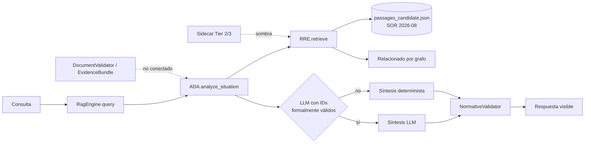
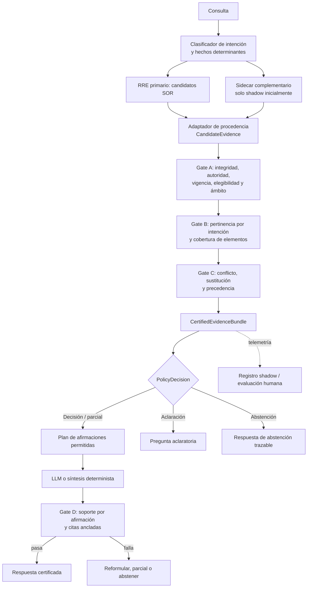

# Diseño arquitectónico: Compuerta de Evidencia Certificada (CEC)

**Proyecto:** IJF SOR Assistant 2026  
**Estado:** diseño para implementación posterior bajo autorización expresa  
**Fundamento:** `docs/auditoria/dictamen_autoridad_documental_rre_ada_codex.md`  
**Alcance de este documento:** arquitectura y validación; no constituye implementación, certificación normativa ni autorización de P0-B.

## 1. Resumen y objetivo

La Compuerta de Evidencia Certificada (CEC) será un control vinculante entre la recuperación RRE y la generación ADA. Su objetivo no es decidir por sí misma cuál es la regla de judo ni certificar una interpretación infalible; su objetivo es impedir que ADA emita una respuesta normativa concluyente cuando no exista un conjunto trazable de evidencia oficial elegible, pertinente y suficiente para el tipo de pregunta.

La CEC deberá producir una decisión explícita y auditable:

- `CERTIFIED_DECISION`: hay norma primaria aplicable y soporte suficiente para las afirmaciones decisorias previstas.
- `CERTIFIED_PARTIAL`: hay evidencia primaria para una parte delimitada de la consulta; la salida debe declarar el límite y no resolver lo no sustentado.
- `CLARIFICATION_REQUIRED`: faltan hechos determinantes para seleccionar una norma o alcance aplicable.
- `ABSTAIN_INSUFFICIENT_EVIDENCE`: no existe evidencia primaria suficiente.
- `ABSTAIN_UNRESOLVED_CONFLICT`: hay conflicto documental o de aplicabilidad sin una regla de precedencia aprobada.
- `ABSTAIN_OUT_OF_SCOPE`: consulta fuera del ámbito IJF/SOR detectada con suficiente confianza.

La CEC convierte procedencia, vigencia, autoridad, aplicabilidad, cobertura y soporte semántico en controles separados. No los reduce a un único puntaje.

## 2. Diagnóstico de la arquitectura actual

### 2.1 Ruta activa observada



Hechos verificados:

- `src/rag_engine.py:199-253` llama ADA para el flujo 2026-08.
- `src/ada_assistant.py:45-64` instancia RRE y recupera evidencia; no instancia `DocumentValidator`.
- `src/rre_engine.py:752-1247` recupera del corpus primario y añade hasta tres pasajes de grafo.
- `src/ada_assistant.py:274-285` valida que IDs citados por LLM pertenezcan a los pasajes recuperados, sin comprobar el soporte semántico de las afirmaciones.
- `src/response_structurer.py:230-376` construye el resumen determinista a partir de `evidence[0]`.
- `src/document_validator.py:164-240` puede producir un `EvidenceBundle`, pero no participa en la ruta anterior.
- `src/rre_engine.py:82-85` y `:1235-1238` mantienen el sidecar multifuente como modo sombra, aislado de la respuesta.

### 2.2 Componentes existentes y decisión de tratamiento

| Componente | Estado actual | Decisión CEC |
|---|---|---|
| `DocumentMetadata` / enums | Modelo correcto de autoridad, vigencia, aprobación y elegibilidad (`src/document_governance.py:22-145`) | **Reutilizar y ampliar** con ámbito, versión/sustitución y evidencia de integridad obligatoria para fuentes activas. |
| `EvidenceItem` / `EvidenceBundle` | Conservan lanes y restricciones Tier 1 (`src/document_governance.py:163-300`) | **Reutilizar y extender** a bundle certificado con decisión, cobertura, conflictos y trazabilidad de evaluación. |
| `DocumentValidator` | Elegibilidad y conflicto puntual de historial/`osaekomi` | **Refactorizar funcionalmente** como etapa de procedencia/elegibilidad; sustituir su detector de conflicto ad hoc por reglas declarativas. |
| RRE | Recuperación híbrida, *stitching*, grafo, abstención heurística | **Mantener como productor de candidatos**, no como certificador. Exponer señales y procedencia requeridas por CEC. |
| Sidecar | Tier 2/3 elegible, en sombra | **Mantener aislado inicialmente**; usarlo como lane interpretativo dentro de evaluación CEC-shadow, nunca como fundamento decisorio único. |
| ADA | Construye prompt y selecciona LLM/fallback | **Modificar en fase posterior** para consumir la decisión CEC antes de generar y después verificar afirmaciones. |
| Síntesis determinista | Top-1 y bloques preescritos | **Restringir**: no puede producir decisión normativa sin `CERTIFIED_DECISION` o `CERTIFIED_PARTIAL`; debe recibir plan de afirmaciones certificado. |
| `NormativeValidator` | Validación contra texto recuperado y patrones | **Conservar como defensa secundaria**, no como fuente de verdad ni criterio de certificación. Debe consumir bundle certificado y emitir hallazgos por afirmación. |
| Validación de citas | Comprueba IDs permitidos | **Reemplazar/encapsular** por validación de cita + anclaje de afirmación + soporte semántico. |

## 3. Principios de diseño y límites

1. El SOR IJF vigente es la base normativa primaria. Una fuente Tier 2/3 no reemplaza esa base por defecto.
2. Autoridad, vigencia, elegibilidad, relevancia, cobertura y exactitud son dimensiones distintas y deben conservarse separadas.
3. La CEC certifica que se superaron controles técnicos/documentales definidos; no sustituye revisión humana IJF ni garantiza exactitud normativa absoluta.
4. El modelo solo puede explicar o relacionar la evidencia incluida en un bundle certificado. Cualquier inferencia debe etiquetarse como tal y tener soporte trazable.
5. La ausencia de evidencia primaria suficiente no se compensa con similitud semántica, vídeo, texto educativo, historial o una cita formalmente existente.
6. Video y material didáctico son contextuales; nunca pueden ser la única base de una decisión normativa.
7. Las decisiones de precedencia y obligatoriedad de fuentes complementarias son gobernanza humana, parametrizada, no una inferencia del modelo.

## 4. Arquitectura propuesta



### 4.1 Ubicación vinculante

La CEC debe tener dos puntos de control:

1. **Pre-generación (obligatorio):** después de RRE y antes de formar el prompt o llamar al fallback. Decide qué evidencia puede ser usada, cuáles afirmaciones pueden intentarse y cuál política de salida corresponde.
2. **Post-generación (obligatorio en enforcement):** antes de exponer la respuesta. Comprueba cada afirmación normativa visible contra el bundle y sus citas ancladas. Una respuesta que falle no se publica como decisión; se degrada a parcial, aclaración o abstención.

El modo shadow inicial ejecutará ambas etapas y registrará discrepancias, pero no cambiará la respuesta actual.

## 5. Contratos e interfaces propuestos

Los nombres siguientes son contratos de diseño; no implican que existan aún en código.

### 5.1 Entrada normalizada

```python
class QueryProfile(BaseModel):
    query_id: str
    original_query: str
    language: str
    intent: Literal[
        'definition', 'scoring', 'penalty', 'exception',
        'procedure', 'equipment', 'eligibility', 'history', 'other'
    ]
    decision_requested: bool
    extracted_facts: dict[str, str | bool | int]
    missing_determinative_facts: list[str]
    requested_effective_date: date | None
    requested_event_scope: str | None
    requested_category_scope: str | None
```

El clasificador de intención puede ser reglas + modelo, pero su resultado es una hipótesis auditable. Debe retener evidencias, confianza y una vía para que las pruebas fijen el perfil esperado.

### 5.2 Candidato de recuperación con procedencia completa

```python
class CandidateEvidence(BaseModel):
    passage_id: str
    document_id: str
    document_version: str | None
    document_sha256: str | None
    content_exact: str
    locator: {"page": int | None, "section": str | None, "span": str | None}
    source_url: str | None
    authority: DocumentAuthority
    validity: ValidityStatus
    approval: ApprovalStatus
    eligibility: EligibilityStatus
    effective_from: date | None
    effective_to: date | None
    scope: dict
    retrieval: {"channel": str, "score": float, "rank": int, "seed": bool}
    declared_role: EvidenceRole
```

El adaptador debe poblar este contrato desde el corpus primario, el catálogo y, en shadow, el sidecar. Si falta un campo de procedencia crítico para una fuente que pretende actuar en la respuesta, el candidato se excluye y se registra la razón.

### 5.3 Bundle certificado

`EvidenceBundle` actual debe ampliarse sin mezclar lanes:

```python
class CertifiedEvidenceBundle(EvidenceBundle):
    query_profile: QueryProfile
    evaluated_at: datetime
    catalog_revision: str
    primary_candidates: list[CandidateEvidence]
    excluded_candidates: list[ExclusionRecord]
    coverage: list[CoverageRequirementResult]
    conflict_assessment: ConflictAssessment
    sufficiency_assessment: SufficiencyAssessment
    policy_decision: PolicyDecision
    permitted_claims: list[ClaimPlan]
    audit_trace_id: str
```

Invariantes:

- Ningún `CandidateEvidence` no elegible entra en lane activa.
- Una respuesta decisoria necesita al menos una evidencia Tier 1 vigente, aprobada, aplicable y pertinente.
- Interpretación Tier 2/3 solo puede entrar como complemento y debe identificar la norma primaria relacionada.
- Un vídeo o material didáctico no puede satisfacer un requisito decisorio ni resolver un conflicto.
- Todo claim decisorio debe tener al menos un soporte primario anclado, salvo que la política aprobada autorice explícitamente una enmienda Tier 2 como prevalente para un ámbito definido.

### 5.4 Resultados y razones estables

```python
class GateResult(BaseModel):
    decision: PolicyDecision
    reason_codes: list[str]
    human_review_required: bool
    safe_response_contract: SafeResponseContract
    certified_bundle: CertifiedEvidenceBundle
```

Los `reason_codes` deben ser estables y medibles, por ejemplo: `PRIMARY_MISSING`, `DOCUMENT_UNAPPROVED`, `VERSION_SUPERSEDED`, `SCOPE_MISMATCH`, `LOW_RELEVANCE`, `COVERAGE_MISSING_EXCEPTION`, `CONFLICT_UNRESOLVED`, `CLAIM_UNSUPPORTED`, `OUT_OF_SCOPE`.

## 6. Lógica de evaluación CEC

### Gate A — procedencia, autoridad, vigencia y ámbito

Para cada candidato:

1. Resolver `document_id` contra el catálogo canónico.
2. Comparar versión, hash y localizador con la entrada registrada cuando el artefacto sea local.
3. Determinar elegibilidad desde autoridad + vigencia + aprobación, no desde el score de recuperación.
4. Verificar fecha efectiva y ámbito (evento, categoría, disciplina, idioma/edición cuando aplique).
5. Asignar lane: primaria, interpretativa o contextual; excluir los no elegibles.

**Regla de seguridad:** un metadato crítico desconocido no puede convertirse en evidencia decisoria. En modo shadow se registra; en enforcement se excluye.

### Gate B — pertinencia y cobertura

La CEC debe transformar el perfil de consulta en requisitos, no exigir una plantilla universal. Ejemplos:

| Intención | Requisitos mínimos de cobertura |
|---|---|
| Definición | concepto, definición o remisión expresa, alcance si existe |
| Puntuación | acción/supuesto, valor, condición o excepción relevante |
| Sanción | conducta, consecuencia, progresión, categoría/rol si cambia resultado |
| Excepción | regla base, condición excepcional y consecuencia |
| Procedimiento | disparador, pasos exigidos, autoridad competente y límite de aplicabilidad |
| Equipamiento | objeto, requisito técnico, tolerancia/medida si la pregunta la solicita |

La cobertura usa una combinación evaluable de señales: coincidencia semántica, entidades/roles, artículos relacionados, presencia de condiciones en el texto y reglas por intención. No debe aprobarse solo por solapamiento lexical o score Top-K.

Un resultado de baja confianza no se convierte en afirmación: se marca `COVERAGE_MISSING_*` y conduce a parcial, aclaración o abstención según el caso.

### Gate C — contradicción, sustitución y precedencia

Se requieren tres clases distintas:

1. **Incompatibilidad documental verificable:** edición derogada, fecha fuera de vigencia, hash/versión distinta, fuente rechazada. Se excluye determinísticamente.
2. **Conflicto de contenido candidato:** dos textos elegibles dan valores, consecuencias o condiciones incompatibles para mismo ámbito. Se bloquea la decisión y se deriva a política/humano.
3. **Tensión aparente por ámbito distinto:** p. ej., categorías, evento u ocasión diferentes. No es contradicción hasta que el perfil de consulta no pueda discriminar el ámbito; se solicita aclaración si falta el hecho determinante.

La resolución de precedencia no debe basarse en heurísticas de texto. Debe usar una tabla de política aprobada por Alexis para relaciones SOR/enmienda/circular/interpretación, con fecha efectiva y alcance.

### Gate D — soporte semántico por afirmación

Antes de mostrar salida, ADA debe entregar una lista de afirmaciones atómicas clasificadas:

- `EXPLICIT_NORM`: reproducible o paráfrasis fiel de un tramo normativo.
- `OFFICIAL_INTERPRETATION`: atribuida a fuente Tier 2/3 identificada y vinculada a la norma primaria.
- `MODEL_EXPLANATION`: explicación no decisoria que no agrega obligación, sanción ni excepción.
- `INFERENCE`: conclusión derivada; solo permitida si la política la autoriza, con premisas y nivel de confianza visible.

Cada afirmación de decisión debe enlazar uno o más `passage_id` y un span/locator. El verificador revisa:

1. que la cita pertenezca al bundle certificado;
2. que el texto soporte sujeto, acción, consecuencia y condiciones requeridas por la intención;
3. que no altere categoría, temporalidad, modalidad o nivel de certeza;
4. que las excepciones requeridas por el plan de cobertura estén expresadas o la respuesta quede explícitamente limitada.

El verificador puede utilizar reglas, extracción estructurada y evaluación semántica; ninguno debe ser considerado infalible. Los resultados ambiguos deben ser conservadores y trazables.

## 7. Política de respuesta

| Decisión CEC | Salida permitida | Prohibiciones |
|---|---|---|
| `CERTIFIED_DECISION` | Respuesta directa con base normativa, cita/ancla, condiciones y alcance | No presentar inferencias como texto expreso. |
| `CERTIFIED_PARTIAL` | Solo parte sustentada; listar lo no determinado | No completar lagunas con conocimiento general. |
| `CLARIFICATION_REQUIRED` | Pregunta breve sobre el hecho que cambia aplicabilidad | No seleccionar arbitrariamente categoría, rol o evento. |
| `ABSTAIN_INSUFFICIENT_EVIDENCE` | Abstención con causa y, si procede, fuentes/campos faltantes | No responder con Top-1 ni material contextual. |
| `ABSTAIN_UNRESOLVED_CONFLICT` | Identificar conflicto, fuentes y necesidad de revisión | No elegir ganador por score o antigüedad inferida. |
| `ABSTAIN_OUT_OF_SCOPE` | Indicar falta de base normativa IJF aplicable | No forzar correspondencia con términos de judo. |

La plantilla determinista y el LLM deben consumir el mismo `SafeResponseContract`. En consecuencia, la ausencia del LLM nunca habilita una respuesta que CEC hubiera bloqueado.

## 8. Estrategia de integración por etapas

### Fase CEC-0 — contrato y observabilidad

**Objetivo:** introducir modelos/adaptadores sin afectar resultados actuales.

- Adaptar evidencia primaria RRE a `CandidateEvidence` con `document_id`, versión, hash y localizador.
- Cargar catálogo mediante `DocumentValidator` y producir bundle CEC shadow.
- Registrar sólo decisiones, exclusiones, cobertura y discrepancias.
- No habilitar complementos en la respuesta ni modificar prompts ni fallback.

**Dependencias:** catálogo de documento mínimo y mapeo explícito SOR-corpus (`DOC-SOR-2026-08` ↔ `SOR-2026-08-14-ENG`).

### Fase CEC-1 — shadow semántico

**Objetivo:** evaluar pertinencia, cobertura y soporte de afirmaciones de la respuesta actual.

- Ejecutar Gate A–D en paralelo a la ruta ADA/RRE existente.
- Comparar `PolicyDecision` contra status técnico y registrar falsos bloqueos/falsas aprobaciones candidatos.
- El sidecar Tier 2/3 puede aportar hallazgos de cobertura a telemetría, nunca contenido visible.

**Salida:** informe de discrepancias con trazas reproducibles, sin declarar exactitud normativa de casos sin oráculo aprobado.

### Fase CEC-2 — enforcement mínimo sobre fuentes primarias

**Objetivo:** volver vinculantes procedencia, elegibilidad y existencia de evidencia primaria para respuestas decisorias.

- Enforce Gate A y decisiones de ausencia/conflicto determinista.
- Aplicar misma decisión a LLM y determinista.
- Mantener CEC Gate B–D en shadow hasta lograr métricas de calibración aprobadas.

### Fase CEC-3 — enforcement de cobertura y afirmaciones

**Objetivo:** publicar solo respuestas con plan de claims aprobado.

- Enforce Gate B y Gate D sobre intenciones y casos con oráculo documental revisado.
- Habilitar `CERTIFIED_PARTIAL` y `CLARIFICATION_REQUIRED` antes de ampliar abstenciones.
- Convertir errores de soporte posteriores a generación en salida segura.

### Fase CEC-4 — multifuente controlado

**Objetivo:** permitir Tier 2/3 aprobado como complemento visible, si Alexis aprueba precedencia y alcance.

- Mantener SOR como fundamento principal.
- Mostrar autoridad, vigencia, rol y relación con SOR para cada complemento.
- No usar Tier 4/5 para decisión; video solo contextual, con timestamp humano verificado.

## 9. Modo shadow

### 9.1 Reglas de aislamiento

- Debe ejecutarse tras recuperar candidatos y tras obtener la respuesta actual.
- No cambia ranking, contexto, prompt, respuesta, citas ni estado visible.
- Un fallo CEC-shadow no debe degradar la ruta vigente; debe generar telemetría `CEC_UNAVAILABLE` y alerta operativa.
- Cada registro debe incluir versión de CEC, hash/versión de corpus, revisión del catálogo y un ID correlacionable con la consulta, sin almacenar secretos ni datos personales innecesarios.

### 9.2 Registro mínimo

```json
{
  "trace_id": "...",
  "query_profile": {"intent": "penalty", "missing_facts": []},
  "retrieved_candidates": ["..."],
  "eligible_primary": ["..."],
  "excluded": [{"id": "...", "reason": "VERSION_SUPERSEDED"}],
  "coverage": [{"requirement": "consequence", "status": "covered"}],
  "policy_decision": "CERTIFIED_PARTIAL",
  "current_answer_claim_results": [{"claim": "...", "status": "UNSUPPORTED"}],
  "conflicts": [],
  "latency_ms": {"cec": 0},
  "review_state": "UNREVIEWED"
}
```

### 9.3 Comparación segura

Las discrepancias se clasifican como hipótesis de calidad, no como verdad normativa automática:

- **Posible falso positivo CEC:** CEC bloquea/limita, pero un revisor humano determina que había soporte suficiente.
- **Posible falso negativo CEC:** CEC certifica, pero la respuesta/evidencia es normativamente errónea o insuficiente según revisión humana.
- **Discrepancia de recuperación:** evidencia primaria necesaria no aparece; no se atribuye culpa a generación.
- **Discrepancia de síntesis:** bundle suficiente, pero afirmación/cita no es fiel o completa.

Los casos pendientes, disputados, sin fuente preservada o sin oráculo humano no se usan para calcular precisión normativa; permanecen como `CANDIDATO_DOCUMENTAL` o `UNREVIEWED`.

## 10. Pruebas y métricas

### 10.1 Métricas separadas

| Dimensión | Métrica | Definición |
|---|---|---|
| Recuperación | `primary_recall@k` | Proporción de casos con evidencia primaria requerida entre candidatos Top-k. |
| Procedencia | `eligible_evidence_precision` | Proporción de evidencia activa con documento, versión, vigencia y elegibilidad válidos. |
| Pertinencia | `primary_relevance_precision` | Evaluación humana/documental de pertinencia de los pasajes primarios recuperados. |
| Cobertura | `requirement_coverage` | Requisitos de la intención cubiertos por evidencia, no por texto generado. |
| Soporte | `claim_support_precision` | Afirmaciones decisorias que un revisor confirma soportadas por su ancla. |
| Citas | `citation_entailment_precision` | Citas que sustentan la afirmación asociada, no solo existen. |
| Conflicto | sensibilidad/especificidad de conflicto | Casos de conflicto o tensión correctamente escalados; informar ambos errores. |
| Abstención | precisión y recall de abstención | Separar OOD, insuficiencia, conflicto y falta de hechos. |
| Seguridad | tasa de decisión no soportada | Decisiones visibles con evidencia insuficiente o no aplicable; objetivo de reducción, no promesa de cero. |
| Rendimiento | p50/p95 de latencia CEC y total | Medir por etapa y por tipo de consulta. |

### 10.2 Pirámide de pruebas

1. **Unitarias:** mapeo de catálogo, exclusión por hash/vigencia/aprobación, lanes, timestamps de vídeo, ámbitos y reglas de precedencia.
2. **Integración RRE→CEC:** candidatos de fuente primaria, pasajes históricos, complements Tier 2/3, grafo y *stitching*; validar que ningún elemento pierda procedencia.
3. **Integración ADA→CEC:** LLM y fallback deben recibir mismo `SafeResponseContract`; ambos deben abstener cuando la decisión CEC lo ordene.
4. **Afirmaciones/citas:** IDs inventados, IDs reales irrelevantes, cita correcta sin excepción, paráfrasis fiel, extrapolación de categoría, procedimiento añadido.
5. **Funcional normativo:** sólo casos con fuente oficial preservada y oráculo humano aprobado. Reportar exactitud por separado de la aprobación técnica.
6. **Regresión y shadow:** comparar baseline y CEC por tipo de decisión, incluyendo casos OOD positivos/negativos y consultas de judo con vocabulario compartido.

### 10.3 Casos mínimos adversariales

- Norma primaria pertinente frente a distractor con fuerte solapamiento léxico.
- Versión SOR sustituida frente a edición vigente.
- Circular aprobada condicionalmente que complementa, pero no reemplaza, el SOR.
- Dos textos aplicables con consecuencias incompatibles para mismo ámbito.
- Consulta que necesita categoría, rol o fecha no proporcionados.
- Vídeo con timestamp verificado y sin norma primaria: debe quedar contextual, no decisorio.
- Cita con pasaje existente pero que no sustenta la afirmación.
- Respuesta determinista que intenta usar `evidence[0]` pese a cobertura incompleta.
- Consulta externa con palabras compartidas y consulta válida de judo con los mismos términos.

### 10.4 Criterios para pasar de shadow a enforcement

Estos umbrales son propuestas iniciales y requieren aprobación de Alexis; no son resultados actuales:

1. 100% de candidatos que lleguen a lane decisoria tienen `document_id`, versión, locator y estado de elegibilidad verificables.
2. Cero fallos conocidos de uso decisorio de evidencia histórica, rechazada, pendiente o audiovisual en la batería de integración.
3. Un conjunto de referencia con oráculos humanos aprobados cubre cada intención y cada tipo de decisión CEC; casos pendientes se excluyen de métricas de exactitud.
4. Tasa de falsos negativos de seguridad y falsos positivos de bloqueo revisada por humano y dentro de umbrales aprobados explícitamente; no se presume 100%.
5. No regresión acordada de `primary_recall@k`, `claim_support_precision` y abstención correcta contra baseline medido.
6. p95 de latencia, coste de inferencia y tasa de fallo de la CEC dentro del presupuesto aprobado; si la CEC no está disponible, el comportamiento debe ser el definido por la política de *fail-safe* aprobada, no uno implícito.

## 11. Riesgos, mitigaciones y costes

| Riesgo | Mitigación propuesta |
|---|---|
| Falsas abstenciones por cobertura demasiado rígida | Calibración shadow por intención, revisión humana y `CERTIFIED_PARTIAL`/aclaración antes de bloquear. |
| Falsas certificaciones por un verificador semántico imperfecto | Defensa en capas: anclaje, reglas de cobertura, evaluación humana, pruebas adversariales y trazas auditables. |
| Confundir complemento con norma | Lanes tipadas, UI con rol visible y obligación de norma primaria para decisiones. |
| Catálogo incompleto o metadatos desconocidos | Exclusión decisoria por defecto y cola de curaduría humana; no rellenar campos con LLM. |
| Latencia adicional | Cachear catálogo y metadatos; evaluar reglas deterministas primero; usar verificación semántica costosa solo sobre claims/candidatos reducidos. Medir p50/p95 en shadow. |
| Coste de LLM | Reutilizar perfil, bundle y extracción de claims; preferir reglas para integridad y sólo aplicar modelo a ambigüedad limitada. |
| Presión por habilitar multifuente prematuramente | Fases CEC-0 a CEC-4, shadow y criterios explícitos de salida. |
| CEC indisponible | Decisión de *fail-open* o *fail-safe* reservada a Alexis. Para respuestas normativas decisorias, la recomendación es *fail-safe* tras validar impacto operativo. |

## 12. Decisiones pendientes de Alexis

1. Política formal de precedencia: SOR, enmiendas, circulares, aclaraciones e interpretaciones, con fecha y ámbito.
2. Definición de qué fuentes Tier 2/Tier 3 pueden ser visibles o influir en una decisión, y cuáles permanecen solo interpretativas.
3. Campos mínimos no negociables para admitir un documento al catálogo activo, incluida política para hashes/URLs no disponibles.
4. Taxonomía inicial de intenciones y requisitos de cobertura por intención.
5. Umbrales aceptables de falsos positivos/falsos negativos para cada decisión CEC y presupuesto de latencia/coste.
6. Política de indisponibilidad de CEC en producción: abstener, degradar a consulta documental o bloquear por completo decisiones normativas.
7. Quién aprueba oráculos de evaluación, conflictos, cambios de vigencia y promoción de casos desde `CANDIDATO_DOCUMENTAL` a referencia normativa aprobada.
8. Criterio y responsable para habilitar CEC enforcement y, posteriormente, integración multifuente visible.

## 13. Recomendación arquitectónica final

Implementar la CEC como una capa de decisión explícita y tipada entre RRE y ADA, no como un validador posterior de citas ni como un componente opcional de documentación. La primera entrega debe ser CEC-0/CEC-1 en shadow, con corpus primario intacto, sidecar aislado y trazas comparables contra oráculos humanos aprobados.

No se recomienda habilitar respuestas multifuente ni imponer una compuerta bloqueante de cobertura hasta que Alexis apruebe precedencia, política de fallo, oráculos de evaluación y umbrales de promoción. El éxito técnico de recuperación o la presencia de citas no debe utilizarse como autorización normativa.

---

### Confirmación de restricciones

Este trabajo creó únicamente este documento. No modificó código, documentos existentes, corpus, índices, embeddings, grafos, configuración o infraestructura; no ejecutó pruebas, experimentos, Git, OCI ni despliegues; no cerró P0-A.1 ni autorizó o ejecutó P0-B.
