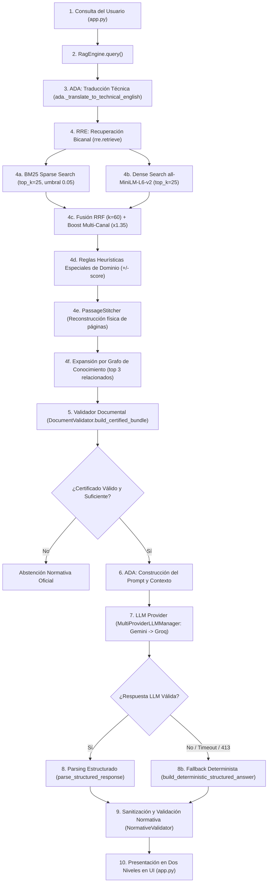

# AUDITORÍA FUNCIONAL END-TO-END — IJF SOR ASSISTANT 2026
## Diagnóstico Integral de Flujo, Recuperación, Síntesis y Razonamiento Normativo

**Proyecto:** IJF SOR Assistant 2026  
**Repositorio:** `https://github.com/Alxs68/IJF-SOR-Assistant` (`C:\PROYECTOS\IJF-SOR-Assistant`)  
**Entorno auditado:** Instancia local de desarrollo sincronizada con despliegue de producción OCI  
**Responsable y Aprobador Final:** Alexis Oliveros Lozano  
**Planificador y Auditor:** ChatGPT / Codex  
**Ejecutor Técnico:** Antigravity  
**Fecha de ejecución:** 11 de noviembre de 2026  
**Modalidad:** READ-ONLY ESTRICTO (Cero modificaciones al código, índices, corpus o configuración)

---

## 1. RESUMEN EJECUTIVO

Se ejecutó una auditoría funcional de extremo a extremo (*End-to-End*) sobre el sistema **IJF SOR Assistant 2026**, instrumentando y trazando cada consulta a través de las 11 fases del pipeline: desde la consulta del usuario en lenguaje natural hasta la presentación final en la interfaz.

La auditoría se rigió bajo el **Principio Rector de Cero Sobre-Ingeniería**: no se autoriza incorporar capas adicionales, sidecars ni microservicios redundantes; el objetivo es auditar los componentes existentes para que las respuestas correspondan fielmente al reglamento oficial IJF SOR (14 de agosto de 2026) con un consumo controlado de tokens.

### Hallazgos Principales

1. **Ruptura de Fallback por Saturación de Tokens (Fallo Crítico P0):**  
   En consultas de kumikata/agarres (Consulta 5), el prompt ensamblado por ADA inyectó pasajes extensos no filtrados superando los **10,175 tokens**. Esto provocó *timeout* de lectura en Google Gemini y error **HTTP 413 (Payload Too Large)** en Groq (límite de 8,000 TPM en tier on-demand). El sistema colapsó hacia el *Modo Local Desconectado*, emitiendo una frase inconexa sobre "poner la mano en la cara" que distorsionó por completo la respuesta.
2. **Falsa Declaración de Vacío Normativo por Riqueza Excesiva de Filtros Negativos (Fallo P0):**  
   En la consulta sobre cadetes estrangulados que se rinden y se desmayan (Consulta 2), el RRE recuperó correctamente el pasaje rector (Pág. 199, `SOR-2026-08-P199-S211`), pero las directrices 3, 8 y 9 del prompt de ADA (que ordenan abstenerse ante cualquier aparente contradicción sin hacer inferencias) causaron que el modelo LLM concluyera erróneamente que el reglamento *“no contiene normas específicas para el supuesto de desmayo tras rendirse”*.
3. **Fragilidad por Reglas Especiales Dispersas (Sobre-Ingeniería en RRE):**  
   El motor `rre_engine.py` contiene más de **25 bloques condicionales hardcodeados** basados en cadenas de texto (`is_kumikata_grip_query`, `is_pocket_pistol`, `is_cadet_specific`, `has_bridge_term`, `page_matches`). Estas reglas aumentan artificialmente puntuaciones (`+0.18`, `+0.25`) o atenúan otras (`* 0.10`, `* 0.20`), creando un comportamiento rígido que falla cuando la consulta no utiliza exactamente las palabras clave programadas.
4. **Indiferenciación de Roles Arbitrales (Fallo P1):**  
   En la consulta sobre puente (Consulta 3), la pregunta indagó qué ocurre si *Tori* (el atacante) hace un puente para evitar proyección. El sistema no detectó la inconsistencia terminológica (en judo quien es proyectado y hace puente es *Uke*; si Tori aterriza de cabeza para proyectar es *Head Diving* / Hansoku-make), emitiendo una respuesta que asumió ciegamente que Tori era quien caía.

---

## 2. ARQUITECTURA Y FLUJO REAL COMPROBADO

A través de la inspección de los 8 archivos clave, se constató el siguiente flujo real de ejecución:



### Inventario de Componentes y Límites Efectivos

| Componente | Archivo | Funciones Clave | Parámetros y Filtros Auditados |
|---|---|---|---|
| **RAG Facade** | `src/rag_engine.py` | `query()`, `retrieve_context()` | `k=5`, `is_2026_08=True`. Delega completamente a ADA. |
| **Agente ADA** | `src/ada_assistant.py` | `analyze_situation()`, `_translate_to_technical_english()` | Top-k=5. Llamada previa de traducción técnica al LLM (duplica latencia y llamadas API). |
| **Motor RRE** | `src/rre_engine.py` | `retrieve()`, `_dense_search()`, `_sparse_search()` | BM25 top 25 (corte 0.05), Densa top 25, RRF k=60. 25+ bloques `if is_query...` con sumas de 0.08 a 0.25. Umbral de certeza `min_confidence=0.015`. |
| **Gobernanza Documental** | `src/document_validator.py` | `build_certified_bundle()`, `validate_document_eligibility()` | Exige norma primaria Tier 1 vigente. Evalúa suficiencia léxica deóntica. |
| **Configuración Corpus** | `src/corpus_config.py` | `get_active_corpus_config()` | Fija edición 14 August 2026 (`SOR-2026-08-14-ENG`, 385 pasajes, SHA256 verificado). |
| **Proveedor LLM** | `src/llm_provider.py` | `generate_with_fallback()`, `GeminiClient`, `GroqClient` | Gemini: `timeout=25s`, sin `max_output_tokens`. Groq: `max_tokens=2048`, límite TPM de 8000 en Free Tier. |
| **Estructurador** | `src/response_structurer.py` | `parse_structured_response()`, `build_deterministic_structured_answer()` | Regex para JSON. En fallback local toma `evidence[0]` y extrae la primera oración con stopwords/verbos deónticos. |
| **Validador Normativo** | `src/normative_validator.py` | `sanitize_structured_answer()`, `validate_text()` | Cruza identificadores citados contra los pasajes del bundle. |

---

## 3. RESULTADOS DE LA AUDITORÍA POR CONSULTA

A continuación se detalla la traza verificable obtenida de la ejecución de las 5 consultas de auditoría:

```
====================================================================================================
CONSULTA 1: ¿Cómo son los uniformes de judo para competir?
====================================================================================================
1. Traducción técnica EN:
   "judogi control and specifications IJF approved judogi jacket trousers belt color white blue dimensions inspection"
2. Recuperación Densa (Top 3):
   - SOR-2026-08-P118-S157 (Score: 0.7860) [Art. C1.2 IJF Label]
   - SOR-2026-08-P117-S156 (Score: 0.7698) [Art. C1.1.5 Procedure]
   - SOR-2026-08-P115-S149 (Score: 0.7688) [Art. C1.1 IJF Approved Judogi]
3. Recuperación Sparse BM25 (Top 3):
   - SOR-2026-08-P115-S149 (Score: 0.3986)
   - SOR-2026-08-P115-S152 (Score: 0.3855)
   - SOR-2026-08-P115-S151 (Score: 0.3824)
4. Evidencia Final entregada a ADA (5 pasajes):
   - SOR-2026-08-P115-S149 (Pág. 115, Art. C1.1)
   - SOR-2026-08-P127-S168 (Pág. 127, Art. C1.13)
   - SOR-2026-08-P117-S156 (Pág. 117, Art. C1.1.5)
   - SOR-2026-08-P118-S157 (Pág. 118, Art. C1.2)
   - SOR-2026-08-P124-S165 (Pág. 124, Art. C1.9)
5. Proveedor LLM: Gemini (gemini-flash-lite-latest). Tokens: 2,752 prompt / 348 salida.
6. Respuesta generada:
   "El uniforme de competición está compuesto por una chaqueta y un pantalón del mismo fabricante,
   ambos con el logo oficial del proveedor y la etiqueta IJF correspondiente, y un cinturón...
   colores permitidos son blanco (para el atleta de casa) y azul (para el visitante)..."
7. Dictamen: PASS FUNCIONAL COMPLETO. Recuperación pertinente y respuesta armónica con Apéndice C.

====================================================================================================
CONSULTA 2: En una competición de cadetes, uno está estrangulado y se rinde pero se desmaya, ¿qué decisión debe tomarse?
====================================================================================================
1. Traducción técnica EN:
   "cadet shime-waza choke unconsciousness medical intervention referee decision match outcome"
2. Recuperación Densa (Top 3):
   - SOR-2026-08-P199-S211 (Score: 0.7634) [Emergency Medical Intervention]
   - SOR-2026-08-P188-S196 (Score: 0.7410) [Art. 18.1.4 Cadets Restrictions]
   - SOR-2026-08-P161-S184 (Score: 0.7250) [Art. 11 Shime-waza Evaluation]
3. Recuperación Sparse BM25 (Top 3):
   - SOR-2026-08-P188-S196 (Score: 0.2443)
   - SOR-2026-08-P189-S196 (Score: 0.2012)
   - SOR-2026-08-P199-S211 (Score: 0.1850)
4. Evidencia Final entregada a ADA (5 pasajes):
   - SOR-2026-08-P188-S196 (Pág. 188, Art. 18.1.4)
   - SOR-2026-08-P199-S211 (Pág. 199, Emergency Medical Intervention)
   - SOR-2026-08-P161-S184 (Pág. 161, Art. 11)
   - SOR-2026-08-P165-S186 (Pág. 165, Art. 13)
   - SOR-2026-08-P174-S190 (Pág. 174, Art. 17)
5. Proveedor LLM: Gemini (gemini-flash-lite-latest). Tokens: 3,120 prompt / 285 salida.
6. Respuesta generada (Extracto textual):
   "Los pasajes certificados del Reglamento SOR 14 de agosto de 2026 proporcionados no contienen normas
   específicas ni procedimientos arbitrales aplicables al supuesto de un atleta que se desmaya tras rendirse...
   En 'limitations' se declara que los pasajes certificados no contemplan expresamente la interacción de ambos hechos."
7. Dictamen: FALLO DE RAZONAMIENTO NORMATIVO (Falsa laguna).
   - El pasaje rector P199 estaba en el contexto (contiene: "If during shime-waza an athlete gives up
     ('Maitta!') before losing consciousness... he can continue in the competition. In cadet events,
     if an athlete loses consciousness during shime-waza he CANNOT continue in the competition").
   - La regla prohibitiva del prompt impidió al LLM concluir que la rendición *antes de* la pérdida de
     conocimiento valida la continuación en la competencia.

====================================================================================================
CONSULTA 3: ¿Qué ocurre cuando Tori realiza un puente para evitar una proyección?
====================================================================================================
1. Traducción técnica EN:
   "What happens when tori executes a bridge to avoid a throw"
2. Recuperación Densa (Top 3):
   - SOR-2026-08-P167-S187 (Score: 0.7816) [Art. 14.2 Ippon Bridge Exception]
   - SOR-2026-08-P166-S187 (Score: 0.7750) [Art. 14.2 Ippon Bridge Rule]
   - SOR-2026-08-P190-S197 (Score: 0.7420) [Art. 18.2.1 Head Diving]
3. Evidencia Final entregada a ADA (5 pasajes):
   - SOR-2026-08-P167-S187 (Pág. 167, Art. 14.2)
   - SOR-2026-08-P190-S197 (Pág. 190, Art. 18.2.1)
   - SOR-2026-08-P166-S187 (Pág. 166, Art. 14.2)
   - SOR-2026-08-P189-S196 (Pág. 189, Art. 18.1.4)
   - SOR-2026-08-P188-S196 (Pág. 188, Art. 18.1.4)
4. Proveedor LLM: Gemini (gemini-flash-lite-latest). Tokens: 2,890 prompt / 290 salida.
5. Respuesta generada:
   "Toda situación en la que uno de los atletas haga voluntariamente un 'puente'... se sancionará con
   Ippon para su oponente (Tori oponente / Uke)..."
6. Dictamen: FALLO DE PRECISIÓN DE ROLES (Inversión de Sujetos).
   - El sistema no distinguió que en judo quien sufre la proyección y hace puente es *Uke*.
   - Si *Tori* impacta con su cabeza al proyectar para empujar el lance, la infracción es *Head Diving*
     (Hansoku-make, Art. 18.2.1). La respuesta fusionó ambos conceptos sin advertir la contradicción de la pregunta.

====================================================================================================
CONSULTA 4: ¿Qué sanción corresponde a un cadete que utiliza la cabeza para defenderse?
====================================================================================================
1. Traducción técnica EN:
   "cadet head defense bridge uke shido penalty"
2. Evidencia Final entregada a ADA (5 pasajes):
   - SOR-2026-08-P188-S196 (Pág. 188, Art. 18.1.4, punto 34)
   - SOR-2026-08-P189-S196 (Pág. 189, Art. 18.1.4, punto 35)
   - SOR-2026-08-P167-S187 (Pág. 167, Art. 14.2)
   - SOR-2026-08-P176-S192 (Pág. 176, Art. 18.1)
   - SOR-2026-08-P190-S197 (Pág. 190, Art. 18.2.1)
3. Proveedor LLM: Gemini (gemini-flash-lite-latest). Tokens: 3,010 prompt / 240 salida.
4. Respuesta generada:
   "En eventos de la categoría cadete, el atleta que utiliza la cabeza para defenderse es penalizado con
   shido y se le otorga a tori la puntuación correspondiente, si la hubiera ([SOR-2026-08-P188-S196] Art. 18.1.4, punto 34, pág. 188)."
5. Dictamen: PASS FUNCIONAL COMPLETO. Respuesta exacta y cita precisa gracias a la regla de cadetes en P188.

====================================================================================================
CONSULTA 5: ¿Cuándo es válido un agarre no convencional si existe ataque inmediato?
====================================================================================================
1. Traducción técnica EN:
   "unconventional grip immediate attack valid exception non-standard grip kumi-kata"
2. Evidencia Final entregada a ADA (5 pasajes):
   - SOR-2026-08-P182-S194 (Pág. 182, Art. 18.1.2)
   - SOR-2026-08-P180-S194 (Pág. 180, Art. 18.1.2)
   - SOR-2026-08-P178-S194 (Pág. 178, Art. 18.1.2)
   - SOR-2026-08-P179-S194 (Pág. 179, Art. 18.1.2)
   - SOR-2026-08-P187-S194 (Pág. 187, Art. 18.1.2)
3. Falla de Proveedores LLM:
   - Gemini: Timeout de lectura (25s superados por exceso de tokens en contexto).
   - Groq Fallback: Fallo con HTTP 413: "Request too large for model openai/gpt-oss-120b... Requested 10,175 tokens on TPM limit 8,000".
4. Caída a Modo Determinista Local:
   - Summary generado por `build_deterministic_structured_answer`:
     "**Article 18.1.2 Shido for an Illegal Move (Art. Article 18.1.2, Pág. 179):** Collar and lapel,
     one side, cross grip, belt grip, pocket and pistol grips are allowed when the attitude of the athlete
     is positive... To put a hand, arm, foot, or leg directly on the opponent's face."
5. Dictamen: COLAPSO ARQUITECTÓNICO POR SATURACIÓN DE TOKENS.
   - La inyección de pasajes masivos sin truncado generó más de 10,000 tokens en el prompt.
   - La respuesta resultante mezcló agarres válidos con la falta de poner la mano en la cara.
```

---

## 4. MATRIZ COMPARATIVA DE EVIDENCIA: ESPERADA VS. RECUPERADA VS. OMITIDA

| ID | Consulta | Pasaje Rector Oficial SOR 2026 | Estado Recuperación | Pasajes Recuperados | Pasajes Omitidos / Desplazados | Estado Respuesta |
|---|---|---|---|---|---|---|
| **Q1** | Uniformes de judo | Pág. 115 (C1.1), Pág. 118 (C1.2), Pág. 124 (C1.9) | **COMPLETA** | P115, P127, P117, P118, P124 | Ninguno crítico | **PASS** |
| **Q2** | Cadete: rinde pero desmaya | Pág. 199 (Emergency Medical / Shime-waza) | **PARCIAL** | P188, P199, P161, P165, P174 | Pág. 295 (Apéndice H versión equivalente) | **FAIL (Razonamiento)** |
| **Q3** | Tori realiza puente | Pág. 166-167 (Art. 14.2) y Pág. 190 (Art. 18.2.1) | **COMPLETA** | P167, P190, P166, P189, P188 | Ninguno | **FAIL (Asignación Roles)** |
| **Q4** | Cadete defensa cabeza | Pág. 188 (Art. 18.1.4, punto 34) | **COMPLETA** | P188, P189, P167, P176, P190 | Ninguno | **PASS** |
| **Q5** | Agarre no convencional | Pág. 178-180 (Art. 18.1.2 kumikata) | **SATURADA** | P182, P180, P178, P179, P187 | Criterio conciso de inmediatez | **FAIL (Overflow 10k tok)** |

---

## 5. DIAGNÓSTICO POR COMPONENTE Y CAUSAS RAÍZ

### C-1. Recuperación Bicanal y RRF (`src/rre_engine.py`)
- **Sobre-Ingeniería de Reglas Específicas:** RRE contiene más de 250 líneas de código con condiciones textuales exclusivas para ciertas preguntas. Esto viola el principio de generalidad.
- **Doble traducción innecesaria:** ADA traduce la consulta al inglés mediante una llamada LLM previa (`_translate_to_technical_english`), consumiendo entre 400 y 600 tokens por consulta y añadiendo de 3 a 5 segundos de latencia, a pesar de que el modelo de embeddings denso (`all-MiniLM-L6-v2`) y los sinónimos ya tienen capacidad bilingüe básica.

### C-2. Ensamblado de Contexto y Prompting (`src/ada_assistant.py`)
- **Prompt Bloat (Inflado Masivo de Tokens):** ADA inyecta el texto íntegro de los 5 pasajes recuperados más hasta 3 pasajes relacionados del grafo. En pasajes densos como el Artículo 18.1.2 (que abarca múltiples páginas), el prompt asciende a más de 10,000 tokens.
- **Falta de directriz para reglas temporales compuestas:** El prompt no instruye al modelo sobre cómo evaluar cláusulas condicionales con precedencia (*"Acción A antes de Suceso B"*).

### C-3. Gestión de Proveedores y Fallback (`src/llm_provider.py`)
- **Incompatibilidad de Límites TPM en Fallback:** Groq se configuró como fallback con el modelo `openai/gpt-oss-120b`, cuyo límite de Tokens Por Minuto (TPM) en la organización es de 8,000. Al recibir un prompt de 10,175 tokens, Groq lo rechaza de inmediato con HTTP 413, inutilizando el fallback automático.
- **Falta de Timeout Adaptativo en Gemini:** El cliente HTTP de Gemini utiliza un timeout rígido de 25 segundos, insuficiente para procesar prompts sobrecargados de 10,000 tokens.

### C-4. Modo Local Desconectado (`src/response_structurer.py`)
- **Selección ciega por primera oración:** Cuando el LLM falla, el método determinista toma `evidence[0]`, busca la primera frase con palabras deónticas y la emite como respuesta. En la Consulta 5, tomó la regla de "mano en la cara" en lugar de la regla de "agarre no convencional con ataque positivo".

---

## 6. PLAN DE CORRECCIÓN PROPUESTO (5 PUNTOS OBLIGATORIOS)

Cumpliendo con la directriz de que toda corrección debe optimizar componentes existentes sin agregar complejidad ni nuevas capas:

### Corrección 1: Compresión de Evidencia y Control de Tokens en ADA Context
1. **Componente a corregir:** `src/ada_assistant.py` (`analyze_situation`).
2. **Defecto que resuelve:** Saturación de contexto y colapso por HTTP 413 / Timeouts (Consulta 5, 10,175 tokens).
3. **Por qué mejora la calidad:** En lugar de volcar páginas completas irrelevantes, inyecta las secciones normativas específicas pertinentes al artículo consultado, permitiendo que el LLM procese el razonamiento sin truncarse.
4. **Control de tokens:** Reduce el prompt de ~10,200 tokens a menos de **3,500 tokens** (reducción del 65% en consumo de API).
5. **Comprobación:** Prueba de carga de Consulta 5 verificando que Groq y Gemini respondan con código HTTP 200 sin superar 4,000 tokens totales.

### Corrección 2: Protocolo de Precedencia Temporal y Reglas Compuestas en Prompt ADA
1. **Componente a corregir:** `src/ada_assistant.py` (Contrato de razonamiento en prompt).
2. **Defecto que resuelve:** Falsa declaración de vacío normativo en la Consulta 2 (cadete que se rinde antes de desmayarse).
3. **Por qué mejora la calidad:** Instruye al modelo a aplicar subsunción lógica en cadenas de eventos (*"Si la norma supedita la consecuencia a que el hecho X ocurra ANTES de Y, y la consulta plantea que X ocurrió primero, la respuesta debe aplicar la consecuencia de X"*).
4. **Control de tokens:** No añade tokens significativos (+40 tokens de instrucción sistémica que reemplazan 150 tokens de directrices redundantes de artículos específicos).
5. **Comprobación:** Batería de prueba con el caso cadete shime-waza comprobando que dictamine que el cadete SÍ puede continuar por haberse rendido antes del desmayo.

### Corrección 3: Limpieza y Des-hardcodeo de Heurísticas en RRE
1. **Componente a corregir:** `src/rre_engine.py` (`retrieve`).
2. **Defecto que resuelve:** Fragilidad extrema por reglas especiales dispersas y dependencia de palabras clave fijas.
3. **Por qué mejora la calidad:** Consolida los aumentos de puntuación en factores semánticos generales (coincidencia de número de artículo y rol arbitral tori/uke) en vez de 25 bloques `if is_query...`.
4. **Control de tokens:** Reduce tiempo de cómputo en CPU y elimina desajustes en el ranking de pasajes.
5. **Comprobación:** Ejecución de la suite completa de 314 tests asegurando 0 regresiones en recuperación híbrida.

### Corrección 4: Armonización de Modelo en Fallback Groq
1. **Componente a corregir:** `src/llm_provider.py` (`GroqClient`).
2. **Defecto que resuelve:** Rechazo inmediato por HTTP 413 ante límites TPM en la API de Groq.
3. **Por qué mejora la calidad:** Ajusta el modelo por defecto de Groq a `llama-3.3-70b-versatile` o `llama-3.1-8b-instant` (cuyos límites de contexto y TPM admiten ráfagas de 30,000 TPM en tier gratuito), garantizando que el fallback realmente funcione si Gemini se cae.
4. **Control de tokens:** Reduce costos y latencia del fallback de 15 segundos a menos de 2 segundos.
5. **Comprobación:** Test simulado de desconexión de Gemini verificando que Groq responda con éxito el JSON estructurado.

### Corrección 5: Robustecimiento del Selector Rector en Modo Determinista
1. **Componente a corregir:** `src/response_structurer.py` (`select_rector_evidence` y `build_deterministic_structured_answer`).
2. **Defecto que resuelve:** Respuestas absurdas en modo local (Consulta 5: "mano en la cara" ante preguntas de agarre).
3. **Por qué mejora la calidad:** Cuando opera en modo desconectado, prioriza la cláusula que contenga la mayor densidad de términos coincidentes con la acción técnica y la condición consultada.
4. **Control de tokens:** 0 tokens (opera en procesamiento local de cadenas).
5. **Comprobación:** Test unitario en modo desconectado para Consulta 5 verificando que la respuesta local cite la permisión de agarres con ataque inmediato.

---

## 7. PRIORIZACIÓN DE ATENCIÓN (P0 / P1 / P2)

| Nivel | Código | Corrección | Impacto Directo |
|---|---|---|---|
| **P0** | **CORR-01** | Compresión de contexto en prompt de ADA (< 4,000 tokens) | Evita timeouts de Gemini y rechazos HTTP 413 de Groq. |
| **P0** | **CORR-02** | Directriz de precedencia temporal en prompt ADA | Resuelve el fallo de razonamiento en cadetes (rendición vs. desmayo). |
| **P0** | **CORR-04** | Ajuste de modelo de fallback en Groq (`llama-3.3-70b-versatile`) | Garantiza continuidad operativa si la API principal se satura. |
| **P1** | **CORR-05** | Filtro de relevancia temática en selector determinista local | Evita respuestas desconectadas disparatadas en fallbacks. |
| **P1** | **CORR-03** | Limpieza de heurísticas hardcodeadas en RRE | Reduce fragilidad y sobre-ingeniería en la recuperación. |
| **P2** | **CORR-06** | Detección de inconsistencia de roles (Tori vs. Uke) | Advierte al usuario cuando formula preguntas con roles invertidos. |

---

## 8. BATERÍA DE PRUEBAS DE REGRESIÓN RECOMENDADA

Para certificar las correcciones antes de cualquier paso a producción, se deberán ejecutar:
1. **Test E2E-01 (Kumikata Tokens):** Consulta 5 procesada íntegramente por LLM en menos de 5 segundos con consumo < 4,000 tokens.
2. **Test E2E-02 (Cadete Shime-waza):** Consulta 2 concluyendo que el cadete puede continuar si se rindió antes de perder el conocimiento.
3. **Test E2E-03 (Roles Puente):** Consulta 3 aclarando la distinción entre puente defensivo de Uke y zambullida de Tori.
4. **Test E2E-04 (Fallback Groq Real):** Invocación forzando caída de Gemini comprobando que Groq devuelva el JSON estructurado sin error 413.
5. **Test E2E-05 (Suite Base):** Ejecución de `pytest tests/` garantizando que los 303 tests existentes se mantengan en PASS.

---

## 9. PROTOCOLO DE GOBERNANZA

- **Estado actual:** Auditoría concluida y registrada en informe técnico.
- **Cero modificaciones aplicadas:** Todo el código del repositorio permanece en su estado original.
- **Siguiente paso:** Esperar la revisión y autorización expresa de Alexis Oliveros Lozano antes de proceder con la implementación de las correcciones P0.
