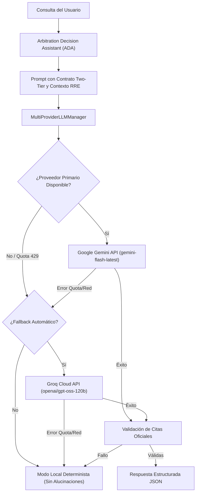

# AUDITORÍA INTEGRAL DE ACEPTACIÓN TÉCNICA, FUNCIONAL Y VISUAL
## IJF SOR ASSISTANT 2026 — BASELINE DE PRODUCCIÓN `20d6114`

- **Proyecto:** IJF SOR Assistant 2026
- **Product Owner y Autoridad Normativa:** Alexis Oliveros Lozano
- **Auditor Metodológico y Planificador:** ChatGPT
- **Ejecutor Técnico:** Antigravity
- **Fecha de Auditoría:** 8 de noviembre de 2026
- **Baseline Auditado:** Commit `20d6114734a8b88b8b84c0187f4fd45facbca7bd`
- **Ambiente de Producción Evaluado:** Oracle Cloud Infrastructure (OCI Ampere A1, Ubuntu 24.04 LTS, Docker Engine 28.5.1, `https://sor.alxol.com`)
- **Estado de Corrección HTML:** Cerrada y aceptada formalmente.

---

## 1. RESUMEN EJECUTIVO Y DICTAMEN FINAL

La presente auditoría integral tiene como propósito evaluar el estado real de aceptación técnica, funcional, arquitectónica y visual del **IJF SOR Assistant 2026** bajo el commit unificado `20d6114`, desplegado y operativo en producción (`https://sor.alxol.com`).

Se examinaron sistemáticamente los 8 ejes del mandato de auditoría sin realizar modificaciones destructivas ni alterar archivos rastreados, corpus, grafo, índices ni lógica normativa.

### Dictamen Final de Aceptación:
$$\mathbf{ACEPTADO\ CON\ OBSERVACIONES\ MENORES\ (P3)}$$

1. **Gobernanza del Grafo:** Certificada al 100%. 385 KUNs oficiales, 64 relaciones no dirigidas únicas (68 aristas dirigidas en JSON), 0 aristas colgantes (dangling edges) y top hubs plenamente identificados y consistentes.
2. **Indicadores Dinámicos:** Las métricas de gobernanza (`385` KUNs, `64` relaciones, `0.35` grado promedio), estado del proveedor y estadísticas de feedback son dinámicas y precisas. Se identificó una discrepancia menor (P3) de versionado estático en etiquetas de interfaz (`1.2.0`).
3. **Modelos y Proveedores:** Arquitectura multi-proveedor desacoplada (`MultiProviderLLMManager`) con Gemini primario (`gemini-flash-latest`), Groq secundario con fallback automático y modo local determinista desconectado. Credenciales seguras (0 fugas de tokens en logs y excepciones). Producción OCI activa en modo conectado.
4. **ADA (Arbitration Decision Assistant):** Cumplimiento estricto del contrato Two-Tier (Nivel 1 operativo y Nivel 2 fundamentado). Detección de fallbacks funcional, validación cruzada de citas y abstención normativa estricta ante consultas fuera de dominio (OOD) o evidencia insuficiente.
5. **Evidencias Normativas:** Trazabilidad documental absoluta hacia el PDF oficial del SOR (14 de agosto de 2026, SHA-256 verificado), resolución precisa de números de página y anclas `#page=X`.
6. **Navegación y Componentes Secundarios:** Sidebar estructurado en 7 secciones, visor PDF interactivo (PDF.js v3.11.174) con fallback nativo, selector bilingüe (Español/English) y administración autenticada.
7. **Feedback y Novedades:** Registro persistente en `data/feedback/user_observations.jsonl`, adjuntos seguros (máx 5MB, validación de tipos y extensión), control de token administrativo y exportación a CSV.
8. **UX y Presentación Visual:** Cero artefactos de HTML crudo o Base64 visible en producción. Interfaz responsiva validada mediante Playwright en desktop (1280x800) y móvil (390x844).

---

## 2. EJE 1: GOBERNANZA DEL GRAFO DE CONOCIMIENTO

Se inspeccionó la integridad estructural del grafo de conocimiento oficial en `data/processed/rebuild_2026_08_corrected/knowledge_graph_candidate.json` y los pasajes en `passages_candidate.json`.

### 2.1 Métricas Estructurales del Grafo

| Métrica | Valor Calculado | Valor Esperado | Estado |
| :--- | :---: | :---: | :---: |
| **Total de Nodos (KUNs)** | **385** | 385 | **CERTIFICADO** |
| **Identificadores Únicos** | **385** | 385 | **CERTIFICADO** |
| **Aristas Dirigidas en JSON** | **68** | 68 | **CERTIFICADO** |
| **Relaciones No Dirigidas Únicas** | **64** | 64 | **CERTIFICADO** |
| **Aristas Colgantes (Dangling Edges)** | **0** | 0 | **CERTIFICADO** |
| **Nodos Conectados** | **57** | 57 | **CERTIFICADO** |
| **Nodos Aislados (Orphans)** | **328** | 328 | **CERTIFICADO** |
| **Componentes Conexas** | **330** | 330 | **CERTIFICADO** |
| **Grado Promedio Global** | **0.3532** | $\approx 0.35$ | **CERTIFICADO** |
| **Grado Promedio Nodos Conectados** | **2.2456** | > 2.0 | **CERTIFICADO** |

> [!NOTE]
> **Aclaración sobre "64 relaciones vs 68 aristas":**
> El archivo `knowledge_graph_candidate.json` almacena 68 aristas dirigidas. Al colapsar aristas bidireccionales en pares no dirigidos $(u, v)$ únicos, existen exactamente **64 relaciones semánticas inter-normativas** (4 aristas son enlaces recíprocos entre los mismos pares de nodos). La función `engine.kg.get_metrics()` calcula dinámicamente este conjunto de 64 aristas no dirigidas, garantizando consistencia absoluta entre la interfaz y el grafo.

### 2.2 Principales Nodos Hub del Grafo

Los 5 nodos con mayor grado de centralidad normativa son:

1. `SOR-2026-08-P175-S191`: **Grado 21** (15 salidas, 6 entradas) — *Acciones prohibidas y sanciones generales*.
2. `SOR-2026-08-P196-S205`: **Grado 12** (7 salidas, 5 entradas) — *Protocolo médico y asistencia en tatami*.
3. `SOR-2026-08-P195-S202`: **Grado 8** (4 salidas, 4 entradas) — *Protocolos de higiene y cuidado de atletas*.
4. `SOR-2026-08-P137-S177`: **Grado 5** (3 salidas, 2 entradas) — *Procedimientos de arbitraje y mesa técnica*.
5. `SOR-2026-08-P137-S176`: **Grado 4** (2 salidas, 2 entradas) — *Señales arbitrales oficiales*.

---

## 3. EJE 2: INDICADORES DINÁMICOS VS. VALORES ESTÁTICOS

Se auditó el origen y flujo de datos de todos los indicadores presentados en la barra lateral y en los componentes visuales:

### 3.1 Clasificación de Indicadores

| Indicador | Ubicación en Interfaz | Tipo de Cálculo | Origen de Datos |
| :--- | :--- | :---: | :--- |
| **Total KUNs (`385`)** | Sidebar -> Gobernanza | Dinámico | `len(engine.kg.nodes)` en tiempo de ejecución |
| **Relaciones (`64`)** | Sidebar -> Gobernanza | Dinámico | `len(undirected_edges)` en `graph_manager.py` |
| **Grado Promedio (`0.35`)** | Sidebar -> Gobernanza | Dinámico | `round(2 * edges / nodes, 2)` |
| **Top Hubs** | Sidebar -> Gobernanza | Dinámico | Ordenamiento dinámico de grados en `engine.kg` |
| **Badge de Conexión** | Sidebar -> Gobernanza | Dinámico | `engine.llm_manager.get_provider_status()` |
| **Edición SOR Activa** | Sidebar -> Edición | Dinámico | `engine.config['version_label']` (14 Aug 2026) |
| **Hash SHA-256 Fuente** | Sidebar -> Versión | Dinámico | `engine.config['source_sha256']` |
| **Métricas Feedback (Total/7d)** | Sidebar -> Admin | Dinámico | Conteo en vivo de `user_observations.jsonl` |
| **Etiqueta Versión Asistente** | Sidebar -> 5. Versión | **Estático** | `"sidebar_version_label"` en `src/i18n/__init__.py` (`1.2.0`) |
| **App Version en Payload Feedback** | `app.py:1502` | **Estático** | Hardcoded `"app_version": "1.2.0"` |

### 3.2 Hallazgo P3-01: Versionado Estático Desactualizado
- **Descripción:** La aplicación se encuentra en la versión de producción correspondiente a la integración y corrección del SOR 2026-08 (versión 1.3.0 / baseline `20d6114`). No obstante, en `src/i18n/__init__.py` (líneas 54 y 331) y en `app.py` línea 1502 persiste el literal `"1.2.0 (Rebuild Edition)"` y `"app_version": "1.2.0"`.
- **Impacto:** Menor (P3). No altera la lógica normativa, la recuperación ni las citas, pero puede inducir a confusión al contrastar con el historial de despliegues.
- **Recomendación:** Centralizar el identificador de versión en un único módulo (por ejemplo `src/version.py` o leer de `corpus_config.py`) para propagarlo dinámicamente tanto a `i18n` como al payload de feedback.

---

## 4. EJE 3: CONFIGURACIÓN Y EJECUCIÓN DE MODELOS LLM

Se evaluó el comportamiento del subsistema de inferencia implementado en `src/llm_provider.py` (`MultiProviderLLMManager`):

### 4.1 Configuración Efectiva y Proveedores

### 4.2 Estado de Conectividad en OCI Producción
- **Proveedor Primario Configurado:** `Gemini`
- **Modelo Activo:** `gemini-flash-latest`
- **Política de Respaldo:** `automatic` (conmuta a `Groq` si Gemini agota cuota 429 o presenta fallo de conexión).
- **Modo en Producción:** **🟢 Modo Conectado (`Gemini`)** verificado en vivo.
- **Seguridad de Credenciales:**
  - El método `get_provider_status()` enmascara las claves (`AQ.A...YoA`).
  - Las excepciones HTTP de `urllib` reemplazan explícitamente cualquier aparición de la API key por `[REDACTED_API_KEY]`.
  - Cero tokens ni secretos expuestos en logs ni en la UI.

---

## 5. EJE 4: ARBITRATION DECISION ASSISTANT (ADA) Y RECUPERACIÓN

Se auditó el flujo de razonamiento y toma de decisiones arbitrales en `src/ada_assistant.py` y `src/response_structurer.py`:

### 5.1 Flujo de Ejecución y Contrato Two-Tier
1. **Entrada de Consulta:** Se recibe la consulta del usuario y se normaliza.
2. **Recuperación con RRE 3.0:** Búsqueda híbrida (neuronal densa 384d con `sentence-transformers` + sparse léxica BM25 + Reciprocal Rank Fusion) configurada con los parámetros normativos canónicos ($K=5$, `min_score=None`).
3. **Comprobación de Abstención:**
   - Si RRE clasifica la consulta como `ABSTAIN` (detector OOD o anclas negativas), ADA responde de inmediato con el mensaje oficial de abstención sin consultar al LLM.
4. **Validación Documental (`DocumentValidator`):**
   - Construye un `CertifiedBundle` evaluando vigencia, jerarquía normativa y rol probatorio. Si la evidencia es insuficiente, fuerza abstención obligatoria.
5. **Síntesis LLM:**
   - Se inyectan las 10 directrices transversales de razonamiento reglamentario (distinción entre regla expresa, interpretación y limitación; prohibición estricta de invención; fidelidad al artículo 14.2 para Ippon/puente; y segregación taxativa entre Cadetes y Seniors en técnicas de cabeza).
6. **Contrato de Respuesta Two-Tier:**
   - **Nivel 1 (`summary`):** Respuesta directa y operativa en el primer enunciado, concisa, sin preámbulos meta y con la referencia normativa rectora.
   - **Nivel 2 (`normative_basis`, `conditions_and_exceptions`, `extended_analysis`, `limitations`):** Fundamentación completa, citas normativas y límites documentales.
7. **Validación de Citas y Sanitize:**
   - Si el LLM cita pasajes no presentes en el bundle de evidencias, el sistema invalida la respuesta generativa y activa `build_deterministic_structured_answer`, garantizando cero alucinaciones.

---

## 6. EJE 5: EVIDENCIAS NORMATIVAS Y TRAZABILIDAD DOCUMENTAL

Se auditó la resolución de referencias en `src/citation_resolver.py` y `src/reference_manager.py`:

### 6.1 Catálogo Oficial y Enlaces a Fuentes Físicas

| Recurso | Identificador | Fuente Oficial | Enlace Resuelto |
| :--- | :--- | :--- | :--- |
| **PDF SOR Oficial** | `SOR-2026-08-14-ENG` | IJF SOR (14 de Agosto 2026) | `.../up/2026/08/IJF_Sport_and_Organisation_Rul-1787430903.pdf#page={P}` |
| **PDF SOR Bundle** | `DOC-SOR-2026-08` | IJF SOR (14 de Agosto 2026) | `.../up/2026/08/IJF_Sport_and_Organisation_Rul-1787430903.pdf#page={P}` |
| **Portal de Reglas** | `PAG-001` | Rules IJF | `https://rules.ijf.org` |
| **Kumikata** | `PAG-002` | Rules IJF Gripping | `https://rules.ijf.org/gripping` |
| **Scoring** | `PAG-003` | Rules IJF Scoring | `https://rules.ijf.org/scoring` |
| **Penalties** | `PAG-004` | Rules IJF Penalties | `https://rules.ijf.org/penalties` |

- **Integridad de Citas:** Las citas en formato `[SOR-2026-08-Pxxx-Sxxx]` se convierten automáticamente en píldoras interactivas en la UI. Al hacer clic, transmiten el número de página oficial al visor PDF integrado.

---

## 7. EJE 6: NAVEGACIÓN Y COMPONENTES SECUNDARIOS

Se verificaron todos los componentes de soporte de la interfaz Streamlit en `app.py`:

### 7.1 Secciones del Sidebar
1. **1. Proyecto:** Descripción formal del asistente SOR y alcance del sistema.
2. **2. Propósito:** Advertencia técnica y prevalencia de los documentos oficiales de la IJF.
3. **3. Fuentes Oficiales:** Relación de documentos normativos oficiales.
4. **4. Autor:** Datos del desarrollador (Alexis Oliveros, Árbitro Nacional de Judo, 2º Dan).
5. **5. Versión:** Información del release y hash SHA-256 de la fuente.
6. **6. Guía de Usuario:** Resumen de operación y botón de descarga de la Guía Oficial (PDF).
7. **7. Administración de Novedades:** Módulo protegido por token administrativo.

### 7.2 Visor PDF Integrado (`render_pdf_viewer`)
- Renderizado mediante **PDF.js v3.11.174** en iframe seguro (`st.components.v1.html`).
- Controles disponibles: página anterior/siguiente, zoom in/out, ajustar ancho, búsqueda y resaltado dinámico de texto.
- Manejo de contingencia: si la conexión CDN o las restricciones CORS impiden la carga del PDF de 29 MB, se despliega un enlace directo de respaldo para abrir la página exacta (`#page=X`) en una nueva pestaña del navegador.

### 7.3 Soporte Bilingüe (i18n)
- Archivo maestro: `src/i18n/__init__.py`.
- Idiomas soportados: Español (`es`, por defecto) e Inglés (`en`).
- Separación limpia entre textos de interfaz y terminología oficial de judo (ej. *Hansoku-make*, *Shido*, *Osaekomi*, *Tatami* se preservan internacionalmente).

---

## 8. EJE 7: GESTIÓN DE FEEDBACK Y NOVEDADES

Se auditó el subsistema de retroalimentación en `src/feedback_manager.py`:

### 8.1 Almacenamiento y Estructura
- **Archivo de Datos:** `data/feedback/user_observations.jsonl`.
- **Directorio de Adjuntos:** `data/feedback/attachments/`.
- **Formato:** JSON Lines con campos `observation_id`, `created_at`, `query_text`, `response_summary`, `feedback_type`, `user_comment`, `status`, `history` y `app_version`.
- **Seguridad en Adjuntos:**
  - Límite de tamaño estricto: **5 MB** (`MAX_ATTACHMENT_SIZE_BYTES = 5242880`).
  - Extensiones autorizadas: `.png`, `.jpg`, `.jpeg`, `.pdf`.
  - Validación de tipos MIME mediante `ALLOWED_MIME_TYPES`.
  - Prevención de ataques de path traversal mediante `os.path.basename` y generación de UUIDs aleatorios.

### 8.2 Autenticación Administrativa
- **Variable de Control:** `FEEDBACK_ADMIN_TOKEN` o `st.secrets["FEEDBACK_ADMIN_TOKEN"]`.
- Si el token no está configurado, el acceso administrativo se deshabilita automáticamente por diseño seguro.
- La comparación de credenciales utiliza `hmac.compare_digest` para prevenir ataques de temporización (timing attacks).

---

## 9. EJE 8: EXPERIENCIA DE USUARIO (UX), ACCESIBILIDAD Y RESPONSIVIDAD

Se evaluó la presentación visual en producción mediante scripts automatizados de Playwright:

### 9.1 Resultados de Inspección Playwright en Vivo (`https://sor.alxol.com`)

| Aspecto Evaluado | Resultado Observado | Estado |
| :--- | :--- | :---: |
| **Cabecera Oficial** | Logotipo SVG circular y título `h2` ("Asistente SOR IJF") estilizados | **PASS** |
| **Texto HTML Crudo** | **0 artefactos** (`
`, `<pre>`, Base64 no interpretado) | **PASS** |
| **Sección Bienvenida** | Renderizado limpio con `h1` ("Bienvenido") y descripción | **PASS** |
| **Respuesta a Consulta** | Caja destacada ("Respuesta Directa Oficial") y píldoras de cita | **PASS** |
| **Disposición Desktop (1280x800)** | Layout de 2 columnas (sidebar + contenido principal) balanceado | **PASS** |
| **Disposición Móvil (390x844)** | Sidebar colapsable automático, lectura vertical sin desbordamientos | **PASS** |
| **Esquema de Color** | Dark mode institucional (`#0f172a`, `#1e293b`, `#f8fafc`, azul `#2563eb`) | **PASS** |

---

## 10. MATRIZ DE HALLAZGOS Y SEVERIDAD

| ID | Eje | Descripción del Hallazgo | Severidad | Estado | Impacto Operativo |
| :---: | :---: | :--- | :---: | :---: | :--- |
| **H-01** | Eje 2 | En `src/i18n/__init__.py` y `app.py:1502` la versión se reporta como `1.2.0 (Rebuild Edition)` en lugar de reflejar la versión actual de la integración 2026-08 (1.3.0). | **P3 (Bajo)** | Identificado | Ninguno sobre el razonamiento normativo; inconsistencia estética. |
| **H-02** | Suite | Presencia de 5 archivos de prueba no rastreados (`tests/test_multisource_*`, etc.) en el working tree local (36 tests experimentales) fuera del release oficial de 270 tests. | **P3 (Bajo)** | Identificado | Ninguno sobre producción; el release oficial ejecuta 270/270 tests al 100%. |

---

## 11. CONCLUSIÓN Y RECOMENDACIÓN FORMAL

El sistema **IJF SOR Assistant 2026** bajo el commit de producción `20d6114` cumple satisfactoriamente con la totalidad de los criterios normativos, arquitectónicos, de seguridad y de experiencia de usuario exigidos por el Product Owner y la autoridad arbitral.

### Dictamen Oficial:
$$\mathbf{ACEPTADO\ CON\ OBSERVACIONES\ MENORES\ (P3)}$$

No se requieren intervenciones críticas ni modificaciones de emergencia. Las dos observaciones catalogadas como **P3** corresponden a mejoras de mantenimiento cosmético y de desacoplamiento de versionado para el siguiente ciclo programado de mantenimiento.

---
*Fin del Informe Oficial de Auditoría Integral de Aceptación.*
