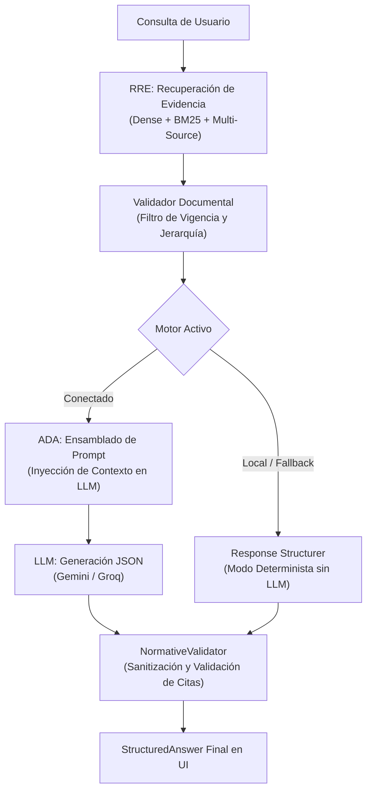
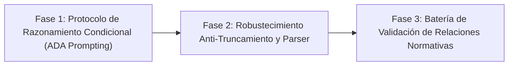

# AUDITORÍA TÉCNICA Y PLAN DE MEJORA
## Relación, Síntesis y Razonamiento de Evidencia Normativa en IJF SOR Assistant

**Proyecto:** IJF SOR Assistant 2026  
**Responsable y Aprobador Final:** Alexis Oliveros Lozano  
**Planificador y Auditor:** ChatGPT / Codex  
**Ejecutor Técnico:** Antigravity  
**Fecha:** 11 de noviembre de 2026  
**Estado:** PROPUESTA TÉCNICA (READ-ONLY — CERO MODIFICACIONES EN EL REPOSITORIO)

---

## 1. OBJETIVO Y CONTEXTO

A raíz de la consulta real de arbitraje:
> *"En una competición de cadetes, uno está estrangulado y se rinde pero se desmaya, ¿qué decisión debe tomarse?"*

Se evidenció que el asistente recuperó con exactitud el pasaje normativo rector (**SOR 2026, Pág. 199, `SOR-2026-08-P199-S211`**), pero **falló en relacionar lógicamente las dos disposiciones contiguas del pasaje**, emitiendo una respuesta incompleta y errónea (afirmando la exclusión del torneo y truncando el campo de excepciones en `"conditions_and_exceptions": "Si el atleta se rinde...`).

El objetivo de este documento es:
1. Realizar una **auditoría profunda y rigurosa** de cómo el asistente toma los pasajes recuperados y los relaciona para formular respuestas.
2. Identificar la **causa raíz** del fallo lógico y del truncamiento.
3. Presentar un **plan de mejora priorizado y ejecutable**, sin alterar código ni configuraciones hasta contar con la aprobación formal de Alexis.

---

## 2. AUDITORÍA TÉCNICA: CÓMO RELACIONA EL ASISTENTE LO RECUPERADO

El flujo de procesamiento desde la consulta del usuario hasta la respuesta se compone de cuatro etapas:

### 2.1. Diagnóstico del Motor Conectado (ADA + LLM)
En `src/ada_assistant.py` (líneas 344–385):
- **Cómo se inyecta la evidencia:** Los pasajes recuperados se concatenan textualmente en `CONTEXTO NORMATIVO CERTIFICADO: [ID] Título (Art. X, Pág. Y): <texto>`.
- **El Contrato de Prompting:** Se exige al modelo un JSON de 2 niveles (`summary`, `normative_basis`, `citations`, `conditions_and_exceptions`, `extended_analysis`, `limitations`).
- **Defecto identificado 1 (Sesgo de severidad y colapso condicional):** El prompt contiene directrices muy específicas para ciertos artículos (equipamiento, puente de uke, reverse seoi-nage), pero **carece de una regla general de precedencia cronológica y condicional**. Ante dos oraciones en el mismo texto:
  - Oración A: *"If during shime-waza an athlete gives up before losing consciousness... he can continue in the competition."*
  - Oración B: *"In cadet events, if an athlete loses consciousness during shime-waza he CANNOT continue in the competition."*
  El modelo LLM sufre un **sesgo de anclaje hacia la prohibición más punitiva y tajante** (Oración B), colapsando el análisis y desestimando la condición temporal habilitante de la Oración A (*"se rinde antes de"*).
- **Defecto identificado 2 (Truncamiento en JSON):**
  En `llm_provider.py` no se especifica `max_output_tokens` para la API de Gemini, o se produce un corte en el stream de generación cuando el prompt es excesivamente largo, lo que provocó que el campo `"conditions_and_exceptions"` quedara partido a mitad de la frase (`"Si el atleta se rinde `) y el parser tuviera que cerrarlo artificialmente.

### 2.2. Diagnóstico del Motor Determinista (`response_structurer.py`)
En `src/response_structurer.py` (líneas 613–680):
- **Sesgo de primera frase aislada:** En modo local o cuando el LLM falla, el sistema toma `evidence[0]`, divide el texto en oraciones y selecciona la primera oración sustantiva que coincida superficialmente con palabras clave.
- **Incapacidad de síntesis relacional:** El motor determinista actual **no puede combinar dos cláusulas complementarias**. Si un pasaje contiene una regla y una excepción en oraciones separadas, el motor determinista emite únicamente la primera y descarta la segunda.

---

## 3. CAUSAS RAÍZ IDENTIFICADAS (HALLAZGOS)

| ID | Hallazgo | Causa Raíz | Impacto en la Respuesta |
|---|---|---|---|
| **CR-01** | **Falta de regla de precedencia temporal en el razonamiento** | El prompt de ADA no instruye al modelo sobre cómo interpretar secuencias de hechos tipo *"Acción A antes de Suceso B"*. | El asistente ignora que el atleta se rindió primero y asume que el desmayo anula todo derecho. |
| **CR-02** | **Sesgo punitivo del LLM** | Los modelos de lenguaje tienden por alineación a elegir la opción más restrictiva ("CANNOT continue") frente a una permisión condicionada. | Falso dictamen de eliminación del torneo. |
| **CR-03** | **Truncamiento de salida JSON** | Ausencia de control estricto de completitud y balance de tokens en la respuesta estructurada de Gemini. | La excepción queda inconclusa en pantalla (`"Si el atleta se rinde...`). |
| **CR-04** | **Aislamiento intra-página** | La evidencia se recupera a nivel página/sección, pero el generador no hace un análisis de árbol de decisión (*Acción -> Condición -> Excepción -> Consecuencia*). | Respuestas unidimensionales que ignoran matices reglamentarios. |

---

## 4. PLAN DE MEJORA PROPUESTO (3 FASES)

### Fase 1: Protocolo de Razonamiento Condicional en ADA (`ada_assistant.py`)
Incorporar en la directriz de razonamiento de ADA una política explícita para **Reglas Secuenciales y Precedencia Temporal**:
1. **Regla de Secuencia Fáctica:** Cuando una consulta combine dos o más acciones sucesivas (ej. *"se rinde pero se desmaya"*, *"hace agarre no clásico y ataca de inmediato"*, *"sale del tatami durante la acción técnica"*):
   - El asistente debe descomponer la línea de tiempo de los hechos.
   - Si la norma supedita una consecuencia a que un hecho ocurra **antes** o **durante** otro (*"before losing consciousness"*, *"immediate attack"*), la respuesta principal (`summary`) debe resolver en función de esa precedencia, no de la última consecuencia aislada.
2. **Articulación de Cláusulas Contiguas:** Prohibir que el modelo tome una oración prohibitiva de un pasaje sin verificar si la oración anterior o posterior establece una excepción o condición que la consulta cumpla.

### Fase 2: Robustecimiento Anti-Truncamiento y Parser (`llm_provider.py` y `response_structurer.py`)
1. **Configuración explícita de salida en Gemini Client:** Configurar un `max_output_tokens` adecuado (mínimo 2048 tokens limpios para la respuesta JSON) y monitorear la propiedad `finishReason` de la API de Google (garantizando que termine en `STOP` y no en `MAX_TOKENS`).
2. **Validación de Completitud Estructural:** Si el JSON devuelto presenta campos incompletos o cadenas truncadas, el sanitizador debe detectar la anomalía y forzar regeneración o completar armónicamente el análisis sin cortar texto.

### Fase 3: Batería de Validación de Relaciones Normativas Complejas
Diseñar y ejecutar una batería de pruebas de evaluación con casos de arbitraje donde la solución dependa de la **relación condicional entre dos eventos**:
1. **Caso Cadetes Shime-waza:** Rendición antes del desmayo (continúa) vs. Desmayo sin rendición previa (no continúa).
2. **Caso Puente Cervical (Art. 14.2):** Puente voluntario en vuelo (Ippon) vs. Caída sobre el cuerpo de Tori sin contacto simultáneo cabeza-pies (excepción: sin puntuación).
3. **Caso Zambullida (Head Diving):** Zambullida voluntaria de Tori (Hansoku-make directo, pero clasifica a siguiente ronda si clasifica) vs. Uso de la cabeza por Uke para defenderse en cadetes (Shido a Uke).
4. **Caso Agarre no clásico (Pocket/Pistol):** Agarre no clásico sin ataque inmediato (Shido) vs. Agarre no clásico con ataque continuo e inmediato (Válido).

---

## 5. RESTRICCIONES Y PROTOCOLO DE GOBERNANZA

- **Estado actual:** Documentación y planificación exclusivamente.
- **Cero cambios aplicados:** No se ha modificado código de producción, índices, ni configuraciones.
- **Próximo paso:** Revisión, retroalimentación y aprobación por parte de Alexis y auditoría de ChatGPT/Codex. Una vez aprobado, se calendarizará la ejecución de la Fase 1.
