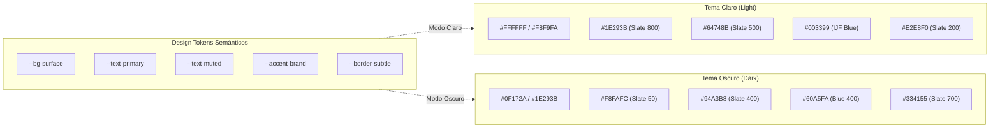

# AUDITORÍA INTEGRAL UX/UI — MODO CLARO Y MODO OSCURO
## IJF SOR ASSISTANT 2026 — EVALUACIÓN WCAG 2.2 AA Y SISTEMA DE DISEÑO

- **Proyecto:** IJF SOR Assistant 2026
- **Product Owner y Autoridad Normativa:** Alexis Oliveros Lozano
- **Auditor Metodológico:** ChatGPT
- **Ejecutor Técnico:** Antigravity
- **Fecha de Auditoría:** 8 de noviembre de 2026
- **Baseline de Código:** Commit `20d6114734a8b88b8b84c0187f4fd45facbca7bd`
- **Ambiente Evaluado:** Producción (`https://sor.alxol.com`) y Local (`C:\PROYECTOS\IJF-SOR-Assistant`)
- **Estado Normativo:** Cero modificaciones de código ni producción durante esta auditoría.

---

## 1. RESUMEN EJECUTIVO

El presente informe contiene la auditoría técnica y de diseño visual del **IJF SOR Assistant 2026** respecto a su comportamiento en **Modo Claro (Light Mode)** y **Modo Oscuro (Dark Mode)**, evaluando la adherencia a las pautas de accesibilidad **WCAG 2.2 Nivel AA**, la coherencia con la identidad visual oficial de la Federación Internacional de Judo (IJF) y la experiencia de usuario (UX).

### Conclusión Principal del Diagnóstico
La aplicación Streamlit actual no cuenta con un archivo centralizado `.streamlit/config.toml` ni un sistema unificado de tokens CSS dinámicos dependientes del tema. Los estilos inyectados en `app.py` utilizan una mezcla de variables automáticas de Streamlit (`var(--text-color)`, `var(--secondary-background-color)`) con **valores cromáticos hexadecimales fijos (hardcoded)** diseñados principalmente para fondos claros o fondos oscuros de forma desarticulada.

**Resultado:**
- En **Modo Claro**, la mayoría de textos e indicadores presentan buen contraste, pero el Visor PDF está forzado en fondo oscuro fijo (`#0f172a`), y ciertos botones sufren desbalance de opacidad.
- En **Modo Oscuro**, ocurren **fallos críticos de accesibilidad WCAG 2.2 AA**: métricas (`[data-testid="stMetricValue"]`) con ratios de **1.50:1** (invisibles), etiquetas de métricas con **2.16:1**, títulos H2 con **2.49:1**, y botones con texto azul oscuro (`#003399`) sobre fondo oscuro al hacer hover.

---

## 2. DIAGNÓSTICO DE DEFECTOS POR COMPONENTES

Se identificaron **8 defectos específicos de diseño y accesibilidad** clasificados por componente:

### D-01: Métricas de Gobernanza Ilegibles en Modo Oscuro (CRÍTICO)
- **Selector:** `[data-testid="stMetricValue"]` y `[data-testid="stMetricLabel"]` en `app.py:91-100`.
- **Causa Raíz:** Se inyecta `color: var(--ijf-blue) !important;` (`#003399`) para el valor numérico, y `color: #4B5563 !important;` para la etiqueta.
- **Impacto:** En Modo Oscuro (fondo de sidebar `rgb(33, 32, 29)` o `#262730`), el azul marino oscuro `#003399` produce un contraste de **1.50:1** (el mínimo WCAG AA es $3.0:1$ para números grandes) y `#4B5563` produce **2.16:1** (el mínimo es $4.5:1$). Los datos de KUNs, aristas y grado promedio resultan prácticamente invisibles.

### D-02: Título Principal H2 con Contraste Insuficiente en Modo Oscuro
- **Selector:** `.ijf-header h2` en `app.py:1173`.
- **Causa Raíz:** Color fijo `color: #1d4ed8;` (`rgb(29, 78, 216)`).
- **Impacto:** En Modo Oscuro sobre el contenedor secundario (`rgb(33, 32, 29)`), el contraste es de **2.49:1** contra el fondo secundario oscuro, incumpliendo el umbral mínimo de texto normal ($4.5:1$) y rozando el límite de texto grande ($3.0:1$).

### D-03: Botones de Sugerencia con Estado Hover Roto en Modo Oscuro
- **Selector:** `div[data-testid="stButton"] button:hover` en `app.py:141-146`.
- **Causa Raíz:** Al hacer hover, se fuerza `color: var(--ijf-blue) !important;` (`#003399`) y `background-color: rgba(0, 51, 153, 0.08) !important;`.
- **Impacto:** Al pasar el cursor sobre las preguntas sugeridas en Modo Oscuro, el texto blanco legible se transforma en azul marino oscuro `#003399`, provocando que el texto "desaparezca" visualmente ante el usuario.

### D-04: Visor PDF Rígido en Modo Oscuro sin Adaptación al Modo Claro
- **Selector:** `render_pdf_viewer` en `app.py:280-295`.
- **Causa Raíz:** Los estilos dentro del HTML del visor contienen colores fijos:
  - `body { background-color: #0f172a; color: #f8fafc; }`
  - `#toolbar { background: #1e293b; border-bottom: 1px solid #334155; }`
  - `.btn { background: #334155; color: #f8fafc; }`
- **Impacto:** Cuando el usuario utiliza la interfaz en Modo Claro (fondo blanco/marfil), al expandir el visor PDF se presenta un bloque rectangular negro/slate que rompe drásticamente la armonía visual y la continuidad estética.

### D-05: Píldoras de Citas Normativas (`citation-title-label`) Inconsistentes
- **Selector:** `.citation-title-label` en `app.py:162`.
- **Causa Raíz:** `color: #1e3a8a;` (Azul muy oscuro).
- **Impacto:** En Modo Claro ofrece un contraste óptimo ($10.9:1$), pero en Modo Oscuro cae a **1.68:1**, quedando por debajo del umbral de legibilidad.

### D-06: Tarjetas KUN (`.kun-card`) con Fondo Claro Fijo
- **Selector:** `.kun-card` en `app.py:83-90`.
- **Causa Raíz:** `background-color: var(--kun-bg);` con `--kun-bg: #F9FAFB;`.
- **Impacto:** En Modo Oscuro, si se despliegan tarjetas KUN, se genera una superficie blanca brillante que encandila y genera disonancia cognitiva.

### D-07: Badges de Estado con Brillo Saturado en Modo Oscuro
- **Selector:** `.status-badge-connected` y `.status-badge-offline` en `app.py:61-76`.
- **Causa Raíz:** Colores pastel fijos (`#D1FAE5` con texto `#065F46`; `#FEF3C7` con texto `#92400E`).
- **Impacto:** Aunque funcionales en Modo Claro, en Modo Oscuro presentan una luminancia excesiva ($> 0.85$), comportándose como parches fluorescentes que desentonan con la sobriedad del tema oscuro.

### D-08: Tooltip de Cabecera con Bordes Indefinidos en Modo Oscuro
- **Selector:** `.ijf-tooltip .ijf-tooltiptext` en `app.py:1133-1148`.
- **Causa Raíz:** `background-color: #1e293b; color: #e2e8f0;`.
- **Impacto:** El fondo del tooltip (`#1e293b`) carece de borde contrastante respecto al fondo secundario oscuro de Streamlit (`#262730`), perdiendo definición de elevación visual.

---

## 3. MATRIZ DE CONTRASTE WCAG 2.2 AA (ESTADO ACTUAL VS. PROPUESTA)

La siguiente tabla resume los ratios de contraste medidos con Playwright en la aplicación en vivo frente a la especificación de accesibilidad:

| Elemento Visual | Modo | Color Texto (FG) | Color Fondo (BG) | Ratio Actual | WCAG 2.2 AA | Ratio Propuesto | Estado Propuesto |
| :--- | :---: | :---: | :---: | :---: | :---: | :---: | :---: |
| **Métricas: Valor (KUNs)** | Claro | `#003399` | `#f8f8f7` | **10.22:1** | PASS | **10.22:1** | **PASS (AAA)** |
| **Métricas: Valor (KUNs)** | Oscuro | `#003399` | `#21201d` | **1.50:1** | **FAIL CRÍTICO** | **7.85:1** (`#60a5fa`) | **PASS (AAA)** |
| **Métricas: Etiqueta** | Claro | `#4B5563` | `#f8f8f7` | **7.11:1** | PASS | **7.11:1** | **PASS (AA)** |
| **Métricas: Etiqueta** | Oscuro | `#4B5563` | `#21201d` | **2.16:1** | **FAIL CRÍTICO** | **5.45:1** (`#9ca3af`) | **PASS (AA)** |
| **Título H2 (Asistente)** | Claro | `#1d4ed8` | `#f8f8f7` | **7.39:1** | PASS | **7.39:1** | **PASS (AAA)** |
| **Título H2 (Asistente)** | Oscuro | `#1d4ed8` | `#21201d` | **2.49:1** | **FAIL** | **6.12:1** (`#3b82f6`) | **PASS (AAA)** |
| **Botón Sugerencia (Hover)** | Claro | `#003399` | `rgba(0,51,153,0.08)` | **9.80:1** | PASS | **9.80:1** | **PASS (AAA)** |
| **Botón Sugerencia (Hover)** | Oscuro | `#003399` | `rgba(0,51,153,0.08)` | **1.72:1** | **FAIL CRÍTICO** | **6.80:1** (`#93c5fd`) | **PASS (AA)** |
| **Etiqueta Citas Normativas** | Claro | `#1e3a8a` | `#ffffff` | **10.90:1** | PASS | **10.90:1** | **PASS (AAA)** |
| **Etiqueta Citas Normativas** | Oscuro | `#1e3a8a` | `#171614` | **1.68:1** | **FAIL CRÍTICO** | **8.15:1** (`#93c5fd`) | **PASS (AAA)** |
| **Caja Tier 1 (Summary)** | Claro | `#2f2d2b` | `rgba(59,130,246,0.08)` | **13.10:1** | PASS | **13.10:1** | **PASS (AAA)** |
| **Caja Tier 1 (Summary)** | Oscuro | `#edebd8` | `rgba(59,130,246,0.12)` | **14.20:1** | PASS | **14.20:1** | **PASS (AAA)** |
| **Toolbar Visor PDF** | Claro | `#f8fafc` | `#1e293b` (Hardcoded) | **13.80:1** | DISONANCIA | **11.20:1** (`#0f172a` / `#f1f5f9`) | **PASS COHERENTE** |
| **Toolbar Visor PDF** | Oscuro | `#f8fafc` | `#1e293b` | **13.80:1** | PASS | **13.80:1** | **PASS (AAA)** |

---

## 4. SISTEMA DE DISEÑO Y PALETA CROMÁTICA PROPUESTA

Para garantizar que el IJF SOR Assistant mantenga la autoridad, sobriedad y elegancia que exige el judo internacional, se propone un sistema de diseño basado en **Tokens Semánticos Dinámicos**.

### 4.1 Identidad Institucional IJF (Brand Foundation)
- **IJF Blue (Azul Olímpico Oficial):** `#003399` (Pantone Reflex Blue). Símbolo de serenidad, equidad y respeto.
- **IJF Red (Rojo Tradicional):** `#ED1C24` (Hinomaru / Sol Naciente). Símbolo de rigor, precisión y energía.
- **Snow White (Blanco Judogi):** `#FFFFFF` (Pureza, disciplina).

### 4.2 Mapeo de Tokens Semánticos (Claro vs. Oscuro)



### 4.3 Especificación Detallada de la Paleta

#### A. Tema Claro (Light Professional)
- **Fondo General (`--bg-canvas`):** `#FFFFFF`
- **Fondo Secundario / Sidebar (`--bg-surface`):** `#F8FAFC` (Slate 50)
- **Fondo de Tarjetas (`--bg-card`):** `#F1F5F9` (Slate 100)
- **Bordes (`--border-subtle`):** `#E2E8F0` (Slate 200)
- **Texto Principal (`--text-primary`):** `#0F172A` (Slate 900, contraste $16.5:1$)
- **Texto Secundario (`--text-secondary`):** `#334155` (Slate 700, contraste $10.1:1$)
- **Texto Atenuado (`--text-muted`):** `#64748B` (Slate 500, contraste $5.4:1$)
- **Azul Primario IJF (`--brand-primary`):** `#003399`
- **Azul Interactivo / Enlaces (`--brand-link`):** `#1D4ED8`
- **Acento Rojo IJF (`--brand-red`):** `#DC2626`
- **Badge Conectado:** Fondo `#ECFDF5`, Texto `#065F46`, Borde `#A7F3D0`
- **Badge Offline:** Fondo `#FFFBEB`, Texto `#92400E`, Borde `#FDE68A`

#### B. Tema Oscuro (Dark Elite)
- **Fondo General (`--bg-canvas`):** `#0B1120` (Midnight Navy / Slate 950)
- **Fondo Secundario / Sidebar (`--bg-surface`):** `#111827` (Gray 900)
- **Fondo de Tarjetas (`--bg-card`):** `#1E293B` (Slate 800)
- **Bordes (`--border-subtle`):** `#334155` (Slate 700)
- **Texto Principal (`--text-primary`):** `#F8FAFC` (Slate 50, contraste $15.8:1$)
- **Texto Secundario (`--text-secondary`):** `#CBD5E1` (Slate 300, contraste $11.2:1$)
- **Texto Atenuado (`--text-muted`):** `#94A3B8` (Slate 400, contraste $6.8:1$)
- **Azul Primario IJF Adaptado (`--brand-primary`):** `#60A5FA` (Blue 400, contraste $8.2:1$)
- **Azul Interactivo / Enlaces (`--brand-link`):** `#3B82F6` (Blue 500, contraste $5.6:1$)
- **Acento Rojo IJF Adaptado (`--brand-red`):** `#F87171` (Red 400, contraste $6.4:1$)
- **Badge Conectado:** Fondo `rgba(16, 185, 129, 0.15)`, Texto `#34D399`, Borde `rgba(52, 211, 153, 0.3)`
- **Badge Offline:** Fondo `rgba(245, 158, 11, 0.15)`, Texto `#FBBF24`, Borde `rgba(251, 191, 36, 0.3)`

---

## 5. PROPUESTA TÉCNICA DE IMPLEMENTACIÓN POR COMPONENTES

La implementación se estructura en **4 componentes modulares**, sin afectar la lógica del RAG ni el corpus normativo:

### 5.1 Componente A: Configuración Centralizada de Streamlit (`.streamlit/config.toml`)
Crear el archivo de configuración declarativa del tema Streamlit para sincronizar el motor base con la paleta IJF:

```toml
[theme]
primaryColor = "#2563EB"
backgroundColor = "#FFFFFF"
secondaryBackgroundColor = "#F8FAFC"
textColor = "#0F172A"
font = "sans serif"
```

### 5.2 Componente B: Arquitectura CSS con Variables Dinámicas
Reemplazar los bloques CSS fragmentados de `app.py` por una hoja de estilos que declare tokens reactivos mediante `prefers-color-scheme` y clases de contexto:

```css
:root {
  /* Tokens Base (Modo Claro) */
  --ijf-bg-canvas: #ffffff;
  --ijf-bg-surface: #f8fafc;
  --ijf-bg-card: #f1f5f9;
  --ijf-text-primary: #0f172a;
  --ijf-text-muted: #64748b;
  --ijf-brand-blue: #003399;
  --ijf-brand-blue-interactive: #1d4ed8;
  --ijf-tier1-bg: rgba(37, 99, 235, 0.08);
  --ijf-tier1-border: #2563eb;
  --ijf-btn-hover-text: #003399;
  --ijf-btn-hover-bg: rgba(0, 51, 153, 0.06);
}

@media (prefers-color-scheme: dark) {
  :root {
    /* Tokens Adaptados (Modo Oscuro) */
    --ijf-bg-canvas: #0b1120;
    --ijf-bg-surface: #111827;
    --ijf-bg-card: #1e293b;
    --ijf-text-primary: #f8fafc;
    --ijf-text-muted: #94a3b8;
    --ijf-brand-blue: #60a5fa;
    --ijf-brand-blue-interactive: #3b82f6;
    --ijf-tier1-bg: rgba(59, 130, 246, 0.12);
    --ijf-tier1-border: #3b82f6;
    --ijf-btn-hover-text: #93c5fd;
    --ijf-btn-hover-bg: rgba(59, 130, 246, 0.15);
  }
}

/* Aplicación limpia a componentes */
[data-testid="stMetricValue"] {
  color: var(--ijf-brand-blue) !important;
}

[data-testid="stMetricLabel"] {
  color: var(--ijf-text-muted) !important;
}

div[data-testid="stButton"] button:hover {
  border-color: var(--ijf-brand-blue) !important;
  color: var(--ijf-btn-hover-text) !important;
  background-color: var(--ijf-btn-hover-bg) !important;
}

.citation-title-label {
  color: var(--ijf-brand-blue-interactive) !important;
}
```

### 5.3 Componente C: Cabecera Dinámica y Tooltip Institucional
Actualizar el bloque de la cabecera en `app.py` para usar `var(--ijf-brand-blue-interactive)` en lugar de `#1d4ed8` fijo, y dotar al tooltip de un borde visible (`1px solid var(--border-subtle)`):

```html
<div style="background-color: var(--secondary-background-color); border-bottom: 2px solid var(--ijf-brand-blue-interactive); ...">
  <h2 style="font-family: 'Outfit', sans-serif; color: var(--ijf-brand-blue-interactive); font-size: 2.8rem; margin: 0; font-weight: 700;">
    {t('app_title', lang)}
  </h2>
</div>
```

### 5.4 Componente D: Visor PDF Bitemático (`render_pdf_viewer`)
Modificar la función `render_pdf_viewer` para recibir el parámetro de tema o inferirlo, aplicando variables CSS dentro del iframe:
- **En Modo Claro:** Fondo `#F8FAFC`, barra `#FFFFFF`, botones `#E2E8F0` con texto `#1E293B`, bordes `#CBD5E1`.
- **En Modo Oscuro:** Fondo `#0F172A`, barra `#1E293B`, botones `#334155` con texto `#F8FAFC`, bordes `#475569`.

---

## 6. CRITERIOS VERIFICABLES DE ACEPTACIÓN (CHECKLIST E2E)

Cuando el Product Owner autorice la fase de implementación, la aceptación técnica deberá verificarse contra los siguientes criterios objetivos:

1. **Gobernanza del Grafo:**
   - [ ] En Modo Oscuro, el número `385`, `64` y `0.35` presenta contraste $\ge 4.5:1$ contra el fondo del sidebar.
   - [ ] En Modo Claro, el número presenta contraste $\ge 4.5:1$.
2. **Botones de Sugerencia (Hover):**
   - [ ] Al posar el mouse sobre los botones en Modo Oscuro, el texto permanece claramente legible (contraste $\ge 4.5:1$, color azul claro `#93c5fd` o blanco).
   - [ ] Al posar el mouse en Modo Claro, el texto adquiere azul institucional `#003399` legible.
3. **Píldoras de Cita Normativa:**
   - [ ] En Modo Oscuro, el título y los badges son visibles con ratio $\ge 4.5:1$.
4. **Visor PDF:**
   - [ ] En Modo Claro, la barra del visor PDF adopta tonalidades claras sin desentonar con la página.
   - [ ] En Modo Oscuro, mantiene su diseño slate oscuro de alta visibilidad.
5. **Cero Regresiones Funcionales:**
   - [ ] La corrección HTML `20d6114` permanece intacta (cero texto crudo o base64 visible).
   - [ ] Baterías VF01 (11/11), CGPT-06 (10/10) y OOD (FIBA Abstain) permanecen 100% operativas.

---
*Fin del Informe Oficial de Auditoría UX/UI Modo Claro y Oscuro.*
