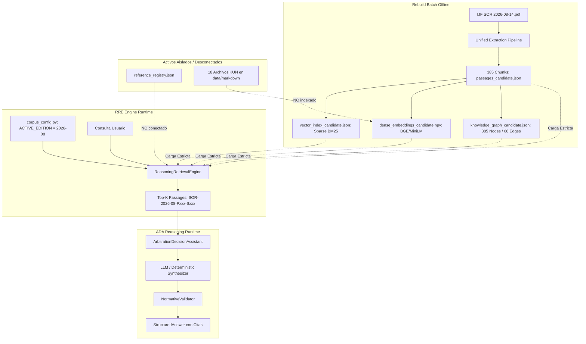
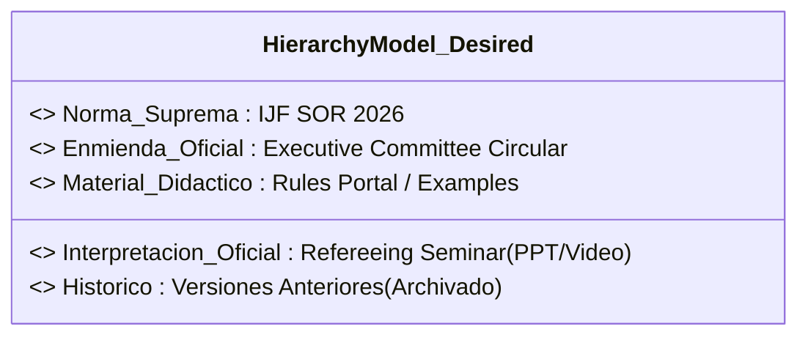
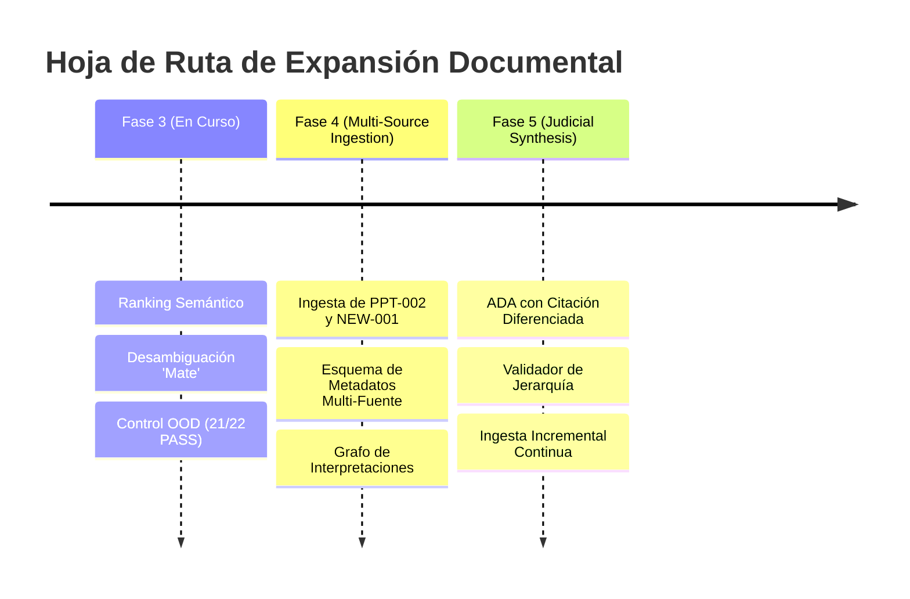

# IJF SOR Assistant — Auditoría de Cobertura Documental IJF

**Estado del Documento:** AUDITORÍA TÉCNICA Y DIAGNÓSTICO ESTRUCTURAL  
**Destino:** `docs/auditoria_cobertura_documental_ijf.md`  
**Fecha:** 2026-11-05  
**Entorno:** Local (`C:\PROYECTOS\IJF-SOR-Assistant`)  
**Rama Git:** `integration/ijf-sor-2026-08-merge`  
**Commit Base:** `61afc1bc2c8fa273f118f4e10bc447dbafcfe650`  
**Autor:** Antigravity (Auditor Técnico y Ejecutor)  
**Revisores:** Alexis (Supervisor) / ChatGPT (Arquitecto y Auditor Normativo)  

---

## 1. Resumen Ejecutivo

La presente auditoría técnica responde a la necesidad crítica de verificar si el **IJF SOR Assistant** cuenta con una cobertura documental integral —incluyendo aclaraciones oficiales, comunicados de arbitraje, presentaciones explicativas y enmiendas— o si opera bajo un acoplamiento mono-documental exclusivo.

### Conclusiones Principales del Diagnóstico:
1. **Pipeline Activo Mono-Documental:** El pipeline operativo de producción y de desarrollo actual (RRE 3.0 / ADA) está conectado **exclusiva y rígidamente a un único documento**: el PDF *IJF Sport and Organisation Rules*, edición **14 de agosto de 2026** (`SOR-2026-08-14-ENG`, 298 páginas, 385 pasajes).
2. **Desconexión del Ecosistema Complementario:** Aunque el repositorio alberga registros estructurados de 19 fuentes normativas en `data/references/reference_registry.json` y 18 archivos de Unidades de Conocimiento (KUN) en `data/markdown/`, **ninguno de estos documentos complementarios genera chunks en los índices activos, ni está presente en los embeddings FAISS/Sparse, ni puede ser recuperado por RRE**.
3. **Inexistencia de Soporte Multi-Documento en RRE:** `src/corpus_config.py` y `src/rre_engine.py` restringen por diseño estricto la carga a `data/processed/rebuild_2026_08_corrected/passages_candidate.json`, donde el 100% de los pasajes tienen `source_id = "SOR-2026-08-14-ENG"`.
4. **Riesgo Normativo de Interpretación:** ADA carece actualmente de la capacidad de recuperar clarificaciones oficiales de seminarios arbitrales (ej. `PPT-002`, `VID-001/005`) o comunicados oficiales (`NEW-001/003`), limitando su razonamiento a la letra impresa del PDF central sin el beneficio de las circulares interpretativas vigentes.

---

## 2. Tarea 1 — Inventario Documental Exhaustivo

Se examinaron todos los activos documentales presentes en el árbol del repositorio (`data/raw/`, `data/processed/`, `data/references/`, `data/markdown/`).

### 2.1 Catálogo de Documentos Identificados

| ID Fuente | Nombre / Título | Ruta Local | Fecha / Edición | Procedencia / Tipo | Estado de Vigencia Conocido | Presencia en Pipeline Activo (Embeddings/RRE) |
|---|---|---|---|---|---|---|
| **DOC-SOR-2026-08** | IJF Sport and Organisation Rules (SOR) | `data/raw/sor_2026_08_rebuild/IJF_Sport_and_Organisation_Rules_2026_08_14.pdf` | 14 de Agosto 2026 | IJF Official / PDF | **VIGENTE (Norma Suprema)** | **SÍ (100% Activo - 385 chunks)** |
| **DOC-001** | IJF Sport and Organisation Rules (SOR) | `data/raw/ijf_sor_2026.pdf` | 21 de Enero 2026 | IJF Official / PDF | **HISTÓRICO (Reemplazado por 14-Ago)** | **NO (Archivado / Inactivo)** |
| **DOC-004** | Medical Manual for Judo (Apéndice E) | `data/markdown/kuns_doc_004.md` | Enero 2026 | IJF Medical Commission / PDF | **PARCIALMENTE SUBSUMIDO (en Apéndice E del SOR)** | **NO (Como fuente independiente)** |
| **PPT-001** | Presentación del Congreso de Tecnología | `data/markdown/kuns_ppt_001.md` | 2025-2026 | IJF IT Commission / Slides | **COMPLEMENTARIO / INFORMATIVO** | **NO** |
| **PPT-002** | Presentación del Seminario de Arbitraje 2026 | `data/markdown/kuns_ppt_002.md` | Enero 2026 | IJF Refereeing Commission / Slides | **VIGENTE (Interpretación Oficial)** | **NO** |
| **NEW-001** | Comunicado: Reglas de Arbitraje LA28 | `data/markdown/kuns_new_001.md` | 2026 | IJF Media / Comunicado Oficial | **VIGENTE (Política Normativa)** | **NO** |
| **NEW-002** | Congreso IJF: Evolución de Tecnología y Reglas | `data/markdown/kuns_new_002.md` | 2025 | IJF Media / Noticia Oficial | **INFORMATIVO** | **NO** |
| **NEW-003** | Reglas Confirmadas para la Temporada 2026 | `data/markdown/kuns_new_003.md` | 2026 | IJF Media / Comunicado Oficial | **VIGENTE** | **NO** |
| **PAG-001** | Portal de Reglas Interactivas de la IJF | `data/markdown/kuns_pag_001.md` | rules.ijf.org | IJF Digital / Web | **COMPLEMENTARIO** | **NO** |
| **PAG-002** | Portal de Reglas: Sección Kumikata | `data/markdown/kuns_pag_002.md` | rules.ijf.org/gripping | IJF Refereeing / Web | **VIGENTE (Explicativo)** | **NO** |
| **PAG-003** | Portal de Reglas: Sección Scoring | `data/markdown/kuns_pag_003.md` | rules.ijf.org/scoring | IJF Refereeing / Web | **VIGENTE (Explicativo)** | **NO** |
| **PAG-004** | Portal de Reglas: Sección Penalties | `data/markdown/kuns_pag_004.md` | rules.ijf.org/penalties | IJF Refereeing / Web | **VIGENTE (Explicativo)** | **NO** |
| **PAG-005** | Portal Oficial de Arbitraje IJF | `data/markdown/kuns_pag_005.md` | referee.ijf.org | IJF Refereeing / Web | **VIGENTE** | **NO** |
| **VID-001** | Videoteca de Reglas y Seminarios IJF | `data/markdown/kuns_vid_001.md` | ijf.org/referee-videos | IJF Refereeing / Video Portal | **VIGENTE (Material Didáctico)** | **NO** |
| **VID-002** | Video Arbitraje: Demostración Kumikata | `data/markdown/kuns_vid_002.md` | rules.ijf.org/gripping | IJF Refereeing / Video | **VIGENTE (Demostrativo)** | **NO** |
| **VID-003** | Video Arbitraje: Criterio Caídas Yuko/Waza-ari | `data/markdown/kuns_vid_003.md` | rules.ijf.org/scoring | IJF Refereeing / Video | **VIGENTE (Demostrativo)** | **NO** |
| **VID-004** | Video Arbitraje: Seguridad Ushiro-Sankaku | `data/markdown/kuns_vid_004.md` | rules.ijf.org/penalties | IJF Refereeing / Video | **VIGENTE (Demostrativo)** | **NO** |
| **VID-005** | Video Arbitraje: Evasión y Tiempo | `data/markdown/kuns_vid_005.md` | rules.ijf.org/penalties | IJF Refereeing / Video | **VIGENTE (Demostrativo)** | **NO** |
| **IMG-001** | Diagrama Oficial Tatami y Zona de Combate | `data/markdown/kuns_img_001.md` | SOR Appendix B | IJF Official / Gráfico | **VIGENTE (Técnico)** | **NO (Como KUN independiente)** |

---

## 3. Tarea 2 — Trazabilidad Documental y Arquitectura del Pipeline

### 3.1 Flujo Operativo Actual del Pipeline


### 3.2 Hallazgos de Trazabilidad Técnica
1. **Acoplamiento Monolítico en `corpus_config.py`:**
   El archivo [`src/corpus_config.py`](file:///C:/PROYECTOS/IJF-SOR-Assistant/src/corpus_config.py) declara `ACTIVE_EDITION = "2026-08"`. Su método `get_active_corpus_config()` retorna invariablemente la ruta única `data/processed/rebuild_2026_08_corrected/passages_candidate.json`.
2. **Homogeneidad Absoluta de Pasajes:**
   Una inspección directa del archivo JSON de 385 pasajes reveló:
   - `unique_source_id`: `{'SOR-2026-08-14-ENG'}` (100% de los fragmentos).
   - `unique_source_title`: `{'IJF Sport and Organisation Rules'}`.
   - `unique_source_version`: `{'2026-08-14'}`.
3. **Desconexión de `reference_registry.json`:**
   El registro [`data/references/reference_registry.json`](file:///C:/PROYECTOS/IJF-SOR-Assistant/data/references/reference_registry.json) contiene metadatos excelentes de 19 fuentes (PDFs, Portales Web, Vídeos de seminarios, Comunicados). Sin embargo, este archivo es utilizado únicamente por `src/reference_manager.py` para resolver hipervínculos externos en la capa de interfaz, **no como fuente de corpus ni de indexación**.
4. **Desconexión del Corpus Markdown (KUNs):**
   Los 18 archivos en `data/markdown/` (ej. `kuns_ppt_002.md`, `kuns_new_001.md`, `kuns_doc_004.md`) fueron compilados en etapas tempranas del proyecto (Fase 2.2B) pero fueron excluidos del proceso de reindexación total de agosto de 2026 (`rebuild_2026_08_corrected`).

---

## 4. Tarea 3 — Cobertura y Actualización Incremental

### 4.1 Balance Cuantitativo de Cobertura

$$\begin{aligned}
\text{Total Fuentes Oficiales Documentadas:} &\quad 19 \\
\text{Fuentes Oficiales Procesadas en Chunks Activos:} &\quad \mathbf{1} \quad (5.26\%) \\
\text{Fuentes Oficiales en Embeddings Densos FAISS:} &\quad \mathbf{1} \quad (5.26\%) \\
\text{Fuentes Oficiales Recuperables en RRE:} &\quad \mathbf{1} \quad (5.26\%) \\
\text{Fuentes Oficiales No Incorporadas al Pipeline:} &\quad \mathbf{18} \quad (94.74\%)
\end{aligned}$$

### 4.2 Documentos Oficiales Faltantes en el Pipeline de Recuperación
- **Seminarios Internacionales de Arbitraje (`PPT-002`):** Contiene aclaraciones operativas indispensables emitidas por los directores de arbitraje de la IJF (Daniel Lascau, Armen Bagdasarov), tales como la continuidad estricta de Tachi-waza a Ne-waza, criterios milimétricos de transiciones y micro-pausas antes de Matte.
- **Comunicados de Fijación de Reglas (`NEW-001`, `NEW-003`):** Establecen la política de congelación de reglas para el ciclo olímpico Los Ángeles 2028 y directrices sobre la no-interpretación de agarres cruzados si hay acción inmediata.
- **Plataforma Interactiva IJF (`PAG-002` a `PAG-004`):** Define ejemplos gráficos y explicaciones textuales que desambiguan qué constituye "acción pasiva" vs "ruptura ilegítima de agarre".

### 4.3 Mecanismos de Actualización Incremental
- **Diagnóstico:** **INEXISTENTES**.
- Actualmente, la incorporación de un nuevo documento requiere ejecutar un script de reconstrucción masiva (`rebuild_vector_index.py`), reprocesando los 298 folios del PDF y regenerando la matriz completa de FAISS y BM25.
- No existen endpoints ni pipelines de ingesta incremental (Delta Ingestion) capaces de añadir un comunicado o circular oficial sin recrear los 385 pasajes existentes.

---

## 5. Tarea 4 — Autoridad, Vigencia y Jerarquía Normativa

### 5.1 Jerarquía Normativa en el Pipeline Actual
El sistema actual **no posee un modelo ontológico de jerarquía ni precedencia jurídica** entre diferentes tipos de fuentes documentales:



### 5.2 Capacidad Actual de ADA para Diferenciar Autoridad
1. **Comportamiento Comprobado en ADA:**  
   ADA trata todos los fragmentos que recibe como **norma positiva idéntica**. Si en el futuro se inyectara un pasaje explicativo de un seminario junto al texto del SOR, ADA no cuenta con instrucciones ni estructuras de datos para indicar:  
   > *"Según la norma vinculante (Art. 18.1), la sanción es Shido; no obstante, la Comisión de Arbitraje en la circular aclaratoria 2026-B especificó que debe concederse un tiempo de gracia de 2 segundos."*
2. **Validación en `NormativeValidator`:**  
   El validador [`src/normative_validator.py`](file:///C:/PROYECTOS/IJF-SOR-Assistant/src/normative_validator.py) busca estrictamente patrones del tipo `SOR-2026-08-Pxxx-Sxxx` y artículos como `Art. 18.1`. Cualquier cita referida a `CIRCULAR-2026-01` o `PPT-002-S035` sería marcada actualmente como **alucinación de código/pasaje** (`hallucinated_codes` / `hallucinated_passages`).

---

## 6. Tarea 5 — Recomendación Arquitectónica (Propuesta Conceptual)

Para evolucionar el sistema hacia un Asistente Judicial Deportivo robusto sin alterar el código actual, se propone la arquitectura de **Corpus Documental Multi-Fuente Jerarquizado**.

### 6.1 Arquitectura del Corpus Ampliado y Metadatos
Se propone enriquecer el esquema de pasajes con metadatos de gobernanza jurídica:

```json
{
  "passage_id": "IJF-REF-2026-SEM-P14",
  "source_id": "PPT-002",
  "document_type": "OFFICIAL_INTERPRETATION",
  "authority_tier": 2,
  "normative_scope": "REFEREEING",
  "replaces_or_clarifies": ["SOR-2026-08-P160-S183"],
  "validity_from": "2026-01-20",
  "validity_to": null,
  "is_binding": true,
  "text_original": "Transition to ne-waza must show uninterrupted progression..."
}
```

### 6.2 Escala de Autoridad y Precedencia Legal (Tiering)
1. **Tier 1 — Norma Primaria Vinculante:** *IJF Sport and Organisation Rules (SOR)* vigente. Prevalece ante cualquier conflicto.
2. **Tier 2 — Enmiendas y Circulares Ejecutivas:** Comunicados firmados por la Comisión Ejecutiva o Presidencia de la IJF posteriores a la fecha del SOR.
3. **Tier 3 — Interpretaciones de la Comisión de Arbitraje:** Seminarios anuales oficiales y circulares de directores de arbitraje (PPT, resoluciones técnicas).
4. **Tier 4 — Material Didáctico y Guías Explicativas:** Portales web (rules.ijf.org), ejemplos en video.
5. **Tier 5 — Archivo Histórico:** Versiones derogadas para análisis comparativo diacrónico.

### 6.3 Resolución de Contradicciones (Principio de Lex Posterior y Lex Superior)
- Si una interpretación de Tier 3 contradice abiertamente una regla de Tier 1, RRE debe recuperar ambas, pero marcar Tier 1 como norma de fondo y Tier 3 como criterio de aplicación práctica.
- Si una enmienda oficial de Tier 2 es posterior al SOR de agosto de 2026, prevalece sobre Tier 1 (*Lex Posterior Derogat Legi Priori*).

### 6.4 Recuperación Conjunta y Citación Diferenciada en ADA
- **Recuperación Coordinada (Enlace en Grafo):** El Knowledge Graph conectará mediante aristas de tipo `clarified_by` o `interpreted_by` los artículos del SOR con los fragmentos de seminarios o comunicados.
- **Formato de Cita en ADA:**  
  ADA generará una respuesta articulada en dos niveles de fuente:
  - **Fundamento Normativo Principal:** `[SOR Art. 18.2.2, p. 191](...)`
  - **Criterio Oficial de Aplicación:** `[Seminario Internacional de Arbitraje 2026, Slide 14](...)`

---

## 7. Impacto Potencial en la Fase 3 de RRE 3.0

1. **Desacoplamiento Necesario:** La Fase 3 (diseñada en `docs/diseno_fase3_ranking_semantico_disambiguacion_ood.md` y revisada en `docs/revision_diseno_fase3_rre_3_0.md`) se diseñó sobre el supuesto de que el corpus es exclusivamente el SOR 2026 de 385 pasajes.
2. **Re-ranker Semántico:** El mecanismo de atenuación de infraestructura ($\lambda_{\text{infra}} = 0.65$) y el desambiguador de comandos arbitrales (`RefereeCommandDisambiguator`) seguirán operando con total eficacia en el SOR 2026 sin colisionar con documentos complementarios.
3. **Control OOD:** El evaluador de dominio suave (`Soft Semantic Domain Grounding`) se verá beneficiado: incorporar los seminarios y comunicados oficiales ampliará la masa vectorial del dominio del Judo, haciendo aún más certera la distinción entre Judo y otros deportes (ej. TC-16 baloncesto).

---

## 8. Plan de Incorporación Futura Gradual (Fase 4+)

No se debe interrumpir la Fase 3 para incorporar documentos complementarios. Se recomienda una hoja de ruta ordenada:



1. **Hito 1 (Inmediato):** Concluir y aprobar la Fase 3 con el corpus canónico del SOR 2026 (meta contractual: 21/22 PASS).
2. **Hito 2 (Fase 4 - Ingesta Multi-Fuente):** Normalizar e indexar `PPT-002` (Seminario 2026) y `NEW-001/003` (Comunicados LA28) en un espacio de embeddings unificado.
3. **Hito 3 (Fase 4 - Trazabilidad):** Actualizar `NormativeValidator` para aceptar identificadores de citas de documentos complementarios (`REF-SEM-2026-...`).
4. **Hito 4 (Fase 5 - Razonamiento de Doble Nivel):** Ajustar las directrices de ADA para explicitar norma vs interpretación.

---

## 9. Dictamen y Conclusiones Finales

- **Estado Comprobado:** El sistema actual es **100% mono-documental**, enfocado con alta precisión en el *IJF SOR 2026 (14 de Agosto)*.
- **Riesgo Actual:** Bajo para consultas reglamentarias directas del manual oficial; Alto para consultas sobre directrices prácticas recientes emitidas exclusivamente en seminarios o circulares de arbitraje.
- **Recomendación Operativa:** **Mantener el congelamiento del corpus en Fase 3**. La inclusión de nuevos documentos en este momento introduciría variables no controladas en el benchmark de los 22 casos. La expansión documental debe programarse como la **Fase 4 de RRE 3.0**.
