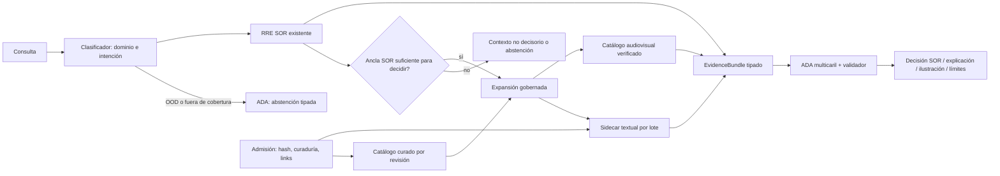

# SOR-IJF — Auditoría comparativa de planes maestros de Fase 4

**Estado:** dictamen arquitectónico independiente; no autoriza implementación, ingesta ni despliegue.  
**Fecha:** 2026-11-05.  
**Documentos comparados:**

1. `docs/plan_maestro_fase4_multifuente_ijf.md` (Antigravity).
2. `docs/plan_maestro_fase4_multifuente_ijf_codex.md` (Codex).

## 1. Resumen ejecutivo

Ambos planes aciertan en el principio rector: el SOR IJF 2026 es la fuente normativa primaria; los materiales complementarios deben mostrarse con atribución diferenciada, y el vídeo es evidencia contextual, no norma. También convergen en preservar el corpus actual y en introducir una evolución gradual de ADA.

La diferencia de seguridad determinante está en el punto de unión. El plan Antigravity propone recuperar candidatos de varias fuentes y ordenarlos con un único puntaje que incorpora pesos de *tier*. El plan Codex propone separar primero **admisibilidad/autoridad/vigencia** de **relevancia**, recuperar SOR primero y expandir a complementos solamente cuando existe una ancla normativa suficiente y una relación curada. La segunda aproximación es más segura para un asistente de decisiones: un peso no demuestra autoridad ni evita que una fuente complementaria semánticamente fuerte se presente como fundamento.

**Dictamen:** adoptar la estructura funcional, casos de prueba, trazabilidad y presentación por capas de Antigravity; adoptar de Codex los contratos de metadatos, la compuerta de ancla SOR, los índices laterales por lote, la evaluación en sombra, el manejo explícito de conflicto y la abstención por cobertura. Rediseñar el ranking global de tiers, el tratamiento prematuro de vídeos y toda afirmación de vigencia/obligatoriedad no demostrada por un expediente de curaduría.

### Convenciones

- **[Verificado]**: observado en el repositorio o en los dos planes.
- **[Recomendación]**: decisión consolidada propuesta.
- **[Pendiente]**: requiere determinación humana, jurídica/deportiva o verificación adicional.

## 2. Base factual y límites de la auditoría

| Hecho verificado | Consecuencia |
|---|---|
| El corpus operativo contiene 385 pasajes, todos `SOR-2026-08-14-ENG`. | La recuperación efectiva es monofuente; cualquier arquitectura multifuente parte de una línea base protegida. |
| RRE valida la correspondencia corpus–índices–metadatos; ADA y sus citas se orientan a pasajes/páginas SOR. | Mezclar documentos directamente en los artefactos existentes crea riesgo de romper invariantes y semánticas de cita. |
| Fase 3 tiene aceptación experimental condicionada, 22/22 en batería canónica y flags desactivados por defecto. Persisten falsos positivos OOD en generalización. | Fase 4 no puede asumir madurez productiva ni usar la ampliación documental como sustituto del trabajo OOD/cobertura. |
| El registro contiene 19 entradas y hay 18 KUN Markdown; su presencia no equivale a documento versionado, autoridad ni segmento citable. | Antes de ingerir hay que verificar artefacto, emisor, vigencia, localizador y política de uso. |
| VID-002..005 resuelven a rutas generales del portal y una referencia YouTube está eliminada/revisión manual. | No hay base verificada para prometer timestamps o clips reproducibles en el piloto. |

No se ejecutaron pruebas, ingestas ni consultas de red para esta auditoría. Las valoraciones de autoridad son arquitectónicas; no reemplazan una determinación IJF o jurídica.

## 3. Comparación estructural sección por sección

| Área | Antigravity | Codex | Evaluación consolidada |
|---|---|---|---|
| Objetivo y alcance | Define evolución RRE/ADA, fuentes complementarias y vídeo; reserva procesamiento audiovisual masivo para Fase 5. | Define capa gobernada, piloto textual y no integración masiva. | Adoptar ambos: visión funcional de Antigravity con límites y piloto de Codex. |
| Arquitectura | Cuatro capas: ingesta, índices, RRE 4.0 y ADA; propone componentes nuevos concretos. | Ancla SOR, expansor gobernado, sidecar y validador; separa admisión de consulta. | Mantener capas, pero anteponer gobierno/curaduría y evitar integrar componentes antes de contrato de evidencia. |
| Metadatos | Un esquema de chunk con tier, estado, fechas, hash y relaciones. | Entidades `Source`, revisión, unidad, dictamen de autoridad, vínculo normativo e ingesta. | El modelo Codex es más completo; conservar del esquema Antigravity localizadores y relaciones visuales. |
| Autoridad | Cinco tiers y asigna recursos concretos a algunos tiers. | Clases A/B/C/D/E/X, con B/C explícitamente pendientes de validación. | Preferir clases/estado independientes; asignaciones a recursos quedan provisionales hasta curaduría. |
| Ingesta | Pipeline técnico completo con parsers, chunker, índices y sincronización de grafo. | Gates previos, sidecar por lote, manifest y evaluación en sombra. | Adoptar gates/sidecar primero; grafo es posterior, no requisito de piloto. |
| Recuperación | Fórmula única con peso de tier, Top-1/2 SOR y complementos Top-3/5. | SOR primero; política filtra, relevancia ordena por carril; relaciones curadas. | Rechazar fórmula única y rangos Top-K rígidos; adoptar carriles tipados. |
| ADA | Divulgación progresiva: decisión, fundamento, criterio, vídeo. | `EvidenceBundle` tipado, validación de modalidad de afirmación y conflictos. | Unir presentación Antigravity con contrato/validador Codex. |
| Vídeos | Descriptor de segmentos y timestamps, además de ruta futura de Fase 5. | Cadena Video→revisión→segmento→transcripción, revisión humana y bloqueo actual. | Modelo Codex; conservar descriptor Antigravity como salida futura, no como evidencia disponible. |
| Pruebas | TC-MULTI, objetivos cuantitativos y benchmark. | matriz por metadatos, gobernanza, regresión, abstención y revisión humana. | Combinar; recalibrar números tras un piloto porque no hay evidencia que valide umbrales propuestos. |
| Hoja de ruta | 4.1 metadatos; 4.2 ingesta; 4.3 ranking; 4.4 ADA; 4.5 aceptación. | 4.0 gobernanza y luego piloto en sombra, ADA, expansión y audiovisual. | Usar la numeración solicitada 4.1–4.5, incorporando la gobernanza como condición de 4.1. |

## 4. Comparación arquitectónica crítica

### 4.1 Arquitectura multifuente y preservación del RRE

**Fortaleza Antigravity.** Identifica bien los límites funcionales —ingesta, almacenamiento, recuperación y ADA— y propone separar físicamente índices complementarios. Esto coincide con la necesidad de no alterar el corpus SOR.

**Fortaleza Codex.** Convierte ese aislamiento en una propiedad verificable: índice lateral versionado por lote, sin compartir IDs ni vectores con SOR, con rollback y evaluación en sombra.

**Debilidad Antigravity.** Llama a la fusión de *namespaces* en RRE 4.0 antes de definir el contrato de autoridad y antes de probar cobertura/OOD. La sincronización temprana de grafo amplía además la superficie de regresión.

**[Recomendación]** Un catálogo de fuentes y un sidecar textual por lote preceden cualquier adaptador RRE. La integración de grafo se limita inicialmente a enlaces declarativos fuera del grafo SOR existente.

### 4.2 Autoridad, vigencia, elegibilidad y relevancia

Antigravity reconoce la jerarquía y la no obligatoriedad automática, pero a la vez asigna `NEW-001/003` a «enmiendas y circulares» con función potencialmente vinculante y asocia vídeos con interpretación operativa. Eso es una clasificación de fondo que el plan no demuestra mediante expediente de emisor, fecha efectiva y relación exacta con SOR.

Codex separa estas dimensiones: la clase de autoridad, la vigencia/supersesión, la elegibilidad de recuperación/cita y la relevancia. Esta separación debe adoptarse. Una fuente puede ser oficial, pertinente y visualmente útil, y aun así no ser elegible para fundamentar una sanción.

**[Recomendación]** Ningún campo de ranking sustituye las condiciones de política:

```text
elegible_para_decisión := clase A vigente y localizador verificable
elegible_como_complemento := revisión aprobada y enlace curado a ancla SOR
orden_en_carril := relevancia semántica/léxica
```

### 4.3 Ingesta, normalización, metadatos y versionado

Antigravity aporta parsers, hashes, chunking y metadatos de página/timestamp. Codex agrega identidad de revisión, procedencia de la ingesta, razón de autoridad, aprobación, estado de transcripción y política de cita. La consolidación debe usar ambos, añadiendo una regla: ninguna unidad se indexa si no tiene artefacto verificable y localizador reproducible.

**[Recomendación]** Una URL de portal es una referencia de descubrimiento, no una unidad probatoria. `reference_registry.json` puede alimentar el inventario, pero no es por sí mismo el catálogo curado de evidencia.

### 4.4 Recuperación híbrida

La fórmula de Antigravity

$$S = \alpha L + \beta D + \gamma W_{tier} + \delta P_{normative}$$

es adecuada, potencialmente, para ordenar candidatos homogéneos dentro de un carril. Es insegura como mecanismo de precedencia entre fuentes: los pesos y los hiperparámetros no establecen competencia normativa; tampoco resuelven conflicto, vigencia o falta de cobertura. La regla Top-1/2 SOR también falla si no existe un SOR pertinente: no debe forzar un pasaje SOR remoto para acompañar una fuente complementaria.

**[Recomendación]** Recuperación en dos pasos: (1) RRE SOR y decisión de suficiencia; (2) expansión solo sobre vínculos curados hacia fuentes complementarias. Cuando no haya ancla suficiente, ADA abstiene de decisión y puede, si procede, describir el material no decisorio rotulado.

### 4.5 ADA, citas y seguridad normativa

Ambos planes comparten una salida por capas. Codex añade una salvaguarda esencial: cada afirmación deóntica o decisoria debe respaldarse en A; las demás fuentes llevan etiqueta y no pueden elevarse a regla. Antigravity aporta formato comprensible para el árbitro y prueba de precedencia SOR vs. material contradictorio.

**[Recomendación]** ADA consume un `EvidenceBundle` tipado y emite cinco secciones: decisión/abstención, fundamento SOR, explicación oficial, evidencia contextual y límites/conflictos. La cita debe resolver a `source_revision + locator`, no solo a un código del registro.

### 4.6 Vídeo, evidencia audiovisual, abstención y OOD

Los planes coinciden correctamente en la subordinación del vídeo. Antigravity avanza demasiado al usar casos que esperan timestamps exactos y «rulings» de vídeo, pese a que el registro actual no acredita clips profundos verificables. Codex lo identifica y exige segmentación, transcripción, revisión humana y URI estable.

La ampliación multifuente amplifica el riesgo OOD de Fase 3. La propuesta Codex de distinguir `OUT_OF_DOMAIN` de `OUT_OF_SCOPE_OR_UNSUPPORTED` complementa el backlog de Antigravity sobre OOD y es necesaria: una consulta puede ser judo, pero no estar cubierta por el SOR ni los complementos aprobados.

## 5. Matriz de decisiones consolidadas

| Decisión | Antigravity | Codex | Evaluación crítica | Recomendación consolidada | Riesgo si se adopta incorrectamente |
|---|---|---|---|---|---|
| Base normativa | SOR Tier 1 y Top-1/2 obligatorio. | Ancla SOR obligatoria para decisión. | Coinciden, pero Top-K fijo puede inducir cita irrelevante. | Ancla SOR suficiente, no cuota Top-K. | Decisión aparentemente fundada en SOR no pertinente. |
| Clasificación complementos | T2/T3 asignados a `NEW-*`, PPT y algunos VID. | B/C requieren dictamen; D para audiovisual. | La asignación anticipada es supuesto no probado. | Curaduría por revisión y artefacto; estado provisional por defecto. | Otorgar obligatoriedad inexistente. |
| Índices | namespaces/particiones y posterior fusión. | sidecar por lote sin tocar SOR. | La primera es compatible solo tras gobierno. | Sidecar con manifest/rollback; fusión lógica posterior. | Romper integridad o degradar RRE. |
| Ranking | score único con peso de tier. | política de elegibilidad antes de relevancia. | No se puede aritméticamente derivar autoridad. | Filtros de política + ranking intrarril; no score global de autoridad. | Complemento desplaza o contradice SOR. |
| Relaciones | grafo Artículos–vídeos–seminarios. | `NormativeLink` curado con tipo/confianza/aprobación. | El grafo temprano aumenta complejidad y puede cristalizar inferencias. | Enlaces curados versionados; grafo solo tras validar piloto. | Enlaces falsos se propagan a recuperación. |
| Metadatos | chunk con tier, fecha, hash y relaciones. | entidades/revisiones/aprobaciones/citación. | El segundo cubre auditoría y versionado mejor. | Unión de ambos, obligatoria por revisión y localizador. | Imposible reproducir o auditar una respuesta. |
| Ingesta | pipeline técnico multiformato. | gates y evaluación en sombra. | Falta de gates permite basura «oficial» indexada. | Curaduría antes de indexar; piloto textual mínimo. | Incremento de ruido, OOD y sesgos. |
| ADA | respuesta por capas. | bundle tipado y validador modal. | Ambos necesarios. | Capas visibles + validador de tipos/citas. | Explicación se presenta como regla. |
| Citas | existencia/estado en `ReferenceChecker`. | revisión + localizador + política de cita. | Existir en registro no basta. | Cita a revisión/localizador, verificación de disponibilidad adicional. | URL general, rota o anacrónica como evidencia. |
| Vídeos | descriptores de segmento, posibles tests de timestamp. | bloquea uso hasta evidencia segmentada/revisada. | La evidencia actual no satisface el primer diseño. | Preparación de catálogo, no recuperación decisoria en 4.1–4.4. | Timestamp o dictamen visual alucinado. |
| OOD/cobertura | mantiene OOD y vincula backlog BK-01/BK-02. | puerta de cobertura y abstención diferenciada. | La expansión exige ambas defensas. | Resolver/cuantificar BK-01 y BK-02 antes de habilitar complementos. | Falsos positivos y respuestas inventadas. |
| Umbrales/SLAs | ≥90% multi, +60 ms. | pide definir métricas tras piloto. | Las cifras no tienen línea base multifuente. | Establecer números tras 4.2, antes de habilitar 4.3. | Objetivos arbitrarios o aceptación prematura. |

## 6. Problemas, contradicciones y supuestos no demostrados

### Contradicciones o tensiones

1. Antigravity afirma no presumir obligatoriedad, pero presenta T2 como capaz de «modificaciones vigentes o aclaraciones vinculantes» para recursos concretos sin prueba incorporada de esa competencia o vigencia.
2. Antigravity clasifica vídeos como T3 en una tabla y como Tier 5 en pruebas; esa inconsistencia puede cambiar su permiso de recuperación y presentación.
3. La opción de responder taxativamente desde un seminario cuando no hay SOR contradice el principio consolidado de que la decisión normativa debe tener fundamento SOR. Debe degradarse a explicación no decisoria o requerir decisión humana explícita que autorice excepción.
4. El propio repositorio registra los vídeos relevantes como rutas generales; los tests de timestamp exacto asumen evidencia que no está demostrada.
5. Ambos planes usan nombres/rutas de futuros componentes como si fueran decisión de implementación. Son útiles como orientación, pero no deben convertirse en compromiso antes del contrato de Fase 4.1.

### Omisiones y complejidad innecesaria

- Falta una autoridad/rol explícito que apruebe `AuthorityAssessment`, conflictos y cambios de vigencia; la política existente de Data Steward/PO es punto de partida, no un flujo completo de aprobación jurídica/deportiva.
- Falta política de internacionalización: texto original, traducción derivada, idioma de recuperación y qué cita se muestra.
- Falta definir retención, licencias, custodia de copias, privacidad y tratamiento de derechos de vídeo.
- Una sincronización inmediata al knowledge graph y un `video_grounding_engine` añaden componentes antes de demostrar valor en un piloto textual. Deben diferirse.
- No hay protocolo de revisión de conflictos ni de retirada de una revisión aprobada.
- Los criterios porcentuales no especifican conjunto de evaluación, intervalo de confianza, severidad de errores ni revisión humana.

### Dependencias técnicas

- Contrato de metadatos y catálogo versionado.
- Artefacto concreto y localizadores verificables para el piloto.
- Adaptador no invasivo entre RRE actual y `EvidenceBundle`.
- Batería ampliada OOD/cobertura y baseline reproducible.
- Capacidades de validación de citas por revisión/localizador, no solo URL.

## 7. Arquitectura consolidada recomendada



### Reglas invariantes

1. SOR vigente es el único carril que puede fundamentar mandatos, sanciones, puntuaciones, obligaciones o prohibiciones.
2. Autoridad, vigencia, elegibilidad, relación SOR y relevancia son campos independientes; el último nunca promueve los anteriores.
3. Toda expansión complementaria requiere una ancla SOR suficiente y un vínculo curado, salvo respuesta explícitamente histórica/contextual rotulada como no decisoria.
4. Complementos se indexan en sidecars versionados, con manifest y rollback; no se reescriben los corpus, índices o grafos SOR.
5. El vídeo no es recuperable para decisión hasta que haya activo, revisión, segmento, transcripción revisada, localizador reproducible y vínculo SOR aprobado.
6. Las respuestas en sombra pueden utilizar complementos para medición, pero no cambian la respuesta visible hasta autorización de la etapa siguiente.

## 8. Roadmap consolidado

### Fase 4.1 — Gobierno, inventario y contrato de evidencia

| Elemento | Definición |
|---|---|
| Objetivo | Congelar la semántica de autoridad y la línea base sin ingerir. |
| Alcance | Taxonomía A/B/C/D/E/X, ciclo de revisión, esquema de `SourceRevision`/`EvidenceUnit`, inventario de candidatos y baseline RRE/ADA/OOD. |
| Entregables | Especificación de metadatos, matriz de responsabilidades, política de conflicto/vigencia/cita, manifiesto de baseline y conjunto de evaluación inicial. |
| Dependencias | Responsable de conocimiento y decisión sobre quién aprueba clases B/C. |
| Aceptación | Ningún candidato piloto queda sin artefacto, estado, localizador, clase provisional y decisión de elegibilidad. |
| Riesgos | Clasificar por intuición o confundir publicación con autoridad. |
| No hacer todavía | No indexar, no modificar `reference_registry.json`, no construir RRE 4.0 ni actualizar ADA. |

### Fase 4.2 — Piloto textual aislado y evaluación en sombra

| Elemento | Definición |
|---|---|
| Objetivo | Probar admisión y recuperación complementaria con un documento textual, limitado y revisado. |
| Alcance | Sidecar temporal/versionado, manifest, segmentación reproducible, enlaces SOR curados y ejecución paralela al baseline. |
| Entregables | Lote piloto, informe de precisión/cobertura/latencia/OOD, registro de conflictos y decisión de continuar o retirar. |
| Dependencias | Aprobación 4.1; selección de artefacto concreto. |
| Aceptación | Sin regresión de TC-01..22 bajo modo SOR; cero elevaciones de autoridad en muestras; resultados OOD/cobertura revisados por humano. |
| Riesgos | Ruido textual, deduplicación deficiente y falsa relación SOR. |
| No hacer todavía | No habilitar resultados de sidecar al usuario, no integrar grafo y no ingerir vídeo. |

### Fase 4.3 — Recuperación gobernada y abstención de cobertura

| Elemento | Definición |
|---|---|
| Objetivo | Implementar el contrato lógico de carriles sin fusionar autoridad y relevancia. |
| Alcance | Adaptador SOR-first, `EvidenceBundle`, filtro de elegibilidad, relación curada, `OUT_OF_SCOPE_OR_UNSUPPORTED` y pruebas de conflicto. |
| Entregables | Especificación/implementación aprobada del adaptador, pruebas diferenciales y métricas/umbrales ratificados. |
| Dependencias | Piloto 4.2 aceptado y backlog OOD/cobertura con criterios definidos. |
| Aceptación | Ninguna consulta decisoria sin ancla SOR; casos de tenis/natación/patrocinador no empeoran; complementos no aparecen sin política válida. |
| Riesgos | Forzar SOR irrelevante o ocultar incertidumbre. |
| No hacer todavía | No puntuación global por tier, no promoción productiva, no vídeo decisorio. |

### Fase 4.4 — ADA multicaril, citas y habilitación limitada

| Elemento | Definición |
|---|---|
| Objetivo | Presentar evidencia tipada de modo entendible y auditable. |
| Alcance | Plantilla de capas, validador por tipo de afirmación, citación `revisión + localizador`, interfaz de conflicto y activación controlada de un lote textual aprobado. |
| Entregables | Contrato ADA, batería de citas/modalidad, manual de presentación y reporte de prueba funcional humana. |
| Dependencias | 4.3 aprobado; presupuesto/SLAs definidos. |
| Aceptación | 100% de afirmaciones decisorias muestreadas con SOR; cero citas a artefacto no recuperado; etiquetas visibles de complemento/contexto. |
| Riesgos | Confusión visual entre regla y explicación. |
| No hacer todavía | No expansión masiva, no inferencia de timestamps, no reproductor o análisis visual automático. |

### Fase 4.5 — Expansión controlada y preparación audiovisual

| Elemento | Definición |
|---|---|
| Objetivo | Repetir admisión por lote y preparar, sin usar decisoriamente, el catálogo audiovisual. |
| Alcance | Nuevos lotes textuales aprobados; modelo de vídeo/revisión/segmento/transcripción; verificación de disponibilidad y flujo de revisión humana. |
| Entregables | Paquete de aceptación por lote, catálogo audiovisual con estados y propuesta separada de habilitación multimedia. |
| Dependencias | 4.4 estable; artefactos audiovisuales y derechos/localizadores confirmados. |
| Aceptación | Cada lote conserva no regresión; ningún vídeo se hace elegible sin todos los gates; decisión humana explícita para cualquier futura activación. |
| Riesgos | Escalada de corpus y costes, enlaces inestables, ASR erróneo. |
| No hacer todavía | No usar vídeo como evidencia normativa, no despliegue automático ni procesamiento masivo de vídeo. |

## 9. Dictamen

### Adoptar de Antigravity

- La separación por capas funcionales y el principio de subordinación audiovisual.
- El aislamiento físico de índices complementarios, el esquema de casos multifuente y los controles de latencia como categorías de prueba.
- La presentación ADA progresiva y el caso de prueba explícito de conflicto SOR–interpretación.
- La conexión explícita con los pendientes OOD, cobertura y trazabilidad del backlog RRE 3.0.

### Adoptar de Codex

- La ancla SOR obligatoria para cualquier conclusión decisoria.
- La separación formal de autoridad, vigencia, elegibilidad y relevancia; y la prohibición de representarlas como un único score.
- El modelo de revisión, proveniencia, lote, manifiesto y sidecar aislado.
- La evaluación en sombra, los enlaces SOR curados, el `EvidenceBundle` tipado y la validación de afirmaciones modales.
- La abstención diferenciada por fuera de dominio y por falta de cobertura; y el bloqueo de vídeos hasta segmentación verificable.

### Descartar o rediseñar

- **Descartar como política de precedencia** el peso único de tier y la cuota rígida Top-1/Top-2 SOR. Pueden reutilizarse como señales intrarril solo después de validación.
- **Rediseñar** la asignación anticipada de `NEW-*`, `PPT-*` y `VID-*` a categorías de autoridad; debe depender de expedientes de revisión por versión.
- **Diferir** integración de grafo, motor audiovisual, timestamps esperados y reproducción visual hasta contar con artefactos y segmentos verificables.
- **Rediseñar** las métricas numéricas de aceptación a partir del baseline/piloto, no de objetivos arbitrarios.

### Arquitectura recomendada y condición de autorización

La arquitectura recomendada es **SOR-first, sidecar por lote, expansión multifuente gobernada y ADA por carriles**, con evaluación en sombra antes de afectar cualquier respuesta visible. La autoridad es una regla de admisión y presentación; la relevancia es un mecanismo de ordenamiento posterior.

**Recomendación sobre autorización de Fase 4.1:** autorizar únicamente Fase 4.1 de diseño/gobierno/inventario si un responsable humano ratifica la matriz de autoridad provisional, los responsables de curaduría y la prohibición de ingesta/alteración de corpus durante la fase. No autorizar 4.2 ni ninguna modificación técnica hasta que 4.1 entregue un documento candidato concreto, verificable y aprobado para piloto.

