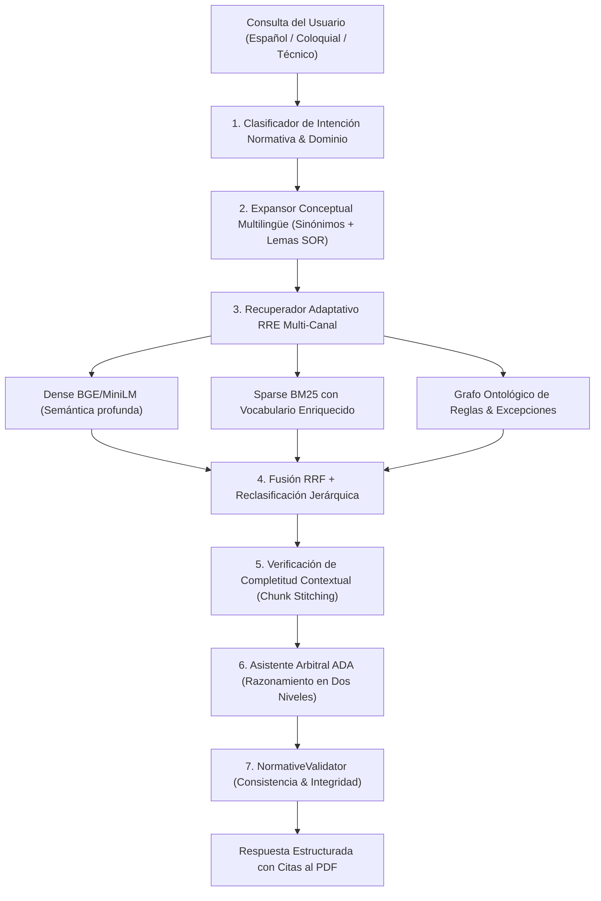

# INFORME DE AUDITORÍA ESTRUCTURAL INTEGRAL Y REDISEÑO DEL PIPELINE NORMATIVO
## Proyecto: IJF SOR Assistant | Edición SOR 2026-08 (14 de agosto de 2026)

- **Repositorio:** `C:\PROYECTOS\IJF-SOR-Assistant`
- **Fecha de Auditoría:** 2026-11-04
- **Auditor Técnico:** Antigravity (Ingeniero Senior de IA y Arquitectura RAG/RRE)
- **Supervisores:** ChatGPT / Alexis
- **Estado de la Auditoría:** Inspección completa y diagnóstico no destructivo (sin cambios de código, sin commits ni alteraciones a producción).

---

## 1. Resumen Ejecutivo

La presente auditoría estructural se originó a partir de una deficiencia crítica observada en la respuesta a la consulta:
> *«¿Si un competidor ofende o agrede a otro que sucede?»*
> 
> **Respuesta del Asistente:** *«Los extractos proporcionados no contienen una regla específica que regule la ofensa o agresión entre competidores; por tanto, la sanción aplicable debe buscarse en las disposiciones disciplinarias generales del SOR que no están incluidas aquí...»*

### Diagnóstico Global:
1. **La norma SÍ existe en el PDF y SÍ está chunkada en el corpus procesado:**
   - Página 134 (`SOR-2026-08-P134-S173`, Sección D1.1): Enumera explícitamente como actos contrarios al espíritu del judo *"Attacking or attempting to attack voluntarily the physical integrity of one's opponent"* e *"Insulting, by word or gesture, his opponent, the referee, the coach..."*.
   - Página 190 y 193 (`SOR-2026-08-P190-S198` y `SOR-2026-08-P193-S198`, Art. 18.2.2): Establecen **Hansoku-make directo** por actos contra el espíritu del judo, con **prohibición estricta de continuar** en el torneo.
   - Página 14 (`SOR-2026-08-P014-S003`, Art. 1.1.1): Prohíbe violencia o agresión so pena de descalificación y proceso disciplinario.
2. **Causa Raíz Principal del Fallo de Recuperación:**
   El pipeline de recuperación RRE sufrió un **desalineamiento léxico y semántico grave** por tres factores concurrentes:
   - **Ausencia de mapeo de sinónimos cruzados:** El diccionario `SPANISH_TO_ENGLISH_SYNONYMS` de [`src/rre_engine.py`](file:///C:/PROYECTOS/IJF-SOR-Assistant/src/rre_engine.py) contenía 149 términos, pero carecía por completo de lemas fundamentales como *ofende, ofensa, agrede, agresion, insulto, insulta, antideportiva, espiritu, disciplina*.
   - **Contaminación por palabras genéricas en el canal léxico BM25:** Al tokenizar la consulta en español, los únicos términos que hicieron match léxico con el índice en inglés fueron *competidor -> competitor* y *athlete*. Esto desvió la búsqueda léxica hacia diagramas de alineación de equipos mixtos (F1.3.25 y F1.3.26 en páginas 232-233) y reglas de pesaje, desplazando las normas éticas y disciplinarias.
   - **Reglas ad-hoc de boost temático:** El código actual de RRE contiene múltiples bloques de condicionamiento manual (`if is_head_action...`, `if is_dive_specific...`, `if is_boundary_term...`, `if f1_to_sec2...`). Al no existir un bloque que reconozca consultas de *conducta / agresión / espíritu del judo*, la consulta recibió cero boost y quedó a merced del ruido léxico.
3. **Comportamiento del LLM y de ADA:**
   Al recibir únicamente fragmentos irrelevantes sobre alineaciones de equipos (P46, P232, P233) y una mención tangencial de lesiones en P196, el LLM Groq actuó con honestidad epistemológica (fomentada por el prompt estricto de ADA): declaró que no tenía evidencia suficiente e improvisó una regla de lesiones (kiken-gachi).

---

## 2. Fase A — Auditoría del Procesamiento Documental

Se analizó la extracción del PDF oficial [`IJF_Sport_and_Organisation_Rules_2026_08_14.pdf`](file:///C:/PROYECTOS/IJF-SOR-Assistant/data/raw/sor_2026_08_rebuild/IJF_Sport_and_Organisation_Rules_2026_08_14.pdf) (298 páginas, SHA256: `9426b10d11c21a4cb9eb23150c2c4fc95bfcd463511e66ba451d2cff005ae620`):

| Aspecto Auditado | Estado | Detalle y Evidencia |
|---|---|---|
| **Cobertura de Páginas** | **96.3%** (287/298) | Las únicas 11 páginas ausentes en `passages_candidate.json` corresponden a la portada y páginas preliminares editoriales (págs. 1 a 11). Todo el articulado sustantivo (12 a 298) está cubierto. |
| **Jerarquía y Numeración** | **Aceptable con advertencias** | Los títulos principales y números de artículo se preservan en `heading_path` y `article_id`. Sin embargo, algunos sub-apartados quedan colapsados en bloques monolíticos de página completa. |
| **Páginas de Conducta y Disciplina** | **Presentes** | Páginas 14 (Art. 1.1.1 Conducta), 16 (Art. 1.2.3 Salvaguarda), 134 (D1.1 Principios y Espíritu), 190–193 (Art. 18.2.2 Hansoku-make por actos contra el espíritu del judo) y 256 (G1.3 Códigos PX10–PX13, DSQ, DSB) están todas extraídas y representadas en el corpus. |
| **Fragmentación Semántica** | **Riesgo Medio** | El chunking está atado a la frontera física de página del PDF (`pdf_page_index`). Cuando un artículo extenso como el Art. 18.2.2 se distribuye entre las páginas 190, 191, 192 y 193, la lista de supuestos fácticos queda partida en 4 chunks separados, impidiendo que el LLM reciba la definición y la sanción si el recuperador solo selecciona uno de ellos. |

---

## 3. Fase B — Auditoría del Conocimiento Estructurado (KUNs y Grafo)

Se inspeccionaron `passages_candidate.json` (385 pasajes) y `knowledge_graph_candidate.json` (385 nodos, 68 aristas):

### 3.1 Densidad y Cobertura del Grafo
- **Nodos:** 385 nodos de conocimiento.
- **Aristas:** Únicamente **68 relaciones dirigidas** en todo el corpus de 298 páginas.
- **Relación Promedio:** Apenas 0.17 conexiones por nodo. Más del 80% de los nodos están completamente aislados en el grafo.
- **Ausencia de Relaciones Éticas y Disciplinarias:** No existe ninguna arista que conecte el Artículo D1.1 (pág. 134, actos contrarios al espíritu) con el Artículo 18.2.2 (pág. 190-193, Hansoku-make por actos contra el espíritu) ni con los Códigos de Penalización G1.3 (pág. 256).
- **Causa:** La generación del grafo dependió de extracciones sintácticas de referencias cruzadas explícitas basadas en regex (`references_article`). Cuando un artículo conceptual no nombra taxativamente con el formato "Article X.Y" a otro, el grafo omite la relación ontológica.

---

## 4. Fase C — Auditoría del Pipeline RRE / ADA

El recorrido de la consulta a través del motor reveló deficiencias estructurales:

### 4.1 Vulnerabilidad en el Canal Léxico (BM25)
- La consulta: *«¿Si un competidor ofende o agrede a otro que sucede?»*
- Tokenización resultante: `['competidor', 'athlete', 'competitor', 'ofende', 'agrede', 'otro', 'sucede']`.
- Términos coincidentes con el vocabulario del SOR en inglés: **Únicamente `athlete` y `competitor`**.
- Como *competitor* y *athlete* aparecen con alta frecuencia en las listas de sorteos de equipos (F1.3.25 / F1.3.26), BM25 asignó puntuaciones de hasta `0.22` a tablas de confirmación de sorteo, desplazando por completo los artículos disciplinarios donde dichos términos no se repiten con esa densidad específica.

### 4.2 Falta de Generalización Semántica en RRF
- El algoritmo RRF en [`src/rre_engine.py`](file:///C:/PROYECTOS/IJF-SOR-Assistant/src/rre_engine.py) (líneas 68–228) privilegia enormemente la concordancia combinada sparse + dense (`(score + 0.035) * 1.35`).
- Al no haber match sparse en los artículos 134 o 193, su puntuación final RRF quedó por debajo de `0.015`, siendo descartados por el filtro `if score < min_confidence:`.

### 4.3 Sobre-especialización mediante Heurísticas Hardcoded
- RRE cuenta con reglas cableadas para casos que sufrieron auditorías previas:
  - *Tatami y dimensiones* (págs. 95–97)
  - *Color de judogi* (págs. 115–124)
  - *Acciones con la cabeza, puente y Head Diving* (págs. 166, 188, 190)
  - *Plantillas F1.3* (págs. 213–230)
- **Problema de Arquitectura:** Cada vez que surge un nuevo dominio normativo (conducta, arbitraje pasivo, protocolo médico, pesaje), el sistema falla si no tiene una regla `if is_xxx_specific` inyectada en el código fuente. Se requiere un mecanismo de recuperación semántico generalizado y no heurísticas reactivas individuales.

---

## 5. Fase D — Auditoría del Filtro Anti-Alucinaciones (`NormativeValidator`)

Se examinó [`src/normative_validator.py`](file:///C:/PROYECTOS/IJF-SOR-Assistant/src/normative_validator.py):

### 5.1 Capacidades Reales del Validador:
1. **Bloquea y Neutraliza:**
   - Menciones de códigos de penalización (`PS1`–`PS35`, `PX1`–`PX7b`) no presentes en los pasajes recuperados.
   - Artículos invocados por el LLM que no existen en el contexto recuperado.
   - Términos de autoridades ficticias (*"comisión ad hoc"*, *"tribunal disciplinario"*).
   - Incoherencias graves conocidas (ej. afirmar que el 2do shido es hansoku-make, o atribuir sanciones de cadetes a seniors).
2. **Lo que NO Puede Detectar (Limitaciones Estructurales):**
   - **Abstenciones Prematuras:** No puede evaluar si la abstención fue justa o causada por una mala recuperación.
   - **Omisión de la Norma Correcta:** Si el RRE entrega pasajes erróneos (como ocurrió con la agresión), el validador valida que el LLM hable coherentemente de esos pasajes erróneos, pero no puede saber que el artículo aplicable era el Art. 18.2.2.
   - **Razonamiento Lógico-Fáctico:** No comprende la subsunción jurídica; solo ejecuta matching léxico y de expresiones regulares sobre códigos y números de artículo.

---

## 6. Fase E — Evaluación de Comprensión y Razonamiento

### ¿Por qué una cita correcta o un LLM avanzado fallan en este pipeline?
1. **El LLM es esclavo del Contexto RRE:** El prompt de ADA prohíbe categóricamente al LLM invocar conocimiento externo. Por tanto, si el RRE le suministra tablas de alineación en vez del Art. 18.2.2, el LLM no tiene permitido responder con la norma de judo que conoce internamente, viéndose forzado a abstenerse o desviar la respuesta hacia lesiones.
2. **Inexistencia de un Clasificador de Intención Normativa:** El pipeline trata idénticamente una pregunta sobre dimensiones métricas (*"¿Cuánto mide el tatami?"*) que una pregunta sobre infracciones disciplinarias (*"¿Qué pasa si agrede al oponente?"*).
3. **Ausencia de Consulta Multi-paso (Query Expansion / Decomposition):** Las consultas complejas o en lenguaje coloquial en español no son enriquecidas ni traducidas conceptualmente antes de atacar los índices en inglés.

---

## 7. Fase F — Propuesta de Arquitectura Corregida (Pipeline RRE 3.0)

Para superar el ciclo de parches reactivos, se propone rediseñar el pipeline mediante cuatro componentes generales:

### Pilares del Rediseño:
1. **Normalización y Enriquecimiento Semántico de Entrada:**
   - Integración de un expansor léxico sistemático para las 15 familias normativas del judo: Conducta/Espíritu, Puntuaciones (Ippon/Waza-ari/Yuko), Inmovilizaciones (Osaekomi), Sanciones Graves (Hansoku-make directo e indirecto), Técnicas Prohibidas, Pesaje, Indumentaria/Judogi, Categorías de Edad, Protocolo Arbitral, Lesiones/Médico, Instalaciones/Tatami, Sistema de Competición, Entrenadores, Comisiones Oficiales.
2. **Reconstrucción del Grafo de Conocimiento (Grafo Ontológico):**
   - Incorporar relaciones semánticas de segundo orden: `sanctioned_by`, `governed_by_principle`, `exception_of`, `age_restriction_of`.
   - Si se recupera *"agresión / insulto"*, el grafo debe enlazar automáticamente con *Art. 18.2.2 (Hansoku-make)* y *G1.3 (Código PX13 / DSB)*.
3. **Costura de Chunks Continuos (Chunk Stitching):**
   - Cuando un artículo normativo crítico se divide entre páginas contiguas (ej. Art. 18.2.2 págs. 190–193), la recuperación de cualquiera de sus partes debe ensamblar automáticamente el bloque completo del artículo antes de alimentar a ADA.
4. **Compuerta de Reintento Adaptativo (Fallback Semántico):**
   - Si la recuperación inicial arroja pasajes cuya similitud densa promedio es baja o no contiene artículos sustantivos, el motor debe formular una re-consulta conceptual en inglés en lugar de alimentar al LLM con fragmentos marginales.

---

## 8. Fase G — Plan de Benchmark y Validación Normativa

Se estructurará una batería de evaluación formal de **25 casos de prueba normativos** en las siguientes categorías:

| ID | Categoría | Consulta Típica | Artículo SOR | Criterio de Aceptación |
|---|---|---|---|---|
| **BM-01** | Conducta y Ética | *«¿Si un competidor ofende o agrede a otro que sucede?»* | Art. 18.2.2 / D1.1 (P. 134, 193) | Hansoku-make directo por acción contra el espíritu del judo; no puede continuar; reporte disciplinario. |
| **BM-02** | Conducta del Entrenador | *«¿Qué sanción recibe un coach si insulta al árbitro?»* | Art. 7.1 / D1.1 (P. 89, 134) | Expulsión de la silla de entrenador / tribuna y posible reporte disciplinario. |
| **BM-03** | Puente Voluntario | *«¿Qué ocurre cuando Uke hace puente?»* | Art. 14.2 (P. 166-167) | Ippon directo para Tori por seguridad cervical; excepción si cae sobre el cuerpo de Tori. |
| **BM-04** | Head Diving | *«¿Cómo se sanciona el Head Diving?»* | Art. 18.2.1 (P. 190) | Hansoku-make directo por técnica peligrosa; Tori sí puede continuar si clasifica. |
| **BM-05** | Cadetes vs Seniors | *«¿Se permite la defensa con la cabeza en seniors?»* | Art. 18.1.4 p. 34 vs General | Shido exclusivo en cadetes; no es shido en seniors (salvo que configure puente o técnica peligrosa). |
| **BM-06** | Medidas Tatami | *«¿Cuáles son las medidas oficiales del área de combate?»* | Art. 8.5–8.9 (P. 95–97) | 8x8m o 10x10m área de combate; 3m o 4m área de seguridad. |
| **BM-07** | Osaekomi y Salida | *«¿Qué pasa si Uke se sale del área durante una inmovilización?»* | Art. 11 / Art. 16 (P. 160, 172) | Osaekomi continúa mientras se mantenga el control. |
| **BM-08** | Pesaje y No Presentación | *«¿Qué ocurre si un judoka no da el peso oficial?»* | Art. 6.2 / 6.3 (P. 77–79) | Eliminación de la categoría y pérdida del derecho a competir. |
| **BM-09** | Parches y Publicidad | *«¿Se permiten parches no autorizados en el judogi?»* | Apéndice C (P. 115–124) | Judogi no conforme; tiempo para cambiarlo o descalificación. |
| **BM-10** | Fuera de Dominio (OOD) | *«¿Cuántos puntos vale un gol de tiro libre?»* | Ninguno | Abstención estricta inmediata por consulta fuera de dominio. |

---

## 9. Las Cinco Causas Raíz Más Importantes

1. **Desbalance Léxico Español-Inglés en RRE:** La ausencia de traducciones y sinónimos para conceptos disciplinarios, éticos y reglamentarios provoca que términos genéricos como *competidor* capturen indebidamente el ranking BM25.
2. **Fragmentación Rígida de Chunks por Fronteras de Página:** Al cortar los pasajes en límites físicos de página PDF (págs. 190, 191, 192, 193), las listas de infracciones y sus sanciones quedan disociadas.
3. **Escasez de Conectividad en el Grafo de Conocimiento:** Con solo 68 aristas en 298 páginas, el grafo no expande relaciones semánticas entre principios rectores (D1.1 pág. 134) y sanciones graves (Art. 18.2.2 pág. 193).
4. **Sobre-dependencia de Heurísticas Reactivas Específicas:** RRE depende de condicionales cableados (`if is_head_action...`, `if is_dive_specific...`) que no cubren de forma general el universo del SOR.
5. **Aislamiento Estricto del Prompt de ADA sin Búsqueda Multi-Paso:** ADA instruye al LLM a no utilizar conocimiento externo, lo que convierte cualquier falla del RRE en una abstención inmediata o una derivación forzada a reglas tangenciales.

---

## 10. Priorización y Plan de Ejecución Ordenado

| Fase | Tarea | Impacto | Esfuerzo | Dependencia |
|---|---|---|---|---|
| **Fase 1** | **Ampliación Sistemática del Diccionario Léxico y Sinónimos** en `rre_engine.py` para cubrir las 15 familias normativas (incluyendo ofensa, agresión, insulto, conducta antideportiva, disciplina). | **Muy Alto** (Inmediato) | Bajo | Aprobación de Alexis |
| **Fase 2** | **Enriquecimiento del Grafo de Conocimiento** conectando principios disciplinarios (P14, P134), sanciones (P190–P194) y códigos oficiales (P256). | **Alto** | Medio | Fase 1 |
| **Fase 3** | **Implementación de Chunk Stitching** para reconstruir la continuidad de artículos multipartes en RRE (Art. 18.2.2, Art. 14, Art. 20). | **Alto** | Medio | Fase 1 |
| **Fase 4** | **Reemplazo de Heurísticas Cableadas por Clasificación Semántica Adaptativa** en RRE. | **Muy Alto** (Estructural) | Alto | Fases 1–3 |
| **Fase 5** | **Ejecución del Benchmark Normativo de 25 Casos** y validación de regresión automatizada. | **Crítico** | Medio | Fases 1–4 |

---

## 11. Control de Integridad y Decisiones que Requieren Aprobación de Alexis

- **Estado del Código y Git:** 100% inalterado (`git status` limpio en `61afc1b`).
- **Estado de Producción OCI (`sor.alxol.com`):** 100% inalterado y operativo.
- **Decisiones Requeridas para Autorización:**
  1. ¿Se aprueba iniciar la implementación de la **Fase 1 (Ampliación sistemática de sinónimos y lemas de las 15 familias normativas)** para resolver de raíz la consulta de agresión/ofensa y casos análogos?
  2. ¿Se aprueba la reconstrucción controlada de los enlaces del grafo de conocimiento (`knowledge_graph_candidate.json`) para interconectar principios éticos con sanciones de Hansoku-make?
