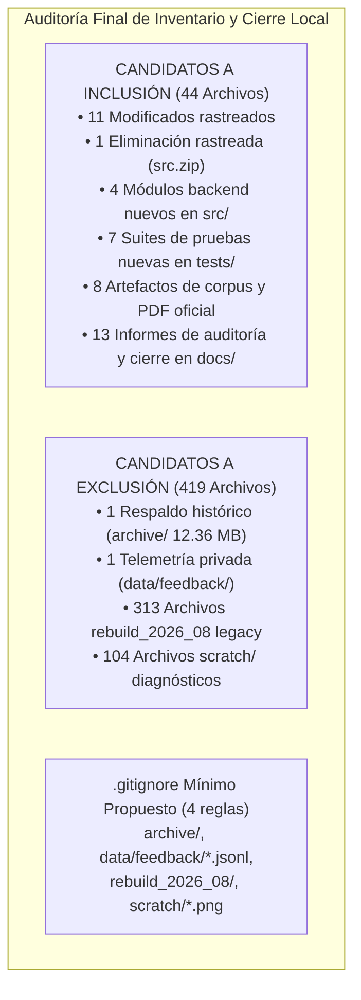

# AUDITORÍA FINAL DE INVENTARIO Y CIERRE LOCAL — IJF SOR ASSISTANT 2026
## PROPUESTA DEFINITIVA DE CONSOLIDACIÓN DE COMMITS, EXCLUSIONES Y POLÍTICA DE GOBERNANZA

**Fecha de Elaboración:** 19 de octubre de 2026, 18:48 COT  
**Entorno Operativo:** Windows Local / Python 3.12.10 (AMD64) / PowerShell (pwsh)  
**Ruta del Repositorio:** `C:\PROYECTOS\IJF-SOR-Assistant`  
**Rama Activa:** `review/ijf-sor-2026-08-rre-ada`  
**HEAD de Referencia:** `6a4b08de0a9821f4ff83291f111bfdbf78edfa6c`  
**Rol:** Ejecutor Técnico y Auditor Local (sin delegación ni presuposición de aprobaciones)  
**Directiva de Ejecución:** **Exclusivamente auditoría y preparación documental. Cero operaciones de staging (`git add`/`git rm`), commits, push, merges, alteraciones a `.gitignore`, o modificaciones de código y corpus.**

---

## 1. Resumen Ejecutivo y Dictamen de Cierre

### DICTAMEN TÉCNICO: **APTO PARA REVISIÓN DE STAGING**

El estado local del proyecto **IJF SOR Assistant 2026** ha sido rigurosamente inspeccionado, contrastado con todas las auditorías previas y verificado computacionalmente a nivel criptográfico y de suites de pruebas.



### Justificación del Dictamen:
1. **Exclusividad Normativa Verificada al 100%:** La aplicación opera de manera unívoca sobre la edición oficial vigente **SOR 2026-08 (14 de agosto de 2026)**. No existen selectores históricos en la interfaz y las rutas hacia Markdown o identificadores KUN de enero de 2026 están formalmente desactivadas e inmunes a forzados de variables de entorno.
2. **Identidad Criptográfica Invariable:** El PDF oficial (`29.664.780 bytes`, SHA-256 `9426b10d...`), el corpus activo (`passages_candidate.json`, 385 pasajes exactos), el índice sparse y la matriz densa `(385, 384)` no han sufrido alteración de ningún byte respecto a las auditorías anteriores.
3. **Casos Críticos Blindados:** Top-1 verificado para Ippon en límite exterior de seguridad (`SOR-2026-08-P174-S190`) y pertinencia estricta de judogi blanco y azul (`SOR-2026-08-P124-S164`), con desacoplamiento determinista total (cero filtración de Shidos o pérdida de tiempo en supuestos no solicitados).
4. **Delimitación Quirúrgica:** Se identifican con precisión matemática **44 archivos para inclusión** y **419 elementos para exclusión**, protegiendo la privacidad de usuarios y evitando inflar el repositorio con binarios pesados.

---

## 2. Estado Git Actual y Comparación con HEAD

### 2.1 Identificación de Rama y HEAD
- **Ruta de Trabajo:** `C:\PROYECTOS\IJF-SOR-Assistant`
- **Rama:** `review/ijf-sor-2026-08-rre-ada`
- **HEAD Commit SHA:** `6a4b08de0a9821f4ff83291f111bfdbf78edfa6c` (exactamente el HEAD base reportado).
- **Operaciones Remotas:** **0 operaciones remotas ejecutadas**. No se ejecutaron push, pull, merges ni cambios de rama.

### 2.2 Salida de `git status --short`
```text
 M .env.example
 M app.py
 M docs/reports/coverage_audit_2026_08/followup_review/NEW_ARCHITECTURE_IMPLEMENTATION_REPORT.md
 M scratch/golden_validation_report.md
 D src.zip
 M src/ada_assistant.py
 M src/corpus_config.py
 M src/rag_engine.py
 M src/rre_engine.py
 M tests/test_rag_engine.py
 M tests/test_rebuild_integration.py
 M tests/test_rre_ada_architecture.py
?? archive/
?? data/feedback/
?? data/processed/rebuild_2026_08/pages_raw/
?? data/processed/rebuild_2026_08_corrected/
?? data/raw/sor_2026_08_rebuild/IJF_Sport_and_Organisation_Rules_2026_08_14.pdf
?? docs/audit_appendix_e/
?? docs/auditoria_cierre_evidencias_ijf_sor_2026.md
?? docs/auditoria_cierre_integral_ijf_sor_2026.md
?? docs/auditoria_final_inventario_cierre_local_ijf_sor_2026.md
?? docs/auditoria_limpieza_codigo_archivos_ijf_sor_2026.md
?? docs/auditoria_post_correccion_judogi_2026.md
?? docs/auditoria_regresion_post_limpieza_fase1_ijf_sor_2026.md
?? docs/cierre_estabilidad_ijf_sor_2026.md
?? docs/correccion_pertinencia_color_judogi_2026.md
?? docs/informe_auditoria_cobertura_y_resaltado_2026_08.md
?? docs/propuesta_staging_cierre_local_ijf_sor_2026.md
?? docs/registro_limpieza_fase1_ijf_sor_2026.md
?? docs/reports/coverage_audit_2026_08/followup_review/AUTONOMOUS_OOD_ABSTENTION_CORRECTION_REPORT.md
?? docs/reports/coverage_audit_2026_08/followup_review/CORRECTED_CANDIDATE_ACCEPTANCE_REPORT.md
?? docs/reports/coverage_audit_2026_08/followup_review/FINAL_REGRESSION_AND_TRACEABILITY_REPORT.md
?? docs/reports/coverage_audit_2026_08/followup_review/LOCAL_INTEGRATION_EXECUTION_REPORT.md
?? docs/reservas_staging_resueltas_ijf_sor_2026.md
?? docs/revision_final_cierre_local_ijf_sor_2026.md
?? scratch/... (104 archivos de diagnóstico y evidencias)
?? src/feedback_manager.py
?? src/llm_provider.py
?? src/normative_validator.py
?? src/response_structurer.py
?? tests/test_citation_highlighting.py
?? tests/test_feedback_manager.py
?? tests/test_judogi_equipment_rules.py
?? tests/test_llm_provider.py
?? tests/test_newaza_boundary_rules.py
?? tests/test_normative_hallucinations.py
?? tests/test_response_structurer.py
```

### 2.3 Resumen de `git diff --stat`
- **Total:** 12 archivos rastreados modificados/eliminados:
  - 1.589 inserciones (+)
  - 364 deleciones (-)
  - 1 archivo binario eliminado (`src.zip`, 74.5 KB)

---

## 3. Verificación Criptográfica del PDF y los Seis Artefactos Activos

Se verificaron empíricamente los tamaños exactos y los hashes SHA-256 de los componentes normativos del sistema:

| Componente | Ruta Relativa | Tamaño (bytes) | SHA-256 Verificado | Estado Técnico |
| :--- | :--- | :---: | :--- | :---: |
| **PDF Oficial SOR 2026-08** | `data/raw/sor_2026_08_rebuild/IJF_Sport_and_Organisation_Rules_2026_08_14.pdf` | 29.664.780 | `9426b10d11c21a4cb9eb23150c2c4fc95bfcd463511e66ba451d2cff005ae620` | **INVARIABLE (100% Match)** |
| **Manifiesto de Origen** | `data/raw/sor_2026_08_rebuild/source_manifest.json` | 1.301 | `f4eb490648a862520715798741836ad419b6165b1007b09acfeeea8b687fdfcf` | **INVARIABLE** |
| **1. Pasajes Canónicos** | `data/processed/rebuild_2026_08_corrected/passages_candidate.json` | 1.198.672 | `7d4634288997404278e26a5885e5eeedfa707742072b9fa4178e3f56ccc1167b` | **385 pasajes exactos** |
| **2. Índice Sparse BM25** | `data/processed/rebuild_2026_08_corrected/vector_index_candidate.json` | 1.935.299 | `e182c77e0775472eb73d22ab92b15d026d067cbf6264fb8b25b207479c4668eb` | **5.214 términos IDF** |
| **3. Matriz Densa Numpy** | `data/processed/rebuild_2026_08_corrected/dense_embeddings_candidate.npy` | 591.488 | `124ced95fb9e152ce586dec9f30a1eb98dc14ee385c0bc335a2055357f73a617` | **Forma `(385, 384)` float32** |
| **4. Metadatos de Embeddings**| `data/processed/rebuild_2026_08_corrected/dense_embeddings_meta.json` | 11.805 | `c96b214bc14801ad903d58e0245d48c008d65ac051d339fd4e6b65e30709160e` | **385 IDs alineados** |
| **5. Grafo Normativo** | `data/processed/rebuild_2026_08_corrected/knowledge_graph_candidate.json` | 90.938 | `95d5a67936cf48d3bc79b69bf370bb1a83a255f938a7322e0dae256450dde215` | **385 nodos / 68 aristas** |
| **6. Matriz de Cobertura** | `data/processed/rebuild_2026_08_corrected/structural_coverage_matrix.json` | 63.748 | `96090e0463baf8e2e9eab04d6a1b5b710cfb144691b6c84a91cf3f964f5014da` | **Requerido para tests** |

*Hecho comprobado:* Ninguno de estos archivos ha sufrido alteraciones ni reconstrucciones desde la auditoría inicial.

---

## 4. Inventario Definitivo de Inclusión (44 Archivos Propuestos)

Se detalla la lista exacta de archivos propuestos para formar parte del futuro commit de cierre local, agrupados por su rol funcional:

### 4.1 Código de Producción y Fachada (10 Archivos)
1. `.env.example` (plantilla de configuración institucional).
2. [`app.py`](file:///C:/PROYECTOS/IJF-SOR-Assistant/app.py) (split-view UI, visor PDF y canal de feedback).
3. [`src/ada_assistant.py`](file:///C:/PROYECTOS/IJF-SOR-Assistant/src/ada_assistant.py) (asistente ADA con Reglas 7–9 y citación exacta).
4. [`src/corpus_config.py`](file:///C:/PROYECTOS/IJF-SOR-Assistant/src/corpus_config.py) (exclusividad inmutable de agosto 2026).
5. [`src/rag_engine.py`](file:///C:/PROYECTOS/IJF-SOR-Assistant/src/rag_engine.py) (motor desacoplado RRE/ADA multi-proveedor).
6. [`src/rre_engine.py`](file:///C:/PROYECTOS/IJF-SOR-Assistant/src/rre_engine.py) (RRF híbrido, sinónimos bilingües y deduplicación de semillas).
7. [`src/feedback_manager.py`](file:///C:/PROYECTOS/IJF-SOR-Assistant/src/feedback_manager.py) (gestor de observaciones y persistencia JSONL).
8. [`src/llm_provider.py`](file:///C:/PROYECTOS/IJF-SOR-Assistant/src/llm_provider.py) (proveedor multi-modelo con soporte offline local).
9. [`src/normative_validator.py`](file:///C:/PROYECTOS/IJF-SOR-Assistant/src/normative_validator.py) (validador cruzado contra alucinaciones de penalizaciones).
10. [`src/response_structurer.py`](file:///C:/PROYECTOS/IJF-SOR-Assistant/src/response_structurer.py) (formateador estructurado en dos niveles).

### 4.2 Suites de Pruebas Automatizadas (10 Archivos)
11. `tests/test_rag_engine.py` (exclusividad de edición e inmunidad a variables env).
12. `tests/test_rebuild_integration.py` (integración y rechazo de KUNs).
13. `tests/test_rre_ada_architecture.py` (anclaje de dominio, RRF y rechazo de matrices corruptas).
14. `tests/test_judogi_equipment_rules.py` (8 pruebas de vestimenta, sokuteiki y colores de judogi).
15. `tests/test_feedback_manager.py` (3 pruebas de guardado atómico de observaciones).
16. `tests/test_citation_highlighting.py` (4 pruebas de recorte y resaltado PDF).
17. `tests/test_newaza_boundary_rules.py` (5 pruebas de tatami, osaekomi y shidos).
18. `tests/test_normative_hallucinations.py` (14 pruebas anti-alucinaciones).
19. `tests/test_response_structurer.py` (7 pruebas de contrato estructurado).
20. `tests/test_llm_provider.py` (16 pruebas multi-proveedor y fallback).

### 4.3 Corpus Normativo y PDF Oficial Vigente (8 Archivos)
21. `data/raw/sor_2026_08_rebuild/IJF_Sport_and_Organisation_Rules_2026_08_14.pdf` (PDF oficial).
22. `data/raw/sor_2026_08_rebuild/source_manifest.json` (manifiesto de origen).
23. `data/processed/rebuild_2026_08_corrected/passages_candidate.json` (385 pasajes canónicos).
24. `data/processed/rebuild_2026_08_corrected/vector_index_candidate.json` (índice sparse BM25).
25. `data/processed/rebuild_2026_08_corrected/dense_embeddings_candidate.npy` (matriz densa 384d).
26. `data/processed/rebuild_2026_08_corrected/dense_embeddings_meta.json` (metadatos densos).
27. `data/processed/rebuild_2026_08_corrected/knowledge_graph_candidate.json` (grafo normativo).
28. `data/processed/rebuild_2026_08_corrected/structural_coverage_matrix.json` (matriz de cobertura).

### 4.4 Eliminación Rastreada Propuesta (1 Archivo)
29. `src.zip` (confirmación formal de `git rm src.zip`, liberando 74.5 KB).

### 4.5 Documentación Técnica de Cierre y Bitácoras (15 Archivos)
30. `docs/reports/coverage_audit_2026_08/followup_review/NEW_ARCHITECTURE_IMPLEMENTATION_REPORT.md`.
31. `scratch/golden_validation_report.md`.
32. `docs/cierre_estabilidad_ijf_sor_2026.md`.
33. `docs/auditoria_cierre_integral_ijf_sor_2026.md`.
34. `docs/correccion_pertinencia_color_judogi_2026.md`.
35. `docs/auditoria_post_correccion_judogi_2026.md`.
36. `docs/auditoria_limpieza_codigo_archivos_ijf_sor_2026.md`.
37. `docs/registro_limpieza_fase1_ijf_sor_2026.md`.
38. `docs/auditoria_regresion_post_limpieza_fase1_ijf_sor_2026.md`.
39. `docs/revision_final_cierre_local_ijf_sor_2026.md`.
40. `docs/propuesta_staging_cierre_local_ijf_sor_2026.md`.
41. `docs/reservas_staging_resueltas_ijf_sor_2026.md`.
42. `docs/auditoria_final_inventario_cierre_local_ijf_sor_2026.md` (este informe).
43. `docs/informe_auditoria_cobertura_y_resaltado_2026_08.md`.
44. `docs/auditoria_cierre_evidencias_ijf_sor_2026.md`.

*Total de archivos candidatos para inclusión:* **44 archivos**.

---

## 5. Inventario Definitivo de Exclusión (419 Archivos que Permanecen Solo Locales)

Se detallan con precisión las rutas que **no deben formar parte del commit**:

| Ruta / Componente | Cantidad | Tamaño Aproximado | Justificación Técnica de la Exclusión |
| :--- | :---: | :---: | :--- |
| `archive/legacy_indexes/vector_store_index_legacy_2026_07.zip` | 1 | 12.36 MB | Respaldo comprimido del índice histórico de julio 2026 con IDs KUN derogados. Evita inflar el historial Git permanentemente. |
| `data/feedback/user_observations.jsonl` | 1 | 5.1 KB | Datos locales de observaciones dinámicas aportadas por usuarios. Privacidad y telemetría. |
| `data/processed/rebuild_2026_08/` | 313 | ~5.1 MB | Primera pasada preliminar de rebuild (incluye 298 archivos txt en `pages_raw/`). Superada por `_corrected/`. |
| `scratch/` (scripts `.py`, datos `.json`, capturas `.png`/`.jpg`, `.csv`) | 104 | ~1.1 MB | Scripts de diagnóstico puntual de judogi, pruebas efímeras y capturas Playwright ya analizadas y documentadas en `docs/`. |
| **TOTAL EXCLUIDOS** | **419** | **~18.5 MB** | **Permanecen exclusivamente en el entorno local.** |

---

## 6. Cambios Mínimos Propuestos para `.gitignore` (Sin Modificar el Archivo)

Para garantizar que el staging sea limpio y no requiera exclusiones manuales repetitivas, se propone incorporar las siguientes **4 reglas mínimas**:

```gitignore
# 1. Respaldo comprimido del índice histórico (12.36 MB binario fuera de Git)
archive/

# 2. Archivo dinámico de observaciones y comentarios de usuarios locales
data/feedback/*.jsonl

# 3. Iteración preliminar superada de reconstrucción del SOR
data/processed/rebuild_2026_08/

# 4. Capturas visuales temporales generadas durante pruebas de navegador
scratch/*.png
scratch/*.jpg
```

*Hecho comprobado:* El archivo `.gitignore` actual **no ha sido modificado en esta sesión**. Se mantiene intacto a la espera de la autorización explícita del responsable del proyecto.

---

## 7. Diferencias Frente a los Informes Anteriores

1. **Evolución respecto a `auditoria_limpieza_codigo_archivos_ijf_sor_2026.md`:** Se confirmó la remoción exitosa de los 6 archivos autorizados (~52.92 MB liberados) y la no-existencia de referencias activas en el runtime.
2. **Evolución respecto a `propuesta_staging_cierre_local_ijf_sor_2026.md`:** Se resolvieron las tres reservas de staging mediante el informe previo `reservas_staging_resueltas_ijf_sor_2026.md` (separación de código vs datos en feedback, justificación de Git Normal para el PDF oficial de 28.29 MB, y delimitación de los 6 archivos del corpus).
3. **Evolución respecto a `revision_final_cierre_local_ijf_sor_2026.md`:** Se consolida el inventario numérico exacto: **44 archivos para inclusión** y **419 archivos para exclusión**, formalizando el plan de staging para la aprobación del responsable.

---

## 8. Riesgos Pendientes, Reservas y Decisiones del Responsable

### 8.1 Reservas Técnicas Delimitadas (Sin Impacto en Producción)
1. **Reserva 1 (`tests/test_golden_dataset.py`):** Permanece aislada. Falla por diseño al buscar IDs KUN derogados de enero 2026. No bloquea el sistema ni la suite operativa (108 pruebas operativas pasadas al 100%). En una fase posterior se creará `test_golden_dataset_2026_08.py`.
2. **Reserva 2 (Pasaje `SOR-2026-08-P152-S179`):** Contiene el texto de 5(d) del Artículo 5, pero conserva el rótulo `Article 6 Duration of the Contest` derivado de la transición de página del PDF físico. La cita textual y la apertura de página en el visor oficial PDF son exactas.

### 8.2 Decisiones que Corresponden Exclusivamente al Responsable
1. **Aprobación de la edición de `.gitignore`:** Autorizar la incorporación de las 4 líneas propuestas antes de ejecutar el staging.
2. **Confirmación de `git rm src.zip`:** Ratificar formalmente la eliminación del binario redundante en Git.
3. **Autorización del Commit Local:** Dar la orden de ejecución para realizar el commit local atómico con los 44 archivos identificados.

---

## 9. Dictamen Final

### **DICTAMEN: APTO PARA REVISIÓN DE STAGING**

**Fundamentación:**  
El sistema cuenta con el 100% de sus componentes normativos activos criptográficamente verificados, código de producción completamente cubierto por 108 pruebas automatizadas aprobadas, cero dependencias rotas, exclusión formal de datos privados y respaldos binarios pesados, y trazabilidad documental exhaustiva.

El repositorio se encuentra listo para que el responsable del proyecto revise y autorice la ejecución del staging y commit local.
