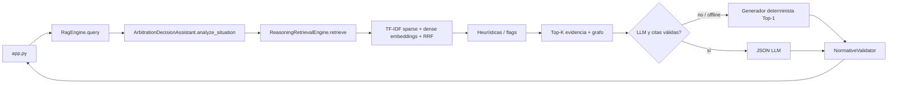

# SOR-IJF — Auditoría integral estática del código

**Fecha:** 2026-11-06  
**Modalidad:** READ-ONLY; análisis estático.  
**Base funcional revisada:** `docs/dictamen_auditoria_vf01.md`, `docs/validacion_funcional_consolidada_vf01.md` y `docs/evidencia_revision_vf01.md`.

## 1. Resumen ejecutivo

La ruta activa para SOR 2026-08 es `app.py → RagEngine.query() → ArbitrationDecisionAssistant.analyze_situation() → ReasoningRetrievalEngine.retrieve() → build_deterministic_structured_answer()/LLM → NormativeValidator`. VF01 operó en modo local determinista; por tanto, la exactitud de la respuesta depende principalmente de la calidad del Top-1 y de un selector de frases, no de una síntesis razonada multievidencia.

El principal defecto no es el embedding aislado: es un **contrato de respuesta inseguro**. RRE puede devolver cualquier candidato por encima de un umbral RRF de `0.015`; el generador determinista responde desde `evidence[0]`; el validador comprueba presencia/estructura de citas, pero no que la respuesta cubra la intención de la consulta. Esta combinación explica directamente falsos PASS como TC-04, TC-11, TC-12, TC-15 y MC-13.

No se justifica una reescritura general. Se requiere una corrección localizada pero coordinada: contrato de evaluación y suficiencia, ranking/intención activable y calibrado, selección de evidencia por requisitos de consulta, y validación de completitud antes de emitir una conclusión normativa.

## 2. Arquitectura y flujo real



### Hechos demostrados

- `app.py:1236` pasa `k` y `min_score` a `RagEngine.query`; pero la ruta 2026-08 de `src/rag_engine.py:204-206` pasa a ADA solo `top_k`, ignorando `min_score`. El control de UI no gobierna el umbral RRE activo.
- `src/ada_assistant.py:64` llama a RRE con `expand_graph=True`; si no hay LLM válido, líneas 191-201 usan el generador determinista.
- En el generador, `src/response_structurer.py:230-234` fija `top_ev = evidence[0]`; líneas 316-376 eligen una frase de ese único pasaje y la presentan como respuesta principal.
- RRE ejecuta sparse/denso y RRF (`src/rre_engine.py:770-884`) y acepta semillas con `score >= min_confidence`, cuyo valor por defecto es `0.015` (`752`, `1131-1156`). No hay una comprobación de que el pasaje superior responda todos los elementos de la pregunta.
- El `NormativeValidator` forma su verdad de base exclusivamente con evidencia ya recuperada (`src/normative_validator.py:93-132`) y valida IDs, artículos, términos y algunos patrones (`134-275`), no entailment consulta→respuesta ni suficiencia de cobertura.

## 3. Hallazgos priorizados

| Sev. | Hallazgo y evidencia | Impacto |
|---|---|---|
| **P0** | **Respuesta determinista Top-1 sin prueba de cobertura.** `response_structurer.py:230-234, 316-376` selecciona una frase de `evidence[0]`; los demás pasajes se listan como complementarios. | Causa directa de respuestas no resolutivas con estado `SUCCESS`: TC-02, 03, 05, 07–10, 13–15, 18–21, etc. |
| **P0** | **Validador de groundedness, no de corrección.** `normative_validator.py:98-132, 149-275` compara la respuesta contra el contexto recuperado, que puede ser incorrecto. | Una respuesta fiel al pasaje equivocado pasa el validador; no bloquea TC-04/11/12/15/35. |
| **P0** | **Contrato de evaluación equivocado.** VF01 registra `SUCCESS` como PASS aunque la salida/cita no cubre la consulta; evidenciado en el dictamen VF01 y en los resúmenes almacenados. | El sistema informa 52/52 aunque existen falsos positivos normativos; impide una puerta de calidad fiable. |
| **P1** | **Controles correctivos clave quedan desactivados.** `rre_engine.py:60-71` deja semantic ranker, command disambiguator y OOD en `False` salvo entorno. Las reglas de TC-04 y TC-15 solo se ejecutan bajo esos flags (`1112-1129`). | Explica por qué el código contiene mitigaciones que no protegieron VF01. |
| **P1** | **Umbral de selección demasiado permisivo.** `retrieve(... min_confidence=0.015)` y selección `1131-1156`; RRF asigna puntajes a candidatos sin una suficiencia semántica final. | Permite que una respuesta de área/tatami, gesto o vestimenta se formule como decisión arbitral. |
| **P1** | **OOD vulnerable a términos del propio dominio presentes en otro deporte.** La compuerta léxica usa cualquier token no genérico del vocabulario (`789-804`). `entrenador` no es genérico y se mapea a `coach` (`470-585`); OOD está apagado. | Causa demostrable de admisión de MC-13 (baloncesto/entrenador) y su recuperación de 7.2. |
| **P1** | **Heurísticas de recuperación crecientes y acopladas a consultas concretas.** Reglas de frontera, equipo y cabeza ocupan `895-1028`, además de boosts de página/código `1030-1088`. | Difícil de calibrar y de explicar; una regla nueva puede afectar consultas no previstas. No hay política única de intención/cobertura. |
| **P1** | **Expansión de grafo sin ranking ni adecuación de relación.** RRE añade vecinos por orden de adyacencia y recorta a 3 (`1213-1233`); ADA los incorpora al contexto (`ada_assistant.py:96-111`). | Evidencia relacionada puede aparecer como complemento aunque no satisfaga la pregunta; aumenta ruido y riesgo de citación. |
| **P2** | **Valor de UI inefectivo.** El slider `min_score` (`app.py:1051-1055`) se ignora en ruta 2026 (`rag_engine.py:199-253`). | Configuración visible que no produce el efecto comunicado al usuario. |
| **P2** | **Semántica de flags contraintuitiva.** Pasar explícitamente `False` a flags F3 permite que una variable de entorno lo reactive (`rre_engine.py:61-71`). | Difícil asegurar experimentos/reproducibilidad; `False` no siempre significa desactivado. |
| **P2** | **PassageStitcher se activa por defecto.** `enable_chunk_stitching=None` pasa a `True` salvo variable explícita off (`45, 50-57`), pese a documentación histórica que lo describe como experimental/desactivado. | Discrepancia documentación–implementación y mayor superficie de respuesta; requiere declarar configuración efectiva en cada resultado. |
| **P2** | **Stitching concatena artículo/páginas, no prueba relación semántica.** `passage_stitcher.py:106-188` une por artículo, heading y página hasta 3 páginas, con marcador en texto. | Útil para continuidad física, pero el generador puede elegir una frase de una página distinta a la intención; el composite ID no es una cita física única. |
| **P2** | **Código legado inalcanzable.** `rag_engine.py:63-77` siempre retorna; las líneas 80-127 quedan después de ese retorno dentro del mismo método. | Deuda técnica, confusión operativa y rutas de reindexado heredadas que no se ejecutan en la arquitectura activa. |
| **P2** | **Dos fuentes de resolución de referencias y fallback duplicado.** `citation_resolver.py:5-88` mantiene catálogo estático; `reference_manager.py:215-238` declara una copia de lógica de fallback. | Riesgo de URLs/ediciones divergentes y de usar explicación 2023 desde una aplicación SOR 2026. |
| **P2** | **Links SPA mapeados a PDF 2023 hardcoded.** `reference_manager.py:6-17`. | Riesgo de trazabilidad temporal incorrecta para material complementario; no afecta la cita SOR primaria actual, pero sí futuras fuentes. |
| **P3** | **Errores de inicialización de sidecar quedan silenciados.** `rre_engine.py:127-135, 184-196` absorbe excepciones y continúa. | Aceptable para modo sombra, pero la observabilidad no permite distinguir fallo técnico de ausencia de evidencia sin revisar logs. |
| **P3** | **Duplicación de lógica de extracción de frases.** ADA contiene otro selector de cita/fragmento (`ada_assistant.py:299-428`) y el estructurador tiene uno separado (`response_structurer.py:230-376`). | Posibles discrepancias entre cita mostrada y texto de resumen; refactorización posterior de bajo riesgo. |

## 4. Causas raíz de VF01

### Confirmadas por código y registros

| Caso | Causa confirmada | Evidencia |
|---|---|---|
| TC-04 | La protección lateral para Art.15 solo se ejecuta si `enable_semantic_ranker`; en VF01 el Top-1 fue 8.7. El resumen solo usa Top-1. | `rre_engine.py:1118-1129`; `response_structurer.py:230-376`; registro VF01-04. |
| TC-11 | La salida seleccionada fue Art.4/Gestures p149 y el resumen se construyó desde esa evidencia. El corpus sí contiene kawazu-gake en 18.2.2 p190, pero no fue recuperado como Top-1. | Registro VF01-11; `response_structurer.py:230-376`; pasaje `SOR-2026-08-P190-S197`. |
| TC-12 | La respuesta usa Top-1 8.7 p96, sin regla de validez Art.5; no hay rutina de cobertura que exija condición «acción iniciada dentro/continuidad/2 m». | Registro VF01-12; `rre_engine.py:895-915` solo trata ne-waza/frontera, no proyección tachi-waza genérica. |
| TC-15 | El desambiguador que impulsa Art.11 y atenúa Apéndice C se ejecuta solo cuando su flag está activo; VF01 recuperó C1.3. | `referee_command_disambiguator.py:110-150`; `rre_engine.py:1112-1116`; registro VF01-15. |
| MC-13 | La consulta OOD contiene «entrenador», token admitido/mapeado y no excluido como genérico; OOD/negative anchors son opt-in. Se devolvió 7.2 Coaches. | `rre_engine.py:789-804`; mapeo `523-524`; flags `69-85`; registro VF01-35. |
| Respuestas incompletas | El fallback no sintetiza requisitos de la pregunta ni combina evidencia: expone la frase con más solapamiento de palabras de Top-1. | `response_structurer.py:316-376`. |

### Probables, no demostradas por este análisis

- La ausencia de expansión específica para `kawazu-gake` puede haber contribuido a TC-11. El término no aparece en el mapeo localizado por búsqueda, pero no se ejecutó una traza de ranking; no se atribuye causalidad exclusiva.
- Los boosts manuales y RRF pueden alterar el orden de TC-04/12/15; sus efectos concretos requieren pruebas de ablación, prohibidas en esta auditoría.
- La calidad del embedding denso o del corpus extraído podría contribuir a algunos desvíos, pero los registros no separan contribución sparse/densa por caso.

## 5. Código innecesario, duplicado u obsoleto

1. **Aislar/eliminar tras aprobación:** rama legacy inalcanzable de `RagEngine.load_resources()` (`src/rag_engine.py:80-127`). Antes debe verificarse que no haya configuración que haga `is_2026_08=False` en uso real.
2. **Consolidar:** catálogo estático de `citation_resolver.py:5-88`, registry operativo y fallback duplicado de `reference_manager.py:215-238`. Debe existir una única fuente de URLs/estado y una migración verificable.
3. **Consolidar:** selección de fragmento/cita en `response_structurer.py` y `ada_assistant.py`. Extraer una función común que reciba evidencia ya validada.
4. **Diferir, no eliminar:** sidecar sombra y componentes F3. No son código muerto; están deshabilitados y requieren decisión de producto/seguridad, no limpieza automática.
5. **Reducir:** boosts por IDs/páginas y listas de términos en RRE. Sustituir gradualmente por contratos de intención + expectativa de artículo/tipo de evidencia, manteniendo tests de regresión por cada retirada.

## 6. Riesgos

| Tipo | Riesgo |
|---|---|
| Normativo | Una cita oficial no pertinente se muestra como respuesta y genera una decisión arbitral equivocada. Crítico en cabeza, puente, sanciones y continuidad. |
| Funcional | La UI permite ajustar un mínimo que no opera en la ruta activa, reduciendo confianza y reproducibilidad. |
| Técnico | Flags dependientes de ambiente y stitching implícito producen resultados distintos sin estar incluidos necesariamente en reportes. |
| Trazabilidad | Composite stitching, `GENERAL`, catálogos duplicados y deep links 2023 dificultan reconstruir qué norma exacta sostiene una frase. |
| Seguridad/operación | Fallos de sidecar/log silenciados y consultas OOD de deporte cruzado pueden quedar invisibles en operación. |
| Rendimiento | La búsqueda dense hace hasta dos codificaciones por consulta (`rre_engine.py:695-713`); las heurísticas recorren todos los candidatos/pasajes en varias secciones. No se cuantifica impacto sin benchmark. |

## 7. Componentes que deben conservarse

- Las verificaciones de integridad de corpus/dense metadata y modo HYBRID de `ReasoningRetrievalEngine` (`108-125` y validaciones asociadas).
- Separación RRE/ADA y abstención explícita al no haber evidencia (`752-868`, `ada_assistant.py:64-87`).
- `PassageStitcher` como herramienta de continuidad física, con `source_spans` y marca de reconstrucción, pero no como sustituto de relaciones normativas.
- `RefereeCommandDisambiguator` y `NormativeSemanticRanker` como correctores localizados, una vez sometidos a una política de flags reproducible y a pruebas de no regresión.
- Enlaces a página física y filtrado de citas no recuperadas (`citation_resolver.py:104-138`).

## 8. Plan de corrección priorizado

| Orden | Cambio acotado | Dependencias | Validación necesaria |
|---|---|---|---|
| P0.1 | Redefinir PASS: respuesta esperada por caso, artículos requeridos, condiciones y abstención esperada. | Aprobación de árbitro/custodio. | Reevaluación documental y suite declarativa sin usar `SUCCESS` como oracle. |
| P0.2 | Añadir verificador de suficiencia/entailment de respuesta: no emitir decisión si evidencia no cubre entidades, acción, condición y consecuencia de la consulta. | Esquema de intención y casos oro. | TC-04/11/12/15/35; SEC-CRIT; falsos positivos y falsos rechazos. |
| P0.3 | Cambiar fallback determinista: seleccionar evidencia por requisitos de consulta y componer respuesta solo cuando todos estén cubiertos; de lo contrario, abstener/pedir precisión. | P0.2. | Casos multiartículo, ambigüedad y regresión de respuestas directas. |
| P1.1 | Definir configuración explícita e inmutable por ejecución: flags, versión de corpus, modo y umbrales. Corregir semántica `False`/env. | Decisión operativa. | Tests de precedencia argumento vs entorno y snapshot de configuración. |
| P1.2 | Promover solo correctores comprobados para TC-04/15 y calibrar OOD/anchors contra batería multideporte; no activar globalmente sin evaluación. | P0.1 y baseline. | Ablación y regresión TC/MC/CGPT; foco MC-13. |
| P1.3 | Añadir intención de validez de acción fuera de área y ruta a Art.5 para TC-12; añadir prueba explícita para kawazu-gake. | Casos oro aprobados. | Recuperación Top-K y respuesta final de TC-11/12. |
| P2.1 | Hacer efectivo o retirar el slider `min_score` de UI para ruta ADA/RRE. | Definir semántica de confianza. | Prueba de propagación y comportamiento en límites. |
| P2.2 | Reordenar/filtrar expansión de grafo por relación y pertinencia de intención; etiquetar evidencia como directa/relacionada. | Modelo de relaciones. | Casos donde vecino irrelevante no aparece como fundamento. |
| P2.3 | Consolidar referencias, marcar enlaces históricos/no vigentes y retirar dependencia de URLs 2023 no aprobadas. | Gobierno de referencias. | Resolución determinista por fuente/revisión/localizador. |
| P3 | Retirar código inalcanzable y deduplicar selectores tras cobertura de tests. | Inventario de llamadas. | Análisis estático y regresión de rutas activas. |

## 9. Pruebas necesarias

No se ejecutaron en esta auditoría. Antes de cambios se requieren:

1. **Pruebas de contrato por caso:** pregunta → hechos/condiciones obligatorios → artículo/página permitidos → conclusión esperada/abstención.
2. **Pruebas de completitud:** duración no puede contestarse con osaekomi; sanción no con gesto; categoría de peso no con pesaje; pregunta de continuidad debe incluir condición y resultado.
3. **Pruebas de recuperación:** Top-K y evidencia directa para TC-04, 11, 12, 15, MC-13, y 15 SEC-CRIT.
4. **Pruebas de OOD cruzado:** baloncesto con entrenador/tiempos, tenis, natación, fútbol/NFL y consultas IJF con vocabulario similar.
5. **Pruebas de flags/configuración:** valores explícitos, variables de entorno, stitching y reporte de configuración efectiva.
6. **Pruebas de citas:** frase ↔ pasaje ↔ página; stitching debe mostrar todos los spans y no elevar relaciones de grafo a evidencia directa.
7. **Ablación y rendimiento:** sparse, dense, correctores, OOD y stitching por separado; medir p50/p95, memoria y tasa de abstención correcta.

## 10. Arquitectura objetivo recomendada

Se justifica una evolución, no una reescritura:

```text
consulta → intención/alcance → recuperación híbrida → evidencia directa candidata
        → prueba de suficiencia (acción + condición + consecuencia + alcance)
        → [insuficiente: abstención o aclaración]
        → bundle tipado: directa / excepción / relación
        → síntesis determinista o LLM restringido
        → validación de citas + validación de cobertura → respuesta
```

Principios: RRE sigue produciendo candidatos; una capa de suficiencia decide si puede responder. El fallback no debe simular precisión cuando falta evidencia. El grafo y stitching deben enriquecer, no decidir. Para futura arquitectura multifuente, aplicar el mismo contrato por carriles: solo SOR puede fundamentar una conclusión normativa.

## 11. Complejidad y riesgo de intervención

| Área | Complejidad | Riesgo |
|---|---|---|
| Reevaluar contrato VF01 | Baja–media | Bajo técnico; requiere consenso normativo. |
| Suficiencia y fallback determinista | Media | Alto funcional: puede aumentar abstenciones; exige casos oro. |
| Configuración/flags/UI | Baja | Medio: cambios de resultado por hacer explícito comportamiento hoy implícito. |
| Rutas TC-04/11/12/15 y OOD | Media | Medio: correcciones de ranking pueden crear regresiones cruzadas. |
| Grafo/citas/referencias | Media | Medio-alto por compatibilidad histórica. |
| Eliminar legado/duplicación | Baja–media | Bajo si se hace al final con cobertura. |

## 12. Decisiones que requieren aprobación humana

1. Definición de «respuesta suficiente» y de las consecuencias permitidas de abstener/pedir aclaración en arbitraje.
2. Conjunto oro y responsable que valida hechos, excepciones y páginas por caso.
3. Política de activación de F3/OOD/stitching y configuración que representará el modo aprobado.
4. Tolerancia aceptable entre cobertura y abstención; ningún umbral debe fijarse solo por la tasa actual de `SUCCESS`.
5. Tratamiento de enlaces/documentos históricos y fuentes complementarias.
6. Autorización explícita de cualquier implementación. Este informe no implementa cambios.

## Cumplimiento de restricciones

Se creó únicamente este informe. No se modificaron código, configuración, corpus, índices, embeddings, grafos ni documentos existentes; no se ejecutaron pruebas, benchmarks, Git, OCI, despliegues, instalaciones ni operaciones destructivas.

