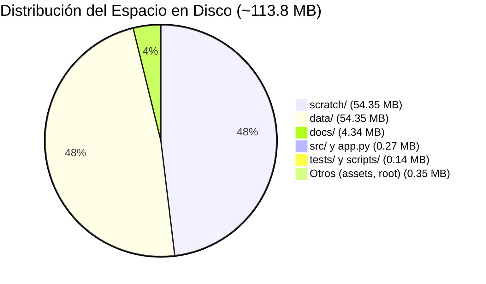
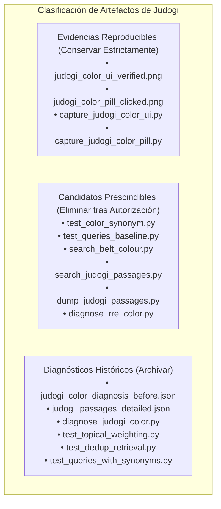

# AUDITORÍA DE LIMPIEZA DE CÓDIGO Y ARCHIVOS SOBRANTES — IJF SOR ASSISTANT 2026
## INVENTARIO EXHAUSTIVO, VERIFICACIÓN TÉCNICA Y PLAN DE SANEAMIENTO CONTROLADO

**Fecha:** 19 de octubre de 2026  
**Entorno Operativo:** Windows Local / Python 3.12.10 (AMD64) / PowerShell (pwsh)  
**Ruta del Repositorio:** `C:\PROYECTOS\IJF-SOR-Assistant`  
**Rama Activa:** `review/ijf-sor-2026-08-rre-ada`  
**HEAD de Referencia:** `6a4b08de0a9821f4ff83291f111bfdbf78edfa6c`  
**Rol:** Ingeniero Responsable de Mantenimiento y Limpieza del Repositorio Local  
**Directiva de Ejecución:** **Revisión final de candidatos e informe consolidado. Cero eliminaciones, modificaciones ni movimientos ejecutados.**

---

## 1. Verificación del Estado Real de Git y Referencia

Se realizó una verificación rigurosa del estado de Git mediante `git status` y comparación de hashes:

- **Rama:** `review/ijf-sor-2026-08-rre-ada` (concordancia exacta).
- **HEAD:** `6a4b08de0a9821f4ff83291f111bfdbf78edfa6c` (concordancia exacta).
- **Archivos Rastreados Modificados (11 archivos):**
  1. `.env.example`
  2. `app.py`
  3. `docs/reports/coverage_audit_2026_08/followup_review/NEW_ARCHITECTURE_IMPLEMENTATION_REPORT.md`
  4. `scratch/golden_validation_report.md`
  5. `src/ada_assistant.py`
  6. `src/corpus_config.py`
  7. `src/rag_engine.py`
  8. `src/rre_engine.py`
  9. `tests/test_rag_engine.py`
  10. `tests/test_rebuild_integration.py`
  11. `tests/test_rre_ada_architecture.py`
- **Archivos No Rastreados (Untracked):** Incluye los módulos funcionales nocturnos (`src/feedback_manager.py`, `src/llm_provider.py`, `src/normative_validator.py`, `src/response_structurer.py`), las suites de prueba complementarias (`tests/test_judogi_equipment_rules.py`, `tests/test_newaza_boundary_rules.py`, `tests/test_citation_highlighting.py`, `tests/test_feedback_manager.py`, `tests/test_llm_provider.py`, `tests/test_normative_hallucinations.py`, `tests/test_response_structurer.py`), el corpus corregido activo (`data/processed/rebuild_2026_08_corrected/`), el PDF oficial (`data/raw/sor_2026_08_rebuild/`), los informes de auditoría en `docs/` y los artefactos de diagnóstico en `scratch/`.
- **Diferencias frente al estado de referencia:** Presencia del informe final [`docs/cierre_estabilidad_ijf_sor_2026.md`](file:///C:/PROYECTOS/IJF-SOR-Assistant/docs/cierre_estabilidad_ijf_sor_2026.md). Todos los archivos funcionales y de datos se mantienen íntegros y sin alteraciones.

---

## 2. Mapa Global del Repositorio y Distribución de Almacenamiento

El repositorio contiene **633 archivos** (excluyendo `.git`, `.venv` y `__pycache__`) con un peso consolidado de **~113.8 MB**:

| Directorio / Prefijo | Cantidad de Archivos | Peso Total (MB) | Función Principal |
| :--- | :---: | :---: | :--- |
| `data/` | 347 | 54.35 MB | PDF oficial de agosto, corpus activo corregido, histórico enero 2026 y feedback. |
| `scratch/` | 108 | 54.35 MB | Índices vectoriales legacy (53.3 MB), scripts de diagnóstico y evidencias de auditoría. |
| `docs/` | 103 | 4.34 MB | Auditorías, informes técnicos, bitácoras de cobertura y capturas de páginas. |
| `src/` | 29 | 0.21 MB | Código de producción RRE/ADA, servidor MCP, gestores y adaptadores. |
| `assets/` | 3 | 0.17 MB | Logotipos institucionales (IJF) e imágenes estáticas de UI. |
| `tests/` | 18 | 0.10 MB | 17 módulos de prueba automatizada (108 tests operativos + 1 histórico). |
| `scripts/` | 5 | 0.04 MB | Scripts de extracción complementaria y configuración de modelo. |
| `Raíz (.)` | 14 | 0.24 MB | `app.py`, `src.zip`, `technical_defense_guide.md`, Dockerfiles y configs. |

---

## 3. Verificación Técnica Profunda de los Candidatos Clave

Se ejecutó una inspección exhaustiva de los candidatos principales para determinar su origen, contenido, referencias y posibles dependencias indirectas:

### 3.1. Caso 1: `scratch/vector_store_index.json` (53.29 MB)
- **Fecha y Origen:** Creado el **25 de julio de 2026, 18:45:50**. Proviene de la fase inicial del proyecto cuando se indexaba el corpus en Markdown mediante Google Gemini Embeddings / TF-IDF híbrido.
- **Formato:** JSON con claves `{"mode": "embeddings", "kun_ids": [...], "doc_lengths": [...], "vectors": [...]}`. Contiene **836 identificadores antiguos** de tipo `KUN-0001` a `KUN-0836` con sus respectivos vectores embebidos en punto flotante.
- **Diferencias con los Índices Activos:**
  - El índice disperso activo es [`data/processed/rebuild_2026_08_corrected/vector_index_candidate.json`](file:///C:/PROYECTOS/IJF-SOR-Assistant/data/processed/rebuild_2026_08_corrected/vector_index_candidate.json) (1.93 MB, 385 pasajes `SOR-2026-08-Pxxx-Sxxx`, vocabulario IDF de 5.214 términos).
  - La matriz densa activa es [`data/processed/rebuild_2026_08_corrected/dense_embeddings_candidate.npy`](file:///C:/PROYECTOS/IJF-SOR-Assistant/data/processed/rebuild_2026_08_corrected/dense_embeddings_candidate.npy) (591 KB, formato binario numpy 384d).
- **Referencias y Dependencias:**
  - En código de producción activo: **Cero**.
  - `src/vector_store.py`: La única mención está en su bloque `if __name__ == '__main__':` (línea 403), como ruta de destino de guardado de un script de prueba manual. No se carga dinámicamente en el flujo de ejecución de la aplicación.
  - `scripts/complete_sor_extraction.py` y `scripts/complete_appendix_d.py`: Menciones en comentarios o guardados de scripts auxiliares.
  - Documentos históricos: Mencionado en informes previos de julio y agosto de 2026.
- **Dependencia Indirecta:** **Ninguna**. El sistema en tiempo de ejecución (Streamlit, `rag_engine.py`, `rre_engine.py`, `ada_assistant.py`) no lee este archivo.
- **Riesgo:** **Nulo para la operación vigente**.
- **Copia de Seguridad Necesaria:** No requiere respaldo en producción. Si se desea preservar por arqueología histórica, empaquetar en un archivo comprimido de archivo histórico antes de eliminar.

### 3.2. Caso 2: `vector_index_candidate.json.bak` (2.12 MB) vs `vector_index_candidate.json` (1.93 MB)
- **Verificación del Archivo Principal (`vector_index_candidate.json`):**
  - Existe, es perfectamente legible, tiene formato JSON válido y contiene exactamente los **385 pasajes oficiales** del corpus activo.
  - Los 385 identificadores coinciden al **100%** con `passages_candidate.json`.
  - Su vocabulario IDF contiene **5.214 términos** con hash SHA-256 del PDF verificado.
- **Comparación con el Respaldo (`vector_index_candidate.json.bak`):**
  - El archivo `.bak` contiene los mismos 385 pasajes canónicos y el mismo hash SHA-256.
  - El archivo `.bak` contiene un vocabulario IDF de **4.897 términos** (frente a 5.214 del principal).
  - El archivo principal tiene un vocabulario ampliado (+407 términos, incluyendo vocabulario técnico de equipamiento como `colour`, `sokuteiki`, `backnumber`).
  - El peso mayor del archivo `.bak` (2.12 MB vs 1.93 MB) se debe a un formateo de serialización JSON con mayor sangría/espaciado de punto flotante en los vectores.
- **Contenido Único:** **No contiene información única reglamentaria**. Es una versión preliminar generada durante el proceso iterativo de construcción del índice corregido antes de incorporar las mejoras de tokenización léxica.
- **Riesgo:** **Nulo**.
- **Copia de Seguridad Necesaria:** Ninguna requerida; el archivo principal es superior y completo.

### 3.3. Caso 3: `src.zip` (74.5 KB) en la Raíz
- **Inspección del Contenido:**
  - Archivo ZIP que contiene **33 elementos** correspondientes a una copia estática de `src/` fechada en julio/agosto de 2026.
  - **No contiene** los módulos nocturnos modernos: faltan `src/feedback_manager.py`, `src/llm_provider.py`, `src/normative_validator.py`, `src/response_structurer.py`, `src/rre_engine.py` y `src/ada_assistant.py`.
  - Los archivos que contiene (`rag_engine.py`, `vector_store.py`, `citation_resolver.py`, `graph_manager.py`) son versiones más antiguas y de menor tamaño que las que residen actualmente en disco.
- **Contenido Único o Evidencia:** **Ninguno**. Todo su contenido está superado por el código activo en disco y versionado en el historial de Git.
- **Riesgo:** **Nulo**.
- **Copia de Seguridad Necesaria:** Ninguna requerida; el historial de Git contiene los commits correspondientes.

### 3.4. Caso 4: Los Tres Archivos `.metadata.json` en `scratch/`
- **Archivos Inspeccionados:**
  1. `scratch/copy_assets.py.metadata.json` (126 B): `{"summary": "Create a script to copy KUN files to the local repository.", "updatedAt": "2026-07-20T10:07:34Z"}`.
  2. `scratch/corpus_conformity_audit.py.metadata.json` (109 B): `{"summary": "Create corpus_conformity_audit.py script.", "updatedAt": "2026-07-20T08:15:00Z"}`.
  3. `scratch/fix_graph_reciprocity.py.metadata.json` (107 B): `{"summary": "Create fix_graph_reciprocity.py script.", "updatedAt": "2026-07-20T08:17:54Z"}`.
- **Herramienta que los creó:** Generados automáticamente por herramientas de entorno de agentes IDE durante sesiones de desarrollo en julio de 2026.
- **Utilidad para Reproducir Tareas:** **Nula**. Son metadatos efímeros descriptivos que no son leídos por Python, pytest ni ninguna rutina de auditoría.
- **Riesgo:** **Nulo**.
- **Copia de Seguridad Necesaria:** Ninguna.

### 3.5. Caso 5: `scratch/rre_engine_baseline.py` y `src/unified_extraction_pipeline.py`
- **`scratch/rre_engine_baseline.py` (19.7 KB):**
  - *Función:* Versión base preliminar utilizada el 18 de octubre para contrastar las métricas de recuperación frente al motor RRE en desarrollo.
  - *Referencias:* No es importado por ningún módulo de `src/`, `tests/` ni `scripts/`. Únicamente se menciona de forma retrospectiva en los informes de cierre.
  - *Valor de Reproducibilidad:* Bajo a moderado; permite contrastar el comportamiento anterior de la recuperación si se hiciera un estudio de ablación formal.
  - *Recomendación:* **Archivar** en `scratch/archive/baselines/` en lugar de eliminar directamente.
- **`src/unified_extraction_pipeline.py` (3.7 KB):**
  - *Función:* Pipeline inicial de extracción de datos orientado a poblar `reference_registry.json` y carpetas de Markdown a partir de transcripciones.
  - *Referencias:* No tiene imports activos en `app.py`, `rag_engine.py` ni en la suite de 77 pruebas.
  - *Valor de Reproducibilidad:* Alto como herramienta de tooling si se deseara re-ejecutar el pipeline de extracción original hacia Markdown.
  - *Recomendación:* **Conservar y mover a `scripts/tooling/unified_extraction_pipeline.py`** (o archivar en `scripts/archive/`), retirándolo de `src/` para no confundirlo con el código de producción en tiempo de ejecución.

---

## 4. Clasificación Individual de los Artefactos de Judogi (16 Archivos)

Durante la corrección de pertinencia del color de judogi se crearon 16 archivos en `scratch/`. A continuación se detalla su clasificación técnica individual:

| Archivo en `scratch/` | Tamaño | Contenido y Función | Clasificación Técnica | Acción Propuesta |
| :--- | :---: | :--- | :---: | :--- |
| `judogi_color_ui_verified.png` | 191.0 KB | Captura Playwright de la respuesta directa de judogi en split-view. | **Evidencia Reproducible** | **Conservar estrictamente** |
| `judogi_color_pill_clicked.png` | 137.5 KB | Captura Playwright de la píldora interactiva sincronizada en el visor PDF (Pág. 124). | **Evidencia Reproducible** | **Conservar estrictamente** |
| `capture_judogi_color_ui.py` | 1.7 KB | Script automatizado Playwright para reproducir la captura de la interfaz. | **Evidencia Reproducible** | **Conservar** (mover a tests e2e o utilidades) |
| `capture_judogi_color_pill.py` | 2.1 KB | Script automatizado Playwright para reproducir la sincronización del PDF. | **Evidencia Reproducible** | **Conservar** (mover a tests e2e o utilidades) |
| `judogi_color_diagnosis_before.json` | 17.8 KB | Registro de la respuesta errónea inicial antes de corregir el sistema. | **Diagnóstico Histórico** | **Archivar** en `scratch/archive/judogi/` |
| `judogi_passages_detailed.json` | 24.7 KB | Volcado de los 6 pasajes de la página 115 y 124 para inspección de solapamiento. | **Diagnóstico Histórico** | **Archivar** en `scratch/archive/judogi/` |
| `diagnose_judogi_color.py` | 1.7 KB | Script que reprodujo la saturación de los pasajes de la página 115. | **Diagnóstico Histórico** | **Archivar** en `scratch/archive/judogi/` |
| `test_topical_weighting.py` | 4.8 KB | Prototipo de la ponderación de entidades temáticas en RRF. | **Diagnóstico Histórico** | **Archivar** en `scratch/archive/judogi/` |
| `test_dedup_retrieval.py` | 3.1 KB | Prueba exploratoria del algoritmo de deduplicación de semillas en RRF. | **Diagnóstico Histórico** | **Archivar** en `scratch/archive/judogi/` |
| `test_queries_with_synonyms.py` | 1.9 KB | Evaluación de cobertura con sinónimos bilingües. | **Diagnóstico Histórico** | **Archivar** en `scratch/archive/judogi/` |
| `test_color_synonym.py` | 0.8 KB | Snippet de 15 líneas que probó inyectar manualmente `color -> colour`. | **Candidato Prescindible** | **Eliminar (autorizable)** |
| `test_queries_baseline.py` | 0.9 KB | Snippet temporal para imprimir rankings basales sin sinónimos. | **Candidato Prescindible** | **Eliminar (autorizable)** |
| `search_belt_colour.py` | 0.8 KB | Búsqueda puntual de pasajes que contienen la palabra *«belt»*. | **Candidato Prescindible** | **Eliminar (autorizable)** |
| `search_judogi_passages.py` | 1.1 KB | Filtro rápido de pasajes que contienen *«judogi»* en el JSON. | **Candidato Prescindible** | **Eliminar (autorizable)** |
| `dump_judogi_passages.py` | 1.2 KB | Script de una sola ejecución que volcó pasajes a JSON. | **Candidato Prescindible** | **Eliminar (autorizable)** |
| `diagnose_rre_color.py` | 1.0 KB | Script puntual para imprimir los scores numéricos del RRE. | **Candidato Prescindible** | **Eliminar (autorizable)** |

*Nota:* Todas las reglas resultantes de estos scripts están formalmente probadas en la suite automatizada permanente [`tests/test_judogi_equipment_rules.py`](file:///C:/PROYECTOS/IJF-SOR-Assistant/tests/test_judogi_equipment_rules.py) (8 pruebas que se ejecutan en 0.8s con 100% verde).

---

## 5. Lista Definitiva de Candidatos y Estrategia de Copia de Seguridad

Antes de realizar cualquier modificación física, se define la política de respaldo requerida para cada elemento:

| Elemento / Ruta | Tamaño | Clasificación | Copia de Seguridad Requerida Previa a la Acción | Justificación de la Acción |
| :--- | :---: | :---: | :--- | :--- |
| **`scratch/vector_store_index.json`** | 53.29 MB | Eliminar (o Archivar) | Respaldo opcional en archivo comprimido `archive/legacy_index_2026_07.zip` si se exige trazabilidad arqueológica completa. | Cero uso en tiempo de ejecución. Perteneciente a edición derogada con IDs KUN. |
| **`data/processed/rebuild_2026_08_corrected/vector_index_candidate.json.bak`** | 2.12 MB | Eliminar | No requiere (el archivo principal `.json` está completo y verificado al 100%). | Copia temporal de respaldo con menor vocabulario que el archivo principal activo. |
| **`src.zip`** | 74.5 KB | Eliminar | No requiere (historial de Git contiene todos los commits). | Respaldo manual en raíz, superado por el árbol de trabajo actual. |
| **`scratch/*.metadata.json`** (3 archivos) | ~342 B | Eliminar | No requiere. | Metadatos temporales de herramientas de agente sin uso funcional. |
| **Snippets de judogi prescindibles** (6 scripts) | ~6.8 KB | Eliminar | Copia de respaldo en `scratch/archive/judogi_snippets_backup.zip`. | Pruebas de concepto de 15–20 líneas superadas por tests formales. |
| **`scratch/rre_engine_baseline.py`** | 19.7 KB | Archivar | Mover a `scratch/archive/baselines/`. | Prototipo de desarrollo con valor comparativo. |
| **`src/unified_extraction_pipeline.py`** | 3.7 KB | Archivar / Reubicar | Mover a `scripts/tooling/`. | Módulo de extracción que no debe residir en `src/` de producción. |
| **Diagnósticos históricos de judogi** (6 archivos) | ~70 KB | Archivar | Mover a `scratch/archive/judogi/`. | Evidencia de apoyo sobre la iteración de diseño. |
| **`data/processed/rebuild_2026_08/`** | 5.1 MB | Archivar | Comprimir en `data/archive/rebuild_2026_08_v1.zip` y retirar carpeta raw. | Primera pasada de rebuild superada por `rebuild_2026_08_corrected/`. |

---

## 6. Elementos que se Mantienen Intactos (Intocables)

En estricta conformidad con las restricciones obligatorias:

1. **PDF Oficial Fuente:** `data/raw/sor_2026_08_rebuild/IJF_Sport_and_Organisation_Rules_2026_08_14.pdf` (SHA-256: `9426b10d11c21a4cb9eb23150c2c4fc95bfcd463511e66ba451d2cff005ae620`).
2. **Corpus Activo y sus Índices:**
   - `data/processed/rebuild_2026_08_corrected/passages_candidate.json` (385 pasajes).
   - `data/processed/rebuild_2026_08_corrected/vector_index_candidate.json` (Índice sparse BM25/TF-IDF).
   - `data/processed/rebuild_2026_08_corrected/dense_embeddings_candidate.npy` (Matriz densa 384d).
   - `data/processed/rebuild_2026_08_corrected/dense_embeddings_meta.json`.
   - `data/processed/rebuild_2026_08_corrected/knowledge_graph_candidate.json`.
   - `data/processed/rebuild_2026_08_corrected/structural_coverage_matrix.json`.
3. **Datos de Feedback:** `data/feedback/user_observations.jsonl` (Canal «Ayúdanos a mejorar»).
4. **Evidencias Clave de Auditoría:**
   - `scratch/audit_7_queries_literal.json` (7 consultas de arbitraje).
   - `scratch/regression_6_queries_verified.json` (6 consultas de equipamiento).
   - `scratch/judogi_color_ui_verified.png` y `scratch/judogi_color_pill_clicked.png` (Capturas split-view).
   - `scratch/audit_post_judogi_verification.py` y `scratch/run_regression_6_queries.py`.
5. **Fuentes Históricas por Restricción:** `data/raw/ijf_sor_2026.pdf` y `data/markdown/`.
6. **Suites de Pruebas Automatizadas:** Todos los módulos en `tests/` (108 pruebas pasadas + 1 histórica).

---

## 7. Conclusión y Espera de Instrucciones

La revisión técnica profunda de todos los candidatos ha finalizado y se ha integrado completamente en este informe.

**No se ha eliminado, modificado ni movido ningún archivo del repositorio.**

Quedo formalmente detenido y a la espera de su **autorización explícita** para ejecutar la limpieza física y archivado según la lista definitiva aprobada.
