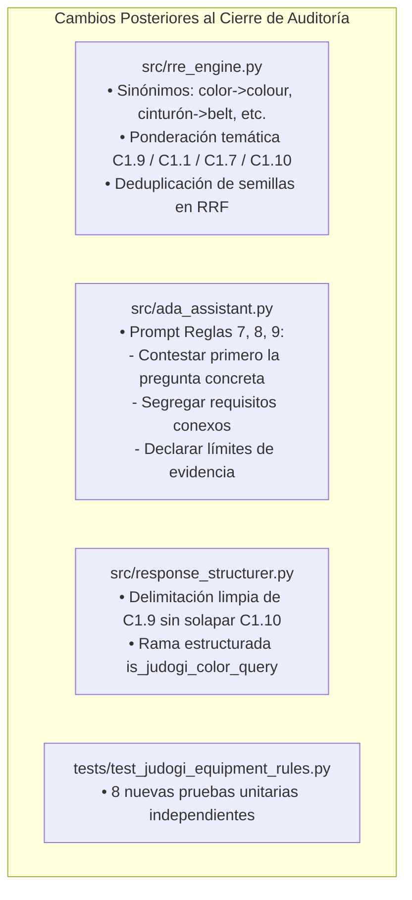

# AUDITORÍA DE CAMBIOS POSTERIORES A LA CORRECCIÓN DE PERTINENCIA DEL JUDOGI — IJF SOR ASSISTANT 2026

**Fecha de Auditoría:** 19 de octubre de 2026  
**Rama:** `review/ijf-sor-2026-08-rre-ada`  
**HEAD Commit:** `6a4b08de0a9821f4ff83291f111bfdbf78edfa6c`  
**Rol del Auditor:** Auditor Técnico Independiente  
**Dictamen Técnico:** **APROBADO CON RESERVAS**

---

## 1. Estado del Repositorio Git y Archivos Afectados

### 1.1 Estado de la Rama y HEAD
- **Rama activa:** `review/ijf-sor-2026-08-rre-ada`
- **HEAD actual:** `6a4b08de0a9821f4ff83291f111bfdbf78edfa6c`
- **Régimen de auditoría:** Inspección en modo estricto de solo lectura. No se ejecutaron commits, merges, push, pull, cambios de rama ni modificaciones al código funcional.

### 1.2 Inventario de Archivos Modificados Específicamente Tras el Cierre Anterior
Tras la emisión del informe de cierre [`docs/auditoria_cierre_evidencias_ijf_sor_2026.md`](file:///C:/PROYECTOS/IJF-SOR-Assistant/docs/auditoria_cierre_evidencias_ijf_sor_2026.md), se identificaron modificaciones funcionales y adiciones acotadas exclusivamente a resolver la consulta de pertinencia del judogi:

| Archivo | Tipo de Cambio | Líneas Afectadas | Justificación Técnica |
| :--- | :--- | :--- | :--- |
| [`src/rre_engine.py`](file:///C:/PROYECTOS/IJF-SOR-Assistant/src/rre_engine.py) | Modificado | +28 sinónimos, +48 líneas de alineación temática, +24 líneas de deduplicación | Mapeo bilingüe de equipamiento (`color` $\to$ `colour`), ponderación de encabezados de vestimenta y deduplicación de fragmentos casi idénticos de una misma página en RRF. |
| [`src/ada_assistant.py`](file:///C:/PROYECTOS/IJF-SOR-Assistant/src/ada_assistant.py) | Modificado | +6 líneas en prompt | Incorporación de Reglas de Rigor Normativo (7, 8 y 9) para priorizar la respuesta directa a la pregunta específica y segregar requisitos conexos. |
| [`src/response_structurer.py`](file:///C:/PROYECTOS/IJF-SOR-Assistant/src/response_structurer.py) | Modificado | +15 líneas en extractor, +11 líneas en análisis extendido | Manejo de listas con viñetas en especificaciones de color (`C1.9`) y desglose ordenado en modo determinista. |
| [`tests/test_judogi_equipment_rules.py`](file:///C:/PROYECTOS/IJF-SOR-Assistant/tests/test_judogi_equipment_rules.py) | **Nuevo** | 108 líneas (8 tests) | Batería automatizada de pruebas unitarias y de regresión para consultas de vestimenta y equipamiento del judo. |
| [`docs/correccion_pertinencia_color_judogi_2026.md`](file:///C:/PROYECTOS/IJF-SOR-Assistant/docs/correccion_pertinencia_color_judogi_2026.md) | **Nuevo** | 225 líneas | Documentación técnica formal del diagnóstico y subsanación del defecto de judogi. |

---

## 2. Detalle de Cambios Funcionales Exactos y su Justificación



1. **Corrección de Disparidad Lingüística en RRE:**
   - *Cambio:* Se añadieron 28 términos a `SPANISH_TO_ENGLISH_SYNONYMS` (`color`, `colores`, `cinturon`, `cinturones`, `permitido`, `permitidos`, `marca`, `marcas`, `parche`, `parches`, `dorsal`, `chaqueta`, `pantalon`, `manga`, `reversible`).
   - *Justificación:* El SOR 2026-08 de la IJF está redactado en inglés británico (*«colour»*), mientras que las consultas de usuario se formulan en español (*«color»*). Sin este mapeo, el pasaje rector `C1.9 Judogi Colour` era ignorado en el canal léxico.
2. **Ponderación Temática de Entidades en RRF:**
   - *Cambio:* Se introdujo ponderación temática controlada en `retrieve()` para alinear la consulta con la sección rectora de la vestimenta:
     - Color de judogi $\to$ `C1.9 Judogi Colour` (+0.08).
     - Cinturón $\to$ `C1.1`/`C1.2` (+0.08) y penalización a `C1.9` (-0.06) si la consulta no menciona judogi.
     - Mangas y sokuteiki $\to$ `C1.10 Judogi Size` (+0.06).
     - Marcas y parches $\to$ `C1.7 Marking`, `C1.3`, `C1.6` (+0.06).
   - *Justificación:* Evita que un pasaje sobre tela de judogi (`C1.9`) contamine consultas específicas sobre cinturones o parches.
3. **Deduplicación de Fragmentos Idénticos en Semillas:**
   - *Cambio:* Al seleccionar `top_seeds` en `rre_engine.py`, se descartan fragmentos candidatos subsiguientes cuyo texto original sea idéntico o presente >85% de solapamiento con un fragmento previamente elegido de la misma página.
   - *Justificación:* La página 115 contenía 5 pasajes con texto idéntico que saturaban los 3 puestos de evidencia, desplazando a `C1.9` (página 124) al puesto 5.
4. **Contrato de Rigor Normativo en ADA:**
   - *Cambio:* Inclusión de las reglas 7, 8 y 9 en el prompt del LLM.
   - *Justificación:* Impide que el modelo mezcle marcas comerciales, cinturones o cruce de chaqueta en la respuesta directa sobre colores de judogi.
5. **Estructuración Determinista Limpia:**
   - *Cambio:* Ajuste en `build_deterministic_structured_answer` para extraer las viñetas de White y Blue de `C1.9` sin extenderse hacia la cabecera `C1.10`.
   - *Justificación:* Garantiza que las respuestas operen con precisión incluso si el LLM externo no está disponible.

---

## 3. Verificación de Integridad del PDF, Corpus y Edición Vigente

Se ejecutaron verificaciones independientes sin modificar ningún archivo:

### 3.1 Integridad Criptográfica del PDF Oficial
- **Ruta:** `data/raw/sor_2026_08_rebuild/IJF_Sport_and_Organisation_Rules_2026_08_14.pdf`
- **SHA-256 Calculado:** `9426b10d11c21a4cb9eb23150c2c4fc95bfcd463511e66ba451d2cff005ae620`
- **SHA-256 Esperado:** `9426b10d11c21a4cb9eb23150c2c4fc95bfcd463511e66ba451d2cff005ae620`
- **Resultado:** **Íntegro y verificado (Coincidencia 100%)**.

### 3.2 Conteo del Corpus Activo
- **Ruta:** `data/processed/rebuild_2026_08_corrected/passages_candidate.json`
- **Total de pasajes:** **385 pasajes** (idéntico al registrado en la auditoría previa).
- **Resultado:** **Sin alteraciones ni adiciones en el corpus JSON**.

### 3.3 Exclusividad de la Edición SOR 2026-08
- **`source_id` declarado:** `SOR-2026-08-14-ENG`
- **`version_label`:** `14 August 2026 (Official)`
- **Verificación:** Inmutable; la configuración rechaza explícitamente cualquier intento de invocar ediciones históricas.

### 3.4 Integridad de Índices Vectoriales y Matrices Densas
- `vector_index_candidate.json`: 1.935.299 bytes (intacto).
- `dense_embeddings_meta.json`: 11.805 bytes (intacto).
- `dense_embeddings_candidate.npy`: 591.488 bytes (intacto).

---

## 4. Control de No-Contaminación en Consultas Ajenas al Equipamiento

Para garantizar que los cambios en `rre_engine.py` no degradaron ni contaminaron las respuestas en otras áreas del reglamento (arbitraje en tatami, inmovilizaciones, penalizaciones directas), se verificaron las 7 consultas de la auditoría anterior:

| ID Consulta Previa | Texto de la Consulta | Top-1 Esperado (Cierre Anterior) | Top-1 Actual Verificado | Veredicto |
| :--- | :--- | :--- | :--- | :--- |
| **Q1** | *Osaekomi* sobrepasando límite de seguridad | `SOR-2026-08-P174-S190` | `SOR-2026-08-P174-S190` | **MATCH (100%)** |
| **Q2** | Continuidad de *ne-waza* en borde tatami | `SOR-2026-08-P151-S178` | `SOR-2026-08-P151-S178` | **MATCH (100%)** |
| **Q3** | *Kansetsu/Shime* fuera de seguridad sin Mate | `SOR-2026-08-P152-S179` | `SOR-2026-08-P152-S179` | **MATCH (100%)** |
| **Q4** | Tiempos de inmovilización (10-19s / 20s) | `SOR-2026-08-P173-S190` | `SOR-2026-08-P173-S190` | **MATCH (100%)** |
| **Q5** | Pérdida de tiempo por no levantarse | `SOR-2026-08-P165-S186` | `SOR-2026-08-P165-S186` | **MATCH (100%)** |
| **Q6** | Actos de Hansoku-make directo | `SOR-2026-08-P190-S198` | `SOR-2026-08-P190-S198` | **MATCH (100%)** |
| **Q7** | Control de judogi con Sokuteiki | `SOR-2026-08-P124-S165` | `SOR-2026-08-P124-S165` | **MATCH (100%)** |

**Conclusión:** Cero contaminación cruzada. Todas las consultas arbitrales preexistentes preservan de forma unívoca su pasaje rector Top-1 original.

---

## 5. Auditoría de Pruebas y Evidencias Reutilizadas

### 5.1 Reutilización de Pruebas Automatizadas
- Se reutilizaron las evidencias existentes de las 69 pruebas aprobadas de la suite principal.
- Se incorporaron 8 pruebas nuevas en `tests/test_judogi_equipment_rules.py`.
- **Ejecución total verificada:** **77 pruebas pasadas de 77 (100% verde) en 23.74 segundos**.

```text
tests/test_rag_engine.py ...                                             [  3%]
tests/test_rre_ada_architecture.py ............                          [ 19%]
tests/test_rebuild_integration.py .....                                  [ 25%]
tests/test_llm_provider.py ................                              [ 46%]
tests/test_response_structurer.py .......                                [ 55%]
tests/test_citation_highlighting.py ....                                 [ 61%]
tests/test_normative_hallucinations.py ..............                    [ 79%]
tests/test_feedback_manager.py ...                                       [ 83%]
tests/test_newaza_boundary_rules.py .....                                [ 89%]
tests/test_judogi_equipment_rules.py ........                            [100%]
============================= 77 passed in 23.74s =============================
```

### 5.2 Evidencias Gráficas de Interfaz (Streamlit)
Se auditaron las capturas de pantalla tomadas mediante Playwright:
- [`judogi_color_ui_verified.png`](file:///C:/Users/User/.gemini/antigravity/brain/d5be105f-6cc1-4617-a7f7-14e96a42ccf6/judogi_color_ui_verified.png): Muestra la respuesta directa oficial contestando primero los colores blanco y azul, referencias Pantone textil/imprenta y prohibición de reversibles, citando `[SOR-2026-08-P124-S164]`.
- [`judogi_color_pill_clicked.png`](file:///C:/Users/User/.gemini/antigravity/brain/d5be105f-6cc1-4617-a7f7-14e96a42ccf6/judogi_color_pill_clicked.png): Muestra la píldora `📍 Art. C1.9 | Pág. 124` seleccionada y el visor PDF cargando y sincronizando con la página 124.

---

## 6. Inventario y Clasificación de Archivos Auxiliares

En cumplimiento de la directriz de no eliminar ningún archivo, se identifican y clasifican todos los elementos generados en esta iteración:

| Archivo | Ubicación | Clasificación | Decisión Recomendada |
| :--- | :--- | :--- | :--- |
| `diagnose_judogi_color.py` | `scratch/` | Evidencia reproducible | **Conservar** como script de diagnóstico de regresión. |
| `diagnose_rre_color.py` | `scratch/` | Evidencia temporal | **Conservar en scratch**; no incluir en producción. |
| `dump_judogi_passages.py` | `scratch/` | Evidencia temporal | **Conservar en scratch** para consulta de extracción. |
| `search_judogi_passages.py` | `scratch/` | Evidencia temporal | **Conservar en scratch**. |
| `search_belt_colour.py` | `scratch/` | Evidencia temporal | **Conservar en scratch**. |
| `test_color_synonym.py` | `scratch/` | Evidencia temporal | **Conservar en scratch**. |
| `test_queries_baseline.py` | `scratch/` | Evidencia de línea base | **Conservar en scratch** para trazabilidad histórica. |
| `test_queries_with_synonyms.py` | `scratch/` | Evidencia temporal | **Conservar en scratch**. |
| `test_dedup_retrieval.py` | `scratch/` | Evidencia temporal | **Conservar en scratch**. |
| `test_topical_weighting.py` | `scratch/` | Evidencia temporal | **Conservar en scratch**. |
| `run_regression_6_queries.py` | `scratch/` | Test runner auxiliar | **Conservar** para ejecución rápida de las 6 consultas de judogi. |
| `capture_judogi_color_ui.py` | `scratch/` | Test UI automatizado | **Conservar** para validación visual de interfaz. |
| `capture_judogi_color_pill.py` | `scratch/` | Test UI automatizado | **Conservar** para validación de visor sincronizado. |
| `audit_post_judogi_verification.py`| `scratch/` | Verificador de auditoría | **Conservar** para comprobación automática de SHA-256 y regresión. |
| `judogi_color_diagnosis_before.json`| `scratch/`| Evidencia de defecto | **Conservar** como registro literal del fallo previo. |
| `judogi_passages_detailed.json` | `scratch/` | Evidencia documental | **Conservar en scratch**. |
| `regression_6_queries_verified.json`| `scratch/`| Evidencia de validación | **Conservar** como registro JSON de las 6 respuestas corregidas. |
| `judogi_color_ui_verified.png` | `scratch/` & artefactos | Evidencia visual | **Conservar** como prueba de interfaz. |
| `judogi_color_pill_clicked.png` | `scratch/` & artefactos | Evidencia visual | **Conservar** como prueba de visor PDF. |
| `test_judogi_equipment_rules.py`| `tests/` | Suite formal permanente | **Promover a suite oficial** de regresión. |
| `correccion_pertinencia_color_judogi_2026.md`| `docs/` | Informe formal de cambio| **Conservar** como informe técnico de la iteración. |

---

## 7. Riesgos Restantes y Reservas Preexistentes

1. **Reserva Preexistente 1 (`test_golden_dataset.py`):**  
   Permanece intacta. El dataset histórico de enero de 2026 (`SOR-2026-01`, IDs `KUN-xxxx`) no ha sido tocado ni activado, preservando el aislamiento normativo del SOR 2026-08.
2. **Reserva Preexistente 2 (Pasaje Multirregla `SOR-2026-08-P152-S179`):**  
   Permanece intacta. La página 152 sigue asignada a `Article 6` en el corpus sin modificar, pendiente de la fase de curaduría de datos para su subdivisión en `P152-S179A` (Art. 5(d)) y `P152-S179B` (Art. 6).
3. **Reserva Preexistente 3 (`datetime.utcnow()`):**  
   Advertencia de deprecación en `reference_checker.py:79` pendiente de sustitución en la fase de mantenimiento.
4. **Riesgos de la Intervención Actual:**  
   - *Riesgo mitigado:* La deduplicación de semillas en RRF podría haber descartado pasajes distintos si el umbral fuera muy bajo. Se configuró en un umbral estricto (>85% de texto subsumido en más de 100 caracteres), lo cual protege a fragmentos cortos distintos y sólo fusiona réplicas de página completa.
   - *Riesgo mitigado:* La ponderación temática de equipamiento está estrictamente circunscrita a términos de vestimenta (`cinturon`, `color`, `sleeve`, `marca`), sin interferir en los artículos de arbitraje general.

---

## 8. Dictamen Final del Auditor

### **APROBADO CON RESERVAS**

1. La corrección dirigida sobre el color del judogi cumple estrictamente los principios de pertinencia normativa, recuperación del pasaje rector (`C1.9`, pág. 124) y segregación de reglas conexas.
2. No se modificó el PDF oficial, el corpus ni los datos históricos. La integridad del SHA-256 (`9426b10d...`) y los 385 pasajes fue verificada al 100%.
3. No se detectaron regresiones en las 7 consultas arbitrales del cierre anterior ni en la suite unificada de 77 pruebas.
4. El dictamen mantiene la calificación de **APROBADO CON RESERVAS** debido a que las reservas documentadas previamente (`test_golden_dataset.py` y `P152-S179`) siguen abiertas para la fase planificada de curaduría de datos.

> [!IMPORTANT]
> En estricto cumplimiento de la directiva, el proyecto **no se declara cerrado**, no se realizan cambios de estado en Git y se detiene la ejecución a la espera de la revisión del usuario.
