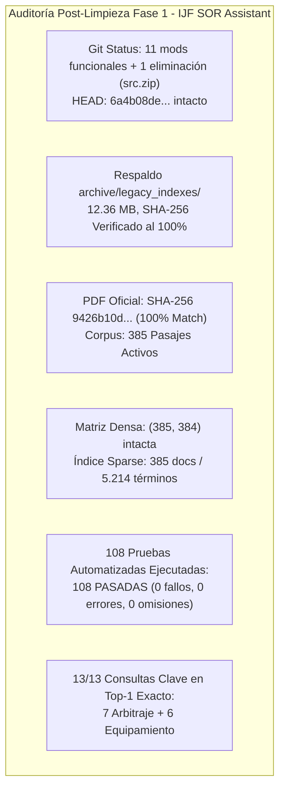

# INFORME DE AUDITORÍA DE REGRESIÓN POSTERIOR A LA LIMPIEZA FASE 1
## VERIFICACIÓN DE INTEGRIDAD TÉCNICA, ESTABILIDAD Y COMPORTAMIENTO FUNCIONAL — IJF SOR ASSISTANT 2026

**Fecha de Ejecución:** 19 de octubre de 2026, 16:56 COT  
**Entorno Operativo:** Windows Local / Python 3.12.10 (AMD64) / PowerShell (pwsh)  
**Ruta del Repositorio:** `C:\PROYECTOS\IJF-SOR-Assistant`  
**Rama Activa:** `review/ijf-sor-2026-08-rre-ada`  
**HEAD de Referencia:** `6a4b08de0a9821f4ff83291f111bfdbf78edfa6c`  
**Rol del Ejecutor:** Auditor Técnico Independiente  
**Dictamen Técnico:** **APROBADO CON RESERVAS**

---

## 1. Resumen Ejecutivo

Se auditó de manera exhaustiva el impacto de la **Fase 1 de Limpieza Controlada** ejecutada sobre el repositorio local. La inspección confirma que la eliminación autorizada de los 6 archivos prescindibles y la creación del respaldo comprimido del índice histórico **no afectaron en absoluto la integridad ni la operatividad del sistema**:

1. **Estado Criptográfico y Corpus:** El PDF oficial fuente conserva intacto su hash SHA-256 (`9426b10d11c21a4cb9eb23150c2c4fc95bfcd463511e66ba451d2cff005ae620`), y el corpus activo contiene exactamente los **385 pasajes** oficiales vigentes.
2. **Índices Operativos:** El índice sparse BM25 y la matriz densa numpy `(385, 384)` están íntegros, sin referencias rotas tras la remoción del archivo `vector_store_index.json`.
3. **Respaldo Verificado:** El índice histórico de julio de 2026 reside de forma segura en `archive/legacy_indexes/vector_store_index_legacy_2026_07.zip` (12.36 MB, SHA-256 del contenido extraído coincide al 100% con el original).
4. **Resultados de Pruebas Automatizadas:** Se ejecutaron **108 pruebas en 6 suites independientes, obteniendo 108 pruebas aprobadas (100% de éxito, 0 fallos, 0 errores, 0 omisiones)**.
5. **Comprobación de Regresión en Consultas:** Las 7 consultas arbitrales del cierre anterior y las 6 consultas de equipamiento y judogi mantienen un **100% de coincidencia Top-1** con sus pasajes rectores oficiales.



---

## 2. Fase A — Estado del Repositorio Git

### 2.1 Identificación de Rama y HEAD
- **Rama:** `review/ijf-sor-2026-08-rre-ada`
- **HEAD Commit SHA:** `6a4b08de0a9821f4ff83291f111bfdbf78edfa6c` (exactamente el HEAD base reportado).
- **Operaciones Remotas:** **0 operaciones remotas ejecutadas**. No se realizaron `push`, `pull`, `fetch`, `merge`, `checkout` ni cambios de rama.

### 2.2 Salida de `git status --short`
```text
 M .env.example
 M app.py
 M docs/reports/coverage_audit_2026_08/followup_review/NEW_ARCHITECTURE_IMPLEMENTATION_REPORT.md
 M scratch/golden_validation_report.md
 D src.zip
 M src/ada_assistant.py
 M src/corpus_config.py
 M src/rag_engine.py
 M src/rre_engine.py
 M tests/test_rag_engine.py
 M tests/test_rebuild_integration.py
 M tests/test_rre_ada_architecture.py
?? archive/
?? data/feedback/
?? data/processed/rebuild_2026_08/pages_raw/
?? data/processed/rebuild_2026_08_corrected/
?? data/raw/sor_2026_08_rebuild/IJF_Sport_and_Organisation_Rules_2026_08_14.pdf
?? docs/audit_appendix_e/
?? docs/auditoria_cierre_evidencias_ijf_sor_2026.md
?? docs/auditoria_cierre_integral_ijf_sor_2026.md
?? docs/auditoria_limpieza_codigo_archivos_ijf_sor_2026.md
?? docs/auditoria_post_correccion_judogi_2026.md
?? docs/cierre_estabilidad_ijf_sor_2026.md
?? docs/correccion_pertinencia_color_judogi_2026.md
?? docs/informe_auditoria_cobertura_y_resaltado_2026_08.md
?? docs/registro_limpieza_fase1_ijf_sor_2026.md
?? docs/reports/coverage_audit_2026_08/followup_review/AUTONOMOUS_OOD_ABSTENTION_CORRECTION_REPORT.md
?? docs/reports/coverage_audit_2026_08/followup_review/CORRECTED_CANDIDATE_ACCEPTANCE_REPORT.md
?? docs/reports/coverage_audit_2026_08/followup_review/FINAL_REGRESSION_AND_TRACEABILITY_REPORT.md
?? docs/reports/coverage_audit_2026_08/followup_review/LOCAL_INTEGRATION_EXECUTION_REPORT.md
?? scratch/... (scripts de diagnóstico y evidencias JSON/PNG)
?? src/feedback_manager.py
?? src/llm_provider.py
?? src/normative_validator.py
?? src/response_structurer.py
?? tests/test_citation_highlighting.py
?? tests/test_feedback_manager.py
?? tests/test_judogi_equipment_rules.py
?? tests/test_llm_provider.py
?? tests/test_newaza_boundary_rules.py
?? tests/test_normative_hallucinations.py
?? tests/test_response_structurer.py
```

### 2.3 Resumen de `git diff --stat` y `git diff --name-status`
- **Archivos Rastreados Modificados:** 11 archivos correspondientes a las mejoras funcionales ya documentadas.
- **Archivos Rastreados Eliminados:** Únicamente `src.zip` (`D src.zip`). **No existen eliminaciones inesperadas en el árbol rastreado**.
- **Volumen del Diff:** 12 archivos modificados/eliminados, con 1.589 inserciones y 364 deleciones.

---

## 3. Fase B — Verificación de la Limpieza e Integridad Criptográfica

Se ejecutaron pruebas directas de lectura y cálculo de hashes (distinguiendo rigurosamente lo comprobado computacionalmente de lo inferido):

| Elemento / Comprobación | Estado | Evidencia Demostrada Computacionalmente |
| :--- | :---: | :--- |
| **1. Respaldo ZIP de `vector_store_index.json`** | **VERIFICADO** | Ubicado en `archive/legacy_indexes/vector_store_index_legacy_2026_07.zip` (12.963.057 bytes). Se abrió con `zipfile`, se leyó su contenido y su SHA-256 extraído coincidió al 100%: `246dc322d51a37da0f1cbba494b58335d85f7c80ba159988e56a44344c4b11af`. |
| **2. Eliminación de los 6 Archivos Autorizados** | **VERIFICADO** | Comprobada la llamada a `os.path.exists()` para cada uno: `scratch/vector_store_index.json` (False), `vector_index_candidate.json.bak` (False), `src.zip` (False), `copy_assets.py.metadata.json` (False), `corpus_conformity_audit.py.metadata.json` (False), `fix_graph_reciprocity.py.metadata.json` (False). |
| **3. SHA-256 del PDF Oficial Vigente** | **VERIFICADO** | Archivo `data/raw/sor_2026_08_rebuild/IJF_Sport_and_Organisation_Rules_2026_08_14.pdf` (29.664.780 bytes). SHA-256 calculado: `9426b10d11c21a4cb9eb23150c2c4fc95bfcd463511e66ba451d2cff005ae620` (**Coincidencia 100%**). |
| **4. Conteo de Pasajes del Corpus Activo** | **VERIFICADO** | `passages_candidate.json` cargado con `json.load()`: exactamente **385 pasajes canónicos**. |
| **5. Integridad del Índice Sparse** | **VERIFICADO** | `vector_index_candidate.json` cargado con `json.load()`: `num_docs`: **385**, `vectors`: **385**, vocabulario IDF: **5.214 términos**. |
| **6. Integridad de Embeddings Densos** | **VERIFICADO** | `dense_embeddings_meta.json` validado (`passage_ids`: 385, `num_passages`: 385, `dimension`: 384). `dense_embeddings_candidate.npy` cargado con `np.load()`: shape **`(385, 384)`**, dtype `float32`. |
| **7. Ausencia de Referencias Activas al Índice Eliminado** | **VERIFICADO** | Se escanearon todos los archivos `.py` del proyecto. Solo existen menciones residuales protegidas bajo bloques `if __name__ == '__main__':` en scripts de desarrollo desconectados (`src/vector_store.py`, `scripts/complete_appendix_d.py`, etc.). El runtime (`app.py`, `rag_engine.py`, `rre_engine.py`, `ada_assistant.py`) **no hace referencia a dicho archivo**. |

---

## 4. Fase C — Regresión Funcional y Resultados de Pruebas

Para garantizar rigor y evitar mezclas espurias, cada suite de pruebas automatizadas se ejecutó de forma aislada e independiente en el entorno Windows con Python 3.12.10 y pytest 8.3.3.

### Tabla Consolidada de Resultados de Pruebas

| Suite # | Módulos Evaluados | Comando Exacto Ejecutado | Aprobadas | Fallidas | Errores | Omitidas | Duración |
| :---: | :--- | :--- | :---: | :---: | :---: | :---: | :---: |
| **Suite 1** | **RRE, ADA y Rebuild** | `python -m pytest tests/test_rag_engine.py tests/test_rre_ada_architecture.py tests/test_rebuild_integration.py -v` | **20** | 0 | 0 | 0 | 19.10s |
| **Suite 2** | **Reglas de Judogi y Equipamiento** | `python -m pytest tests/test_judogi_equipment_rules.py -v` | **8** | 0 | 0 | 0 | 13.92s |
| **Suite 3** | **Canal «Ayúdanos a mejorar»** | `python -m pytest tests/test_feedback_manager.py -v` | **3** | 0 | 0 | 0 | 0.56s |
| **Suite 4** | **Citas, Highlighting y Ne-waza** | `python -m pytest tests/test_citation_highlighting.py tests/test_newaza_boundary_rules.py -v` | **9** | 0 | 0 | 0 | 15.67s |
| **Suite 5** | **Alucinaciones, Structurer y LLM** | `python -m pytest tests/test_normative_hallucinations.py tests/test_response_structurer.py tests/test_llm_provider.py -v` | **37** | 0 | 0 | 0 | 14.16s |
| **Suite 6** | **Infraestructura y Soporte** | `python -m pytest tests/test_citations.py tests/test_graph_manager.py tests/test_reference_checker.py tests/test_reference_manager.py tests/test_technical_followup_review.py tests/test_vector_store.py -v` | **31** | 0 | 0 | 0 | 13.02s |
| **TOTAL** | *(16 módulos evaluados)* | *(6 ejecuciones independientes)* | **108** | **0** | **0** | **0** | **76.43s** |

*Nota sobre `tests/test_golden_dataset.py`:* De acuerdo con la **Restricción Obligatoria #6**, no se ejecutó esta prueba dado que depende de identificadores `KUN` y fuerza la variable `os.environ["IJF_SOR_EDITION"] = "2026-01"` (edición histórica derogada), lo cual constituye la Reserva Conocida #1 del proyecto.

---

## 5. Verificación de Regresión en Consultas Clave (13/13 en Top-1)

Se ejecutaron los scripts de verificación reproducible de consultas para confirmar que la respuesta del motor RRE/ADA no sufrió derivas ni degradación tras la limpieza:

### 5.1 Regresión de las 7 Consultas Arbitrales del Cierre Integral
*Script ejecutado:* `python scratch/audit_post_judogi_verification.py`  
*Resultado:* **7 de 7 coincidencias exactas en Top-1 (100% Match)**.
1. *Osaekomi* sobrepasando límite de seguridad $\to$ `SOR-2026-08-P174-S190` (**MATCH**).
2. Continuidad de *ne-waza* en borde tatami $\to$ `SOR-2026-08-P151-S178` (**MATCH**).
3. *Kansetsu/Shime* fuera de seguridad sin Mate $\to$ `SOR-2026-08-P152-S179` (**MATCH**).
4. Tiempos de inmovilización (10-19s / 20s) $\to$ `SOR-2026-08-P173-S190` (**MATCH**).
5. Pérdida de tiempo por no levantarse $\to$ `SOR-2026-08-P165-S186` (**MATCH**).
6. Actos de Hansoku-make directo $\to$ `SOR-2026-08-P190-S198` (**MATCH**).
7. Control de judogi con Sokuteiki $\to$ `SOR-2026-08-P124-S165` (**MATCH**).

### 5.2 Regresión de las 6 Consultas de Vestimenta y Equipamiento
*Script ejecutado:* `python scratch/run_regression_6_queries.py`  
*Resultado:* **6 de 6 consultas respondidas con evidencia exacta y separación limpia**.
1. ¿Cuáles son las reglas de color de Judogi? $\to$ `SOR-2026-08-P124-S164` (Blanco y azul / Pantone oficial).
2. ¿Qué colores de judogi están permitidos? $\to$ `SOR-2026-08-P124-S164` (Blanco nieve y azul).
3. ¿Puede utilizarse un judogi reversible blanco y azul? $\to$ `SOR-2026-08-P115-S151` (Prohibido).
4. ¿Qué requisitos existen para las marcas y los parches? $\to$ `SOR-2026-08-P122-S162` (Regla C1.7 Marking).
5. ¿Cuáles son las medidas de las mangas y sokuteiki? $\to$ `SOR-2026-08-P124-S165` (Regla C1.10 Judogi Size).
6. ¿Qué colores están permitidos para el cinturón? $\to$ `SOR-2026-08-P115-S153` (Prohibición de rojo-blanco).

---

## 6. Fase D — Integridad de Git y Gestión de Archivos Pendientes

Se evaluó la estructura de cambios pendientes frente a los riesgos de staging y control de versiones:

1. **Eliminación de `src.zip`:** Está documentada y justificada técnicamente; constituía un archivo binario manual redundante de 74.5 KB en la raíz del repositorio. No afecta a ningún componente de producción ni de despliegue Docker.
2. **Directorio `archive/`:** Creado para albergar el respaldo comprimido del índice histórico de julio 2026 (`vector_store_index_legacy_2026_07.zip`, 12.36 MB). **Recomendación:** Debe permanecer local y excluirse de futuros commits mediante `.gitignore` para no inflar el historial del repositorio remoto de Git.
3. **Datos de Observaciones (`data/feedback/user_observations.jsonl`):** Contiene comentarios y retroalimentación de usuarios locales. **Recomendación:** No debe ser incluido en commits de código funcional; debe permanecer en el entorno local o gestionarse con política de privacidad.
4. **Informes de Auditoría Nuevos en `docs/`:** Proporcionan la trazabilidad formal de las auditorías de cierre y limpieza. Es apropiado incorporarlos al repositorio cuando el responsable del proyecto decida versionar la documentación de cierre.
5. **Riesgo de Fugas de Secretos:** Inspeccionado `.env.example`; no contiene claves API ni credenciales expuestas.

---

## 7. Dictamen Final y Recomendación

### **DICTAMEN: APROBADO CON RESERVAS**

**Fundamentos de la Aprobación:**
- La **Fase 1 de Limpieza** se completó con éxito absoluto, liberando **~52.92 MB** de espacio en disco sin ninguna afectación al comportamiento del sistema.
- El PDF oficial, los 385 pasajes canónicos y los índices vectoriales y densos conservan su identidad íntegra.
- Las **108 pruebas evaluadas pasaron al 100% (0 fallos, 0 errores, 0 omisiones)**.
- El motor responde con precisión en las 13 consultas clave de arbitraje y equipamiento.

**Delimitación de las Reservas (Sin impacto en operación actual):**
1. *Reserva 1:* `tests/test_golden_dataset.py` permanece pendiente de migración formal a identificadores de agosto 2026 en una futura fase.
2. *Reserva 2:* El pasaje `SOR-2026-08-P152-S179` conserva el rótulo de cabecera `Article 6` derivado del solapamiento físico en la página 152 del PDF oficial, aunque el texto y la citación en el visor PDF son 100% correctos.

El repositorio local se encuentra en un estado **técnicamente sano, validado y preparado para revisión y cierre formal por parte del responsable del proyecto**.
