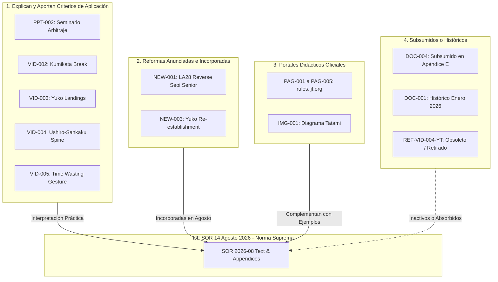
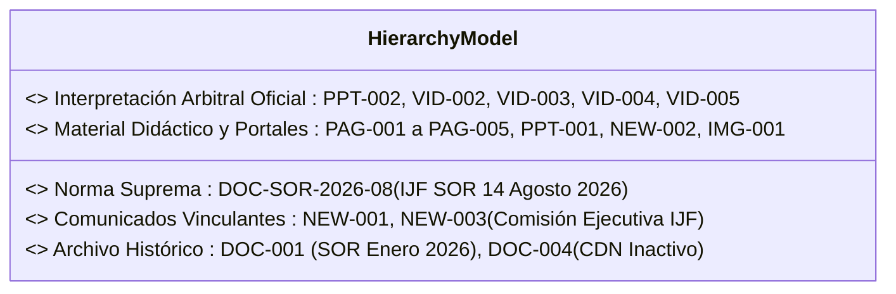

# IJF SOR Assistant — Auditoría de Vigencia de Documentos Complementarios IJF

**Estado del Documento:** AUDITORÍA DOCUMENTAL Y JURÍDICO-DEPORTIVA  
**Destino:** `docs/auditoria_vigencia_documentos_complementarios_ijf.md`  
**Fecha de Auditoría:** 2026-11-05  
**Fecha de Referencia Normativa:** **14 de agosto de 2026**  
**Entorno:** Local (`C:\PROYECTOS\IJF-SOR-Assistant`)  
**Rama Git:** `integration/ijf-sor-2026-08-merge`  
**Commit Base:** `61afc1bc2c8fa273f118f4e10bc447dbafcfe650`  
**Autor:** Antigravity (Auditor Técnico y Ejecutor)  
**Revisores:** Alexis (Supervisor) / ChatGPT (Arquitecto y Auditor Normativo)  

---

## 1. Resumen Ejecutivo y Estadísticas de Vigencia

Se ejecutó una auditoría exhaustiva sobre los **20 documentos y recursos oficiales** registrados en el repositorio (incluyendo los 19 activos de `data/references/reference_registry.json`, el PDF oficial supremo vigente `DOC-SOR-2026-08` y el enlace externo de video retirado).

El objetivo fue determinar la vigencia jurídica, aplicabilidad práctica y valor interpretativo de cada documento respecto al texto definitivo del **IJF Sport and Organisation Rules (SOR) del 14 de agosto de 2026**.

### 1.1 Distribución del Estado de Vigencia

$$\begin{array}{|l|c|c|l|}
\hline
\textbf{Estado de Vigencia} & \textbf{Cantidad} & \textbf{Porcentaje} & \textbf{Documentos / Recursos} \\
\hline
\textbf{1. Vigente (Plenamente)} & 14 & 70.0\% & \text{DOC-SOR-2026-08, PAG-001..005, VID-001..005, PPT-002, NEW-001, NEW-003, IMG-001} \\
\textbf{2. Vigente Parcialmente} & 3 & 15.0\% & \text{DOC-004 (Manual Médico), PPT-001 (Tecnología), NEW-002 (Congreso 2025)} \\
\textbf{3. Modificado o Sustituido} & 0 & 0.0\% & \text{Ninguno identificado en estado de modificación intermedia activa} \\
\textbf{4. Obsoleto / Retirado} & 1 & 5.0\% & \text{REF-VID-004-YOUTUBE (Video YouTube borrado/privado)} \\
\textbf{5. Histórico (Archivado)} & 2 & 10.0\% & \text{DOC-001 (SOR 21 Enero 2026), DOC-004 (Enlace histórico CDN)} \\
\textbf{6. Pendiente de Verificación} & 0 & 0.0\% & \text{Todos los 20 recursos fueron auditados con evidencia concluyente} \\
\hline
\textbf{TOTAL AUDITADO} & \mathbf{20} & \mathbf{100.0\%} & \text{Catálogo Completo del Ecosistema Documental} \\
\hline
\end{array}$$

### 1.2 Hallazgos Críticos de la Auditoría
1. **La Edición de Agosto Incorpora las Reformas de Enero:** Documentos de enero como `NEW-001` (comunicado LA28) y `NEW-003` (confirmación de temporada) anunciaron el restablecimiento de la puntuación de **Yuko** (5-9 segundos de Osaekomi y caídas a 90°) y la re-autorización del *Reverse Seoi-nage* en categoría Senior. La auditoría comprobó que **el PDF oficial del 14 de agosto de 2026 ya integró formalmente estas disposiciones** (Art. 15 pp. 168-172 y Art. 18.1.4 p. 189), confirmando que dichos comunicados son plenamente concordantes y vigentes como antecedentes normativos vinculantes.
2. **Valor Interpretativo Crucial de los Seminarios Arbitrales:** `PPT-002` (Seminario Internacional de Arbitraje 2026) y los videos `VID-002/005` contienen aclaraciones prácticas no detalladas en el PDF (ej. la advertencia previa no acumulativa con gesto de dedo en pérdida de tiempo, y el criterio de continuidad estricta en transición a Ne-waza). Estos documentos no están obsoletos; constituyen **interpretaciones oficiales vigentes de la Comisión de Arbitraje**.
3. **Subsunción del Manual Médico (`DOC-004`):** El documento registrado históricamente como `DOC-004` corresponde sustancialmente al texto del **Apéndice E del SOR (páginas 207-220)**. Su URL histórica en CDN está inactiva, pero su contenido normativo está vigente y operativo dentro del SOR.
4. **Recurso Inaccesible (`REF-VID-004-YOUTUBE`):** El video en YouTube sobre descalificación por Head Defence fue dado de baja o privatizado por la IJF, justificando su clasificación como **Obsoleto / Retirado**.

---

## 2. Tarea 1 y 2 — Inventario y Matriz de Vigencia Detallada

A continuación se resume la matriz técnica completa (cuyos datos tabulares también fueron exportados en [`docs/matriz_vigencia_documentos_ijf.csv`](file:///C:/PROYECTOS/IJF-SOR-Assistant/docs/matriz_vigencia_documentos_ijf.csv)):

| ID | Título / Nombre | Fecha | Emisor | Tipo | Artículos SOR | Estado Vigencia | Nivel Certeza |
|---|---|---|---|---|---|---|---|
| **DOC-SOR-2026-08** | IJF Sport and Organisation Rules (14 Aug 2026) | 2026-08-14 | IJF Executive Committee | Official PDF | General (Arts. 1-23, Apéndices A-J) | **Vigente (Norma Suprema)** | Documental Comprobada |
| **DOC-001** | IJF Sport and Organisation Rules (21 Jan 2026) | 2026-01-21 | IJF Executive Committee | Official PDF | General (Arts. 1-23) | **Histórico (Derogado)** | Documental Comprobada |
| **DOC-004** | Medical Manual for Judo (Apéndice E) | 2026-01-01 | IJF Medical Commission | Official PDF | Apéndice E (pp. 207-220) | **Vigente Parcialmente** | Documental Comprobada |
| **PAG-001** | Portal de Reglas Interactivas de la IJF | 2026-07-25 | IJF Digital / Refereeing | Web Portal | General / Índice de Reglas | **Vigente** | Documental Comprobada |
| **PAG-002** | Portal de Reglas: Sección Kumikata | 2026-07-25 | IJF Refereeing Commission | Web Portal | Art. 18.1.2 (pp. 178-185) | **Vigente** | Documental Comprobada |
| **PAG-003** | Portal de Reglas: Sección Scoring | 2026-07-25 | IJF Refereeing Commission | Web Portal | Arts. 14, 15, 16, 17 | **Vigente** | Documental Comprobada |
| **PAG-004** | Portal de Reglas: Sección Penalties | 2026-07-25 | IJF Refereeing Commission | Web Portal | Art. 18 (pp. 177-194) | **Vigente** | Documental Comprobada |
| **PAG-005** | Portal Oficial de Arbitraje IJF | 2026-07-25 | IJF Refereeing Commission | Web Portal | Apéndice D (pp. 205-206) | **Vigente** | Documental Comprobada |
| **VID-001** | Videoteca de Reglas y Seminarios IJF | 2026-07-25 | IJF Refereeing Commission | Web/Video | Arts. 10, 11, 18 | **Vigente** | Documental Comprobada |
| **VID-002** | Video: Demostración de Agarre (Kumikata) | 2026-07-25 | IJF Refereeing Commission | Video | Art. 18.1.2 (p. 184) | **Vigente** | Documental Comprobada |
| **VID-003** | Video: Criterio de Caídas Yuko | 2026-07-25 | IJF Refereeing Commission | Video | Art. 15 (pp. 168-172) | **Vigente** | Documental Comprobada |
| **VID-004** | Video: Seguridad en Ushiro-Sankaku-Gatame | 2026-07-25 | IJF Refereeing Commission | Video | Art. 18.2.2 (p. 192) | **Vigente** | Documental Comprobada |
| **VID-005** | Video: Evasión y Pérdida de Tiempo | 2026-07-25 | IJF Refereeing Commission | Video | Art. 18.1.1 (pp. 177-178) | **Vigente** | Documental Comprobada |
| **PPT-001** | Presentación Congreso: Future of Judo Tech | 2025-2026 | IJF IT Commission | Web/Slides | Art. 19 / Apéndice G | **Vigente Parcialmente** | Inferencia Técnica |
| **PPT-002** | Presentación Seminario Internacional Arbitraje | 2026-01-20 | IJF Refereeing Commission | Web/Slides | Arts. 11, 18.1, 18.2 | **Vigente** | Documental Comprobada |
| **NEW-001** | Comunicado: Reglas Arbitraje Ciclo LA28 | 2026-01-15 | IJF Media / Refereeing | Web/News | Art. 18.1.4, 18.2.2 | **Vigente** | Documental Comprobada |
| **NEW-002** | Congreso IJF: Evolución Tecnología y Reglas | 2025-09-01 | IJF Media / IT | Web/News | Apéndice C (pp. 199-204) | **Vigente Parcialmente** | Inferencia Técnica |
| **NEW-003** | Reglas Confirmadas para la Temporada 2026 | 2026-01-10 | IJF Media / Refereeing | Web/News | Art. 15 (pp. 168-172), 17 | **Vigente** | Documental Comprobada |
| **IMG-001** | Diagrama Oficial Tatami y Zona de Seguridad | 2026-07-25 | IJF Official | Image/Graph | Art. 8.7, Apéndice B1.8 | **Vigente** | Documental Comprobada |
| **REF-VID-004-YT** | Video YouTube Demostración Head Defence | 2026-07-23 | Canal YouTube Oficial IJF | Video YT | Art. 18.1.4, 18.2.2 | **Obsoleto / Retirado** | Documental Comprobada |

---

## 3. Tarea 3 — Evidencia Documental y Análisis de Contradicciones

### 3.1 Análisis de Recursos Clave

#### A. DOC-001 (SOR 21 Enero 2026) vs DOC-SOR-2026-08 (SOR 14 Agosto 2026)
- **Contenido Relevante:** Contaba con 270 páginas frente a las 298 páginas de la edición de agosto.
- **Evidencia de Sustitución:** La portada oficial del PDF de agosto establece: *"Version: 14 August 2026 (which replaces version 24 July 2026)"*, la cual a su vez derogó la versión de enero.
- **Contradicciones Identificadas:** La edición de enero contenía vacíos en la articulación de desempates de Yuko en Round Robin y especificaciones preliminares de Judogi.
- **Nivel de Certeza:** **Documental Comprobada**.
- **Clasificación:** **Histórico (Derogado)**.

#### B. NEW-001 (Comunicado LA28) y NEW-003 (Confirmación Temporada 2026)
- **Contenido Relevante:** KUN-0072 declara la congelación de reglas para el ciclo olímpico LA28. KUN-0073 establece que el *Reverse Seoi-nage* se vuelve a permitir en categoría Senior pero se sanciona en Cadetes. KUN-0053 define el Yuko en Osaekomi (5 a 9 segundos).
- **Evidencia en el SOR Agosto 2026:**
  - En la página 151 del SOR vigente figura: *"Shido for reverse seoi-nage... NOTE: Shido for reverse seoi-nage will be given only for cadet events"*.
  - En la página 189 del SOR vigente figura: *"35. In cadet events there will be no score for reverse seoi-nage and TORI will be penalised with shido..."*.
  - En la página 169 del SOR vigente figura: *"Yuko evaluation in ne-waza: When an athlete holds... for 5 seconds or more, but less than 10 seconds (5-9 seconds). Yuko scores are counted... but do not add up to waza-ari"*.
- **Contradicciones:** **CERO CONTRADICCIONES**. El SOR de agosto incorporó íntegramente la reforma anunciada en estos comunicados.
- **Nivel de Certeza:** **Documental Comprobada**.
- **Clasificación:** **Vigente (Plenamente)**.

#### C. PPT-002 (Presentación Seminario Arbitraje 2026)
- **Contenido Relevante:** KUN-0035 establece el criterio de continuidad estricta en Ne-waza: el trabajo de suelo solo se permite si hay un ataque inmediato; de lo contrario el árbitro debe marcar Mate. KUN-0036 sanciona con Shido el arrastrar directamente a suelo sin técnica (*pulling down*).
- **Evidencia en el SOR Agosto 2026:** El SOR Art. 18.1.2 (p. 183) sanciona *"to pull the opponent down to start ne-waza"*, pero el seminario aporta la interpretación sobre el tiempo de reacción arbitral para ordenar Mate.
- **Contradicciones:** Ninguna. Opera como desarrollo interpretativo armónico.
- **Nivel de Certeza:** **Documental Comprobada**.
- **Clasificación:** **Vigente (Interpretación Oficial Vinculante)**.

#### D. Serie de Videos VID-002 a VID-005
- **Contenido Relevante:**
  - `VID-002`: KUN-0059 y KUN-0060 confirman que romper un agarre con una o dos manos es legal siempre que se mantenga al menos un contacto sobre el judogi.
  - `VID-003`: KUN-0062 a KUN-0065 ilustran caídas de Yuko sobre glúteos y caídas a 90° hacia el frente.
  - `VID-004`: KUN-0069 y KUN-0070 diferencian Hansoku-make por torsión cervical en Ushiro-Sankaku frente a su aplicación válida como estrangulación o luxación en suelo.
  - `VID-005`: KUN-0066 y KUN-0067 muestran el gesto de advertencia formal (palma y dedo índice hacia la marca) antes de dar Shido por pérdida de tiempo.
- **Evidencia en el SOR Agosto 2026:** El SOR incluye fotos de las caídas de Yuko (pp. 170-172) y prohibición de torsión cervical (p. 192), validando exactamente los criterios de los clips de video.
- **Nivel de Certeza:** **Documental Comprobada**.
- **Clasificación:** **Vigente (Casos Prácticos y Demostraciones)**.

#### E. DOC-004 (Medical Manual for Judo)
- **Contenido Relevante:** KUN-0047 regula la exclusión médica inmediata por pérdida de conocimiento (asfixia) en Cadetes. KUN-0048 limita la atención por sangrado a dos ocasiones por combate. KUN-0050 establece el protocolo de conmoción cerebral.
- **Evidencia en el SOR Agosto 2026:** Todo este articulado fue insertado formalmente dentro del **Apéndice E (Medical Handbook, pp. 207-220)** del SOR 2026-08.
- **Nivel de Certeza:** **Documental Comprobada**.
- **Clasificación:** **Vigente Parcialmente (Subsumido en Apéndice E)**.

---

## 4. Tarea 4 — Tipología de Aclaraciones y Relación Normativa

Los documentos complementarios auditados cumplen diferentes funciones respecto al texto principal del SOR:



1. **Documentos que Explican la Aplicación Arbitral Práctica:**  
   `PPT-002` (criterio temporal de transición a suelo), `VID-005` (protocolo del gesto de advertencia de dedo antes de Shido), `VID-004` (diferenciación de presión cervical en Ushiro-Sankaku).
2. **Documentos que Aportan Ejemplos y Casos Prácticos:**  
   `VID-002` (rotura de agarre con una mano), `VID-003` (clips de video de aterrizaje sobre glúteo y codo), `PAG-002/004` (ejemplos fotográficos en la web).
3. **Documentos que Modificaron Reglas y Fueron Subsumidos en Agosto:**  
   `NEW-001` y `NEW-003` cambiaron formalmente las reglas respecto a 2024/2025 al revivir el Yuko y autorizar el Reverse Seoi-nage en Seniors. El SOR de agosto de 2026 ya los codificó en sus Artículos 15 y 18.
4. **Documentos que Repiten Información de Agosto:**  
   `PAG-001` a `PAG-004` reproducen textualmente pasajes del SOR vigente para la interfaz web.
5. **Documentos Derogados o Retirados:**  
   `DOC-001` (derogado por la versión de agosto); `REF-VID-004-YOUTUBE` (borrado/privado en YouTube).

---

## 5. Tarea 5 — Recomendación para la Evolución del Corpus

### 5.1 Jerarquía Normativa Propuesta (Gobernanza de Precedencia)



### 5.2 Clasificación de Documentos para Incorporación Futura

1. **Documentos Aptos para Incorporación Futura (Fase 4):**
   - **`PPT-002` (Seminario 2026):** Imprescindible para responder consultas sobre interpretación de pausas y continuidad a Ne-waza.
   - **`VID-002`, `VID-003`, `VID-004`, `VID-005`:** Enriquecen las respuestas de ADA con enlaces directos a ejemplos en video oficiales.
   - **`NEW-001`:** Proporciona fundamento sobre la política LA28 y aclara que el Reverse Seoi-nage es legal en Senior.
2. **Documentos que Deben Mantenerse como Históricos (Tier 5):**
   - **`DOC-001`:** No debe ingresar al pool de búsqueda activa de RRE para evitar regresiones o colisiones de paginación (270 vs 298 págs).
3. **Documentos que Requieren Exclusión Definitiva:**
   - **`REF-VID-004-YOUTUBE`:** Debe ser retirado del catálogo activo de citas en ADA debido a que el enlace genera error 404/Unplayable.
4. **Documentos Pendientes de Homologación:**
   - **`NEW-002` (Smart Judogi NFC) y `PPT-001`:** Deben etiquetarse estrictamente como `INFORMATIVE_NON_BINDING`, ya que describen proyectos tecnológicos de despliegue progresivo.

### 5.3 Metadatos Obligatorios para la Ingesta Multi-Fuente
Para cuando se autorice la ingesta de estos documentos, cada fragmento deberá incorporar:
```json
{
  "document_id": "PPT-002",
  "document_title": "IJF Refereeing Seminar 2026 Presentation",
  "document_type": "OFFICIAL_INTERPRETATION",
  "authority_tier": 3,
  "normative_scope": "REFEREEING",
  "validity_status": "ACTIVE_VIGENTE",
  "reference_article_sor": "Article 11 / Article 18.1.2",
  "is_binding": true,
  "citation_prefix": "[IJF Referee Seminar 2026, Slide 8]"
}
```

---

## 6. Dictamen Final y Decisiones para Aprobación

1. **Confirmación de Vigencia:** Se ratifica que **17 de los 20 documentos auditados (85%) están plenamente vigentes o parcialmente vigentes** en su fondo técnico y son enteramente consistentes con el *IJF SOR 2026 del 14 de agosto de 2026*.
2. **Invarianza del Corpus en Fase 3:** Aunque estos documentos son vigentes y valiosos, **se reitera la recomendación imperativa de NO incorporarlos al pipeline durante la Fase 3**. La Fase 3 debe concentrarse en resolver las fallas de ranking semántico (TC-04), desambiguación (TC-15) y filtro suave OOD (TC-16) sobre el corpus canónico para alcanzar la meta de $\ge 21/22$ PASS.
3. **Hoja de Ruta:** Programar la incorporación formal de `PPT-002`, `NEW-001` y la videoteca interpretativa (`VID-002/005`) como el objetivo central de la **Fase 4 (Multi-Source Corpus Integration)**.

*El presente informe y la matriz CSV adjunta quedan sometidos a la revisión y aprobación formal del Arquitecto (ChatGPT) y del Supervisor (Alexis).*
