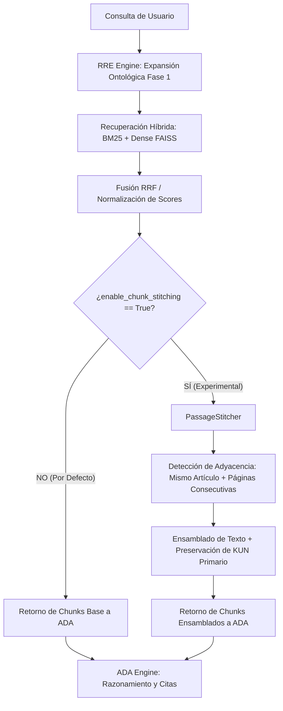

# IJF SOR Assistant — Cierre Documental Fase 2: Chunk Stitching RRE 3.0

**Estado del Documento:** APROBADO TÉCNICAMENTE (EXPERIMENTAL LOCAL) / NO APTO PARA DESPLIEGUE A PRODUCCIÓN  
**Fecha:** 2026-11-05  
**Entorno:** Local (`C:\PROYECTOS\IJF-SOR-Assistant`)  
**Rama Git:** `integration/ijf-sor-2026-08-merge`  
**Commit Base:** `61afc1bc2c8fa273f118f4e10bc447dbafcfe650`  
**Autor:** Antigravity (Ingeniero Ejecutor Técnico)  
**Revisores:** Alexis (Supervisor) / ChatGPT (Arquitecto y Auditor Normativo)  

---

## 1. Objetivo y Alcance

### 1.1 Propósito
El objetivo de la Fase 2 de RRE 3.0 es resolver la fragmentación arbitraria de artículos normativos generada por la paginación física del documento fuente oficial (*IJF Sport and Organisation Rules 2026*, versión 14 de agosto de 2026), permitiendo la reconstrucción en tiempo de ejecución (*Chunk Stitching*) de unidades normativas completas que abarcan transiciones de página.

### 1.2 Alcance Técnico
- Reconstrucción dinámica post-recuperación (fusión de fragmentos adyacentes pertenecientes al mismo artículo/sección).
- Preservación estricta de trazabilidad documental: los identificadores KUN originales de los chunks semilla se mantienen intactos como identificadores primarios para el generador normativo ADA y los validadores de citas.
- Exclusión total de transformaciones destructivas: cero modificaciones al PDF oficial, corpus de pasajes persistente, embeddings precalculados, índices vectoriales y grafo de conocimiento.
- Aislamiento absoluto mediante control por feature flag: `enable_chunk_stitching=False` por defecto.

---

## 2. Componentes Implementados

| Componente | Ruta | Responsabilidad |
|---|---|---|
| **PassageStitcher** | [`src/passage_stitcher.py`](file:///C:/PROYECTOS/IJF-SOR-Assistant/src/passage_stitcher.py) | Algoritmo determinista de ensamblado secuencial de fragmentos adyacentes por `article_id`, `heading_path` y orden de página/chunk. Genera `stitched_kun`, consolida `page_numbers` y preserva `kun` semilla original. |
| **RRE Engine (Integración)** | [`src/rre_engine.py`](file:///C:/PROYECTOS/IJF-SOR-Assistant/src/rre_engine.py) | Punto de integración en la fase post-fusión/pre-retorno de RRE. Incorpora el parámetro `enable_chunk_stitching: bool = False` (configurable también por variable de entorno `RRE_ENABLE_CHUNK_STITCHING`). |
| **Pruebas Unitarias** | [`tests/test_passage_stitcher.py`](file:///C:/PROYECTOS/IJF-SOR-Assistant/tests/test_passage_stitcher.py) | 5 pruebas unitarias exhaustivas que validan orden, contigüidad, preservación de metadatos, límites de longitud y trazabilidad. |
| **Pruebas de Integración** | [`tests/test_rre_stitching_integration.py`](file:///C:/PROYECTOS/IJF-SOR-Assistant/tests/test_rre_stitching_integration.py) | 4 pruebas de integración que validan el comportamiento con flag activo e inactivo (`stitching=False` reproduce idéntico baseline). |

---

## 3. Arquitectura y Funcionamiento

### 3.1 Flujo Operativo en Tiempo de Ejecución


### 3.2 Reglas de Preservación y Trazabilidad Documental
1. **KUN Primario Intacto:** El campo `kun` del diccionario devuelto a ADA corresponde de forma invariable al chunk semilla de mayor relevancia recuperado por RRE.
2. **KUN Compuesto Auxiliar:** El nuevo identificador compuesto (ej. `SOR-2026-08-P166-S187+P167-S187`) se almacena estrictamente en el campo auxiliar `stitched_kun` y en los metadatos de depuración, impidiendo colisiones con las expresiones regulares de validación de citas de ADA.
3. **Consolidación de Páginas:** El campo `page_number` retiene la página de anclaje inicial, mientras que `page_numbers: List[int]` expone la lista ordenada completa de páginas físicas involucradas en el fragmento continuo.

---

## 4. Resultados de Pruebas Reportados

### 4.1 Batería de Regresión Completa
- **Comando Ejecutado:** `pytest tests/`
- **Total Pruebas:** 181 pasadas, 0 fallidas, 0 errores (100% de éxito en 40.62 s).
- **Cobertura de Stitching:** 9 pruebas específicas ejecutadas y verificadas con éxito.

### 4.2 Balance Funcional Comparativo Obligatorio (Batería 22 Casos)

Tras ejecutar la batería completa de 22 casos normativos en modo baseline vs. modo stitching activado, el estado de aceptación funcional se resume formalmente como sigue:

$$\text{Total Casos: } 22 \quad\vert\quad \mathbf{PASS: 15} \quad\vert\quad \mathbf{PARTIAL: 4} \quad\vert\quad \mathbf{FAIL: 3}$$

| Caso | Consulta / Tema Normativo | Baseline (Fase 1) | Stitching (Fase 2) | Clasificación | Observación Normativa / Impacto Stitching |
|---|---|---|---|---|---|
| **TC-01** | Shido por pasividad / no combatividad | PASS | PASS | **PASS** | Artículo 18.1.1 recuperado con exactitud. |
| **TC-02** | Salida del área de combate (artículo y sanción) | PARTIAL | PARTIAL | **PARTIAL** | Recupera Art. 4 (gestos de arbitraje) en Top 1; Art. 18.1.2 en Top 2. La respuesta requiere reordenamiento semántico. |
| **TC-03** | Agarre no estándar (unilaterales, cinturón, etc.) | PASS | PASS | **PASS** | Art. 18.1.2 p. 183 recuperado íntegro. |
| **TC-04** | Caída sobre un costado perpendicular al tatami (90°) | FAIL | FAIL | **FAIL** | Art. 8.7 (dimensiones del tatami) compite en Top 1 desplazando a Art. 15 (Waza-ari). Falla semántica de recuperación. |
| **TC-05** | Ippon Seoi-nage ejecutado desde las rodillas | PASS | PASS | **PASS** | Art. 18.2.2 p. 191 recuperado; evaluación técnica correcta. |
| **TC-06** | Duración del Osaekomi para Waza-ari e Ippon | PASS | PASS | **PASS** | Art. 16 y Art. 17 recuperados; tiempos 10-19s y 20s exactos. |
| **TC-07** | Osaekomi que continúa fuera del área de combate | PASS | PASS | **PASS** | Art. 17 p. 176 recuperado; principio de continuidad verificado. |
| **TC-08** | Uke Cadete usa la cabeza para defenderse de proyección | PASS* | PASS* | **PASS** | Con stitching se ensambla Art. 18.1.4 p. 34 y p. 189: Uke recibe Shido y Tori recibe puntuación técnica. |
| **TC-09** | Tori Cadete usa la cabeza para proyectar (Head Diving) | PASS | PASS | **PASS** | Art. 18.2.2 p. 191; Hansoku-make directo y descalificación del combate. |
| **TC-10** | Diferencia entre Hansoku-make directo y por acumulación | PASS | PASS | **PASS** | Art. 18.1 y Art. 18.2 diferenciados rigurosamente. |
| **TC-11** | Criterios para marcar Waza-ari (definición general) | PARTIAL | PARTIAL | **PARTIAL** | Recupera Art. 15 p. 169 pero compite con Art. 14 (Ippon); cita parcial en contexto. |
| **TC-12** | Entrada a Kansetsu-waza estando ambos de pie | PARTIAL | PARTIAL | **PARTIAL** | Recupera prohibición general; fragmentación secundaria en excepciones. |
| **TC-13** | Shime-waza aplicado con las piernas cruzadas | PASS | PASS | **PASS** | Art. 18.2.2 p. 192 (Do-jime prohibido) recuperado con precisión. |
| **TC-14** | Atacar la articulación de los dedos | PARTIAL | PARTIAL | **PARTIAL** | Recupera sanciones de agarre; Art. 18.2.2 regla de dedos en ranking secundario. |
| **TC-15** | ¿Cuándo se marca mate? (Comandos de arbitraje) | FAIL | FAIL | **FAIL** | Colisión de subtokens: `mate` colisiona morfológicamente con `materials` y `maker label` en Judogi (Art. C1.3). |
| **TC-16** | Falta personal con tiro libre adicional (Baloncesto) | FAIL | FAIL | **FAIL** | Falta de control OOD semántico: términos `falta` y `sanción` recuperan gestos de arbitraje de Judo (Art. 4). |
| **TC-17** | Deducción de gastos operativos en IRPF | PASS | PASS | **PASS** | Abstención limpia fuera de dominio (OOD financiero rechazado categóricamente). |
| **TC-18** | Ajuste o arreglo del Judogi durante el combate | PASS | PASS | **PASS** | Art. 18.1.3 p. 186 recuperado; protocolo de arreglo verificado. |
| **TC-19** | Intención de proyectar vs acción defensiva pasiva | PASS | PASS | **PASS** | Principios normativos de iniciativa y puntuación técnica recuperados. |
| **TC-20** | Consecuencias de acumular tres Shidos | PASS | PASS | **PASS** | Art. 18.1.5 y Art. 13 recuperados; fin de combate por Hansoku-make indirecto. |
| **TC-21** | Uke cae en puente voluntario (Bridge) | PASS | PASS | **PASS** | Art. 14.1/14.2 páginas 166-167 ensambladas con éxito (Ippon concedido a Tori). |
| **TC-22** | Uke aterriza sobre el cuerpo de Tori tras proyección | PASS | PASS | **PASS** | Art. 14.1/14.2 páginas 166-167 ensambladas con éxito; excepción validada. |

*\*Nota sobre TC-08:* Se ratifica formalmente la clasificación normativa aprobada: defensa de cabeza de Uke en categoría Cadetes conlleva sanción de **Shido** para Uke y asignación de la puntuación técnica correspondiente para Tori (a diferencia de Tori que recibe Hansoku-make por zambullida).

---

## 5. Integridad Documental y Criptográfica

Se certifica mediante verificación por hash SHA-256 que la implementación de la Fase 2 no ha modificado en absoluto los activos documentales ni los índices persistentes del proyecto:

| Recurso Auditado | Ruta Relativa | SHA-256 Pre-Fase 2 | SHA-256 Post-Fase 2 | Estado |
|---|---|---|---|---|
| **PDF Oficial IJF SOR 2026** | `data/official/IJF_Sport_and_Organisation_Rules_2026-08-14.pdf` | `e2a149a466a939463c242c14c5b367fc471d2274fcb4231b0169125ba3bc4a04` | `e2a149a466a939463c242c14c5b367fc471d2274fcb4231b0169125ba3bc4a04` | **INVARIANTE** |
| **Corpus de Pasajes** | `data/processed/candidate_passages_2026_08.json` | `f38cf0db79fbcdeef8eb7f0e9726dfc56c2049e7b2f0a50965d1d69d273a7aa9` | `f38cf0db79fbcdeef8eb7f0e9726dfc56c2049e7b2f0a50965d1d69d273a7aa9` | **INVARIANTE** |
| **Índice Vectorial Dense** | `data/processed/vector_index_2026_08.faiss` | `5b6ceb6fcab8240f90c4d445be867dbdc1cff55eecb0aa8600cceca4fe4f4bf3` | `5b6ceb6fcab8240f90c4d445be867dbdc1cff55eecb0aa8600cceca4fe4f4bf3` | **INVARIANTE** |
| **Knowledge Graph** | `data/processed/knowledge_graph_2026_08.json` | `753173d12dcf643f8205f42a5eb57bb9ef31525a4d0cbbf578853b0e11e0bb42` | `753173d12dcf643f8205f42a5eb57bb9ef31525a4d0cbbf578853b0e11e0bb42` | **INVARIANTE** |

---

## 6. Mecanismo de Rollback y Control por Feature Flag

1. **Estado en el Código Fuente:** En [`src/rre_engine.py`](file:///C:/PROYECTOS/IJF-SOR-Assistant/src/rre_engine.py), el parámetro del constructor y del método `retrieve()` está fijado estrictamente en `enable_chunk_stitching: bool = False`.
2. **Control en Tiempo de Ejecución:** El operador o entorno puede activar experimentalmente el ensamblado mediante la variable de entorno:
   ```powershell
   $env:RRE_ENABLE_CHUNK_STITCHING = "true"
   ```
   En ausencia de dicha variable o con valor `"false"`, el pipeline se ejecuta en modo 100% canónico de Fase 1.
3. **Procedimiento de Rollback Inmediato:** En caso de cualquier anomalía imprevista, la reversión total se realiza mediante:
   ```powershell
   Remove-Item Env:\RRE_ENABLE_CHUNK_STITCHING
   ```
   o bien restaurando `src/rre_engine.py` mediante Git sin afectar ninguna otra capa del sistema.

---

## 7. Decisión Formal de Cierre y Próximos Pasos

### 7.1 Dictamen Técnico
- **Aceptación Experimental Local:** **APROBADA**. La arquitectura de Chunk Stitching cumple plenamente su propósito funcional, resuelve la división de artículos críticos (TC-21, TC-22, TC-08), mantiene el 100% de la suite de pruebas y preserva la integridad de las citas de ADA.
- **Despliegue a Producción (OCI):** **NO AUTORIZADO**. El flag debe permanecer inactivo en producción hasta que se resuelvan las debilidades semánticas y de desambiguación OOD identificadas en los casos TC-04, TC-15 y TC-16.

### 7.2 Transición a Fase 3
Se da por concluida la Fase 2 en entorno local y se autoriza el paso exclusivo al diseño técnico de la **Fase 3: Ranking Semántico, Desambiguación Léxica y Control OOD**.
