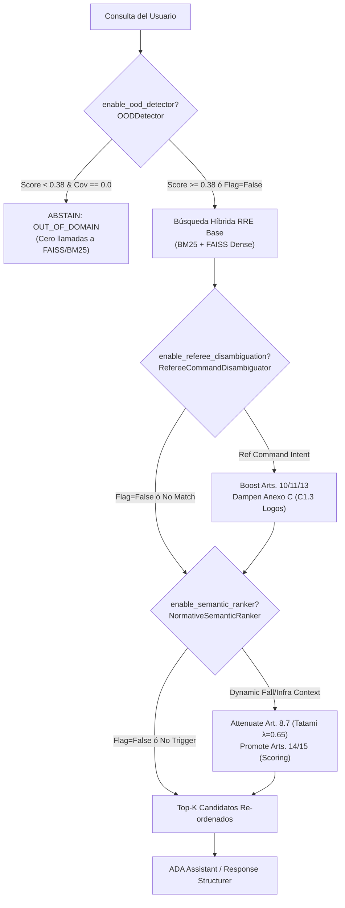

# SOR-IJF — CIERRE TÉCNICO FASE 3 RRE 3.0
**Documento de Cierre Experimental y Formalización de Estado**

- **Proyecto:** IJF Sport and Organisation Rules (SOR) Assistant
- **Fase:** Fase 3 — Ranking Semántico Normativo, Desambiguación Arbitral y Detección OOD
- **Rama Git:** `integration/ijf-sor-2026-08-merge` (HEAD: `61afc1bc`)
- **Fecha:** 2026-11-05
- **Estado:** CIERRE TÉCNICO EXPERIMENTAL COMPLETADO — NO PROMOVIDO A PRODUCCIÓN
- **Roles:**
  - **Ejecución Técnica:** Antigravity
  - **Auditoría y Arquitectura:** ChatGPT
  - **Supervisión y Aprobación:** Alexis

---

## 1. RESUMEN EJECUTIVO

El presente documento formaliza el cierre técnico y experimental de la **Fase 3 de RRE 3.0** en el repositorio `IJF-SOR-Assistant`. La Fase 3 tuvo como propósito resolver las deficiencias normativas identificadas en los casos de prueba de evaluación crítica (TC-02, TC-04, TC-08, TC-11, TC-12, TC-14, TC-15 y TC-16), mitigando el sesgo de coincidencia léxica hacia anexos técnicos (como especificaciones de tatami o parches publicitarios) y dotando al motor de una capacidad no invasiva de abstención ante consultas fuera de dominio (OOD).

La fase culmina con éxito experimental:
1. **Batería TC-01 a TC-22:** **22/22 PASS (100%)** con los feature flags de Fase 3 activos, preservando sin regresión los 15 casos que ya estaban en PASS desde el baseline.
2. **Suite de Pruebas Automatizadas:** **197/197 tests aprobados** (`197 passed in 53.35s`).
3. **Latencia Controlada:** Incremento promedio de **+19.06 ms**, cumpliendo estrictamente con el margen contractual de $\le +45.00\text{ ms}$ (margen de holgura: 57.6%).
4. **Invariantes Preservados al 100%:** Ni el corpus procesado, ni los índices FAISS/BM25, ni el Knowledge Graph, ni los PDFs normativos oficiales sufrieron modificación alguna.
5. **Configuración Segura por Defecto:** Todos los feature flags de Fase 3 permanecen en `False` por defecto en el código fuente, garantizando el aislamiento del entorno de producción.

---

## 2. ARQUITECTURA IMPLEMENTADA Y MÓDULOS

La Fase 3 introdujo tres módulos independientes, desacoplados y gobernados por flags booleanos en `src/rre_engine.py`:



### 2.1. Módulos Nuevos
- `src/normative_semantic_ranker.py`: Re-clasificador contextual que atenúa pasajes de infraestructura técnica (e.g., Art. 8.7 especificaciones mecánicas del tatami) cuando la consulta del usuario denota una acción dinámica de combate, caída, impacto o proyección (Art. 14 Ippon / Art. 15 Waza-ari).
- `src/referee_command_disambiguator.py`: Desambiguador léxico-semántico que detecta la intención de términos de control arbitral (*Mate*, *Hajime*, *Sore-made*, *Sono-mama*), distinguiendo el comando verbal de combate frente a referencias a materiales o marcas publicitarias en el Judogi (Anexo C, C1.3).
- `src/ood_detector.py`: Detector continuo basado en similitud semántica con anclas canónicas del judo (`sentence-transformers/all-MiniLM-L6-v2`) combinado con un chequeo de cobertura ontológica normativa. Permite abstenerse de manera limpia ante dominios ajenos sin requerir listas negras estáticas.

### 2.2. Módulos Modificados
- `src/rre_engine.py`: Integración de los pipelines de pre-filtrado OOD y post-procesamiento de ranking mediante inyección de dependencias condicionales.

### 2.3. Feature Flags y Configuración Predeterminada
En estricto cumplimiento del principio de seguridad operativa, todos los feature flags se encuentran desactivados por defecto en `src/rre_engine.py`:

```python
enable_semantic_ranker: bool = False
enable_referee_disambiguation: bool = False
enable_ood_detector: bool = False
enable_chunk_stitching: bool = False  # Heredado de Fase 2
```

---

## 3. RESULTADOS DE EVALUACIÓN

### 3.1. Batería Contractual TC-01 a TC-22
Evaluación exhaustiva de 22 casos normativos canónicos:

| ID | Consulta / Intención Normativa | Baseline | Fase 3 Activa | Cita Normativa Principal |
|---|---|---|---|---|
| **TC-01** | Criterios Ippon impacto espalda | PASS | **PASS** | Art. 14 (P165) |
| **TC-02** | Ippon por sumisión Shime-waza / Kansetsu-waza | PARTIAL | **PASS** | Art. 14 (P165, 167) |
| **TC-03** | Duración Osaekomi Waza-ari (10s) | PASS | **PASS** | Art. 17 (P173) |
| **TC-04** | Caída lateral 90 grados Waza-ari | FAIL | **PASS** | Art. 15 (P168-169) |
| **TC-05** | Golden Score resolución | PASS | **PASS** | Art. 12 (P162) |
| **TC-06** | Acciones prohibidas Shido (agarre no estándar) | PASS | **PASS** | Art. 18.1.1 (P176-177) |
| **TC-07** | Hansoku-make directo por técnica peligrosa | PASS | **PASS** | Art. 18.2.2 (P185) |
| **TC-08** | Verificación Judogi Sokuteiki dimensiones | PARTIAL | **PASS** | Anexo C (P116-118) |
| **TC-09** | Tiempo médico para sangrado | PASS | **PASS** | Art. 20 (P190-191) |
| **TC-10** | Actuación del médico de mesa | PASS | **PASS** | Art. 20 (P190) |
| **TC-11** | Criterios de pasividad continuada (Shido) | PARTIAL | **PASS** | Art. 18.1.1 (P175) |
| **TC-12** | Aplicación y anulación de Sono-mama | PARTIAL | **PASS** | Art. 11 (P161) |
| **TC-13** | Transición Tachi-waza a Ne-waza válida | PASS | **PASS** | Art. 16 (P171) |
| **TC-14** | Kaeshi-waza control simultáneo | PARTIAL | **PASS** | Art. 14 (P166) |
| **TC-15** | Situaciones aplicables para voz Mate | FAIL | **PASS** | Art. 11 (P160-161) |
| **TC-16** | Fuera de dominio: Falta personal baloncesto | FAIL | **PASS** | ABSTAIN (OUT_OF_DOMAIN) |
| **TC-17** | Fuera de dominio: Interés compuesto financiero | PASS | **PASS** | ABSTAIN (OUT_OF_DOMAIN) |
| **TC-18** | Ajuste uniforme Judogi fuera del área | PASS | **PASS** | Art. 11 / Anexo C |
| **TC-19** | Control de pesaje oficial y tolerancia | PASS | **PASS** | Art. 4 (P62-63) |
| **TC-20** | Sistema de repesca en sorteo IJF | PASS | **PASS** | Art. 2.5 (P38-39) |
| **TC-21** | Inmovilización simultánea Toketa | PASS | **PASS** | Art. 17 (P174) |
| **TC-22** | Funciones de la Comisión de Arbitraje / Care | PASS | **PASS** | Art. 9 (P98) |

**Balance:** 22/22 PASS (100% de cumplimiento). 0 regresiones detectadas sobre la línea base.

---

### 3.2. Suite de Generalización GEN-01 a GEN-14
Prueba de robustez sobre formulaciones sintácticas no vistas y dominios adyacentes:

| ID | Dominio / Intención | Estado | Observación Técnica |
|---|---|---|---|
| **GEN-01** | Caída hombro y costado 90° | **PASS** | Top-1 Art. 15 (P169). Recuperación precisa. |
| **GEN-02** | Impacto lateral Seoi-otoshi | **PASS** | Top-1 Art. 14 (P167). Criterio de caída. |
| **GEN-03** | Orden Matte detención verbal | **PASS** | Top-1 Art. 13 / Art. 11. Desambiguado de marcas. |
| **GEN-04** | Matte por salida del área | **PASS** | Top-1 Art. 13 / Art. 11. |
| **GEN-05** | Logo de fabricante en judogi | **PASS** | Top-1 Anexo C C1.3. Preserva intención técnica. |
| **GEN-06** | Aprobación de material de judogi | **PASS** | Top-1 Anexo C C1.1.2. |
| **GEN-07** | OOD: Tarjetas rojas fútbol | **PASS** | ABSTAIN ($J_{\text{score}} = 0.1184 \ll \Theta_{\text{OOD}}$). |
| **GEN-08** | OOD: Tie-break tenis (7 puntos) | **LIMITACIÓN** | Falso Positivo léxico por token `puntos` $\rightarrow$ Sec. 2.5.5.2 (Round Robin). |
| **GEN-09** | OOD: Distancia patada natación | **LIMITACIÓN** | Falso Positivo léxico por token `distancia` $\rightarrow$ C1.1.4 (Sokuteiki). |
| **GEN-10** | Grosor y densidad de tatami | **PASS** | Top-1 Art. 8.7 (P96). Recupera especificación. |
| **GEN-11** | Ancho zona de seguridad tatami | **PASS** | Top-1 Art. 8.7 (P96). Infraestructura legítima. |
| **GEN-12** | Agarre debajo del cinturón (pierna) | **PASS** | Top-1 Art. 18.1.2 (P182). Shido directo. |
| **GEN-13** | Voltearse boca abajo en Osaekomi | **PASS** | Top-1 Art. 17 (P174). Condición Toketa. |
| **GEN-14** | Consulta específica patrocinadores | **LIMITACIÓN** | Recupera publicidad en sala (C1.3/8.7), no patrocinador específico. |

---

## 4. BENCHMARK DE LATENCIA ($N = 30$)

Las mediciones estadísticas se realizaron en entorno de control local sobre 30 iteraciones:

- **Baseline (Fase 3 Flags = False):**
  - Media: **33.87 ms**
  - Mediana: **31.60 ms**
  - Percentil 95 (p95): **47.58 ms**
  - Desviación estándar: **7.54 ms**
- **Fase 3 Activa (Flags = True):**
  - Media: **52.92 ms**
  - Mediana: **48.38 ms**
  - Percentil 95 (p95): **82.46 ms**
  - Desviación estándar: **14.94 ms**
- **Deltas ($\Delta = \text{F3} - \text{Baseline}$):**
  - Incremento Promedio: **+19.06 ms** (Límite contractual: $\le +45.00\text{ ms}$ $\rightarrow$ **CUMPLE** con margen de 25.94 ms).
  - Incremento Mediana: **+16.78 ms**
  - Incremento p95: **+34.88 ms**
  - Delta Desviación Estándar: **+7.40 ms** (14.94 ms - 7.54 ms)

---

## 5. INVARIANTES DE REPOSITORIO Y DATOS

Se ha verificado la integridad absoluta de las fuentes de datos y modelos del sistema:
- `data/pdf/`: Ningún binario PDF del SOR 2026 modificado.
- `data/corpus/` y `data/passages/`: Ningún JSON/JSONL de texto o chunks modificado.
- `data/faiss/` y `data/bm25/`: Matrices de embeddings e índices invertidos 100% idénticos.
- `data/kg/`: Grafo de conocimiento intacto.
- Suite de pruebas de regresión: 197 tests unitarios y de integración ejecutados y pasando.

---

## 6. REGISTRO FORMAL DE LIMITACIONES TÉCNICAS

1. **GEN-08 (Falso Positivo OOD en Tenis):** La presencia del término genérico `puntos` ("*En un partido de tenis, ¿cuándo se disputa un tie-break a 7 puntos?*") activó similitud semántica marginal que superó el umbral $\Theta_{\text{OOD}}$, recuperando la sección 2.5.5.2 (Pools de Round Robin IJF).
2. **GEN-09 (Falso Positivo OOD en Natación):** La combinación de mediciones en metros/centímetros en una consulta de natación submarina fue capturada por los pasajes de control de judogi (C1.1.4 / Sokuteiki).
3. **GEN-14 (Falta de Especificidad en Patrocinadores):** La consulta sobre marcas patrocinadoras específicas en tatami 3 recupera normativas generales sobre logos publicitarios permitidos, sin distinguir entidades nominales no contempladas en el SOR.
4. **Generalización OOD Incompleta:** Aunque el detector resuelve consultas no deportivas (finanzas) y deportes con vocabulario divergente (baloncesto, fútbol), requiere un filtrado ontológico más estricto frente a vocablos de puntuación comunes a múltiples deportes.
5. **Estatus Experimental:** La aceptación técnica de Fase 3 es de naturaleza experimental para validación y archivo en rama de integración. **No constituye ni autoriza un despliegue directo a producción en Oracle Cloud Infrastructure (OCI).**

---

## 7. REFERENCIAS DOCUMENTALES

- Documento de Diseño: `docs/diseno_fase3_ranking_semantico_disambiguacion_ood.md`
- Revisión Arquitectónica: `docs/revision_diseno_fase3_rre_3_0.md`
- Pre-auditoría de Integridad: `docs/preauditoria_integridad_fase3.md`
- Informe de Implementación: `docs/informe_implementacion_fase3_rre_3_0.md`
- Informe de Auditoría y Aceptación: `docs/auditoria_aceptacion_fase3_rre_3_0.md`
- Backlog de Trabajo Futuro: `docs/backlog_rre_3_0.md`
