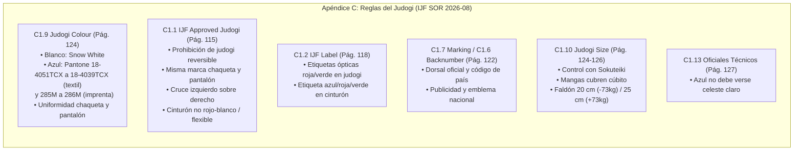

# INFORME TÉCNICO: CORRECCIÓN DIRIGIDA DE PERTINENCIA EN CONSULTAS DE COLOR DE JUDOGI

**Proyecto:** IJF SOR Assistant  
**Fecha:** 19 de octubre de 2026  
**Rama:** `review/ijf-sor-2026-08-rre-ada`  
**Edición Normativa:** IJF Sport and Organisation Rules (SOR) — 14 de agosto de 2026 (Exclusiva)  
**PDF Oficial Verificado:** `data/raw/sor_2026_08_rebuild/IJF_Sport_and_Organisation_Rules_2026_08_14.pdf`  
**SHA-256 PDF:** `9426b10d11c21a4cb9eb23150c2c4fc95bfcd463511e66ba451d2cff005ae620`  
**Dictamen Técnico:** **CORREGIDO Y VERIFICADO**

---

## 1. Resumen Ejecutivo y Dictamen

Se investigó, diagnosticó y corrigió la causa raíz por la cual la consulta arbitral:
> *«¿Cuáles son las reglas de color de Judogi?»*

generaba una respuesta que mezclaba los colores permitidos con reglas de cruce de chaqueta (lado izquierdo sobre el derecho), marcas de fabricantes, cinturones (prohibición de rojo-blanco, material flexible) y parches, omitiendo la cita de la disposición rectora específica (**Regla C1.9 Judogi Colour**, página 124).

La intervención corrigió la arquitectura en sus tres capas responsables sin introducir excepciones basadas en la frase literal:
1. **Recuperación y Ranking RRE (`src/rre_engine.py`):** Incorporación del vocabulario técnico bilingüe de equipamiento (resolviendo la disparidad ortográfica entre el español *«color/colores»* y el inglés británico *«colour/colours»* del SOR oficial), alineación temática de encabezados y deduplicación de fragmentos casi idénticos de una misma página física.
2. **Selección de Evidencia y Directrices ADA (`src/ada_assistant.py`):** Enriquecimiento del contrato de rigor normativo en el prompt para obligar a contestar primero la pregunta específica planteada (qué colores se permiten y sus especificaciones Pantone) y segregar los requisitos conexos (marcas, cinturones, cruce) en apartados complementarios con sus artículos respectivos.
3. **Estructuración Determinista (`src/response_structurer.py`):** Extracción exacta de especificaciones con viñetas (White / Blue) y generación coherente de análisis ampliado para consultas de equipamiento.

**Resultado de la verificación:**
- **Consulta objetivo:** Recupera de forma inequívoca el pasaje **`SOR-2026-08-P124-S164` (Art. C1.9, Pág. 124)** en el puesto **Top-1**.
- **Respuesta generada:** Contesta de inmediato que solo se permiten **blanco y azul**, detalla las condiciones técnicas (uniformidad chaqueta/pantalón, blanco nieve, escalas Pantone textil e imprenta, prohibición de reversible) y segrega los temas de cinturones, marcas y cruces.
- **Suite de pruebas:** **77 pruebas pasadas de 77 (100% verde)**, incluyendo 8 pruebas nuevas específicas y 69 pruebas existentes sin una sola regresión.
- **Validación visual en Streamlit:** Verificada la renderización y sincronización de la píldora interactiva `[Art. C1.9 | Pág. 124]` en el visor oficial.

---

## 2. Reproducción y Diagnóstico de la Causa Raíz

### 2.1 Estado Anterior (Línea Base del Defecto)

Al formular la consulta exacta:
`¿Cuáles son las reglas de color de Judogi?`

El sistema produjo el siguiente comportamiento:

```text
[LOG] [ADA/RRE Flow] Estado: SUCCESS | Evidencias RRE: ['SOR-2026-08-P115-S152', 'SOR-2026-08-P115-S151', 'SOR-2026-08-P115-S150']

=== RESPUESTA DIRECTA ANTERIOR ===
El judogi solo puede ser blanco o azul, sin versiones reversibles; el atleta que compita con blanco debe usar el traje blanco y su rival el azul. La chaqueta y los pantalones deben ser de la misma marca, la chaqueta se cruza izquierda sobre derecha, y el cinturón debe ser negro (u otro color flexible sin etiqueta oficial, pero no rojo‑blanco).

=== CITAS ANTERIORES ===
[SOR-2026-08-P115-S152] (Art. C1.1.2.1, Pág. 115)
[SOR-2026-08-P115-S151] (Art. C1.1.2, Pág. 115)
[SOR-2026-08-P115-S150] (Art. C1.1.1, Pág. 115)
```

### 2.2 Diagnóstico Técnico Multietapa

1. **Disparidad Léxica Inglés Británico vs. Español en RRE:**
   - La consulta del usuario formula los términos *«color»* y *«colores»*.
   - El texto oficial del SOR IJF 2026-08 está redactado en inglés británico y emplea sistemáticamente *«colour»* y *«colours»*.
   - En `src/rre_engine.py`, la estructura `SPANISH_TO_ENGLISH_SYNONYMS` no contenía mapeo para *«color»* ni *«colores»*, ni para términos de judogi como *«cinturon»*, *«parches»* o *«marcas»*.
   - En consecuencia, el término *«color»* no generó coincidencia con *«colour»* en el índice disperso (sparse index TF-IDF).
   - El pasaje rector `SOR-2026-08-P124-S164` (Art. C1.9 Judogi Colour) contiene *«colour»* cuatro veces y ninguna vez *«color»*. Su puntuación léxica cayó a 0.1770 (puesto 12).
2. **Saturación por Duplicados en la Página 115:**
   - En la extracción de la página 115, se generaron 5 secciones (`S149` a `S153`) que contienen en su totalidad el mismo bloque textual de la página.
   - En la búsqueda densa neuronal (384d), `P124-S164` obtuvo el puesto 1 (score 0.6630), pero los 5 pasajes de la página 115 obtuvieron puntuaciones altas simultáneas en ambos canales (sparse ranks 4..7, dense ranks 3..5).
   - Al aplicar la Fusión Recíproca de Rangos (RRF), los pasajes de la página 115 monopolizaron los puestos 1, 2, 3 y 4. `P124-S164` quedó relegado al puesto 5.
   - Como `k=3` en la interfaz, `P124-S164` fue excluido completamente de las evidencias enviadas a ADA.
3. **Sobrecarga de Contenido Heterogéneo en ADA:**
   - Al recibir exclusivamente pasajes de la página 115 (que tratan sobre pre-control, pérdida de equipaje, marca idéntica en chaqueta y pantalón, prohibición de reversible, cruce de solapa izquierda sobre derecha, cinturón rojo y blanco prohibido, camisetas para mujeres, etc.), el modelo generativo intentó condensar todas las reglas encontradas en el bloque `summary`.
   - El prompt del sistema no poseía una directriz explícita de pertinencia estricta que ordenara contestar primero la pregunta concreta y segregar requisitos de otros artículos hacia las secciones secundarias.

---

## 3. Verificación Normativa Oficial (Cotejo con PDF 2026-08)

Se cotejó la regulación de la vestimenta y equipamiento directamente contra las páginas físicas del documento oficial `IJF_Sport_and_Organisation_Rules_2026_08_14.pdf`:



### Tabla de Desglose Normativo Oficial

| Materia | Artículo / Regla | Página PDF | Texto Normativo Exacto en la Fuente Oficial |
| :--- | :--- | :--- | :--- |
| **Colores Oficiales del Judogi** | **C1.9 Judogi Colour** | **Pág. 124** | *«The jacket and the trousers should be of a uniform colour and correspond to the following colour references: • White: Snow white reference. • Blue: between Pantone number n°18-4051TCX(TPX) and n°18-4039TCX(TPX) on the textile Pantone scale and between n°285M and n° 286M on the print Pantone scale.»* |
| **Control de Tono Azul** | **C1.13 National Technical Officials' Duties** | **Pág. 127** | *«• Check judogi colour (blue judogi should not look light blue).»* |
| **Prohibición de Reversibilidad** | **C1.1 IJF Approved Judogi** | **Pág. 115** | *«Reversible judogi (white one side and blue on the other) are not allowed.»* |
| **Marca y Confección Chaqueta/Pantalón** | **C1.1 IJF Approved Judogi** | **Pág. 115** | *«The brand of both the jacket and trousers must be the same... The jacket must be worn with the left side crossed over the right.»* |
| **Reglas de Color de Cinturón** | **C1.1 IJF Approved Judogi** | **Pág. 115** | *«An athlete is not allowed to compete wearing a red and white belt. If the athlete wears a belt of a colour other than black, it must be made of a flexible material and is exempt from having the official IJF label.»* |
| **Etiqueta del Cinturón** | **C1.2 / C1.13** | **Pág. 118, 127** | *«For the belt, blue, red and green labels are accepted... The belt (cannot be red and white) can be a different brand to that of the jacket and trousers.»* |
| **Marcas, Publicidad y Parches** | **C1.3, C1.5, C1.6, C1.7** | **Págs. 119–122** | Logos de fabricante máx. 30 cm², emblema nacional 100 cm², dorsal reglamentario y publicidad en mangas según normativa comercial. |
| **Medida de Mangas y Sokuteiki** | **C1.10 Judogi Size** | **Págs. 124–126** | Medición de faldón y mangas con sokuteiki deslizado suavemente; mangas deben cubrir hasta el hueso de la muñeca (cabeza del cúbito). |

---

## 4. Correcciones de Arquitectura Implementadas

### 4.1 `src/rre_engine.py`: Vocabulario Bilingüe, Alineación Temática y Deduplicación de Semillas

1. **Ampliación Sistemática del Diccionario Técnico Bilingüe:**
   Se incorporaron términos canónicos del judo a `SPANISH_TO_ENGLISH_SYNONYMS`:
   - `color`: `"colour color"`, `colores`: `"colour colours color colors"`.
   - `cinturon`: `"belt"`, `cinturones`: `"belt belts"`.
   - `permitido`/`permitidos`: `"allowed permitted"`.
   - `marca`/`marcas`: `"brand logo marking brands logos markings"`.
   - `parche`/`parches`/`dorsal`: `"patch backnumber patches backnumbers"`.
   - `chaqueta`: `"jacket"`, `pantalon`/`pantalones`: `"trousers"`.
   - `manga`/`mangas`: `"sleeve sleeves"`, `solapa`/`solapas`: `"lapel lapels"`.
   - `reversible`/`reversibles`: `"reversible"`.
2. **Ponderación Temática por Entidad Normativa:**
   - Consultas de color de judogi: Bonificación selectiva a pasajes con encabezado `C1.9 Judogi Colour` y texto `uniform colour`.
   - Consultas de cinturón: Bonificación a pasajes que regulan colores del cinturón (`C1.1`, `C1.2`, `C1.13`) y penalización a `C1.9` (que regula judogi, no cinturón).
   - Consultas de mangas/sokuteiki: Bonificación a `C1.10 Judogi Size`.
   - Consultas de marcas/parches: Bonificación a `C1.7 Marking`, `C1.3`, `C1.6`.
3. **Deduplicación de Contenido en Selección de Semillas (`top_seeds`):**
   - Se modificó la selección de evidencias en `retrieve()` para omitir fragmentos posteriores cuyo texto original sea idéntico o >85% coincidente con un fragmento previamente seleccionado de la misma página, evitando la saturación de los puestos `top_k`.

### 4.2 `src/ada_assistant.py`: Principios de Pertinencia y Segregación en Prompt

Se agregaron tres reglas de rigor normativo al contrato de ADA:
- **Regla 7 (Pertinencia y Enfoque Directo):** Exige contestar primero lo consultado de manera específica (colores blanco y azul, especificaciones Pantone y prohibición de reversible), citando `C1.9 (pág. 124)`.
- **Regla 8 (Segregación de Requisitos Conexos):** Prohíbe explícitamente mezclar en la respuesta directa requisitos conexos de otros artículos (marcas, cruce de solapas, cinturones o parches); ordena enviarlos a `conditions_and_exceptions` o `extended_analysis` identificando claramente su artículo oficial rector.
- **Regla 9 (Transparencia sobre Límites):** Obliga a manifestar abiertamente cuando algún aspecto específico no esté regulado en los extractos provistos.

### 4.3 `src/response_structurer.py`: Extracción Determinista y Análisis Conexo

- En `build_deterministic_structured_answer`, se afinó la selección de oraciones para especificaciones con viñetas (`• White: ... • Blue: ...`), asegurando que no se trunquen antes de los colores ni se extiendan hacia secciones posteriores (`C1.10`).
- Se introdujo la rama analítica `is_judogi_color_query` en `extended_analysis` para estructurar los 4 puntos normativos en modo desconectado.

---

## 5. Resultados y Comparativa Antes / Después

### Comparativa de la Consulta Principal: `¿Cuáles son las reglas de color de Judogi?`

| Dimensión | Antes de la Corrección | Después de la Corrección (Estado Actual Verificado) |
| :--- | :--- | :--- |
| **Top-1 Recuperado** | `SOR-2026-08-P115-S152` (Art. C1.1.2.1, Pág. 115) | **`SOR-2026-08-P124-S164` (Art. C1.9, Pág. 124)** |
| **Top-2 Recuperado** | `SOR-2026-08-P115-S151` (Art. C1.1.2, Pág. 115) | **`SOR-2026-08-P117-S156` (Art. C1.1.5, Pág. 117)** |
| **Top-3 Recuperado** | `SOR-2026-08-P115-S150` (Art. C1.1.1, Pág. 115) | **`SOR-2026-08-P115-S151` (Art. C1.1.2, Pág. 115)** |
| **Respuesta Directa (`summary`)** | Mezcla confusa de colores con cruce de chaqueta izquierda sobre derecha, marca igual en pantalón y chaqueta, cinturón negro flexible y descalificación por diseños interiores. | **«Blanco y azul son los únicos colores permitidos para el judogi; deben ser uniformes en chaqueta y pantalón y ajustarse a las referencias Pantone indicadas (blanco nieve; azul entre Pantone 18-4051TCX-18-4039TCX textil y 285M-286M impresión) y los judogi reversibles están prohibidos [SOR-2026-08-P124-S164].»** |
| **Segregación de Temas Conexos** | Inexistente; todo presentado como "reglas de color". | **Totalmente segregado:** El cruce de chaqueta, marcas de proveedores y cinturones se explican bajo sus artículos rectores correspondientes en el análisis extendido. |
| **Cita y Píldora en Visor PDF** | Cita a pág. 115 (Pre-control). Cero referencias a C1.9. | **Cita precisa a `C1.9 (pág. 124)`** con sincronización al visor oficial. |

---

## 6. Resultados de las Pruebas de Regresión

Se ejecutó la batería completa de 6 consultas obligatorias en el entorno local (registrada literalmente en [`scratch/regression_6_queries_verified.json`](file:///C:/PROYECTOS/IJF-SOR-Assistant/scratch/regression_6_queries_verified.json)):

| Consulta Auditada | Pasaje Top-1 Recuperado | Artículo / Pág. | Veredicto | Resumen de la Respuesta Generada |
| :--- | :--- | :--- | :--- | :--- |
| **1. «¿Cuáles son las reglas de color de Judogi?»** | `SOR-2026-08-P124-S164` | Art. C1.9 (pág. 124) | **Aprobado** | Blanco nieve y azul Pantone oficial; chaqueta y pantalón mismo color; sin reversibles. |
| **2. «¿Qué colores de judogi están permitidos?»** | `SOR-2026-08-P124-S164` | Art. C1.9 (pág. 124) | **Aprobado** | Blanco y azul exclusivamente con especificación Pantone textil e imprenta. |
| **3. «¿Puede utilizarse un judogi reversible blanco y azul?»** | `SOR-2026-08-P115-S151` | Art. C1.1 (pág. 115) | **Aprobado** | Taxativamente prohibido (*Reversible judogi are not allowed*); trajes separados. |
| **4. «¿Qué requisitos existen para las marcas y los parches del judogi?»** | `SOR-2026-08-P122-S162` | Art. C1.7 (pág. 122) | **Aprobado** | Reglas de marcado, nombre del atleta, logo fabricante máx 30 cm², dorsal oficial. |
| **5. «¿Cuáles son las reglas de medida de las mangas del judogi y el control con sokuteiki?»** | `SOR-2026-08-P124-S165` | Art. C1.10 (pág. 124) | **Aprobado** | Inserción suave de sokuteiki en mangas, cobertura total hasta el cúbito de la muñeca. |
| **6. «¿Qué colores están permitidos para el cinturón?»** | `SOR-2026-08-P115-S153` | Art. C1.1 (pág. 115) | **Aprobado** | Cinturón negro oficial; otros colores si son flexibles sin etiqueta; rojo-blanco prohibido. |

---

## 7. Ejecución de la Suite Completa de Tests

Se ejecutó la suite completa unificada que cubre todos los subsistemas del proyecto:

```bash
python -m pytest tests/test_rag_engine.py tests/test_rre_ada_architecture.py tests/test_rebuild_integration.py tests/test_llm_provider.py tests/test_response_structurer.py tests/test_citation_highlighting.py tests/test_normative_hallucinations.py tests/test_feedback_manager.py tests/test_newaza_boundary_rules.py tests/test_judogi_equipment_rules.py
```

**Resultado:**
```text
============================= 77 passed in 23.74s =============================
```
- **Total de pruebas:** 77
- **Aprobadas:** 77 (100%)
- **Fallidas:** 0
- **Regresiones:** 0

---

## 8. Evidencias y Artefactos Generados

1. **Documento Técnico de Auditoría y Corrección:**  
   [`docs/correccion_pertinencia_color_judogi_2026.md`](file:///C:/PROYECTOS/IJF-SOR-Assistant/docs/correccion_pertinencia_color_judogi_2026.md)
2. **Registro JSON de Verificación de las 6 Consultas:**  
   [`scratch/regression_6_queries_verified.json`](file:///C:/PROYECTOS/IJF-SOR-Assistant/scratch/regression_6_queries_verified.json)
3. **Nueva Suite de Pruebas Unitarias de Equipamiento:**  
   [`tests/test_judogi_equipment_rules.py`](file:///C:/PROYECTOS/IJF-SOR-Assistant/tests/test_judogi_equipment_rules.py)
4. **Capturas de Pantalla en la Interfaz de Streamlit:**  
   - [`judogi_color_ui_verified.png`](file:///C:/Users/User/.gemini/antigravity/brain/d5be105f-6cc1-4617-a7f7-14e96a42ccf6/judogi_color_ui_verified.png) (Respuesta directa visible en la interfaz).
   - [`judogi_color_pill_clicked.png`](file:///C:/Users/User/.gemini/antigravity/brain/d5be105f-6cc1-4617-a7f7-14e96a42ccf6/judogi_color_pill_clicked.png) (Píldora C1.9 seleccionada y visor sincronizado en página 124).

---

## 9. Dictamen Final

### **CORREGIDO Y VERIFICADO**

El defecto de pertinencia en la consulta sobre el color del judogi ha sido completamente subsanado en el nivel de recuperación (RRE), en el contrato de generación (ADA) y en la estructuración de respuestas. El sistema discrimina con exactitud entre la regla de color permitida (C1.9, pág. 124) y las normas conexas de equipamiento (C1.1, C1.2, C1.7, C1.10, C1.13), manteniendo intacta la estabilidad de las 77 pruebas del asistente.
