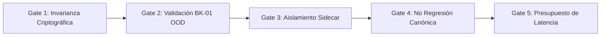

# SOR-IJF — CRITERIOS DE ACEPTACIÓN FASE 4.2
**Condiciones Contractuales de Aprobación Técnica y Puertas de Calidad (Quality Gates)**

- **Proyecto:** IJF Sport and Organisation Rules (SOR) Assistant
- **Fase:** Fase 4.2.0 — Criterios de Aceptación
- **Fecha:** 2026-11-05
- **Rama Git:** `integration/ijf-sor-2026-08-merge` (Commit Base: `61afc1bc`)
- **Autor / Ejecutor Técnico:** Antigravity
- **Arquitectura y Auditoría:** ChatGPT
- **Supervisión Normativa:** Alexis

---

## 1. COMPUERTAS DE CALIDAD (QUALITY GATES)

Para declarar culminada con éxito la **Fase 4.2**, la implementación deberá satisfacer de manera estricta y demostrable las siguientes cinco compuertas de calidad:

---

## 2. MATRIZ DE CRITERIOS CUANTITATIVOS Y CUALITATIVOS

| Gate | Área Evaluada | Condición de Aprobación (PASS) | Condición de Rechazo (FAIL) |
|---|---|---|---|
| **Gate 1** | **Invarianza Criptográfica del SOR** | SHA-256 de `sor_2026_corpus.json` y de los índices en `data/processed/rebuild_2026_08_corrected/` permanecen 100% idénticos a la línea base previa. | Cualquier cambio de un solo byte en el corpus primario o sus matrices FAISS/BM25. |
| **Gate 2** | **Refinamiento OOD (BK-01)** | Resolución exitosa de falsos positivos en tenis (`GEN-08` / `OOD-BK01`) y natación (`GEN-09` / `OOD-BK02`) con resultado limpio `ABSTAIN (OUT_OF_DOMAIN)`. | El sistema sigue recuperando pasajes de judo para preguntas explícitas de tenis o natación. |
| **Gate 3** | **Aislamiento de Sidecar e Ingesta** | Documentos secundarios aprobados residen exclusivamente en `data/corpus_multisource/`. Ningún documento no firmado por Alexis pasa a elegible. | Documentos complementarios mezclados en la carpeta del SOR o inclusión de recursos en estado `PENDIENTE`. |
| **Gate 4** | **No Regresión Normativa Canónica** | 100% PASS (22/22) en la batería contractual TC-01 a TC-22. Cero regresiones en los 212 tests unitarios automatizados. | Cualquier caso previo que caiga a `PARTIAL` o `FAIL`, o fallo en pruebas de regresión. |
| **Gate 5** | **Presupuesto de Latencia (Shadow Mode)** | Incremento promedio de tiempo de inferencia RRE $\Delta_{\text{mean}} \le +35.00\text{ ms}$ respecto al baseline de Fase 3. Percentil 95 $\Delta_{\text{p95}} \le +60.00\text{ ms}$. | Incremento promedio $> +35.00\text{ ms}$ o p95 $> +60.00\text{ ms}$. |

---

## 3. CRITERIOS ESPECÍFICOS DE ATRIBUCIÓN Y GOBIERNO

1. **Prevalencia Normativa Absoluta:**
   - En el 100% de las consultas resueltas, el candidato Top-1 en el carril primario del `EvidenceBundle` debe pertenecer a `DOC-SOR-2026-08`.
   - Si un documento complementario (e.g. `PPT-002`) presenta una redacción divergente, el sistema debe otorgar precedencia a la redacción del SOR.
2. **Subordinación Audiovisual:**
   - Cero clips de video presentados como fundamentación normativa.
   - Cero timestamps no verificados (`is_verified=False`) admitidos en el bundle activo.
3. **Manejo de Conflictos:**
   - Si el validador detecta colisión temporal o sustantiva entre la norma primaria y una fuente secundaria, el bundle debe activar automáticamente `abstention_required = True`.

---

## 4. CRITERIOS DE ROLLBACK (REVERSIÓN OBLIGATORIA)

El Supervisor (**Alexis**) o el Arquitecto (**ChatGPT**) ordenarán la reversión inmediata de Fase 4.2 a Fase 3 si:
- Ocurre una regresión en cualquiera de los 15 casos que ya estaban en PASS desde el baseline.
- Se detecta contaminación de índices primarios.
- La ejecución en modo sombra degrada la estabilidad de memoria de la aplicación en Streamlit.
- Se violan las políticas de confidencialidad o licencias en los materiales secundarios.
