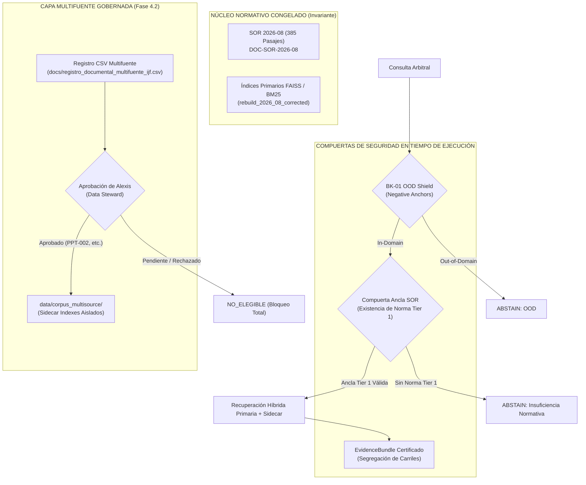

# SOR-IJF — CONSOLIDACIÓN DE DECISIONES ARQUITECTÓNICAS FASE 4.2
**Registro de Decisiones Arquitectónicas Formalizadas (ADR)**

- **Proyecto:** IJF Sport and Organisation Rules (SOR) Assistant
- **Fase:** Fase 4.2.0 — Consolidación Arquitectónica y Especificación Ejecutable
- **Fecha:** 2026-11-05
- **Rama Git:** `integration/ijf-sor-2026-08-merge` (Commit Base: `61afc1bc`)
- **Roles:**
  - **Ejecución Técnica:** Antigravity
  - **Arquitectura y Auditoría:** ChatGPT
  - **Supervisión y Aprobación:** Alexis

---

## 1. INTRODUCCIÓN Y MARCO DE REFERENCIA

Tras el cierre y aceptación experimental con reservas de la **Fase 4.1** (`docs/cierre_fase4_1_ijf.md`), el sistema cuenta con contratos de datos (`EvidenceBundle`), esquemas de gobierno (`DocumentMetadata`) y un inventario formalizado (`docs/registro_documental_multifuente_ijf.csv`).

El propósito del presente documento es formalizar la resolución de las cinco decisiones arquitectónicas pendientes (**DP-01 a DP-05**) y establecer los principios invariantes que gobernarán la Fase 4.2 y etapas posteriores.

---

## 2. REGISTRO FORMAL DE DECISIONES (ADR)

### ADR-DP-01: Tratamiento de Portales Web Didácticos (`rules.ijf.org`)
- **Estado:** RESUELTO / APROBADO
- **Decisión:** Los portales web didácticos (`PAG-001` a `PAG-005`) **no se ingerirán ni se vectorizarán como texto continuo en el corpus activo** en esta etapa. Se mantendrán estrictamente como enlaces externos y referencias complementarias en `data/references/reference_registry.json`.
- **Justificación:** Los portales reproducen pedagógicamente los artículos del SOR (Kumikata, Scoring, Penalties). Ingerirlos en el índice semántico crearía duplicidad masiva de pasajes y riesgo de dilución de relevancia frente al texto canónico del SOR (Arts. 14, 15, 17 y 18).
- **Evolución:** La ingestión textual selectiva de portales queda condicionada a una fase posterior donde se implemente extracción de micro-secciones con anclaje relacional explícito.

---

### ADR-DP-02: Flujo de Aprobación Documental y Responsabilidad
- **Estado:** RESUELTO / APROBADO
- **Decisión:** **Alexis** asume la responsabilidad exclusiva de aprobación documental (*Data Steward* y Supervisor Normativo). 
- **Regla de Operación:** 
  1. Ningún documento o fragmento en estado `PENDIENTE` en `docs/registro_documental_multifuente_ijf.csv` podrá pasar a `APROBADO` o `APROBADO_CONDICIONADO` sin una bitácora de curaduría formal firmada por Alexis.
  2. Todo recurso en estado `PENDIENTE`, `RECHAZADO` o `ARCHIVADO` es forzado determinísticamente por código a `EligibilityStatus.NO_ELEGIBLE`.
- **Justificación:** Previene la incorporación descontrolada de materiales informativos o provisionales al motor decisorio.

---

### ADR-DP-03: Gobernanza y Curaduría de Recursos Audiovisuales
- **Estado:** RESUELTO / APROBADO
- **Decisión:** Los recursos de video (`VID-001` a `VID-005`) **no participarán como evidencia puntual en la recuperación si no cuentan con curaduría humana previa, segmentación verificada, timestamps exactos (HH:MM:SS) y vinculación a un artículo SOR específico**.
- **Regla de Operación:** 
  - La clase `VideoTimestamp` exige obligatoriamente `is_verified=True`.
  - Si un clip carece de verificación curada, su item se evalúa como `NO_ELEGIBLE`.
  - En la etapa actual, los videos permanecen disponibles exclusivamente a través del índice general de la videoteca didáctica (`VID-001`) como enlaces de consulta complementaria.
- **Justificación:** Elimina el riesgo de que el modelo de lenguaje alucine segundos, minutos o interpretaciones visuales inexistentes.

---

### ADR-DP-04: Aislamiento Criptográfico de Sidecar Indexes
- **Estado:** RESUELTO / APROBADO
- **Decisión:** Se adopta de manera estricta la arquitectura de **Sidecar Indexes**. Los documentos complementarios aprobados se indexarán en particiones aisladas dentro de un directorio secundario dedicado (`data/corpus_multisource/`).
- **Regla de Operación:**
  - El corpus operativo primario (`data/processed/rebuild_2026_08_corrected/`) que contiene los 385 pasajes del SOR y sus matrices FAISS/BM25 permanece congelado e inmutable.
  - Los índices secundarios (`faiss_multisource.index`, `bm25_multisource.pkl`) residirán en almacenamiento desacoplado y solo serán instanciados en modo lectura condicional.
- **Justificación:** Garantiza la invariabilidad criptográfica de la línea base operativa y permite el desacople y reversión inmediata (rollback) sin reconstruir el índice principal.

---

### ADR-DP-05: Precedencia y Evaluación Obligatoria de BK-01 (Negative Domain Anchor Scoring)
- **Estado:** RESUELTO / APROBADO
- **Decisión:** El ítem de backlog **BK-01** (*Negative Domain Anchor Scoring* en el detector OOD) **debe ser implementado, evaluado y aprobado antes de habilitar cualquier recuperación multifuente activa en tiempo real**.
- **Justificación:** La incorporación de textos adicionales con terminología deportiva genérica (`puntos`, `tiempo`, `distancia`, `penalización`) incrementaría la tasa de falsos positivos en deportes ajenos (como tenis `GEN-08` y natación `GEN-09`). Se requiere blindar el detector OOD previo a la apertura del espacio de búsqueda.

---

## 3. RESUMEN DE LA ARQUITECTURA MULTIFUENTE GOBERNADA

---

## 4. INVARIANTES NORMATIVOS CONSOLIDADOS

1. **Precedencia Taxativa:** El SOR del 14 de agosto de 2026 es la única fuente de `NORMA_PRIMARIA`.
2. **Imposibilidad de Mutación de Rol:** Ningún clip audiovisual, presentación o circular ejecutiva puede asumir el rol de norma primaria.
3. **Abstención por Conflicto:** Cualquier divergencia insalvable entre un documento complementario y el SOR 2026 resulta en la activación obligatoria de `abstention_required = True`.
