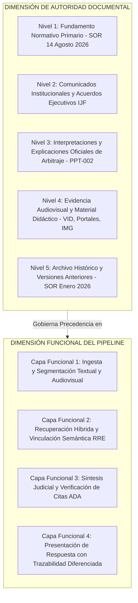
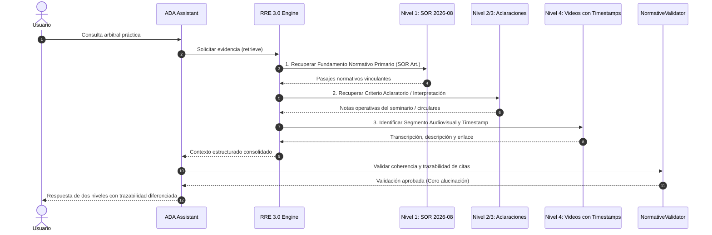
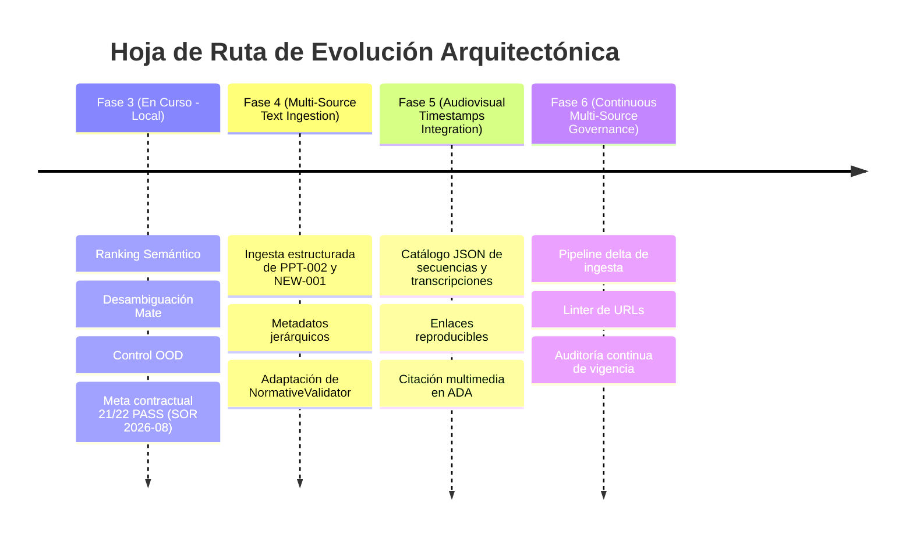

# IJF SOR Assistant — Diseño de Arquitectura de Conocimiento Multifuente IJF

**Estado del Documento:** PROPUESTA Y CONSOLIDACIÓN ARQUITECTÓNICA DOCUMENTAL (REVISIÓN FINAL AJUSTADA)  
**Destino:** `docs/diseno_arquitectura_conocimiento_multifuente_ijf.md`  
**Fecha:** 2026-11-05  
**Entorno:** Local (`C:\PROYECTOS\IJF-SOR-Assistant`)  
**Rama Git:** `integration/ijf-sor-2026-08-merge`  
**Commit Base:** `61afc1bc2c8fa273f118f4e10bc447dbafcfe650`  
**Autor:** Antigravity (Ingeniero Ejecutor y Auditor)  
**Revisores:** Alexis (Supervisor) / ChatGPT (Arquitecto y Auditor Normativo)  

---

## 1. Principio Rector y Marco Conceptual

### 1.1 El Fundamento Normativo Primario vs. Complemento Interpretativo
El manual oficial *IJF Sport and Organisation Rules (SOR)*, edición vigente del **14 de agosto de 2026** (`DOC-SOR-2026-08`), constituye de manera indiscutible el **fundamento normativo primario**. No obstante, en la práctica arbitral de alto nivel, la letra formal del manual no contiene —ni pretende contener— la totalidad de los criterios operacionales necesarios para resolver cada lance táctico en el tatami.

Las aclaraciones oficiales, interpretaciones de la Comisión de Arbitraje, presentaciones de seminarios (`PPT-002`) y notas técnicas emitidas por la IJF:
- **Aportan precisión sobre situaciones dinámicas o ambiguas** (ej. tiempos de reacción arbitral antes de ordenar Matte).
- **Establecen criterios operacionales de aplicación práctica** (ej. la exigencia de continuidad técnica ininterrumpida e inmediata en la transición de Tachi-waza a Ne-waza).
- **Proporcionan casuística y excepciones operativas** que enriquecen el juicio arbitral sin contradecir la norma.
- **Transfieren conocimiento arbitral experto** que no aparece suficientemente desarrollado en el texto del reglamento.

> **Principio de No Exclusión por Incorporación Parcial:**  
> Un documento o recurso complementario **NO debe ser excluido** únicamente porque una edición posterior del SOR haya incorporado parte de sus contenidos o reformas de fondo. Si el documento original conserva explicaciones operativas, criterios prácticos o precisiones contextuales no trasladadas literalmente al texto estatutario, dicho documento mantiene su valor como **fuente interpretativa complementaria**.

Del mismo modo, **tampoco debe atribuirse automáticamente carácter vinculante independiente** a todo material publicado por la IJF sin una evaluación individualizada de su emisor, contexto y alcance jurídico.

### 1.2 La Función Arquitectónica de los Videos Oficiales
Los videos oficiales de la IJF (`VID-001` a `VID-005` y clips asociados) tienen una **función estrictamente complementaria de evidencia audiovisual y contextualización práctica**.
- **NO constituyen la fuente primaria** para confirmar, crear ni derogar una norma.
- **Ilustran la aplicación real** de la norma y permiten verificar cómo los árbitros internacionales juzgan una acción concreta.
- **Las transcripciones segmentadas y los timestamps** constituyen el **mecanismo de recuperación audiovisual**, permitiendo indexar el contenido semántico de las secuencias y enlazar directamente al segundo exacto de la demostración.

---

## 2. Diagnóstico Documental y Correcciones Críticas a la Auditoría de Vigencia

### 2.1 Estado Actual Comprobado
El pipeline operativo actual (`src/rre_engine.py` y `src/ada_assistant.py`) opera en modalidad **mono-documental estricta**:
- Indexa únicamente 385 pasajes del PDF central `SOR-2026-08-14-ENG`.
- Deja completamente desconectados 18 recursos registrados en `data/references/reference_registry.json` y los 18 archivos KUN de `data/markdown/`.

### 2.2 Correcciones Críticas a la Perspectiva de Auditoría Previa
Se corrigen de forma taxativa los criterios previos de evaluación documental:

1. **Reclasificación de `PPT-002` (Presentación del Seminario de Arbitraje 2026):**  
   Se sustituye la denominación "Interpretativo Obligatorio" por **"Interpretación / Explicación Oficial de Arbitraje"**. Refleja con fidelidad su naturaleza de directriz operativa emitida por los directores de arbitraje (Daniel Lascau, Armen Bagdasarov) para unificar criterios en el tatami, sin atribuirle una obligatoriedad estatutaria formal no demostrada fuera del marco de la Comisión de Arbitraje.
2. **Evaluación Individualizada de Comunicados (`NEW-001` y `NEW-003`):**  
   No se debe asumir que `NEW-001` y `NEW-003` mantienen una autoridad vinculante autónoma e indefinida una vez que sus reformas fueron codificadas en el SOR del 14 de agosto de 2026:
   - **`NEW-001` (Comunicado LA28):** Conserva valor institucional para acreditar la política de estabilidad reglamentaria hasta 2028 y la motivación de la re-autorización del *Reverse Seoi-nage* en Senior. Se clasifica como **"Comunicado Institucional / Antecedente Regulatorio"**.
   - **`NEW-003` (Confirmación de Temporada 2026):** Al haber sido su contenido normativo (Yuko en Osaekomi de 5 a 9 segundos) absorbido textualmente en el Art. 15 del SOR vigente, su valor presente es el de **"Documento Aclaratorio Subsumido / Referencia Confirmatoria"**, no una norma autónoma paralela.
3. **Pérdida Inadmisible ante Exclusión de la Videoteca Arbitral:**  
   Los videos `VID-002` a `VID-005` contienen información visual irremplazable: la advertencia formal no acumulativa de dedo antes de Shido por demora (`VID-005`), la rotura legítima de agarre con una mano (`VID-002`), los ángulos de aterrizaje de Yuko (`VID-003`) y el riesgo cervical prohibido en Ushiro-Sankaku (`VID-004`). Excluirlos empobrecería severamente la capacidad explicativa del asistente.

---

## 3. Arquitectura Propuesta: Separación entre Capas Funcionales y Niveles de Autoridad

Para evitar confusiones metodológicas, el diseño desacopla formalmente dos dimensiones ortogonales:
1. **La Dimensión Funcional del Sistema (Capas del Pipeline RRE / ADA):** Cómo fluye, se procesa y se indexa la información.
2. **La Dimensión Jerárquica Documental (Niveles de Autoridad Jurídica):** Qué peso legal y precedencia posee cada recurso.



### 3.1 Dimensión de Autoridad Documental (Jerarquía Jurídico-Deportiva)

| Nivel de Autoridad | Tipo de Recurso | Función Normativa / Jurídica | Rango de Precedencia | Recursos en el Repositorio |
|---|---|---|---|---|
| **Nivel 1** | **Fundamento Normativo Primario** | Disposición estatutaria y regulatoria suprema. | **Imperativo / Prevalente** | `DOC-SOR-2026-08` (SOR 14 Agosto 2026) |
| **Nivel 2** | **Comunicados Institucionales IJF** | Resoluciones de política deportiva y antecedentes regulatorios. | **Complementario Institucional** | `NEW-001`, `NEW-003` (evaluados caso por caso) |
| **Nivel 3** | **Interpretación / Explicación Oficial** | Criterios operacionales y directrices de la Comisión de Arbitraje. | **Interpretativo Oficial** | `PPT-002` (Seminario Internacional 2026) |
| **Nivel 4** | **Evidencia Audiovisual y Didáctica** | Demostraciones en video, clips, diagramas y portales web explicativos. | **Demostrativo / Ilustrativo** | `VID-002` a `VID-005`, `IMG-001`, `PAG-001` a `PAG-005` |
| **Nivel 5** | **Archivo Histórico** | Textos sustituidos o derogados para análisis diacrónico y trazabilidad. | **No Vigente (Referencial)** | `DOC-001` (SOR Enero 2026) |

### 3.2 Dimensión Funcional del Pipeline (Capas Operativas)
- **Capa Funcional 1 (Ingesta y Normalización):** Segmentación de textos del SOR, fichas de seminarios y transcripciones segmentadas de videos con timestamps.
- **Capa Funcional 2 (Recuperación Híbrida RRE):** Búsqueda combinada BM25 + FAISS que ancla primero el artículo del SOR y expande el grafo hacia aclaraciones y videos asociados.
- **Capa Funcional 3 (Razonamiento y Validación ADA):** Ensamblado de la argumentación jurídica y verificación estricta de citas para impedir alucinaciones.
- **Capa Funcional 4 (Presentación y Trazabilidad):** Renderizado en dos niveles con enlaces a páginas físicas de PDF y enlaces reproducibles a los instantes exactos de los videos.

---

## 4. Función de los Videos y Mecanismo de Recuperación Audiovisual

### 4.1 Principio de Subordinación Audiovisual
Los videos oficiales no son normas; son **evidencia audiovisual de aplicación práctica**.
- **El SOR vigente** responde: *«¿Cuál es la regla y cuál es la consecuencia?»*.
- **La aclaración del seminario** responde: *«¿Cuál es el criterio operativo para interpretar la regla?»*.
- **El video con timestamp** responde: *«¿Cómo se ve esta acción en el tatami real y cómo actuaron los árbitros?»*.

### 4.2 Estructura de Datos Integral de Vinculación Semántico-Audiovisual
Para implementar en el futuro la trazabilidad bidireccional entre la norma, la aclaración y el clip audiovisual, se define formalmente la siguiente estructura de datos extensible:

```json
{
  "linkage_id": "LNK-VID005-SEG01-ART18",
  "topic": "Time Wasting - Formal Warning Procedure",
  "situation_description": "Atleta que demora intencionalmente el regreso al centro del tatami para reiniciar el combate.",
  
  "normative_grounding": {
    "source_id": "DOC-SOR-2026-08",
    "article_id": "Article 18.1.1",
    "page_number": 177,
    "kun_seed": "SOR-2026-08-P177-S193",
    "text_anchor": "Negative positions, against the fighting spirit, will be penalised by shido..."
  },
  
  "interpretative_clarification": {
    "source_id": "PPT-002",
    "authority_level": "Nivel 3 - Interpretación / Explicación Oficial",
    "source_reference": "Refereeing Seminar 2026 - Slide 12",
    "operational_criterion": "La primera demora no conlleva Shido inmediato; el árbitro debe realizar una advertencia formal previa utilizando el gesto de palma y dedo."
  },
  
  "audiovisual_evidence": {
    "video_id": "VID-005",
    "video_title": "2026 Rules Update - Time Wasting Penalties",
    "platform": "official_video_portal",
    "base_url": "https://rules.ijf.org/penalties",
    "segment_id": "VID-005-SEG-01",
    "timestamp_start_seconds": 12,
    "timestamp_end_seconds": 38,
    "timestamp_display": "00:12 - 00:38",
    "deep_link_reproducible": "https://rules.ijf.org/penalties#t=12s",
    "transcript": {
      "en": "The first instance of time-wasting behavior results in a formal warning from the referee using a palm and finger gesture.",
      "es": "La primera instancia de conducta de pérdida de tiempo resulta en una advertencia formal del árbitro utilizando un gesto de palma y dedo."
    },
    "visual_action_description": "El árbitro extiende la palma abierta hacia la marca del competidor y levanta el dedo índice antes de ordenar Hajime."
  }
}
```

---

## 5. Flujo de Recuperación y Citación en ADA (Arbitration Decision Assistant)

### 5.1 Flujo Secuencial de Razonamiento


### 5.2 Formato de Respuesta ADA con Trazabilidad Diferenciada

```markdown
### Decisión Arbitral Inmediata (Tier 1)
La primera acción de pérdida de tiempo o demora deliberada para reanudar el combate debe ser sancionada inicialmente mediante una advertencia formal del árbitro y no con Shido inmediato. La reincidencia posterior sí conlleva Shido.

---

### Fundamentación y Evidencia Oficial (Tier 2)

#### 1. Fundamento Normativo Primario (Nivel 1 — Vinculante)
- **Norma:** *IJF Sport and Organisation Rules (14 de agosto de 2026)*, [Article 18.1.1 (pág. 177)](https://.../IJF_Sport_and_Organisation_Rules_2026_08_14.pdf#page=177).  
- **Disposición:** Establece que las conductas contrarias al espíritu combativo y la pérdida de tiempo son sancionadas con Shido.

#### 2. Criterio de Aplicación Arbitral (Nivel 3 — Explicación Oficial)
- **Fuente:** *IJF Refereeing Seminar 2026 Presentation*, [Slide 12](file:///.../kuns_ppt_002.md).  
- **Criterio Operativo:** La Comisión de Arbitraje aclara que para evitar penalizaciones prematuras, el árbitro debe aplicar un protocolo de advertencia formal en la primera demora antes de imponer el primer Shido por esta causa.

#### 3. Evidencia Audiovisual de Aplicación (Nivel 4 — Ilustrativo)
- **Recurso:** *Video Arbitraje IJF: Evasión y Pérdida de Tiempo*, [Ver Demostración Oficial (00:12 - 00:38)](https://rules.ijf.org/penalties#t=12s).  
- **Descripción de la Secuencia:** Muestra el gesto formal del árbitro extendiendo la palma hacia arriba en dirección a la marca inicial y levantando el dedo índice hacia el competidor demorado.
```

---

## 6. Fases de Implementación Sugeridas y Hoja de Ruta



1. **Fase 3 (Foco Exclusivo e Inmediato):**  
   - Concluir la implementación del re-ranker semántico, desambiguación y filtro OOD sobre el corpus canónico del SOR 2026 (385 pasajes).
   - Lograr el cumplimiento estricto de los criterios contractuales reforzados ($\ge \mathbf{21/22\ PASS}$).
2. **Fase 4 (Ingesta de Aclaraciones Textuales Oficiales):**  
   - Incorporar `PPT-002` y los antecedentes relevantes de `NEW-001/003` con metadatos jerárquicos tipados.
   - Habilitar en `NormativeValidator` la verificación de fuentes secundarias diferenciadas.
3. **Fase 5 (Integración Audiovisual con Transcripciones y Timestamps):**  
   - Estructurar el catálogo JSON de vinculación para los videos `VID-002` a `VID-005`.
   - Conectar ADA para que recomiende el clip exacto con timestamp reproducible.

---

## 7. Riesgos, Limitaciones y Decisiones Pendientes del Supervisor

### 7.1 Matriz de Riesgos

| Riesgo Técnico | Severidad | Mitigación Arquitectónica |
|---|---|---|
| **Confusión de Autoridad en LLM** | Alta | ADA debe forzar siempre en el prompt que el *Fundamento Normativo Primario* proceda exclusivamente del SOR (Nivel 1). |
| **Enlaces Audiovisuales Inestables** | Media | Monitoreo periódico de disponibilidad; exclusión inmediata de enlaces rotos (ej. `REF-VID-004-YOUTUBE`). |
| **Aumento de Latencia en ADA** | Media | La búsqueda de video se ejecuta como paso post-recuperación indexado en memoria, sin llamadas externas que degraden el SLA. |
| **Riesgo de Regresión en Fase 3** | Crítica | **Aislamiento estricto:** Prohibir cualquier alteración del corpus hasta que la Fase 3 esté 100% aprobada en benchmark. |

### 7.2 Decisiones Pendientes para el Supervisor (Alexis) y el Arquitecto (ChatGPT)
1. **Ratificación del Alcance de Fase 3:** ¿Se ratifica mantener congelado el corpus en el SOR 2026-08 (385 pasajes) hasta aprobar el benchmark de 21/22 PASS de la Fase 3?
2. **Aprobación del Esquema Desacoplado (Capas Funcionales vs Niveles de Autoridad):** ¿Se aprueba la separación conceptual entre las 4 capas funcionales del pipeline y los 5 niveles de autoridad documental?
3. **Aprobación de la Estructura de Vinculación Audiovisual:** ¿Se aprueba el esquema de metadatos `video → segmento → transcripción → situación → artículo SOR → criterio aclaratorio` para su desarrollo en la Fase 5?
4. **Baja Definitiva del Video de YouTube Roto:** ¿Se autoriza formalmente la eliminación operativa de la referencia `REF-VID-004-YOUTUBE` por error irrecuperable en YouTube?

---

## 8. Dictamen Final

El documento de diseño multifuente ha sido ajustado integralmente para reflejar con máxima precisión la gobernanza jurídica del Judo: el **SOR del 14 de agosto de 2026** actúa como fundamento normativo primario inderogable, las **aclaraciones de la Comisión de Arbitraje** operan como complementos interpretativos indispensables, y los **videos oficiales** aportan evidencia audiovisual práctica mediante transcripciones y timestamps.

Se ratifica que el entorno se mantiene en **estado limpio de solo diseño**, sin código modificado, a la espera de la autorización expresa del supervisor.
