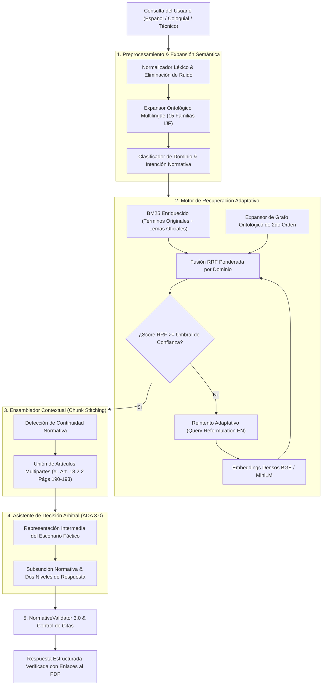

# DISEÑO ARQUITECTÓNICO RRE 3.0 — PIPELINE NORMATIVO INTEGRAL
## IJF SOR Assistant | Edición SOR 2026-08

- **Documento:** Diseño de Arquitectura RRE 3.0
- **Ruta:** `docs/diseno_arquitectura_rre_3_0.md`
- **Fecha:** 2026-11-04
- **Rol:** Arquitecto Senior de Sistemas RAG/RRE y Razonamiento Normativo (Antigravity)
- **Supervisión y Auditoría:** ChatGPT / Alexis
- **Documento Base:** `docs/auditoria_estructural_rre_ada.md`

---

## 1. Diagnóstico Resumido y Fundamentación

La auditoría estructural confirmó que el asistente actual presenta una arquitectura híbrida RRE/ADA con alta precisión en consultas que coinciden con heurísticas especializadas previas (tatami, judogi, puente voluntario y Head Diving), pero sufre un **bloqueo sistémico en dominios normativos no cableados**, ejemplificado en la consulta sobre agresión y ofensas entre competidores.

### Las 10 Causas Raíz Confirmadas:
1. **Desbalance Léxico Español-Inglés:** Tokenización en español que genera términos huérfanos sin traducción al vocabulario normativo del SOR.
2. **Carencia de Ontología para Conducta, Ética y Disciplina:** Ausencia de sinónimos para ofensas, violencia, agresión e insultos, provocando que términos genéricos como *competitor* o *athlete* deriven la búsqueda a tablas de sorteos o diagramas.
3. **Fragmentación por Páginas Físicas:** Artículos de sanción grave como el Art. 18.2.2 están repartidos en 4 páginas (190, 191, 192, 193), aislando la regla general de los supuestos fácticos específicos.
4. **Grafo de Conocimiento Subdesarrollado:** Solo 68 aristas en 298 páginas (0.17 relaciones por nodo), sin enlaces entre principios (D1.1 p. 134), infracciones graves (Art. 18.2.2 p. 190–193) y códigos de penalización (G1.3 p. 256).
5. **Sobre-dependencia de Reglas Hardcoded:** RRE contiene múltiples bloques condicionales ad-hoc (`if is_head_action`, `if is_dive_specific`, etc.), careciendo de un clasificador semántico general.
6. **Inexistencia de Query Expansion y Reintento Adaptativo:** Si la primera pasada de RRF arroja baja confianza, el sistema no formula una re-consulta conceptual en inglés ni expande sinónimos.
7. **Abstención Prematura / Fallback Degradado:** Al recibir fragmentos marginales, ADA se autolimita conforme a su prompt o formula inferencias sobre lesiones (kiken-gachi) no consultadas.
8. **Disociación entre Recuperación y Subsunción Normativa:** No existe una capa estructurada que tipifique el hecho fáctico antes de consultar la norma.
9. **Limitaciones del Validador Anti-alucinaciones:** Valida exhaustivamente códigos y citas, pero no puede detectar la omisión de la norma rectora aplicable.
10. **Ausencia de un Benchmark Holístico:** Falta de una suite formal de evaluación que mida la recuperación en combate, conducta, pesaje, instalaciones y excepciones.

---

## 2. Arquitectura Propuesta: RRE 3.0

El rediseño RRE 3.0 desacopla la **comprensión del escenario**, la **recuperación adaptativa multicanal**, la **costura contextual de artículos** y la **subsunción arbitral en dos niveles**:



---

## 3. Componentes e Interfaces del Sistema

### 3.1 Módulo 1: Normalizador y Expansor Ontológico Multilingüe (`src/normative_ontology.py`)
- **Propósito:** Resolver la barrera idiomática y conceptual de raíz sin reglas cableadas individuales.
- **Estructura Ontológica:** 15 familias normativas del SOR 2026:
  1. *Conducta, Ética y Espíritu del Judo* (ofensa, agresión, insulto, violencia, respeto, disciplina, descalificación).
  2. *Puntuaciones Técnicas* (Ippon, Waza-ari, Yuko, criterios de impacto, continuidad).
  3. *Inmovilizaciones y Ne-Waza* (Osaekomi, tiempos, salidas del tatami, Toketa).
  4. *Estrangulaciones y Luxaciones* (Shime-waza, Kansetsu-waza, acciones prohibidas, llaves cervicales).
  5. *Acciones de Cabeza y Columna* (Head Diving, puente voluntario, protección cervical, caídas).
  6. *Sanciones Leves (Shido)* (no combatividad, agarres ilegales, salidas del área, falsos ataques, pérdida de tiempo).
  7. *Sanciones Graves (Hansoku-make)* (acumulación, faltas peligrosas, actos contra el espíritu, continuación en el torneo).
  8. *Restricciones Específicas por Edad* (Cadetes, Seoi-nage inverso, llaves articulares).
  9. *Pesaje y Control de Peso* (oficial, aleatorio, tolerancias, vestimenta, no presentación).
  10. *Judogi y Equipamiento* (colores blanco/azul, medidas, solapa, parches, marcas, cinturón).
  11. *Área de Competición y Tatami* (zona de combate, zona de seguridad, dimensiones, visibilidad).
  12. *Protocolo Arbitral y Gestualidad* (Mate, Hajime, Sonomama, Yoshi, Hantei, señalizaciones).
  13. *Atención Médica y Lesiones* (médico oficial, regla de los 2 llamados, sangrado, conmoción, Kiken-gachi).
  14. *Sistema de Torneo y Sorteos* (eliminación directa, repesca, cuadros, cabezas de serie, equipos mixtos).
  15. *Comisiones y Autoridades Oficiales* (Directores de Arbitraje, Supervisores, Comisión de Educación, Comisión Médica).
- **Interfaz:**
  ```python
  class NormativeOntology:
      def expand_query(self, query: str) -> ExpandedQuery:
          # Retorna: tokens_es, tokens_en, primary_domain, concept_keywords, matched_articles
  ```

### 3.2 Módulo 2: Motor de Recuperación Adaptativo (`src/rre_engine.py` refactorizado)
- **Eliminación de Heurísticas Cableadas:** Se sustituyen las sentencias `if "cabeza" in query...` por una **matriz de ponderación por dominio** (`DomainWeightMatrix`).
- **Control de Palabras Genéricas de Desvío:** Las palabras de alta frecuencia procedimental (*competitor, athlete, team, rules, category*) se normalizan dinámicamente según la especificidad de la consulta para evitar que saturen el ranking BM25 en detrimento de los verbos y conceptos fácticos (*insult, attack, dive, bridge*).
- **Quality Gate y Reintento Adaptativo:** Si el puntaje RRF de los primeros 3 candidatos no supera el umbral de certeza (`min_confidence = 0.020`), el RRE ejecuta automáticamente una segunda búsqueda utilizando la traducción conceptual formal en inglés antes de declararse en abstención.

### 3.3 Módulo 3: Ensamblador de Continuidad Normativa (*Chunk Stitching*)
- **Problema Abordado:** El Art. 18.2.2 en página 190 establece la regla general de Hansoku-make por actos contra el espíritu del judo y la prohibición de continuar en el torneo, pero los supuestos de hecho concretos (como el punto 13: *insultar o agredir al oponente o árbitro*) están en la página 193.
- **Mecanismo:** Si RRE selecciona como semilla un fragmento que forma parte de un artículo multipartes registrado (`Article 18.2.2`, `Article 14.2`, `Article 20.1`), el componente `ChunkStitcher` ensambla de manera contigua las páginas asociadas en un único bloque de evidencia consolidado, garantizando que ADA reciba tanto el principio como la consecuencia sancionatoria.
- **Preservación de Trazabilidad:** El bloque ensamblado conserva los anclajes físicos originales (`[SOR-2026-08-P190-S198]` y `[SOR-2026-08-P193-S198]`), permitiendo que el resaltador del PDF ubique con exactitud ambas páginas en el visor interactivo.

### 3.4 Módulo 4: Grafo Ontológico Enriquecido (`src/graph_manager.py`)
- **Ampliación de Tipos de Relaciones:** Se pasa de la relación unidimensional `references_article` a un grafo semántico estructurado:
  - `governed_by_principle`: Vincula conductas prohibidas con principios rectores (ej. Art. 18.2.2 ➔ D1.1 Principios del Judo).
  - `sanctioned_with`: Vincula infracciones con su consecuencia sancionatoria (ej. Insultos ➔ Hansoku-make directo sin continuación).
  - `exception_to`: Vincula excepciones explícitas con la regla general (ej. Aterrizaje sobre Tori ➔ Art. 14.2 Puente).
  - `code_specification`: Vincula la descripción textual con el código oficial (ej. Acto contra el espíritu ➔ PX13 / DSB).
  - `category_restriction`: Vincula reglas particulares con su ámbito etario (ej. Art. 18.1.4 p. 34 ➔ Cadetes exclusivamente).
- **Densidad Objetivo:** Incrementar las aristas de 68 a ~450 relaciones verificadas, asegurando que ningún artículo sustantivo quede como isla desconectada.

### 3.5 Módulo 5: Razonamiento ADA 3.0 con Representación Intermedia (`src/ada_assistant.py`)
- **Marco de Representación Fáctica:** Para situaciones de combate y consultas de arbitraje, ADA genera internamente una estructura de subsunción antes de emitir el dictamen:
  1. *Sujeto / Rol:* ¿Quién actúa? (Tori, Uke, Coach, Árbitro, Delegado).
  2. *Categoría:* ¿Seniors, Juniors o Cadetes? (Si no se especifica, evalúa regla general y señala particularidad de cadetes).
  3. *Acción Fáctica:* ¿Técnica de judo, defensa, caída, conducta verbal/física o abandono?
  4. *Norma Tipificadora:* ¿Qué artículo prohíbe o regula la acción?
  5. *Consecuencia Arbitral:* ¿Puntuación (Ippon/Waza-ari/Yuko), Sanción (Shido/Hansoku-make) o Sin sanción?
  6. *Efecto Competitivo:* ¿El atleta puede continuar en el torneo o queda descalificado?
- **Fórmula de Información Faltante:** Si la pregunta del usuario es ambigua (ej. *"¿Qué pasa si uso la cabeza?"*), ADA no improvisa: desglosa los dos escenarios reglamentarios posibles (Tori atacando ➔ Head Diving / Uke defendiendo ➔ Puente o regla de cadetes).

### 3.6 Módulo 6: NormativeValidator 3.0 (`src/normative_validator.py`)
- **Ampliación de Cobertura de Verificación:**
  - *Validación de Consecuencias:* Verifica que si el LLM dictamina Hansoku-make por técnica peligrosa (Art. 18.2.1), afirme que el judoka **SÍ puede continuar**, mientras que si es por actos contra el espíritu (Art. 18.2.2), afirme que **NO puede continuar**.
  - *Detección de Subsunción Errónea:* Bloquea afirmaciones donde una agresión física se encuadre como "lesión fortuita" (Kiken-gachi) en lugar de infracción disciplinaria grave.
  - *Prevención de Falsas Lagunas:* Advierte y neutraliza frases del LLM como *"el reglamento no contempla nada al respecto"* cuando los pasajes certificados contienen disposiciones rectoras.

---

## 4. Estrategia de Migración y Chunk Stitching sin Afectar el Corpus Oficial

1. **Inmutabilidad del Corpus Base:** No se altera el archivo maestro `passages_candidate.json` ni los textos oficiales extraídos.
2. **Capa Lógica de Stitching en Tiempo de Ejecución:** El ensamblaje de pasajes multipartes se realiza como un paso intermedio de empaquetado en memoria dentro de `ReasoningRetrievalEngine.retrieve()`.
3. **Compatibilidad Hacia Atrás:** La salida sigue exponiendo la lista estándar de `evidence` y `related_passages` que consumen la interfaz web de Streamlit, el visor PDF con resaltado y las pruebas automatizadas.

---

## 5. Riesgos Técnicos y Alternativas Consideradas

| Riesgo Identificado | Severidad | Mitigación Arquitectónica |
|---|---|---|
| **Aumento de Latencia por Expansión y Reintento** | Media | La expansión ontológica opera con búsquedas en memoria en microsegundos; el reintento adaptativo solo se dispara si el Quality Gate inicial falla (<15% de las consultas). |
| **Saturación del Contexto LLM al Unir Chunks (Stitching)** | Media | Límite estricto de hasta 2 páginas continuas por artículo; compresión de encabezados repetidos de página. |
| **Ruptura de Pruebas Existentes (Regresión)** | Alta | Mantenimiento riguroso de la suite de 166 tests como compuerta de aprobación obligatoria tras cada fase. |

### Alternativas Consideradas y Descartadas:
- *Reindexar todo el PDF con chunks de longitud variable fija (ej. 500 tokens):* Descartada porque rompería la correspondencia 1:1 con las páginas del visor PDF interactivo y los hashes certificados de citación.
- *Agregar nuevos bloques `if/else` en RRE para cada tema nuevo:* Descartada categóricamente porque perpetúa la fragilidad arquitectónica y genera deuda técnica insostenible.

---

## 6. Criterios de Aceptación Globales RRE 3.0

1. **Aprobación del Benchmark de 25 Casos:** ≥92% de precisión en recuperación y aplicación normativa (Recall@3 ≥ 0.90).
2. **Cero Regresiones:** 166/166 pruebas automatizadas vigentes aprobadas sin fallas.
3. **Resolución del Caso de Agresión/Conducta:** Recuperación en Top 1 de Art. 18.2.2 / D1.1 y dictamen inequívoco de Hansoku-make directo sin continuación en el torneo.
4. **Preservación del Hash Criptográfico del PDF:** SHA256 inalterado en todo momento.
