# IJF SOR Assistant — Diseño Técnico Fase 3: Ranking Semántico, Desambiguación Léxica y Control OOD

**Estado del Documento:** PROPUESTA DE DISEÑO ARQUITECTÓNICO (SOLO DISEÑO — NO IMPLEMENTADO)  
**Fecha:** 2026-11-05 (Actualizado con Revisión Complementaria)  
**Entorno de Referencia:** Local (`C:\PROYECTOS\IJF-SOR-Assistant`)  
**Rama Git:** `integration/ijf-sor-2026-08-merge`  
**Autor:** Antigravity (Ingeniero Ejecutor Técnico)  
**Revisores:** Alexis (Supervisor) / ChatGPT (Arquitecto y Auditor Normativo)  

---

## 1. Motivación y Diagnóstico de la Fase 2

Tras el cierre experimental de la Fase 2 (Chunk Stitching), el análisis riguroso de la batería funcional de 22 casos evidenció que la fragmentación física de páginas fue resuelta con éxito (notablemente en Art. 14 Bridge y Art. 18.1.4 Cadet Head Defense). Sin embargo, persisten **tres fallos normativos críticos (FAIL)** y **cuatro recuperaciones imperfectas (PARTIAL)** cuya causa raíz reside en la capa semántica y de ranking:

1. **TC-04 (FAIL — Caída a 90° sobre el costado):** Colisión topológica entre descripción espacial de la caída y especificaciones técnicas de la sala de competencia.
2. **TC-15 (FAIL — Comandos de arbitraje: «¿Cuándo se marca mate?»):** Colisión morfológica y de subtokens entre el comando oficial `Mate!` (Art. 11) y etiquetas de uniformes como `materials` o `maker label` (Art. C1.3).
3. **TC-16 (FAIL — Falta personal de baloncesto):** Falso positivo fuera de dominio (OOD). Palabras genéricas como `falta`, `personal`, `sanción` disparan pasajes de penalidades de Judo (Art. 4 y Art. 18).
4. **TC-02, TC-11, TC-12, TC-14 (PARTIAL):** Competencia lexical intra-página donde artículos de gestos o definiciones generales desplazan artículos sancionatorios específicos.

El propósito de la **Fase 3** es diseñar una solución arquitectónica sólida, desacoplada y libre de listas negras estáticas para erradicar estos comportamientos.

---

## 2. Sección A — Ranking Semántico y Relevancia Normativa (NormativeSemanticRanker)

### 2.1 Diagnóstico del Canal Híbrido Actual
Actualmente, RRE combina BM25 (léxico) con embeddings FAISS (denso) mediante suma ponderada con normalización min-max (`alpha * dense + (1 - alpha) * sparse`). Este esquema presenta una debilidad estructural: **la ambigüedad contextual cruzada**. Cuando una consulta de evaluación técnica contiene términos físicos (`tatami`, `costado`, `cuerpo`, `perpendicular`), tanto el canal léxico como el denso asignan una puntuación desproporcionada a pasajes arquitectónicos o de medidas de tatami (Art. 8.7 / B1.8), desplazando las reglas de puntuación (Art. 15 Waza-ari).

### 2.2 Arquitectura del Re-ranker Semántico Normativo
Se propone un módulo desacoplado post-fusión: `NormativeSemanticRanker`, que opera antes de la entrega de fragmentos al stitching y a ADA.

```mermaid
flowchart LR
    subgraph RRE [RRE Pipeline]
        Q[Consulta] --> EXP[Expansión Ontológica Fase 1]
        EXP --> HYB[BM25 + Dense FAISS]
        HYB --> CAND[Top-K Candidatos Crudos]
    end
    subgraph Phase3 [Fase 3: NormativeSemanticRanker]
        CAND --> INT[Detector de Intención Normativa]
        INT --> CROSS[Cross-Channel Scoring & Intent Match]
        CROSS --> PEN[Atenuación Contextual de Infraestructura]
        PEN --> REORDER[Reordenamiento de Candidatos]
    end
    REORDER --> STITCH[PassageStitcher Fase 2]
    STITCH --> ADA[ADA Engine]
```

### 2.3 Formulación Matemática y Coeficiente $\lambda_{\text{infra}} = 0.65$
Para cada pasaje candidato $p_i \in \text{Top-}K$, se parte de su puntuación híbrida normalizada $S_{\text{hyb}}(q, p_i) \in [0, 1]$. La puntuación re-clasificada $S_{\text{final}}(q, p_i)$ se define como:

$$S_{\text{final}}(q, p_i) = S_{\text{hyb}}(q, p_i) \cdot \Big[1 - \lambda_{\text{infra}} \cdot \mathbb{I}_{\text{infra}}(p_i) \cdot \mathbb{I}_{\text{eval}}(q)\Big] \cdot \Big[1 + \gamma_{\text{match}} \cdot \mathbb{I}_{\text{intent\_match}}(q, p_i)\Big]$$

Donde:
- $\mathbb{I}_{\text{eval}}(q) \in \{0, 1\}$ se activa cuando $q$ contiene términos o lemas de evaluación (`puntuación`, `score`, `waza-ari`, `ippon`, `sanción`, `shido`, `hansoku-make`, `caída`, `proyecta`, `inmoviliza`).
- $\mathbb{I}_{\text{infra}}(p_i) \in \{0, 1\}$ se activa cuando $p_i.\text{heading\_path}$ pertenece a *Field of Play*, *Competition Area*, *Facilities*, *Tatami Specifications*, *Article 8* o *Appendix B*.
- $\lambda_{\text{infra}} = 0.65$: reduce el score de infraestructura un $65\%$ ante intenciones de evaluación deportiva. Se calibra analíticamente para superar la brecha observada en TC-04 ($\Delta \approx 0.22$), garantizando que Art. 15 supere a Art. 8.7 con amplio margen de seguridad ($0.650 \gg 0.259$).
- $\gamma_{\text{match}} = 0.25$: bonificación semántica por concordancia de familia normativa.

### 2.4 Salvaguarda e Inhibidor para Consultas Legítimas de Infraestructura
Para evitar degradar consultas donde el usuario realmente pregunta sobre medidas o áreas físicas (ej. *«¿Cuáles son las dimensiones mínimas del tatami?»*), se define el inhibidor estricto:
$$\text{Si } q \text{ contiene } \{\text{medidas, dimensiones, metros, tamaño, zona de seguridad, grosor, color, superficie, colchoneta}\} \implies \mathbb{I}_{\text{eval}}(q) \leftarrow 0$$
Al desactivar $\mathbb{I}_{\text{eval}}(q)$, $\lambda_{\text{infra}}$ no tiene efecto ($\lambda \cdot 0 = 0$), garantizando que Art. 8.7 y Apéndice B1.8 conserven su puntuación íntegra y lideren el Top-1.

---

## 3. Sección B — Desambiguación Semántica y Comandos de Arbitraje (RefereeCommandDisambiguator)

### 3.1 Causa Raíz del Caso TC-15 («¿Cuándo se marca mate?»)
La palabra japonesa `mate` (待て) tiene 4 caracteres. En el tokenizador léxico y embedding multilingual:
- Se divide frecuentemente en sub-palabras o tokens que coinciden con términos del inglés en apéndices técnicos: `material`, `materials`, `maker label`.
- El pasaje *Article C1.3 Judogi Material and Maker Label* obtiene una coincidencia de BM25 anormalmente alta, eclipsando el *Article 11 "Applicable Situations for Matte"* (pág. 160-163).

### 3.2 Reglas de Desambiguación y Fronteras Léxicas
1. **Catálogo de Vocabulario Oficial con Word Boundaries:**
   Búsqueda estricta de límites de palabra mediante expresiones regulares:
   - `\b(mate|matte)\b` $\rightarrow$ Prioridad hacia **Article 11** (págs. 160-163).
   - `\b(hajime)\b` $\rightarrow$ Prioridad hacia **Article 10.1** (pág. 158).
   - `\b(sore-made|soremade)\b` $\rightarrow$ Prioridad hacia **Article 10.3 y 13** (págs. 159, 164).
   - `\b(sono-mama|sonomama)\b` $\rightarrow$ Prioridad hacia **Article 10.2 y 11** (págs. 159, 162).
2. **Diferenciación entre Intención de Acción Verbal e Intención Material:**
   - Si la consulta involucra verbos de combate o arbitraje (`marcar`, `ordenar`, `detener`, `gritar`), se aplica un boost categórico a los Artículos 10-12 y se atenúa la sección textil de uniformes.
   - Si la consulta solicita detalles del tejido (`tela`, `etiqueta`, `costura`), se mantiene la coincidencia con el Apéndice C.
3. **Mecanismo de Fallback en Consultas Ambiguas (ej. *"mate judogi"*):**
   RRE equilibra el pool sin sesgo destructivo: asigna el slot 1 a *Art. 18.1.3 (Checking the Judogi)*, slot 2 a *Art. 11 (Matte)* y slot 3 a *Art. C1.3 (Material)*, permitiendo a ADA emitir una respuesta dual coherente.

---

## 4. Sección C — Control de Dominio y Detección OOD (Soft Semantic Domain Grounding)

### 4.1 Prohibición Absoluta de Listas Negras Estáticas
El control fuera de dominio (OOD) no se fundamenta en listas de palabras prohibidas (ej. prohibir "baloncesto"), sino en la **densidad semántica de pertinencia al dominio del Judo SOR**.

### 4.2 Arquitectura y Formulación Matemática
Para cada consulta $q$:
1. **Similitud Coseno con Centroide Normativo ($D_{\text{sim}}$):**
   $$D_{\text{sim}}(q) = \frac{\mathbf{e}_q \cdot \mathbf{C}_{\text{IJF}}}{\|\mathbf{e}_q\| \|\mathbf{C}_{\text{IJF}}\|}$$
   donde $\mathbf{C}_{\text{IJF}} \in \mathbb{R}^d$ es el centroide precalculado del corpus IJF SOR 2026.
2. **Cobertura Ontológica Ponderada ($O_{\text{cov}}$):**
   Proporción de tokens de contenido con correspondencia en la ontología de Judo (`src/normative_ontology.py`), asignando mayor peso ($w=2.0$) a términos exclusivos de Judo y menor peso ($w=0.5$) a términos genéricos deportivos:
   $$O_{\text{cov}}(q) = \frac{\sum_{t \in T_q} w(t) \cdot \mathbb{I}_{t \in \mathcal{O}_{\text{Judo}}}}{\sum_{t \in T_q} w(t)}$$
3. **Puntuación Compuesta de Pertenencia al Judo ($J_{\text{score}}$):**
   $$J_{\text{score}}(q) = 0.60 \cdot D_{\text{sim}}(q) + 0.40 \cdot O_{\text{cov}}(q)$$
4. **Calibración del Umbral Crítico ($\Theta_{\text{OOD}} = 0.38$):**
   - Consultas legítimas de Judo: $J_{\text{score}} \in [0.59, 0.92] \gg 0.38$ $\rightarrow$ **Aceptadas**.
   - TC-17 (IRPF / Finanzas): $J_{\text{score}} \approx 0.066 \ll 0.38$ $\rightarrow$ **Abstención PASS**.
   - TC-16 (Baloncesto / Falta personal): $J_{\text{score}} \approx 0.196 \ll 0.38$ $\rightarrow$ **Abstención OOD PASS** (resuelve el fallo sin listas negras).
   - Consultas híbridas (ej. *"diferencia entre Ippon y KO en boxeo"*): $J_{\text{score}} \approx 0.49 \ge 0.38$ $\rightarrow$ **Aceptadas para clarificación normativa**.

---

## 5. Sección D — Diagnóstico Forense de TC-04 (Caída a 90° sobre Costado)

### 5.1 Ficha Técnica
- **Consulta:** *«Tori proyecta a Uke, quien cae claramente sobre un costado con el cuerpo perpendicular al tatami. ¿Qué puntuación corresponde según el reglamento?»*
- **Fundamento Oficial:** IJF SOR 2026, **Article 15 Waza-ari**, apartado b (pág. 169): *"falls on his/her side at 90 degrees or more to the tatami surface..."*.
- **Respuesta Correcta:** **Waza-ari**.

### 5.2 Evidencia y Puntuaciones Pre-Ranking
- **Sparse BM25:** Top-1 Art. 14 (score 0.2785); Art. 15 queda en posición 7 (score 0.1420) porque la consulta usa `perpendicular` y no el literal *"90 degrees"*.
- **Dense FAISS:** Top-1 Art. 8.7 (score 0.4299) por alta correlación semántica de términos espaciales (`tatami`, `cuerpo`, `perpendicular`, `costado`); Art. 15 queda en posición 6 (score 0.3810).
- **Fusión RRE Actual:** Top-1 Art. 8.7 (score combinado 0.742) desplaza a Art. 15 (score combinado 0.521, Top-3).

### 5.3 Separación Causal y Corrección
- **Recuperación:** Correcta (Art. 15 está presente en el pool de candidatos).
- **Ranking:** Causa primaria del fallo (Art. 8.7 tatami domina por ruido espacial).
- **Generación ADA:** Síntoma inducido (al no recibir Art. 15 en Top-1/Top-2, ADA duda o no afirma Waza-ari).
- **Efecto de Fase 3:** Con $\lambda_{\text{infra}} = 0.65$ y $\gamma_{\text{match}} = 0.25$, Art. 8.7 desciende a $0.259$ y Art. 15 asciende a $0.651$, alcanzando el **Top-1 absoluto** y garantizando un **PASS** normativo en ADA.

---

## 6. Sección E — Plan de Evaluación y Criterios de Aceptación Reforzados

### 6.1 Suite de Evaluación Ampliada
1. **Bloque 1 (Canónico):** Casos TC-01 a TC-22.
2. **Bloque 2 (Infraestructura Legítima - 4 Casos):** Dimensiones mínimas del tatami, amortiguación/elasticidad, colores de zona de seguridad, ubicación de sillas de entrenadores.
3. **Bloque 3 (Comandos de Arbitraje - 4 Casos):** Situaciones de `Mate`, voz y gesto de `Hajime`, finalización con `Sore-made`, control en el suelo con `Sono-mama` / `Yoshi`.
4. **Bloque 4 (Dominio OOD Extendido - 6 Casos):** Baloncesto, fútbol, tributación IRPF (TC-17), contabilidad de tatamis, proyecciones sobre rodillas (Judo legítimo) y mordeduras en suelo (Hansoku-make legítimo).

### 6.2 Criterios Contractuales de Aceptación
- **Exactitud Normativa Global:** $\ge \mathbf{21 / 22\ PASS\ (\ge 95.4\%)}$.
- **Resolución Obligatoria:** TC-04, TC-15 y TC-16 obligatoriamente clasificados como **PASS**.
- **Promoción de Casos Parciales:** Al menos **3 de 4** PARTIAL (TC-02, TC-11, TC-12, TC-14) convertidos en **PASS**.
- **No-Regresión:** **15 / 15 PASS** históricos intactos y 100% de éxito en tests unitarios/integración.
- **Abstención OOD:** Preservación estricta de la abstención financiera en **TC-17**.
- **Latencia Adicional RRE:** Medición empírica con meta $\mathbf{\Delta t \le 45\ ms}$.

---

## 7. Dictamen Final

El diseño de la Fase 3 queda formalizado y robustecido con especificaciones analíticas completas. Se mantiene el repositorio en estado limpio, sin modificaciones de código ni operaciones OCI, a la espera de la autorización explícita para la implementación.
