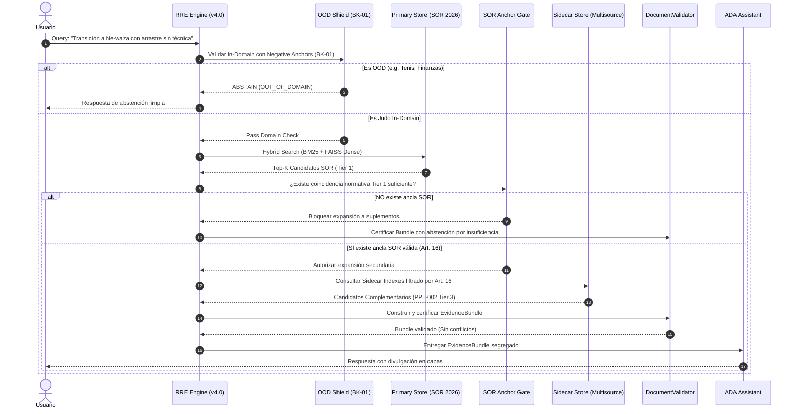

# SOR-IJF — ESPECIFICACIÓN TÉCNICA FASE 4.2
**Especificación Ejecutable del Pipeline Multifuente, Sidecar Indexes y Evaluación Shadow**

- **Proyecto:** IJF Sport and Organisation Rules (SOR) Assistant
- **Fase:** Fase 4.2.0 — Especificación Técnica Ejecutable
- **Fecha:** 2026-11-05
- **Rama Git:** `integration/ijf-sor-2026-08-merge` (Commit Base: `61afc1bc`)
- **Autor / Ejecutor Técnico:** Antigravity
- **Arquitectura y Auditoría:** ChatGPT
- **Supervisión Normativa:** Alexis

---

## 1. ALCANCE Y OBJETIVOS DE LA ESPECIFICACIÓN

El presente documento define la arquitectura técnica detallada, estructuras de datos, interfaces y flujos de ejecución que compondrán la **Fase 4.2**. La implementación se planifica de forma estrictamente modular y desacoplada del sistema productivo actual.

---

## 2. ESTRUCTURA DE ALMACENAMIENTO: SIDECAR INDEXES

Para cumplir con el **ADR-DP-04**, se define la estructura de directorios y artefactos aislados en `data/corpus_multisource/`:

```
data/corpus_multisource/
├── manifests/
│   ├── batch_manifest_001.json       # Manifiesto criptográfico del lote ingerido
│   └── curatorship_log_alexis.md     # Bitácora de aprobación formal de Alexis
├── processed/
│   ├── multisource_passages.json     # Chunks segmentados de fuentes complementarias
│   ├── multisource_metadata.json     # Metadatos mapeados a DocumentMetadata
│   ├── faiss_multisource.index       # Índice denso aislado (all-MiniLM-L6-v2)
│   └── bm25_multisource.pkl          # Índice léxico BM25 independiente
└── staging/
    └── raw_approved/                 # Copias validadas de archivos Markdown/PDF
```

### 2.1 Esquema del Manifiesto de Lote (`batch_manifest_001.json`)
Cada lote de ingestión secundaria debe registrar:
```json
{
  "batch_id": "BATCH-MULTI-2026-11-01",
  "created_at": "2026-11-05T00:00:00Z",
  "approved_by": "Alexis",
  "curatorship_file": "curatorship_log_alexis.md",
  "documents": [
    {
      "document_id": "PPT-002",
      "source_path": "data/markdown/kuns_ppt_002.md",
      "sha256": "05cce344311a93cd779b5c57502aa56877074627443e26f582df57cb9a2343c5",
      "chunks_generated": 14,
      "authority_tier": "TIER_3_REFEREEING_INTERPRETATION",
      "validity_status": "VIGENTE"
    }
  ],
  "primary_corpus_baseline_sha256": "9426b10d11c21a4c9523f66c8d76dbbb9f33b1e353272d5ef7df4bfa95f265ee"
}
```

---

## 3. ESPECIFICACIÓN DEL MOTOR DE RECUPERACIÓN MULTIFUENTE (RRE 4.0 - SHADOW MODE)

El acceso a las fuentes complementarias no reemplazará la búsqueda primaria. Se implementa un **recuperador jerárquico SOR-First con compuerta de anclaje**:



### 3.1 Algoritmo de la Compuerta de Anclaje SOR (`SOR_Anchor_Gate`)
La consulta al Sidecar Index solo se dispara si se cumplen copulativamente tres condiciones:
1. `score_sor_top1 >= 0.50` (Existe relevancia reglamentaria comprobada en el SOR).
2. El candidato Top-1 del SOR pertenece a un artículo canónico (`Art. 1` a `Art. 23`).
3. El feature flag `enable_multisource_sidecar` está explícitamente activado.

---

## 4. EVALUACIÓN SHADOW (MODO SOMBRA)

Antes de cualquier activación visible para el usuario, el motor multifuente operará en **Shadow Mode**:
- Cada consulta enviada al sistema ejecuta en paralelo el flujo de **Línea Base (Fase 3)** y el flujo **Multifuente (Fase 4.2)**.
- El usuario recibe exclusivamente la respuesta de la línea base probada.
- Los resultados de Fase 4.2 (candidatos recuperados, tiempos de latencia, presencia de conflictos y estructura del `EvidenceBundle`) se registran asíncronamente en una bitácora de auditoría: `scratch/shadow_evaluation_log.jsonl`.
- Se evalúan discrepancias normativas durante un período mínimo de observación sin impacto en el servicio interactivo.

---

## 5. ESPECIFICACIÓN DE BK-01 (NEGATIVE DOMAIN ANCHOR SCORING)

Para resolver definitivamente los falsos positivos de `GEN-08` (tenis) y `GEN-09` (natación), el detector OOD se extenderá de la siguiente forma:

### 5.1 Vectores de Anclas Negativas
Se definen centroides semánticos para 4 categorías de deportes externos:
1. **Deportes de Raqueta / Puntos:** Tenis, Pádel, Bádminton, Tenis de mesa (`tie-break`, `set`, `game`, `raqueta`, `saque`).
2. **Deportes Acuáticos / Distancia:** Natación, Waterpolo, Salto (`patada submarina`, `estilo mariposa`, `brazada`, `metros bajo agua`).
3. **Deportes de Pelota y Equipo:** Fútbol, Baloncesto, Balonmano, Rugby (`tiro libre`, `canasta`, `córner`, `tarjeta roja`, `penalti`).
4. **Deportes de Combate con Striking Exclusivo:** Boxeo, Kickboxing, Muay Thai (`nocaut`, `round`, `ring`, `guante de box`).

### 5.2 Ecuación de Decisión con Inhibición Negativa
$$J_{\text{score\_calibrado}}(q) = \alpha \cdot D_{\text{judo}}(q) + (1 - \alpha) \cdot O_{\text{cov}}(q) - \beta \cdot \max_{k} D_{\text{neg\_centroid\_k}}(q)$$

Donde:
- Si $\max_{k} D_{\text{neg\_centroid\_k}}(q) > 0.55$ y $O_{\text{cov}}(q) == 0.0$ (cero conceptos exclusivos de judo en ontología), la consulta es rechazada de manera forzosa como `OUT_OF_DOMAIN`, anulando cualquier coincidencia casual con palabras genéricas como `puntos` o `distancia`.

---

## 6. POLÍTICA DE ROLLBACK CONCEPTUAL

Si en cualquier fase experimental se detecta:
1. Una degradación en los 22 casos de la batería canónica TC-01 a TC-22.
2. Un incremento de latencia promedio $> +35\text{ ms}$ introducido por los Sidecar Indexes.
3. Un falso positivo donde un documento de Tier 2-4 contradiga al SOR.

**Procedimiento de Rollback Inmediato:**
- Desactivar el feature flag `enable_multisource_sidecar = False` en `src/rre_engine.py`.
- Eliminar o desacoplar el directorio `data/corpus_multisource/`.
- El sistema revertirá automáticamente al comportamiento 100% monofuente certificado de Fase 3 sin requerir reconstrucción de índices.
