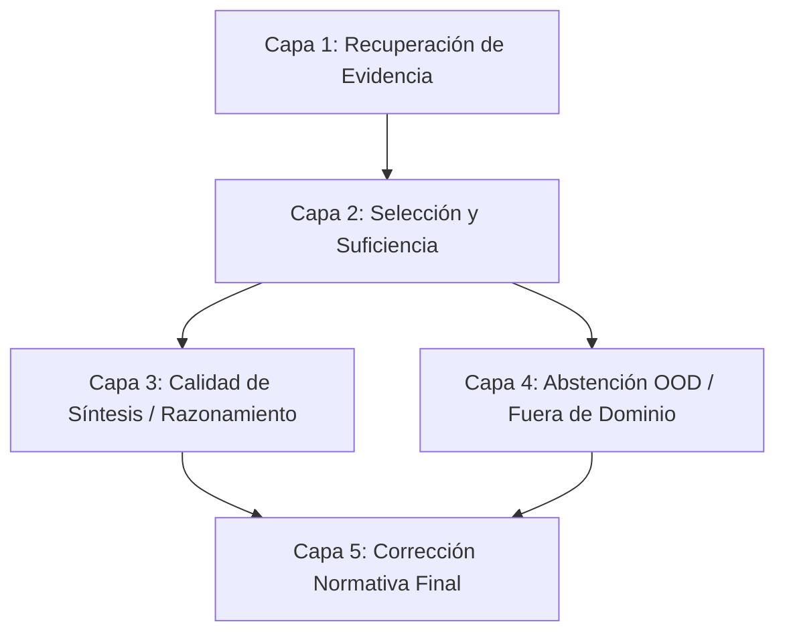

# Línea Base Normativa y Comparativa de Evaluación — VF01

> [!NOTE]
> **ESTADO DE RESOLUCIÓN (7 de noviembre de 2026):**  
> Los 11 casos que mantenían en suspenso la evaluación definitiva fueron formalmente resueltos y ratificados por Alexis Oliveros Lozano (Product Owner / Autoridad Arbitral).  
> La matriz consolidada registra 100% de casos resueltos (52/52), con oráculos fijados e incorporados al expediente oficial en [docs/auditoria/validacion_humana_resultados_actuales.md](file:///c:/PROYECTOS/IJF-SOR-Assistant/docs/auditoria/validacion_humana_resultados_actuales.md).

> **Proyecto:** IJF SOR Assistant 2026  
> **Fase:** P0-A.1.2 (Subsanación Documental Final posterior a Reauditoría Codex)  
> **Fecha:** Noviembre 2026  
> **Responsable del proyecto y decisor final:** Alexis Oliveros Lozano  
> **Planificador y auditor independiente:** ChatGPT  
> **Auditor independiente:** Codex (Dictámenes `dictamen_auditoria_p0a_codex.md`, `dictamen_reauditoria_p0a1_codex.md` y `dictamen_reauditoria_final_p0a1_codex.md`)  
> **Ejecutor técnico documental:** Antigravity  
> **Documento normativo de referencia:** `IJF Sport and Organisation Rules 2026` (14 de agosto de 2026, 298 páginas físicas, SHA-256 `9426b10d11c21a4cb9eb23150c2c4fc95bfcd463511e66ba451d2cff005ae620`)

---

## 1. Resumen Ejecutivo y Propósito

El presente informe establece la **Línea Base Normativa y Comparativa de Evaluación** del IJF SOR Assistant tras la ejecución de la Validación Funcional Consolidada VF01 y la revisión de auditoría independiente efectuada por Codex (`dictamen_reauditoria_final_p0a1_codex.md`).

En la batería consolidada VF01 se registraron históricamente 52 ejecuciones técnicas exitosas del pipeline:
$$\text{Rendimiento Técnico Histórico (Pipeline)} = \frac{52}{52} \text{ PASS } (100.0\%)$$

Sin embargo, conforme a la **Auditoría Integral de Código** (`docs/auditoria_integral_codigo.md`), el **Dictamen de Auditoría Independiente VF01** (`docs/dictamen_auditoria_vf01.md`) y las sucesivas auditorías independientes de **Codex**, es metodológicamente indispensable **separar de forma estricta el rendimiento técnico de ejecución del sistema frente a la exactitud normativa de fondo**:
1. **Rendimiento Técnico Histórico (52/52 PASS):** Refleja la estabilidad del software y del pipeline (código de salida cero, ausencia de caídas, retorno de respuestas estructuradas o abstenciones automáticas formales). Este indicador se preserva íntegramente como registro histórico de ejecución técnica.
2. **Exactitud Normativa Material:** Evalúa si la respuesta generada por el asistente satisface el oráculo normativo del SOR 2026, si la cita es correcta y si el razonamiento arbitral es jurídicamente suficiente. La ejecución exitosa (`SUCCESS`) o abstención de pipeline (`ABSTAIN`) no certifica corrección normativa material.
3. Se certificaron históricamente como `PASS` respuestas que citaban artículos por coincidencia léxica pero cuyas soluciones eran incompletas o erróneas (ej. TC-04, TC-11, TC-12, TC-15).
4. Conforme dictaminó Codex, los 41 casos preliminares se clasifican estrictamente como `CANDIDATO_DOCUMENTAL`, comprendiendo 35 casos con pasaje canónico localizado en el SOR y 6 casos de política de abstención OOD documentada (`Ninguno (Fuera de Dominio)`), reservando la condición de oráculo normativo aprobado para cuando se formalice la revisión humana acreditada.

---

## 2. Comparación Global: Rendimiento Técnico Histórico vs. Línea Base Normativa

A continuación se contrasta el rendimiento técnico de ejecución frente a la verdad básica documental normativa, distinguiendo claramente ambas dimensiones:

| Dimensión de Evaluación | Rendimiento Técnico Histórico (VF01) | Línea Base Documental P0-A.1 | Estado de Certificación Metodológica |
|---|:---:|:---:|---|
| **Casos Totales Evaluados** | 52 | 52 | Inventario consolidado sin duplicados |
| **Rendimiento Técnico de Pipeline (`PASS`)** | **52 / 52 (100.0%)** | **52 / 52 (100.0%)** | **Preservado íntegramente.** Refleja terminación técnica (`SUCCESS`/`ABSTAIN`). No prueba exactitud normativa. |
| **Candidatos Documentales Preliminares (`CANDIDATO_DOCUMENTAL`)** | No distinguía capas | **41 (78.8%)** | Pendiente registro formal de revisor y doble revisión. |
| — *Subtipo A: Pasaje SOR Localizado* | — | *35 (67.3%)* | Pasaje canónico identificado y cotejado en texto oficial. |
| — *Subtipo B: Candidato de Política de Abstención OOD* | — | *6 (11.5%)* | Materia ajena a judo; política de abstención documentada. |
| **Casos Pendientes de Revisión Humana Arbitral** | 0 (0.0%) | **8 (15.4%)** | VF01-01, VF01-07, VF01-09, VF01-14, VF01-29, VF01-30, VF01-42, VF01-48. |
| **Casos Pendientes de Evidencia Externa (Tier 2 / Circulares)** | 0 (0.0%) | **1 (1.9%)** | VF01-23 (Reverse seoi-nage Senior, requiere Circular 2026_01 en Paso 3). |
| **Casos Sin Oráculo Verificable en SOR Canónico** | 0 (0.0%) | **1 (1.9%)** | VF01-25 (LA28 freeze date, no existe en 298 págs. de SOR base; abstención obligatoria). |
| **Casos con Tensión o Interpretación Disputada** | 0 (0.0%) | **1 (1.9%)** | VF01-24 (Tiempo kumi-kata, conflicto texto general vs. borrador circular). |
| **Casos Críticos de Seguridad Arbitral (SEC-CRIT)** | 15 | 15 | 10 candidatos identificados; 5 pendientes humanos (VF01-07, 09, 14, 30, 42). |
| **Respuestas Históricas Favorables (Dictamen VF01)** | 52 aparente | **17 / 52 (32.7%)** | Resultado histórico auditado: 12 correctas + 5 abstenciones válidas en dictamen VF01. |
| **Tasa de Corrección Normativa Certificada Final** | No evaluada | **SUSPENDIDA** | Suspendida formalmente hasta resolver los 11 casos de decisión y la doble revisión SEC-CRIT. |

---

## 3. Desglose por Capas de Evaluación del Sistema

Para diagnosticar las causas raíz de las fallas sin atribuirlas genéricamente a la inteligencia del modelo, el sistema se evalúa en 5 capas operativas independientes:

### Capa 1: Recuperación de Evidencia (RRE + PassageStitcher)
- **Fallas de Recuperación Documentadas:**
  - *TC-01 (VF01-01):* El Art. 8.7 (pág. 96) contiene tanto las medidas del área de combate como las del área de seguridad. El motor recuperó p. 96 pero solo recortó la porción de área de combate. Corregida la referencia errónea previa que lo vinculaba a Art. 8.8 pág. 97 (Medical).
  - *TC-04 (VF01-04):* Búsqueda de "caída lateral hacia un codo" recuperó Art. 8.7 (área de competición) en lugar de Art. 15 (criterios de Waza-ari).
  - *TC-11 (VF01-11):* La consulta histórica sobre sanción por kawazu-gake devolvió Art. 4 Gestures (pág. 149) debido a la ausencia del término en sinónimos. El pasaje canónico candidato está perfectamente ubicado en Art. 18.2.2 punto 1 (pág. 190), pero la respuesta generada fue fallida.
  - *TC-12 (VF01-12):* Búsqueda de "luxación continuada fuera del tatami" recuperó Art. 8.7 en lugar de Art. 5 (validez técnica y continuidad).
  - *TC-15 (VF01-15):* Búsqueda de "criterios para Mate" recuperó C1.3 (Comisión Médica) por coincidencia léxica en lugar de Art. 11.
  - *MC-13 (VF01-35):* Consulta sobre tiempos fuera en básquetbol recuperó Art. 7.2 (entrenadores) por coincidencia en la palabra "entrenador", produciendo una respuesta alucinada en vez de abstenerse.

### Capa 2: Selección y Suficiencia de Evidencia
- **Defecto P0 Crítico:** Falta de un evaluador de completitud antes de enviar los fragmentos a síntesis.
- **Impacto:** En casos multipartes (como TC-01: dimensiones de tatami y zona de seguridad; TC-07: diving cadetes vs. senior; TC-09: diving y continuidad competitiva), el motor seleccionó un solo fragmento incompleto (`evidence[0]`), redactando respuestas parciales sin advertir la omisión de la segunda condición.

### Capa 3: Calidad de Síntesis y Razonamiento Deóntico
- **Comportamiento Observado:** El sintetizador es altamente obediente al contexto inmediato, pero carece de un marco de razonamiento deóntico arbitral (Obligación / Prohibición / Permisión / Excepción).
- Cuando el fragmento recuperado es tangencial, el modelo intenta "forzar" una respuesta arbitral conectando términos aislados (ej. TC-04 justificando una caída técnica a partir de las dimensiones del área de seguridad).

### Capa 4: Abstención Correcta (OOD y Ambigüedad)
- **Desempeño en Fuera de Dominio (OOD):**
  - Casos exitosamente abstenidos (4/5): TC-16 (básquetbol), TC-17 (finanzas), MC-14 (natación), MC-15 (fútbol americano).
  - Falsos positivos en OOD (1/5): MC-13 (tiempos fuera de básquetbol) no se abstuvo, respondiendo con normas de judo sobre entrenadores.
- **Desempeño en Ambigüedad Normativa:**
  - Fallo generalizado: Ante consultas incompletas o abiertas (TC-14 "¿Qué pasa si un judoka usa la cabeza?", CGPT-06 "El judoka cometió una falta con el agarre"), el sistema no solicita aclaración ni desglosa escenarios; toma una rama al azar y formula una afirmación categórica pero incompleta.

### Capa 5: Corrección Normativa Final (Dictamen de Fondo)
- Conforme a las auditorías independientes de Codex y la revisión de VF01, no es procedente atribuir una cifra fija de 28 casos normativamente correctos sin una reconciliación exhaustiva caso a caso. El dictamen previo de VF01 certificaba 17 casos favorables (12 correctos y 5 abstenciones correctas). El universo de candidatos y respuestas queda sujeto a la revisión formal de la tabla de reconciliación en la reauditoría.

---

## 4. Métricas que No Pueden Calcularse Definitivamente (Bloqueos P0-A / P0-A.1)

En estricto apego al dictamen de auditoría independiente Codex, **se suspende el cálculo y publicación de las siguientes métricas finales** hasta que concluyan las decisiones de Alexis y la doble revisión humana:

1. **Exactitud Normativa Absoluta (Accuracy Arbitral Certificada):**
   - No puede fijarse un porcentaje definitivo único.
   - El dictamen previo de VF01 constató un **32.7% (17/52)** de respuestas históricas favorables (12 correctas + 5 abstenciones válidas).
   - Existen **41 casos clasificados como `CANDIDATO_DOCUMENTAL`** (35 con pasajes identificados en el SOR y 6 candidatos de política de abstención OOD), pero su certificación como oráculo definitivo requiere registro de doble revisión y resolución de los **8 casos pendientes de decisión humana**, el caso pendiente de evidencia y el caso disputado.
2. **Tasa de Aprobación en Consultas Críticas de Seguridad (SEC-CRIT):**
   - De los 15 casos SEC-CRIT, **10 casos disponen de pasajes candidatos localizados** en el SOR canónico (`CANDIDATO_DOCUMENTAL`).
   - **5 casos están estrictamente clasificados como `PENDIENTE_REVISION_HUMANA`:**
     - VF01-07 (Tori usa cabeza: Cadetes vs. Senior).
     - VF01-09 (Head diving y continuidad de competición).
     - VF01-14 (Uso de cabeza en escenarios múltiples / ambigüedad).
     - VF01-30 (Contacto involuntario de cabeza con tatami: sin excepción textual en p. 190).
     - VF01-42 (Accidental landing on head in counter throw: sin excepción textual en p. 190).
   - Ningún caso SEC-CRIT puede considerarse aprobado con doble revisión hasta que se cuente con el registro formal firmado.
3. **Métrica de Cobertura de Circulares (Tier 2):**
   - 0.0% aplicable en el entorno actual (arquitectura Lean con corpus exclusivo del SOR 2026-08 base; el Paso 3 de circulares técnicas está pendiente de integración).

---

## 5. Dictamen de la Línea Base P0-A.1

> [!IMPORTANT]
> **Conclusión Metodológica Formal:**
> La afirmación previa de "100% de exactitud normativa en VF01" queda **formalmente revocada**.
> Se **preserva íntegramente el registro de 52/52 PASS técnico histórico**, aclarando que mide estabilidad y finalización técnica del pipeline, no exactitud normativa.
> La línea base corregida P0-A.1 establece un inventario de **41 casos con la condición estricta de `CANDIDATO_DOCUMENTAL`** (35 de pasaje SOR y 6 de política OOD), **8 casos bajo revisión humana arbitral directa de Alexis Oliveros Lozano**, **1 caso pendiente de evidencia externa**, **1 caso sin oráculo canónico** y **1 caso disputado**.
>
> Toda métrica de exactitud normativa global permanece formalmente suspendida hasta la reauditoría de cierre y la aprobación definitiva de Alexis Oliveros Lozano.
