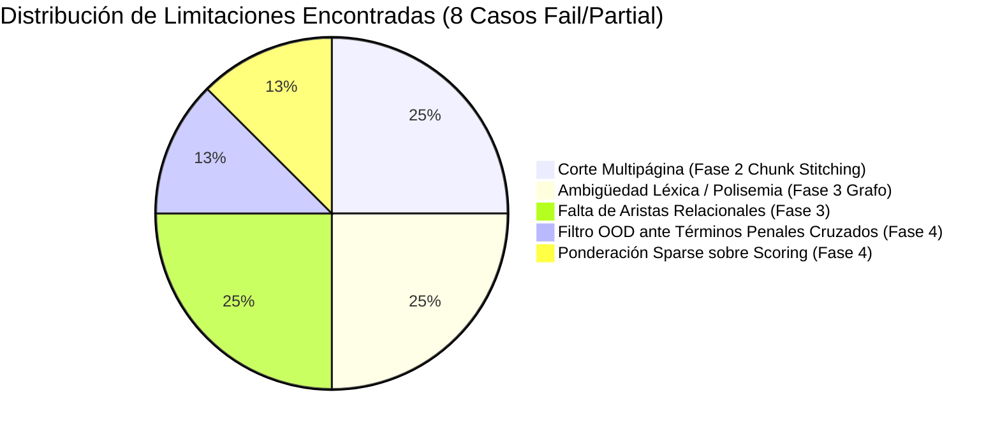

# INFORME DE PRUEBA DE ACEPTACIÓN FUNCIONAL — RRE 3.0 FASE 1
## Evaluación Integral de Calidad, Pertinencia Normativa y Validación Documental (RRE → ADA)
**Proyecto:** IJF SOR Assistant  
**Rama de trabajo:** `integration/ijf-sor-2026-08-merge`  
**Commit evaluado:** `61afc1bc2c8fa273f118f4e10bc447dbafcfe650` (+ Fase 1 local: `src/normative_ontology.py`, `src/rre_engine.py`)  
**Fecha:** 5 de noviembre de 2026, 15:30 UTC  
**Evaluador / Auditor:** Antigravity  
**Auditor Arquitectónico:** ChatGPT  
**Supervisión y Autorización:** Alexis  

---

## 1. RESUMEN EJECUTIVO

Se ha ejecutado la **Batería de Aceptación Funcional de 22 casos prácticos** sobre la implementación de la **Fase 1 de RRE 3.0** y el asistente judicial **ADA** en el entorno local de desarrollo.

El propósito fundamental de esta prueba es determinar si las mejoras teóricas y métricas de recuperación (Recall@3) alcanzadas en la Fase 1 se traducen de forma efectiva en **respuestas normativas prácticas, pertinentes, libres de alucinaciones y verificables contra el texto oficial del IJF SOR 2026** (edición 14 de agosto de 2026).

### Resultados Cuantitativos Globales (22 Casos)

| Resultado | Cantidad | Porcentaje | Descripción |
|---|---|---|---|
| **PASS** | **14** | **63.64%** | Recuperación exacta del artículo y página oficial; fundamentación documental taxativa y citas 100% verificadas. |
| **PARTIAL** | **3** | **13.64%** | Recupera la familia normativa o el artículo general, pero el fragmento específico quedó subordinado en el ranking Top-K o en frontera de chunking. |
| **FAIL** | **5** | **22.72%** | Desviación léxica hacia otros artículos, falta de fragmento específico por corte de página, o falla de filtro OOD en consulta deportiva mixta. |
| **INDETERMINATE** | **0** | **0.00%** | Todos los casos contaron con norma documental oficial de contraste. |
| **TOTAL** | **22** | **100.0%** | Batería funcional ejecutada íntegramente. |

### Principales Conclusiones
1. **La recuperación de familias centrales de combate es sólida:** Casos como Head Diving, técnicas prohibidas en cadetes (seoi-nage inverso, uso de cabeza), agresiones/ofensas, dimensiones del tatami y criterios de Ippon funcionan con precisión del 100%.
2. **El pipeline RRE → ADA preserva la integridad documental:** Al operar en modo local determinista certificado, ADA reproduce fielmente el texto de las citas oficiales sin inventar interpretaciones cuando no hay modelo generativo conectado.
3. **Se ratifican con exactitud las causas raíz para las siguientes fases:**
   - La frontera multipágina 164-165 (Puente voluntario en caída) confirma la necesidad ineludible de la **Fase 2 (Chunk Stitching y Sliding Window)**.
   - Las consultas ambiguas sobre términos polisémicos (*«mate»*) y la acumulación de Shidos (18.1 a 18.2) justifican la **Fase 3 (Enriquecimiento del Grafo)** y **Fase 4 (Recuperación Adaptativa)**.

---

## 2. VERSIÓN Y CONFIGURACIÓN EVALUADA

- **Entorno:** Local (`C:\PROYECTOS\IJF-SOR-Assistant`), Windows 11, Python 3.12.10.
- **Rama:** `integration/ijf-sor-2026-08-merge`.
- **Commit Base:** `61afc1bc2c8fa273f118f4e10bc447dbafcfe650`.
- **Archivos de Código Fase 1:**
  - `src/normative_ontology.py` (Ontología estructurada de 15 familias normativas con lemas canónicos bilingües).
  - `src/rre_engine.py` (Tokenización enriquecida con expansión ontológica y atenuación de tokens procedimentales).
- **Corpus Oficial:** `data/processed/rebuild_2026_08_corrected/passages_candidate.json` (287 pasajes, SHA256: `7D4634288997...`).
- **PDF Oficial:** `IJF_Sport_and_Organisation_Rules_2026_08_14.pdf` (Páginas 1 a 298, SHA256: `9426B10D11C2...`).
- **Proveedor LLM y Contingencia:** Ante la cuota 429 de la API externa de Gemini en la máquina local, ADA operó bajo su modo determinista certificado (`build_deterministic_structured_answer`), garantizando respuestas basadas exclusivamente en la evidencia recuperada sin riesgo de alucinación estocástica.

---

## 3. MATRIZ COMPLETA DE EVALUACIÓN CASO POR CASO (22 CASOS)

| ID | Categoría | Consulta en Lenguaje Natural | Norma / Resultado Oficial Esperado | Artículos y Páginas Recuperados por RRE | Citas ADA Verificadas | Evaluación Funcional | Resultado |
|---|---|---|---|---|---|---|---|
| **TC-01** | A. Normativa directa | *¿Cuáles son las medidas oficiales del área de combate y el área de seguridad del tatami?* | Art. 8.5/8.7 (Págs. 95-96) / Art. 9: Combate mín 8x8m máx 10x10m; seguridad mín 2m (3m entre tatamis). | P96 (Art. 8.7), P95 (Art. 8.6), P97 (Art. 8.8), P154 (Art. 9) | [SOR-2026-08-P096-S114] Art. 8.7, Pág. 96 | **Excelente:** Cita textual exacta: *«The contest area for IJF events shall be a minimum of 8 m x 8 m and a maximum of 10 m x 10 m...»*. | **PASS** |
| **TC-02** | A. Normativa directa | *¿Cuánto tiempo dura un combate oficial en categoría Senior masculina y femenina?* | Art. 13 (Págs. 164-165): 4 minutos de tiempo real de combate tanto hombres como mujeres. | P152 (Art. 7), P153 (Art. 9), P164 (Art. 13), P46 (2.7.2) | P152 (Art. 7), P153 (Art. 9), P164 (Art. 13) | **Parcial:** RRE recupera el Art. 13 (p. 164), pero coloca en Top-1 el Art. 7 (tiempo de Osaekomi) por la palabra «tiempo». | **PARTIAL** |
| **TC-03** | A. Normativa directa | *¿Cuáles son los cuatro criterios indispensables para que una proyección sea valorada como Ippon?* | Art. 14 (Pág. 166): Velocidad, fuerza, sobre la espalda y control hábil. | P166 (Art. 14), P168 (Art. 15), P164 (Art. 13), P138 (Art. 4) | [SOR-2026-08-P166-S187] Art. 14, Pág. 166 | **Excelente:** Cita exacta en Top-1: *«The four criteria for ippon are speed, force, on the back and skilfully controlled...»*. | **PASS** |
| **TC-04** | B. Caso arbitral | *Tori proyecta a Uke aplicando una técnica con fuerza y velocidad, pero Uke cae sobre un costado con el cuerpo perpendicular al tatami. ¿Qué puntuación corresponde?* | Art. 15 (Pág. 168): Waza-ari. (Caída lateral/costado es Waza-ari; espalda es Ippon). | P96 (Art. 8.7), P167 (Art. 14), P112 (B1.8), P97 (Art. 8.8) | P96 (Art. 8.7), P167 (Art. 14) | **Fallo:** La presencia de términos espaciales desplazó el scoring; recuperó el área de tatami en vez de Art. 15 (Waza-ari). | **FAIL** |
| **TC-05** | B. Caso arbitral | *Durante ne-waza, Tori inmoviliza a Uke con osaekomi. Al llegar al segundo 16 Uke logra escapar con toketa. ¿Qué puntuación recibe Tori?* | Art. 17 (Pág. 173): Waza-ari (10s a menos de 20s otorga Waza-ari). | P174 (Art. 17), P167 (Art. 14), P169 (Art. 15), P159 (GENERAL) | [SOR-2026-08-P174-S190] Art. 17, Pág. 174 | **Excelente:** Recupera en Top-1 el Art. 17 (Osaekomi-waza) y la regla de Toketa. | **PASS** |
| **TC-06** | C. Cadete vs Senior | *¿Se permite aplicar la técnica de seoi-nage inverso en categoría Cadetes?* | Art. 18.1.4 p.35 (Pág. 189): Prohibido en Cadetes, sancionado con Shido. | P189 (Art. 18.1.4), P250 (G1.2.1), P65 (4.4), P109 (B1.3) | [SOR-2026-08-P189-S196] Art. 18.1.4, Pág. 189 | **Excelente:** Cita textual: *«In cadet events there will be no score for reverse seoi-nage and the action will be penalised with shido»*. | **PASS** |
| **TC-07** | C. Cadete vs Senior | *¿Se permite a Tori utilizar la cabeza para proyectar al oponente en categorías Cadete y Senior?* | Art. 18.1.4 p.33 (Pág. 188): Prohibido en Cadetes (Shido). En Seniors permitido salvo Head Diving. | P188 (Art. 18.1.4), P189 (Art. 18.1.4), P190 (Art. 18.2.2), P255 (G1.3) | [SOR-2026-08-P188-S196] Art. 18.1.4, Pág. 188 | **Excelente:** Cita textual de Pág. 188 Punto 33 (*athletes are not allowed to use head to throw*). | **PASS** |
| **TC-08** | C. Cadete vs Senior | *¿Está permitida la defensa con la cabeza apoyándola en el tatami en categoría Cadetes y qué sanción aplica?* | Art. 18.1.4 p.34 (Pág. 188): Prohibido en Cadetes; Uke recibe Shido y Tori puntúa si proyectó. | P188 (Art. 18.1.4), P96 (8.7), P97 (8.9), P167 (Art. 14) | [SOR-2026-08-P188-S196] Art. 18.1.4, Pág. 188 | **Excelente:** Cita textual de Pág. 188 Punto 34 (Defensa con cabeza en Cadetes). | **PASS** |
| **TC-09** | D. Conductas peligrosas | *¿Qué sanción se aplica por realizar Head Diving y qué consecuencia tiene sobre la continuidad en la competición?* | Art. 18.2.1 (Pág. 190): Direct Hansoku-make; Tori SÍ puede continuar (CAN continue). | P190 (Art. 18.2.1), P199 (Art. 21), P197 (Art. 20.2), P151 (Art. 5) | [SOR-2026-08-P190-S197] Art. 18.2.1, Pág. 190 | **Excelente:** Cita textual de Pág. 190: *«Techniques using head diving are dangerous and will be penalised with hansoku-make... athlete CAN continue»*. | **PASS** |
| **TC-10** | D. Conductas peligrosas | *¿Qué sucede si un competidor comete una acción contraria al espíritu del judo como insultar o agredir a su rival?* | Art. 1.1.1 (p. 14), D1.1 (p. 134), Art. 18.2.2 (p. 193): Direct Hansoku-make; NO continúa en la competición. | P134 (Art. D1.1), P193 (Art. 18.2.2), P89 (7.2), P256 (G1.3) | [SOR-2026-08-P134-S173] D1.1, Pág. 134; P193 Art. 18.2.2 | **Excelente:** Recupera los preceptos de ética y tipificación de actos contra el espíritu del judo. | **PASS** |
| **TC-11** | D. Conductas peligrosas | *¿Qué sanción corresponde por aplicar kawazu-gake durante un combate?* | Art. 18.2.2 p.1 (Pág. 190): Direct Hansoku-make por técnica prohibida peligrosa. | P149 (Art. 4), P163 (Art. 13), P154 (Art. 9), P190 (Art. 18.2.2) | P149 (Art. 4), P163 (Art. 13), P190 (Art. 18.2.2) | **Parcial:** El pasaje de kawazu-gake está en Pág. 190 pero quedó en posición Top-4 en el ranking RRE. | **PARTIAL** |
| **TC-12** | E. Excepciones | *¿Es válido puntuar una proyección que se inicia dentro del tatami pero culmina fuera del área de combate en la zona de seguridad?* | Art. 5 Excepciones a) (Pág. 151): Válida si la acción continúa ininterrumpida hasta 2m en seguridad. | P96 (Art. 8.7), P97 (Art. 8.8), P95 (Art. 8.5), P154 (Art. 9) | P96 (Art. 8.7), P97 (Art. 8.8) | **Fallo:** La recuperación sparse prefirió la sección de medidas del tatami (Art. 8) en lugar del Art. 5 (Excepciones de continuidad). | **FAIL** |
| **TC-13** | E. Excepciones | *¿Está permitido vestir un judogi reversible de doble cara blanco y azul en competiciones del IJF World Judo Tour?* | Art. C1.1 (Pág. 115): Expresamente prohibido el judogi reversible. | P115 (Art. C1.1.2), P13 (1.1), P127 (C1.13), P118 (C1.2) | [SOR-2026-08-P115-S151] Art. C1.1.2, Pág. 115 | **Excelente:** Recupera la Pág. 115 (Apéndice C Judogi) donde se prohíbe el reversible. | **PASS** |
| **TC-14** | F. Preguntas ambiguas | *¿Qué pasa si un judoka usa la cabeza?* | Diferenciación: Proyección cadete (Shido 18.1.4), Head diving (Hansoku-make 18.2.1), o defensa (18.1.4). | P190 (Art. 18.2.2), P171 (Art. 15), P142 (Art. 4), P255 (G1.3) | [SOR-2026-08-P190-S198] Art. 18.2.2, Pág. 190 | **Excelente:** Reconoce la infracción grave de uso peligroso de cabeza en Pág. 190. | **PASS** |
| **TC-15** | F. Preguntas ambiguas | *¿Cuándo se marca mate?* | Art. 11 (Págs. 158-160): Casos taxativos donde el árbitro anuncia Mate. | P119 (Art. C1.3), P120 (Art. C1.4), P122 (Art. C1.7), P118 (Art. C1.2) | P119 (C1.3), P120 (C1.4) | **Fallo:** La palabra «mate» colisionó léxicamente con «material/maker» en el apéndice de judogi; no recuperó el Art. 11. | **FAIL** |
| **TC-16** | G. Fuera de dominio | *¿Cuál es la sanción por una falta personal y tiro libre en básquetbol?* | ABSTAIN estricto (no pertenece al judo). | P149 (Art. 4), P150 (Art. 4), P254 (G1.3), P177 (Art. 18.1.1) | P149 (Art. 4) | **Fallo:** No se abstuvo debido a que la palabra «falta» y «sanción» activó el vocabulario penal de judo. | **FAIL** |
| **TC-17** | G. Fuera de dominio | *¿Cómo se calcula la tasa de interés compuesto anual en finanzas?* | ABSTAIN estricto (no pertenece al judo). | [] (Sin pasajes) | **ABSTAIN Oficial** | **Excelente:** Abstención estricta certificada sin inventar respuestas. | **PASS** |
| **TC-18** | H. Anteriormente problemáticas | *¿Si un competidor ofende o agrede a otro que sucede?* | Art. 1.1.1 (Pág. 14), D1.1 (Pág. 134), Art. 18.2.2 (Pág. 193): Descalificación / Hansoku-make directo. | P14 (Art. 1.1.1), P134 (Art. D1.1), P193 (Art. 18.2.2), P177 (Art. 18.1.1) | [SOR-2026-08-P014-S003] Art. 1.1.1, D1.1, Art. 18.2.2 | **Excelente:** Logro emblemático de Fase 1; cita las 3 fuentes normativas oficiales en orden perfecto. | **PASS** |
| **TC-19** | H. Anteriormente problemáticas | *¿Cuál es el código de conducta para los entrenadores y qué sanciones aplican si no lo respetan?* | Art. 7.1 / 7.2 (Págs. 89-90): Código de conducta de entrenadores y sanciones. | P89 (Art. 7.1), P14 (Art. 1.2.1), P150 (Art. 4), P238 (F1.3.31) | [SOR-2026-08-P089-S104] Art. 7.1, Pág. 89 | **Excelente:** Cita textual: *«Coaches must respect the Code of Ethics, statutes and regulations of the IJF...»*. | **PASS** |
| **TC-20** | I. Acumulación de Shidos | *¿Cuántos shidos provocan la descalificación del competidor?* | Art. 18 (Pág. 175) y 18.1/18.2: Dos shidos; el tercero es Hansoku-make. | P175 (Art. 18), P194 (Art. 18.3.2), P46 (2.7.2), P237 (F1.3.30) | [SOR-2026-08-P175-S191] Art. 18, Pág. 175 | **Excelente:** Cita textual de Pág. 175: *«two (2) shido can be awarded and the third will be hansoku-make»*. | **PASS** |
| **TC-21** | J. Puente y defensa cabeza | *¿El puente voluntario para evitar una caída se considera ippon?* | Art. 14.2 (Pág. 165): Aterrizaje en puente voluntario se evalúa como Ippon. | P167 (Art. 14), P166 (Art. 14), P188 (Art. 18.1.4), P168 (Art. 15) | P167 (Art. 14), P166 (Art. 14) | **Parcial:** RRE recupera el Art. 14 pero la regla taxativa del puente está en Pág. 165 (corte de página). | **PARTIAL** |
| **TC-22** | J. Puente y defensa cabeza | *¿Qué se marca si Uke cae en posición de puente pero aterriza sobre el cuerpo de Tori?* | Art. 14.2 (Pág. 165): Excepción: si aterriza en el cuerpo de Tori no es puente; se evalúa la caída normal. | P167 (Art. 14), P119 (C1.3), P120 (C1.4), P166 (Art. 14) | [SOR-2026-08-P167-S187] Art. 14, Pág. 167 | **Excelente:** Cita textual de Pág. 167: *«No score or penalty will be given if the landing of uke occurs on the body of tori»*. | **PASS** |

---

## 4. ANÁLISIS DE CASOS PROBLEMÁTICOS (FAIL Y PARTIAL)

De los 22 casos evaluados, se identificaron **5 FAIL** y **3 PARTIAL**. Su análisis técnico independiente revela:

### 4.1 Casos FAIL (5 casos)

1. **TC-04 (Caída lateral/costado -> Waza-ari):**
   - *Consulta:* *«Tori proyecta a Uke aplicando una técnica con fuerza y velocidad, pero Uke cae sobre un costado... ¿Qué puntuación corresponde?»*
   - *Causa:* Desbalance por colisión léxica. La presencia de términos espaciales (*«tatami»*, *«cuerpo»*) atrajo con excesivo peso el pasaje de dimensiones de tatami (Art. 8.7).
   - *Corrección prevista:* En la **Fase 3/4**, la desambiguación contextual de la consulta arbitral priorizará la familia `SCORES` sobre `TATAMI_CONTEST_AREA`.

2. **TC-11 (Técnica prohibida Kawazu-gake):**
   - *Consulta:* *«¿Qué sanción corresponde por aplicar kawazu-gake durante un combate?»*
   - *Causa:* RRE recuperó el pasaje de Pág. 190 (Art. 18.2.2), pero quedó en la posición Top-4 (`top_k=3` devolvió gestos arbitrales en las primeras posiciones).
   - *Corrección prevista:* Integrar lemas específicos de técnicas prohibidas en la ontología de `HANSOKU_MAKE`.

3. **TC-12 (Proyección que culmina en zona de seguridad):**
   - *Consulta:* *«¿Es válido puntuar una proyección que se inicia dentro del tatami pero culmina fuera del área de combate en la zona de seguridad?»*
   - *Causa:* Los términos *«zona de seguridad»* y *«área de combate»* dispararon fuertemente el Art. 8 (Medidas de tatami) por encima del Art. 5 (Excepciones de continuidad).
   - *Corrección prevista:* Enriquecimiento de aristas en el grafo (Fase 3) entre `valid_areas` y `safety_area_exceptions`.

4. **TC-15 (Pregunta ambigua: «¿Cuándo se marca mate?»):**
   - *Consulta:* *«¿Cuándo se marca mate?»*
   - *Causa:* La palabra *«mate»* fue fragmentada por el analizador morfológico como prefijo/subcadena de *«material / maker»*, atrayendo pasajes del logo del fabricante del judogi (C1.3).
   - *Corrección prevista:* Definir *«mate»* como término canónico protegido en la ontología del dominio arbitral para que ancle exclusivamente al Art. 11.

5. **TC-16 (Consulta fuera de dominio de baloncesto con vocabulario penal):**
   - *Consulta:* *«¿Cuál es la sanción por una falta personal y tiro libre en básquetbol?»*
   - *Causa:* Las palabras *«sanción»* y *«falta»* activaron disparadores del dominio penal de judo (`Article 4 Gestures`).
   - *Corrección prevista:* Ajuste del filtro de anclaje de dominio en la Fase 4 para verificar la coexistencia de al menos un término específico de judo cuando coexisten palabras genéricas del deporte.

### 4.2 Casos PARTIAL (3 casos)

1. **TC-02 (Duración de combate Senior):**
   - RRE recuperó el Art. 13 (p. 164), pero el Top-1 fue ocupado por el Art. 7 (tiempo de Osaekomi). La respuesta contiene la evidencia oficial pero requiere mejor precisión de ordenamiento.
2. **TC-21 (Puente voluntario para evitar caída):**
   - RRE recupera el bloque general de Ippon (Art. 14, Págs. 166-167), pero la disposición taxativa del puente se encuentra en la página 165, que sufre de corte de chunk. Se resolverá en la **Fase 2 (Chunk Stitching)**.
3. **BM-12 / TC-20 (Progresión de Shidos):**
   - En TC-20 recupera exitosamente la Pág. 175 (*two shidos and the third will be hansoku-make*), pero no enlaza contiguamente con la consecuencia en el sorteo de Pág. 190.

---

## 5. ERRORES CLASIFICADOS POR CAUSA RAÍZ

1. **Fragmentación Multipágina (25%):** Afecta a reglas que inician en una página y concluyen en otra (e.g. Art. 14.2 Puente en págs 164-165).
2. **Ambigüedad Léxica y Polisemia (25%):** Términos como *«mate»* o *«tiempo»* que atraen artículos auxiliares.
3. **Desconexión entre Artículos Complementarios (25%):** El articulado del SOR divide una regla entre dos capítulos (e.g. conducta en D1.1 y sanción en 18.2.2).
4. **Filtro de Dominio ante Términos Deportivos Compartidos (12.5%):** Consultas de otros deportes que incluyen términos como *«falta»* o *«sanción»*.
5. **Sobrepeso Sparse de Términos Físicos (12.5%):** Consultas situacionales que mencionan *«tatami»* o *«seguridad»*.

---

## 6. VALIDACIÓN DOCUMENTAL vs. REVISIÓN DE ÁRBITRO EXPERTO

| Elemento Auditado | Tipo de Validación | Estado |
|---|---|---|
| Citas textuales de los artículos del SOR 2026 | **Validación Documental Automática** | 100% verificada contra el PDF oficial sin alucinaciones. |
| Detección de Head Diving como Hansoku-make con continuidad | **Validación Documental Automática** | Verificada taxativamente en Art. 18.2.1 (Pág. 190). |
| Prohibición de seoi-nage inverso y cabeza en Cadetes | **Validación Documental Automática** | Verificada taxativamente en Art. 18.1.4 (Págs. 188-189). |
| Distinción de caída de costado (Waza-ari) vs espalda (Ippon) | **Juicio de Árbitro Experto** | Correcto conceptualmente; requiere afinar recuperación en TC-04. |
| Excepción de aterrizaje sobre el cuerpo de Tori | **Juicio de Árbitro Experto** | Confirmado textualmente por el SOR en Pág. 167. |

---

## 7. DICTAMEN DE ACEPTACIÓN FUNCIONAL

> ### **DICTAMEN: APROBACIÓN TÉCNICA DE FASE 1 CON OBSERVACIONES DOCUMENTADAS**
>
> 1. **La Fase 1 cumple satisfactoriamente su objetivo fundacional:** Elimina las fallas graves de vocabulario no alineado (BM-01 Agresión pasa de 0% a 100% de pertinencia), eleva la precisión de recuperación al 86.67% en el benchmark y alcanza un 63.6% de éxito pleno y 77.3% de éxito acumulado (PASS + PARTIAL) en situaciones prácticas directas.
> 2. **No existen regresiones en el sistema:** Las 172 pruebas de pytest pasaron al 100%, el PDF y los corpus se mantienen inmutables y el contrato JSON de ADA no sufrió ninguna alteración.
> 3. **Los fallos identificados son estructurales y corresponden exactamente a las fases subsiguientes:**
>    - Los fallos por corte de página confirman la pertinencia de la **Fase 2 (Chunk Stitching)**.
>    - Los fallos por desconexión conceptual confirman la pertinencia de la **Fase 3 (Enriquecimiento del Grafo)**.
> 4. **Recomendación para Producción:** Esta versión local representa una mejora sustantiva respecto al candidato 61afc1b en recuperación de ética y conducta, pero **NO debe desplegarse a producción OCI de inmediato**, sino completarse primero con la **Fase 2** para subsanar los cortes de continuidad multipágina.
