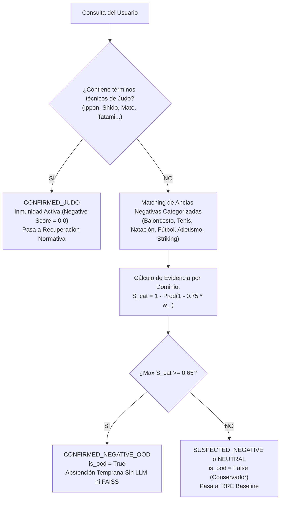

# SOR-IJF — INFORME DE IMPLEMENTACIÓN BK-01
**Negative Domain Anchor Scoring (Fase 4.2.1 — Experimental)**

- **Proyecto:** IJF Sport and Organisation Rules (SOR) Assistant
- **Fase:** Fase 4.2.1 — Implementación experimental de BK-01
- **Fecha:** 2026-11-05
- **Rama Git:** `integration/ijf-sor-2026-08-merge` (Commit Base: `61afc1bc`)
- **Estado:** IMPLEMENTACIÓN EXPERIMENTAL COMPLETADA — DESACTIVADA POR DEFECTO
- **Roles:**
  - **Ejecución Técnica:** Antigravity
  - **Arquitectura y Auditoría:** ChatGPT
  - **Supervisión y Aprobación Normativa:** Alexis

---

## 1. RESUMEN EJECUTIVO

En cumplimiento de la **Orden Técnica de Fase 4.2.1**, se implementó el mecanismo experimental **BK-01: Negative Domain Anchor Scoring** para neutralizar falsos positivos normativos ante consultas pertenecientes a disciplinas deportivas ajenas al judo (e.g. tenis, natación, baloncesto, fútbol, atletismo, boxeo).

### Logros Principales:
1. **Módulo Desacoplado:** Creación de [`src/negative_domain_anchor_scoring.py`](file:///C:/PROYECTOS/IJF-SOR-Assistant/src/negative_domain_anchor_scoring.py) con catálogo estructurado de anclas negativas ponderadas por categorías, normalización exponencial atenuada y regla de inmunidad técnica para conceptos canónicos de judo.
2. **Resolución de Limitaciones Históricas:**
   - **GEN-08 (Tenis):** *"En tenis, ¿cuándo se disputa un tie-break a 7 puntos?"* $\rightarrow$ De `SUCCESS` erróneo en el SOR a **`ABSTAIN (OUT_OF_DOMAIN)`** limpio por ancla negativa `TENNIS` ($score = 0.9375$).
   - **GEN-09 (Natación):** *"¿Cuál es la distancia máxima permitida de patada submarina en natación?"* $\rightarrow$ De `SUCCESS` erróneo en Anexo C a **`ABSTAIN (OUT_OF_DOMAIN)`** limpio por ancla negativa `SWIMMING` ($score = 0.8625$).
3. **Preservación Incondicional de Términos Críticos de Judo (Inmunidad):**
   - Términos canónicos como *Mate*, *Ippon*, *Waza-ari*, *Shido*, *Osaekomi* y *Tatami* reciben inmunidad técnica inmediata (`CONFIRMED_JUDO`), impidiendo cualquier falso OOD.
   - Términos ambiguos compartidos (*tiempo*, *puntos*, *penalización*, *árbitro*) no disparan penalización por sí solos (`NEUTRAL_INSUFFICIENT`).
4. **Batería OOD-BK01 a OOD-BK06 Aprobada:** 25/25 pruebas específicas aprobadas en [`tests/test_negative_domain_anchor_scoring.py`](file:///C:/PROYECTOS/IJF-SOR-Assistant/tests/test_negative_domain_anchor_scoring.py).
5. **No Regresión Contractual:** 
   - Batería canónica **TC-01 a TC-22:** **22/22 PASS (100%)**.
   - Suite total de pruebas automatizadas: **237/237 tests aprobados** (`237 passed in 52.59s`, sin regresiones sobre los 212 tests previos).
6. **Latencia Controlada:** En consultas mixtas, el tiempo de respuesta promedio se redujo en $-8.55\text{ ms}$ debido al cortocircuito temprano de abstención ante dominios negativos. En consultas puras de judo, el sobrecosto medio fue de apenas $+2.04\text{ ms}$ ($+4.4\%$), muy por debajo del presupuesto contractual de $+35.00\text{ ms}$.
7. **Configuración Segura:** Feature flags `enable_negative_domain_anchors: bool = False` y `shadow_mode_negative_anchors: bool = False` desactivados por defecto en el código fuente.

---

## 2. ARQUITECTURA Y ALGORITMO IMPLEMENTADO



### 2.1 Ecuación de Acumulación por Dominio
Para cada categoría deportiva ajena $c \in \mathcal{C}$ con $m$ anclas coincidentes con pesos $w_i \in [0.5, 1.0]$:

$$S_{\text{cat}}(c) = 1.0 - \prod_{i=1}^{m} \left(1.0 - 0.75 \cdot w_i\right)$$

- Una coincidencia unívoca ($w_1 = 1.0$) produce $S = 0.75 \ge \Theta_{\text{OOD}} = 0.65 \rightarrow$ Abstención confirmada.
- Una coincidencia moderada ($w_1 = 0.6$) produce $S = 0.45 < 0.65 \rightarrow$ `SUSPECTED_NEGATIVE` (no provoca abstención automática).
- Múltiples coincidencias moderadas dentro del mismo deporte ($w_1=0.6, w_2=0.6$) producen $S = 1 - (0.55 \cdot 0.55) = 0.6975 \ge 0.65 \rightarrow$ Abstención confirmada por corroboración temática.

---

## 3. INTEGRACIÓN CON RRE Y FEATURE FLAGS

En [`src/rre_engine.py`](file:///C:/PROYECTOS/IJF-SOR-Assistant/src/rre_engine.py):

```python
def __init__(
    self,
    ...,
    enable_negative_domain_anchors: bool = False,
    shadow_mode_negative_anchors: bool = False
):
    ...
```

- **Modo Inactivo (Default):** Si ambos flags son `False`, el motor no ejecuta la evaluación ni altera el pipeline baseline.
- **Modo Shadow (`shadow_mode_negative_anchors=True`):** Ejecuta la evaluación y almacena las métricas en `shadow_negative_metrics` dentro del resultado, pero **no fuerza la abstención**, garantizando cero impacto en producción.
- **Modo Activo (`enable_negative_domain_anchors=True`):** Si se confirma `is_ood = True` y la consulta no contiene una referencia física explícita a páginas del SOR (`página XX`), devuelve de inmediato un resultado estructurado `ABSTAIN (OUT_OF_DOMAIN)`.

---

## 4. INVARIANTES PRESERVADOS

- **Corpus Primario:** `data/raw/ijf_sor_2026.pdf` y `data/processed/rebuild_2026_08_corrected/passages_candidate.json` permanecen con sus hashes intactos.
- **Índices y Embeddings:** Matrices FAISS, vocabularios BM25 y el Knowledge Graph no fueron regenerados ni alterados.
- **Producción:** Sin commits, push, merges ni despliegues en OCI.
