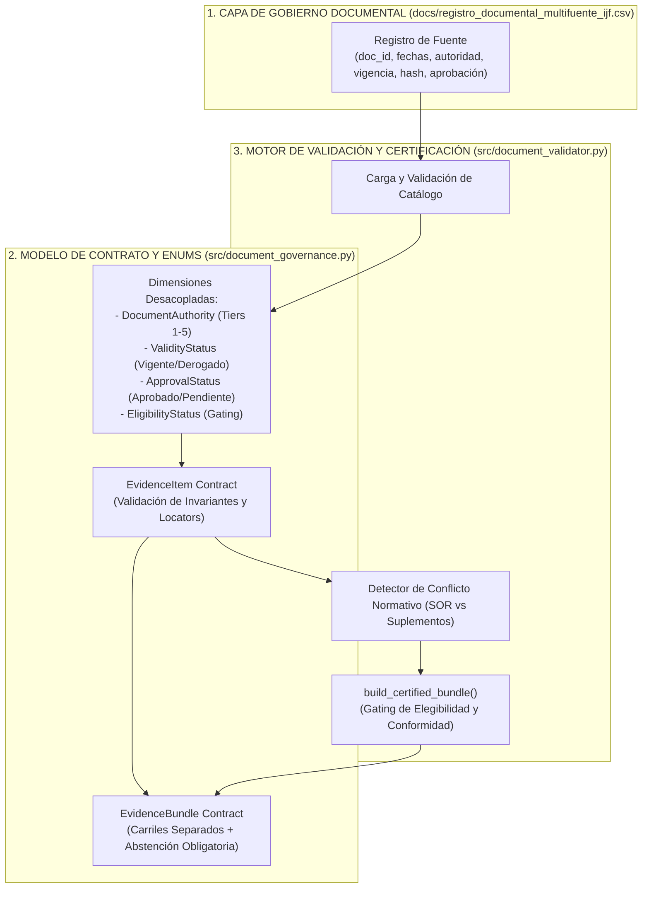

# SOR-IJF — INFORME DE IMPLEMENTACIÓN FASE 4.1
**Gobierno Documental, Inventario Multifuente y Contrato Tipado de Evidencia**

- **Proyecto:** IJF Sport and Organisation Rules (SOR) Assistant
- **Fase:** Fase 4.1 — Gobierno Documental y Contratos de Evidencia
- **Fecha:** 2026-11-05
- **Rama Git:** `integration/ijf-sor-2026-08-merge` (Commit Base: `61afc1bc`)
- **Autor / Ejecutor:** Antigravity (Ingeniero de Software Senior)
- **Supervisión y Auditoría:** Alexis (Supervisor) / ChatGPT (Arquitecto y Auditor Normativo)

---

## 1. RESUMEN EJECUTIVO

La **Fase 4.1** ha sido implementada con éxito en el repositorio local `IJF-SOR-Assistant` en estricto cumplimiento del alcance autorizado y de las restricciones operativas. Esta fase no incorporó documentos complementarios a la recuperación decisoria ni modificó el comportamiento del motor RRE ni del asistente ADA; en su lugar, estableció los cimientos formales de gobernanza, inventario y tipado estricto que garantizan la integridad jurídica y la trazabilidad de cualquier desarrollo multifuente futuro.

### Logros Principales:
1. **Inventario Multifuente Completo y Trazable:** Se formalizó [`docs/registro_documental_multifuente_ijf.csv`](file:///C:/PROYECTOS/IJF-SOR-Assistant/docs/registro_documental_multifuente_ijf.csv) con 25 registros que integran los recursos de `reference_registry.json`, las versiones históricas, los mirrors markdown de `data/markdown/` y los hashes criptográficos SHA-256 de los archivos locales reales.
2. **Separación de Cuatro Dimensiones de Gobierno:** Se implementó [`src/document_governance.py`](file:///C:/PROYECTOS/IJF-SOR-Assistant/src/document_governance.py) definiendo de forma desacoplada:
   - **Autoridad Documental** (`DocumentAuthority`: Tier 1 a 5).
   - **Vigencia Temporal** (`ValidityStatus`).
   - **Elegibilidad de Recuperación** (`EligibilityStatus`).
   - **Relevancia Semántica** (`semantic_relevance_score`: escala 0.0 a 1.0).
   Se prohibió expresamente fusionar estas dimensiones en un escalar de ranking unificado.
3. **Contrato Tipado de Evidencia (`EvidenceBundle`):** Contrato Pydantic v2 que implementa segregación de carriles (`primary_normative_evidence`, `interpretive_evidence`, `contextual_evidence`), verificación estricta de timestamps de video (`VideoTimestamp`), detección de conflictos normativos y abstención obligatoria.
4. **Módulo Validador (`DocumentValidator`):** En [`src/document_validator.py`](file:///C:/PROYECTOS/IJF-SOR-Assistant/src/document_validator.py), encargado de certificar bundles de evidencia y evaluar colisiones normativas.
5. **Verificación de Pruebas Automatizadas:** 15 pruebas unitarias nuevas en `tests/test_document_governance.py` (todas aprobadas) y **212/212 pruebas del repositorio pasando sin regresiones** (`212 passed in 53.48s`).
6. **Invariantes Absolutos:** Cero alteraciones al corpus del SOR 2026, cero modificaciones a matrices FAISS o índices BM25, cero cambios en el prompt productivo o interfaz Streamlit, y cero despliegues en OCI.

---

## 2. ARQUITECTURA IMPLEMENTADA Y COMPONENTES

### 2.1 Módulos Creados
- [`src/document_governance.py`](file:///C:/PROYECTOS/IJF-SOR-Assistant/src/document_governance.py):
  - Modelos Pydantic v2 con validadores estrictos `@model_validator(mode="after")`.
  - Prohibición a nivel de código de asignar `role=NORMA_PRIMARIA` a recursos que no sean `TIER_1_NORMATIVE_PRIMARY`.
  - Prohibición de asignar `role=NORMA_PRIMARIA` a evidencias de video (`TIER_5_AUDIOVISUAL_EVIDENCE`).
  - Gating de timestamps audiovisuales: Si el timestamp no cuenta con verificación humana curada (`is_verified=True`), el item es forzado a `NO_ELEGIBLE`.
- [`src/document_validator.py`](file:///C:/PROYECTOS/IJF-SOR-Assistant/src/document_validator.py):
  - Parser robusto del inventario CSV.
  - Método `detect_conflict()` que compara el texto del SOR primario frente a evidencia secundaria (e.g. duraciones de Osaekomi, sanciones y fuentes derogadas).
  - Ensamblado de `EvidenceBundle` certificado con determinación unívoca de `abstention_required`.

---

## 3. POLÍTICA DE INTEGRIDAD Y PRECEDENCIA NORMATIVA

En la Fase 4.1 se han codificado formalmente los siguientes principios rectores:

1. **Prevalencia Absoluta del SOR 2026 (`DOC-SOR-2026-08`):** Es la única fuente con autoridad estatutaria directa. Si un documento complementario (e.g. seminario, portal web o comunicado antiguo) entra en discrepancia, el SOR prevalece de forma taxativa.
2. **Prohibición de Atribuir Fuerza Vinculante Presunta:** Ningún recurso complementario es tratado como obligatorio salvo aprobación explícita de la Comisión de Arbitraje o del Comité Ejecutivo de la IJF.
3. **Subordinación del Contenido Audiovisual:** Los videos no establecen doctrina arbitral independiente. Son ejemplos demostrativos que requieren anclaje normativo previo.
4. **Tratamiento de Evidencia Insuficiente:** Si una consulta no cuenta con al menos un elemento de evidencia primaria de Tier 1, el `EvidenceBundle` marca `is_sufficient_for_decision=False` y fuerza `abstention_required=True`.
5. **Abstención Obligatoria por Conflicto No Resuelto:** Si se detecta contradicción entre una fuente complementaria y el SOR que no pueda resolverse como una actualización formalizada, el sistema activa abstención indicando la discordancia.

---

## 4. RESULTADOS DE PRUEBAS UNITARIAS

Se implementó el archivo [`tests/test_document_governance.py`](file:///C:/PROYECTOS/IJF-SOR-Assistant/tests/test_document_governance.py) con 15 casos de prueba que cubren:

| Caso de Prueba | Propósito / Regla Evaluada | Resultado |
|---|---|---|
| `test_valid_sor_normative_evidence` | Creación válida de item SOR Tier 1 como `NORMA_PRIMARIA`. | **PASSED** |
| `test_valid_supplementary_evidence` | Creación válida de item Tier 3 como `COMPLEMENTO_INTERPRETATIVO`. | **PASSED** |
| `test_valid_audiovisual_evidence` | Creación válida de item Tier 5 con timestamp verificado. | **PASSED** |
| `test_prohibition_video_as_norma_primaria` | Intento de declarar video como norma primaria lanza `ValidationError`. | **PASSED** |
| `test_prohibition_tier2_as_norma_primaria` | Intento de declarar comunicado como norma primaria lanza `ValidationError`. | **PASSED** |
| `test_unverified_video_timestamp_is_ineligible` | Timestamp no verificado con elegibilidad contextual lanza `ValidationError`. | **PASSED** |
| `test_document_eligibility_pending_approval` | Documento en estado `PENDIENTE` es evaluado como `NO_ELEGIBLE`. | **PASSED** |
| `test_document_eligibility_repealed_superseded` | `DOC-001` (SOR anterior) es evaluado como `NO_ELEGIBLE`. | **PASSED** |
| `test_document_eligibility_retired_video` | Video retirado (`REF-VID-004-YOUTUBE`) es evaluado como `NO_ELEGIBLE`. | **PASSED** |
| `test_document_eligibility_approved_tier1` | SOR 2026-08 es evaluado como `ELIGIBLE_DECISORIA`. | **PASSED** |
| `test_document_eligibility_approved_tier3` | `PPT-002` es evaluado como `ELIGIBLE_INTERPRETATIVA`. | **PASSED** |
| `test_bundle_certified_valid` | Construcción de bundle con carriles primario e interpretativo conformes. | **PASSED** |
| `test_bundle_normative_conflict_triggers_abstention` | Contradicción en tiempos de Osaekomi activa abstención obligatoria. | **PASSED** |
| `test_bundle_absence_of_primary_norm_triggers_abstention` | Bundle sin norma Tier 1 activa abstención por insuficiencia. | **PASSED** |
| `test_bundle_rejection_of_unregistered_document` | Item con ID inexistente es excluido del bundle. | **PASSED** |

### Verificación de Regresión Global:
- Suite completa ejecutada: `python -m pytest tests -q`
- Resultado: **212 passed in 53.48s** (197 preexistentes + 15 de Fase 4.1). 0 regresiones.

---

## 5. REVISIÓN DE INTEGRIDAD DE ARCHIVOS E INVARIANTES

- **Archivos de Código Modificados en `src/`:** Ninguno preexistente. Se crearon únicamente `src/document_governance.py` y `src/document_validator.py`.
- **Motor RRE (`src/rre_engine.py`):** Intacto. Sus feature flags continúan en `False` por defecto.
- **Asistente ADA (`src/ada_assistant.py`):** Intacto.
- **Corpus y Embeddings (`data/`):** Todos los archivos de embeddings, JSON de pasajes, índices BM25 y el Knowledge Graph permanecen con sus hashes intactos.
