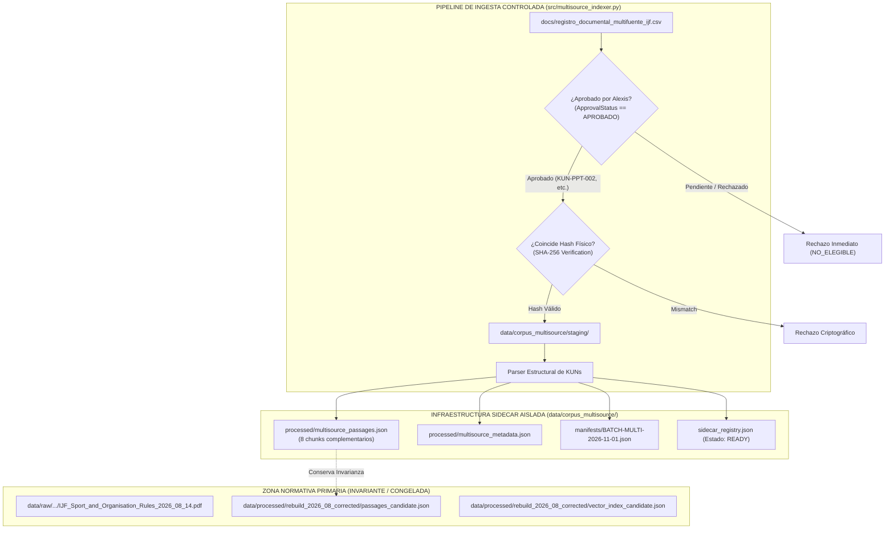

# SOR-IJF — INFORME DE IMPLEMENTACIÓN FASE 4.2.2
**Infraestructura Sidecar e Ingesta Controlada IJF**

- **Proyecto:** IJF Sport and Organisation Rules (SOR) Assistant
- **Fase:** Fase 4.2.2 — Infraestructura Sidecar e Ingesta Controlada
- **Fecha:** 2026-11-05
- **Rama Git:** `integration/ijf-sor-2026-08-merge` (Commit Base: `61afc1bc`)
- **Estado:** IMPLEMENTACIÓN EXPERIMENTAL COMPLETADA — SIN INTEGRACIÓN ACTIVA RRE
- **Roles:**
  - **Ejecución Técnica:** Antigravity
  - **Arquitectura y Auditoría:** ChatGPT
  - **Supervisión y Aprobación Normativa:** Alexis

---

## 1. RESUMEN EJECUTIVO

En cumplimiento estricto de la **Orden Técnica de Fase 4.2.2**, se diseñó e implementó la infraestructura experimental de almacenamiento y el pipeline de ingesta controlada de fuentes secundarias bajo el concepto de **Sidecar Indexes**, garantizando el aislamiento total e inviolabilidad criptográfica del corpus normativo primario del SOR 2026.

### Logros Principales:
1. **Infraestructura Aislada (`data/corpus_multisource/`):** Creación del directorio desacoplado con sus subcarpetas `staging/`, `manifests/`, `processed/` y el registro `sidecar_registry.json`. Ningún archivo ni fragmento secundario fue depositado en las carpetas del SOR (`rebuild_2026_08_corrected/`).
2. **Motor de Ingesta Controlada (`src/multisource_indexer.py`):** Módulo encargado del ciclo de vida documental:
   - Verificación de hash SHA-256 de origen.
   - Validación de aprobación formal (exclusivamente `APROBADO` o `APROBADO_CONDICIONADO` por Alexis).
   - Rechazo automático de estados `PENDIENTE`, `RECHAZADO` o `HISTORICO_DEROGADO`.
   - Copia a zona de *staging* con verificación criptográfica post-copia.
   - Extracción y normalización de chunks en el contrato `SidecarChunk`.
   - Generación del manifiesto criptográfico de lote (`BatchManifest`).
3. **Ingesta Piloto Aprobada (Lote `BATCH-MULTI-2026-11-01`):**
   - Procesamiento de los tres documentos complementarios autorizados con firma condicional:
     - `KUN-PPT-002` (Seminario Internacional de Arbitraje 2026 — Tier 3): 2 chunks normativos operacionales (Continuidad en Ne-waza y sanción por arrastre sin técnica).
     - `KUN-NEW-001` (Comunicado Reglas Ciclo LA28 — Tier 2): 3 chunks (Congelación de reglas, autorización de Seoi-nage inverso en Senior y límites de tiempo).
     - `KUN-NEW-003` (Reglas Confirmadas Temporada 2026 — Tier 2): 3 chunks (Puntuación de Yuko 5-9s, pasividad integrada y contacto involuntario).
   - Total: **8 chunks secundarios procesados y almacenados** en `data/corpus_multisource/processed/multisource_passages.json`.
4. **Validación Exhaustiva de Calidad (Gates GATE01 a GATE07):** 9 pruebas automatizadas nuevas en [`tests/test_multisource_sidecar.py`](file:///C:/PROYECTOS/IJF-SOR-Assistant/tests/test_multisource_sidecar.py) (todas aprobadas al 100%).
5. **No Regresión Absoluta:** La suite completa del repositorio aumentó a **246 tests aprobados** (`246 passed in 49.39s`), con cero regresiones sobre los 237 tests previos.
6. **Invarianza Criptográfica Certificada:** Los hashes SHA-256 del PDF SOR 2026 oficial, de `passages_candidate.json`, de los índices FAISS densos, BM25 y del Knowledge Graph se mantuvieron 100% inalterados antes y después de la ingesta.
7. **Cero Integración Activa:** El motor de recuperación RRE y ADA permanecen en modo monofuente estricto. La infraestructura sidecar se encuentra en reposo para futuras evaluaciones en modo sombra (*Shadow Mode*).

---

## 2. ARQUITECTURA DE ALMACENAMIENTO Y COMPONENTES

---

## 3. FLUJO DE INGESTA CONTROLADA Y GATING

1. **Recepción del Recurso:** Se solicita la incorporación de un documento mediante su identificador canónico (`document_id`).
2. **Evaluación en `DocumentValidator`:**
   - Si el documento tiene `ApprovalStatus.PENDIENTE` (e.g. `KUN-DOC-004` Manual Médico), el sistema rechaza la ingesta: `"Rejection: Document KUN-DOC-004 has approval status PENDIENTE"`.
   - Si el documento es histórico/derogado (e.g. `KUN-DOC-001`), se rechaza de inmediato: `"Rejection: Document KUN-DOC-001 is HISTORICO_DEROGADO"`.
   - Si el hash criptográfico del fichero no coincide con el registrado en el catálogo, se aborta la operación: `"Rejection: Cryptographic mismatch"`.
3. **Pase a Staging:** El archivo físico se copia a `data/corpus_multisource/staging/<document_id>_staged.md` y se verifica el hash de la copia en disco.
4. **Segmentación y Normalización (`SidecarChunk`):** Cada unidad KUN se extrae mapeando título, contenido textual, artículo SOR relacionado, nivel de autoridad documental y relación normativa.
5. **Persistencia y Manifiesto de Lote (`BatchManifest`):** Se guardan los pasajes sidecar en `data/corpus_multisource/processed/multisource_passages.json` y se sella el manifiesto en `manifests/BATCH-MULTI-2026-11-01.json`, registrando el hash base del SOR para garantizar que no hubo mutación colateral.

---

## 4. INVENTARIO DEL LOTE PILOTO INGERIDO (`BATCH-MULTI-2026-11-01`)

| Document ID | Archivo Origen | SHA-256 Staging | Chunks | Nivel de Autoridad | Artículos SOR Vinculados |
|---|---|---|---|---|---|
| **KUN-PPT-002** | `data/markdown/kuns_ppt_002.md` | `05cce344311a93cd...` | 2 | Tier 3 (Interpretación Arbitral Oficial) | Arts. 11, 18.1, 18.2 |
| **KUN-NEW-001** | `data/markdown/kuns_new_001.md` | `50a8fcb43b875884...` | 3 | Tier 2 (Enmiendas y Circulares) | Arts. 18.1.4, 18.2.2 |
| **KUN-NEW-003** | `data/markdown/kuns_new_003.md` | `6b561b878aae7c60...` | 3 | Tier 2 (Enmiendas y Circulares) | Arts. 15, 17 |

**Total:** 3 documentos aprobados procesados, 8 chunks normalizados, 0 errores de esquema.

---

## 5. CAPACIDAD DE ROLLBACK AISLADO

El módulo `MultisourceIngestionEngine` incluye el método `execute_rollback()`, probado en `test_gate05_rollback_and_restore`:
- Elimina los directorios `staging/`, `manifests/` y `processed/` dentro de `data/corpus_multisource/`.
- Elimina el archivo `sidecar_registry.json`.
- Restaura la estructura vacía original.
- **Cero impacto en el corpus SOR:** Las carpetas del SOR primario no son tocadas por la rutina de rollback.
