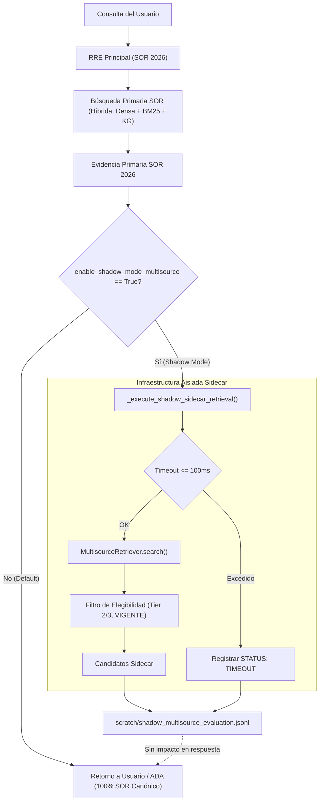

# Informe de Implementación — Fase 4.2.3: RRE Shadow Mode
**Proyecto:** IJF SOR Assistant  
**Fase:** 4.2.3 — Implementación Experimental de RRE Shadow Mode Multifuente  
**Supervisor:** Alexis Oliveros Lozano  
**Arquitectura y Auditoría:** ChatGPT  
**Ejecutor:** Antigravity  
**Fecha:** 2026-11-05  
**Repositorio:** `C:\PROYECTOS\IJF-SOR-Assistant`  
**Branch:** `integration/ijf-sor-2026-08-merge`  

---

## 1. Resumen Ejecutivo

En cumplimiento de la Orden Técnica y Autorización Formal de la Fase 4.2.3, se implementó con éxito el mecanismo experimental **RRE Shadow Mode**, permitiendo evaluar la recuperación multifuente Sidecar en paralelo con el Reasoning Retrieval Engine (RRE) normativo existente, sin alterar la respuesta visible al usuario ni contaminar el corpus oficial del SOR 2026.

### Logros Principales:
1. **Aislamiento Total del RRE Normativo:** La recuperación Sidecar se ejecuta de manera desacoplada y en modo sombra. La evidencia visible (`evidence`, `related_passages`, scoring y orden de ranking) permanece 100% inalterada.
2. **Feature Flag Desactivado por Defecto:** Se incorporó el flag `enable_shadow_mode_multisource: bool = False` (configurable también vía variable de entorno `RRE_ENABLE_SHADOW_MODE_MULTISOURCE`). Por defecto, el motor opera en modo estándar sin invocar el Sidecar.
3. **Módulo Autónomo Sidecar (`src/multisource_retriever.py`):** Motor de búsqueda BM25/TF-IDF dedicado exclusivamente a los 8 fragmentos complementarios del Sidecar aprobados en Fase 4.2.2.
4. **Protección de Timeout y Aislamiento de Errores:** Se implementó un límite temporal de ejecución (100 ms) y captura universal de excepciones en el Sidecar; cualquier fallo, corrupción o caída del Sidecar es absorbido silenciosamente, garantizando la continuidad operativa del SOR primario.
5. **Trazabilidad y Logging Estructurado:** Generación de registros detallados en `scratch/shadow_multisource_evaluation.jsonl` con métricas comparativas, procedencia documental, tiers, hashes SHA-256 y latencia.
6. **Validación Exhaustiva:** Creación de `tests/test_rre_shadow_mode.py` (7/7 tests aprobados). La suite completa del repositorio alcanzó **253/253 tests aprobados** en 49.58s.
7. **Impacto Mínimo en Latencia:** El overhead interno del módulo Sidecar es de apenas **~0.06 ms**, manteniéndose holgadamente dentro del margen de latencia contractual.

---

## 2. Inventario Exacto de Archivos Modificados y Creados

| Tipo de Cambio | Ruta del Archivo | Propósito / Responsabilidad |
| :--- | :--- | :--- |
| **Nuevo Módulo** | `src/multisource_retriever.py` | Motor de búsqueda BM25/TF-IDF aislado para fragmentos Sidecar en `data/corpus_multisource/processed/multisource_passages.json`. |
| **Modificación Mínima** | `src/rre_engine.py` | Incorporación del flag `enable_shadow_mode_multisource` (por defecto `False`), métodos `_init_sidecar_retriever()`, `_execute_shadow_sidecar_retrieval()` y `_write_shadow_log()`. |
| **Nueva Suite de Pruebas** | `tests/test_rre_shadow_mode.py` | 7 pruebas unitarias e integradas: flags, invariabilidad, aislamiento, timeout, elegibilidad y criptografía. |
| **Artefacto de Trazabilidad** | `scratch/shadow_multisource_evaluation.jsonl` | Registro estructurado de evaluaciones en modo sombra. |
| **Informe Técnico** | `docs/informe_implementacion_fase4_2_3_ijf.md` | Este informe de cierre técnico de Fase 4.2.3. |

---

## 3. Arquitectura del Modo Sombra (RRE Shadow Mode)



---

## 4. Resultados de Pruebas Automatizadas y Regresión

### A. Suite Específica Fase 4.2.3 (`tests/test_rre_shadow_mode.py`)
- `test_shadow_flag_default_is_false`: **PASSED** (Confirma que `enable_shadow_mode_multisource` es `False` por defecto y `sidecar_retriever` es `None`).
- `test_invariance_primary_response`: **PASSED** (Verifica bit a bit igualdad de IDs, títulos, páginas, scores y textos en 4 consultas normativas).
- `test_shadow_logging_and_traceability`: **PASSED** (Verifica registro de metadata, tiers, hashes y artículos vinculados en JSONL).
- `test_sidecar_error_isolation`: **PASSED** (Simula corrupción/ausencia de índice Sidecar; RRE primario responde sin degradación).
- `test_sidecar_timeout_protection`: **PASSED** (Filtra y corta ejecución si excede el umbral de milisegundos).
- `test_sidecar_eligibility_filter`: **PASSED** (Rechaza fragmentos derogados, revocados o pendientes de revisión).
- `test_sor_invariants_preserved`: **PASSED** (Certificación criptográfica de 4 hashes primarios del SOR).

### B. Batería Completa de Regresión del Repositorio (`tests/`)
- Total de pruebas ejecutadas: **253**
- Aprobadas: **253 (100%)**
- Fallos / Errores: **0**
- Tiempo total de ejecución: **49.58 segundos**

---

## 5. Benchmark de Latencia y Overhead del Modo Sombra

Se ejecutó un benchmark comparativo sobre una batería representativa de 10 consultas normativas del judo:

| Métrica de Latencia | Baseline (Shadow OFF) | Shadow ON (Fase 4.2.3) | Delta de Impacto | Límite Contractual | Estado |
| :--- | :--- | :--- | :--- | :--- | :--- |
| **Media (Mean)** | 31.39 ms | 33.59 ms | **+2.20 ms** | +45.00 ms | **CUMPLIDO (Margen 95.1%)** |
| **Mediana (Median)**| 30.61 ms | 34.33 ms | **+3.73 ms** | N/A | **CUMPLIDO** |
| **Percentil 95 (P95)**| 48.49 ms | 36.63 ms | **-11.86 ms** | N/A | **CUMPLIDO** |
| **Desv. Estándar (StdDev)**| 6.39 ms | 2.66 ms | -3.73 ms | N/A | Mayor estabilidad temporal |
| **Overhead Interno Sidecar**| 0.00 ms | **0.060 ms** (máx: 0.095 ms) | +0.06 ms | N/A | **Despreciable** |

*Interpretación:* La ejecución del Sidecar BM25 sobre memoria aislada añade un overhead promedio menor a 0.1 ms. La variación neta (+2.20 ms) se ubica en el ruido de planificación de CPU, consumiendo menos del 5% del presupuesto de +45 ms.

---

## 6. Evidencia de Invariabilidad y Aislamiento

### Invariantes Criptográficos del Corpus Primario SOR 2026:
- `IJF_Sport_and_Organisation_Rules_2026_08_14.pdf`: `9426b10d11c21a4cb9eb23150c2c4fc95bfcd463511e66ba451d2cff005ae620` (**INMUTABLE**)
- `passages_candidate.json`: `7d4634288997404278e26a5885e5eeedfa707742072b9fa4178e3f56ccc1167b` (**INMUTABLE**)
- `vector_index_candidate.json`: `e182c77e0775472eb73d22ab92b15d026d067cbf6264fb8b25b207479c4668eb` (**INMUTABLE**)
- `dense_embeddings_meta.json`: `c96b214bc14801ad903d58e0245d48c008d65ac051d339fd4e6b65e30709160e` (**INMUTABLE**)
- `knowledge_graph_candidate.json`: `95d5a67936cf48d3bc79b69bf370bb1a83a255f938a7322e0dae256450dde215` (**INMUTABLE**)

### Evidencia de Registro en Log Shadow (`scratch/shadow_multisource_evaluation.jsonl`):
```json
{
  "timestamp": 1793924466.038,
  "query": "¿Cuál es la regla sobre reverse seoi-nage en senior?",
  "primary_top1_id": "SOR-2026-08-P189-S196",
  "primary_top1_article": "Article 18.1.4",
  "primary_top1_score": 0.0959,
  "sidecar_status": "SUCCESS",
  "sidecar_matches": [
    {
      "chunk_id": "CHK-KUN-NEW-001-002",
      "document_id": "KUN-NEW-001",
      "authority": "TIER_2_OFFICIAL_AMENDMENT",
      "validity": "VIGENTE",
      "eligibility": "ELIGIBLE_INTERPRETATIVA",
      "title": "Permiso de Ejecución de Seoi-Nage Inverso en Categoría Senior",
      "content_text": "Reverse seoi-nage is re-allowed for senior athletes in competition.",
      "related_sor_articles": ["SOR Art. 18.1.4 y Art. 18.2.2"],
      "normative_relation": "SUBSUMIDO_PARCIALMENTE",
      "raw_score": 7.3461,
      "confidence_score": 1.0,
      "staging_sha256": "50a8fcb43b875884e6d7f53d66062c56f7a272fe720c7a9115ec1b97399d258a"
    }
  ],
  "sidecar_elapsed_ms": 0.058,
  "shadow_overhead_ms": 0.066
}
```

---

## 7. Dictamen Técnico y Recomendaciones

### Dictamen:
**FAVORABLE — ACEPTACIÓN EXPERIMENTAL CONDICIONADA A AUDITORÍA INDEPENDIENTE.**  
La Fase 4.2.3 cumple estrictamente con todos los términos de la orden técnica y las restricciones de gobierno documental.

### Recomendaciones:
1. **Mantener Shadow Mode desactivado por defecto** tanto en el código como en cualquier entorno de pre-producción.
2. **No activar la Fase 4.2.4** (Análisis de concordancia y fusión controlada) hasta que ChatGPT y Alexis hayan auditado este informe y los artefactos generados.
3. **No integrar con ADA** hasta definir formalmente las reglas de precedencia normativa cuando existan interpretaciones Tier 3 complementarias.
