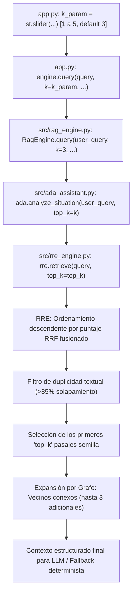
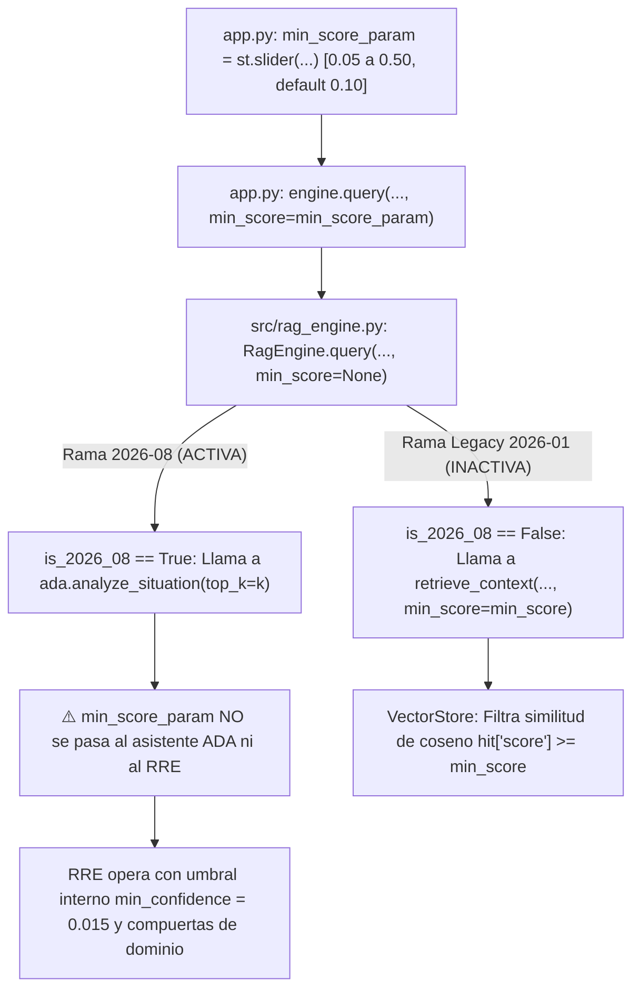

# INFORME DE INSPECCIÓN TÉCNICA — PARÁMETROS RRE/ADA
## IJF SOR Assistant | Producción Commit `61afc1b`

- **Proyecto:** IJF SOR Assistant
- **Entorno Evaluado:** Local (`C:\PROYECTOS\IJF-SOR-Assistant`) y Producción OCI (`https://sor.alxol.com` en `61afc1b`)
- **Fecha:** 2026-11-04
- **Rol:** Auditor Técnico Independiente (Antigravity)
- **Modalidad:** Solo lectura e inspección estática y dinámica no destructiva

---

## 1. Resumen Ejecutivo

1. **Identificación de los Controles de Interfaz:**
   En la barra lateral (`st.sidebar`) de [`app.py`](file:///C:/PROYECTOS/IJF-SOR-Assistant/app.py) (líneas 1046–1055), bajo la sección *"Configuración de Búsqueda"*, existen exactamente dos controles deslizantes (`st.slider`):
   - **Control 1 (Top-K):** Etiquetado en español como *"Cantidad de Reglas a Consultar"* (`k_slider_label`), rango `1` a `5`, valor predeterminado `3`.
   - **Control 2 (Filtro/Umbral):** Etiquetado en español como *"Filtro Anti-Distracciones"* (`min_score_label`) y en inglés como *"Relevance Gate Filter"*, rango `0.05` a `0.50`, paso `0.05`, valor predeterminado `0.10`.

2. **Hallazgo Crítico de Arquitectura (Desacoplamiento RRE/ADA vs. Legacy RAG):**
   - **Top-K (`k_param`):** **Sí llega efectivamente al motor activo RRE + ADA**. Viaja desde [`app.py`](file:///C:/PROYECTOS/IJF-SOR-Assistant/app.py) (`res = engine.query(..., k=k_param)`) hacia [`src/rag_engine.py`](file:///C:/PROYECTOS/IJF-SOR-Assistant/src/rag_engine.py) y se transmite a [`src/ada_assistant.py`](file:///C:/PROYECTOS/IJF-SOR-Assistant/src/ada_assistant.py) (`top_k=k`) y a [`src/rre_engine.py`](file:///C:/PROYECTOS/IJF-SOR-Assistant/src/rre_engine.py). Determina de manera estricta cuántos pasajes semilla directos (`seeds`) se extraen tras el ranking RRF antes de la expansión por grafo de conocimiento.
   - **Control de "Alucinaciones" / Filtro Anti-distracciones (`min_score_param`):**
     - **En la arquitectura activa de agosto 2026 (RRE + ADA):** El parámetro `min_score` es recibido por la firma de [`RagEngine.query()`](file:///C:/PROYECTOS/IJF-SOR-Assistant/src/rag_engine.py), pero **NO se transmite a `ArbitrationDecisionAssistant` ni a `ReasoningRetrievalEngine`**. En su lugar, el RRE utiliza un umbral interno calibrado fijado por diseño (`min_confidence: float = 0.015`) y filtros de dominio léxico/semántico independientes.
     - **En el flujo Legacy (Edición previa enero 2026):** Sí filtraba directamente los vectores semánticos en [`VectorStore.search()`](file:///C:/PROYECTOS/IJF-SOR-Assistant/src/vector_store.py) (`hit['score'] >= min_score`).
     - **Protección real contra alucinaciones:** No reside en este slider, sino en dos subsistemas automáticos deterministas: el validador estricto de citas [`ArbitrationDecisionAssistant._validate_llm_citations()`](file:///C:/PROYECTOS/IJF-SOR-Assistant/src/ada_assistant.py) y el [`NormativeValidator`](file:///C:/PROYECTOS/IJF-SOR-Assistant/src/normative_validator.py).

---

## 2. Tabla de Parámetros y Valores

| Control UI | Clave i18n | Etiqueta UI (ES / EN) | Variable en Código | Rango UI | Valor Default | Ámbito | Efectividad en Arquitectura Activa (2026-08) |
|---|---|---|---|---|---|---|---|
| **Selector de Cantidad** | `k_slider_label` | *Cantidad de Reglas a Consultar* / *Number of Rules to Inspect* | `k_param` | `1` a `5` (paso 1) | `3` | Sesión de usuario (Streamlit) | **Alta (100% efectivo).** Modifica directamente los pasajes semilla en RRE y el contexto provisto al LLM. |
| **Filtro de Relevancia** | `min_score_label` | *Filtro Anti-Distracciones* / *Relevance Gate Filter* | `min_score_param` | `0.05` a `0.50` (paso 0.05) | `0.10` | Sesión de usuario (Streamlit) | **Inerte en flujo RRE/ADA.** No altera la arquitectura 2026-08 (permanece activo únicamente si se conmuta al motor Legacy 2026-01). |

---

## 3. Trazabilidad Detallada de Parámetros

### 3.1 Trazabilidad del Parámetro Top-K



#### Código y Mecanismo:
1. **Definición UI:** En [`app.py`](file:///C:/PROYECTOS/IJF-SOR-Assistant/app.py) (línea 1046):
   ```python
   k_param = st.slider(t("k_slider_label", lang), 1, 5, 3, help=t("k_slider_help", lang))
   ```
2. **Invocación:** En [`app.py`](file:///C:/PROYECTOS/IJF-SOR-Assistant/app.py) (línea 1236):
   ```python
   res = engine.query(query_to_run, k=k_param, min_score=min_score_param, language=lang)
   ```
3. **Recepción en RAG:** En [`src/rag_engine.py`](file:///C:/PROYECTOS/IJF-SOR-Assistant/src/rag_engine.py) (línea 137):
   ```python
   if self.is_2026_08 and self.ada is not None:
       ada_res = self.ada.analyze_situation(user_query, top_k=k, language=language)
   ```
4. **Recepción en ADA:** En [`src/ada_assistant.py`](file:///C:/PROYECTOS/IJF-SOR-Assistant/src/ada_assistant.py) (línea 66):
   ```python
   def analyze_situation(self, situation_query: str, top_k: int = 4, language: Optional[str] = None):
       retrieval_res = self.rre.retrieve(situation_query, top_k=top_k, expand_graph=True)
   ```
5. **Filtrado y Selección en RRE:** En [`src/rre_engine.py`](file:///C:/PROYECTOS/IJF-SOR-Assistant/src/rre_engine.py) (líneas 311–337):
   - Los pasajes candidatos se clasifican por su puntuación combinada RRF (Sparse BM25 + Dense 384d + Recompensas contextuales).
   - Se eliminan duplicados textuales que superen el 85% de similitud.
   - Se seleccionan estrictamente los primeros `top_k` pasajes (`top_seeds`).
6. **Efecto de la Expansión por Grafo:**
   - La cantidad de fragmentos que recibe el LLM **no es igual a `top_k`**.
   - Tras seleccionar `top_k` semillas, la función `_expand_graph` (líneas 367–388) agrega hasta 3 pasajes adicionales vinculados por relaciones de referencia cruzada (`references_article`, `exception_to`, `penalty_for`).
   - Por lo tanto, el total de pasajes en evidencia oscila entre `top_k` y `top_k + 3` (ej. si `top_k=3`, se suministran típicamente entre 4 y 6 pasajes al LLM).

---

### 3.2 Trazabilidad del Control de "Alucinaciones" / Filtro Anti-Distracciones



#### Código y Mecanismo:
1. **Definición UI:** En [`app.py`](file:///C:/PROYECTOS/IJF-SOR-Assistant/app.py) (líneas 1051–1055):
   ```python
   min_score_param = st.slider(
       t("min_score_label", lang),
       0.05, 0.50, 0.10, 0.05,
       help=t("min_score_help", lang)
   )
   ```
2. **Traducción y Concepto en UI:**
   - Español: *"Filtro Anti-Distracciones"* — *"Controla qué tan relacionadas deben estar las reglas encontradas con tu consulta."*
   - Inglés: *"Relevance Gate Filter"* — *"Controls semantic and lexical relevance threshold. Higher values retain only strictly top-matching passages."*
3. **Consumo en `src/rag_engine.py`:**
   En las líneas 135–180:
   ```python
   def query(self, user_query, k=3, min_score=None, language: Optional[str] = None):
       if self.is_2026_08 and self.ada is not None:
           ada_res = self.ada.analyze_situation(user_query, top_k=k, language=language)
           ...
           return ...
       
       # 2. Legacy RAG Flow for 2026-01
       context_text, retrieved_kuns = self.retrieve_context(user_query, k=k, min_score=min_score)
   ```
4. **Comportamiento Real:**
   - En el corpus vigente oficial (`2026-08`), la variable `min_score_param` **queda completamente desacoplada**.
   - Mover el control deslizante de 0.05 a 0.50 **no altera en absoluto los resultados** en la versión desplegada en producción.

---

## 4. Dónde Reside Realmente el Control de Alucinaciones en el Sistema

El sistema implementa la mitigación de alucinaciones en tres capas automáticas no expuestas al control manual del usuario:

1. **Compuerta de Dominio y Abstención en RRE ([`src/rre_engine.py`](file:///C:/PROYECTOS/IJF-SOR-Assistant/src/rre_engine.py), líneas 38–66):**
   - Si la consulta no contiene términos sustantivos presentes en el vocabulario oficial del SOR 2026 ni referencias a páginas válidas (1–298) y la similitud densa es menor a `0.45`, el RRE emite automáticamente un estado de **ABSTENCIÓN** (`OUT_OF_DOMAIN`).
2. **Validación Criptográfica y Estricta de Citas ([`src/ada_assistant.py`](file:///C:/PROYECTOS/IJF-SOR-Assistant/src/ada_assistant.py), líneas 229–238):**
   - Si el modelo LLM genera una respuesta que cita identificadores de pasaje no presentes en el contexto recuperado, o si no los incluye de forma explícita, el método `_validate_llm_citations` rechaza la síntesis generativa y activa de inmediato el modo seguro:
     `Resumen de Evidencias Normativas (Fallback: Citas IA no verificables)`.
3. **Inspector de Rigor Normativo ([`src/normative_validator.py`](file:///C:/PROYECTOS/IJF-SOR-Assistant/src/normative_validator.py)):**
   - Escanea el texto generado buscando códigos de penalización (`PS1`–`PS35`, `PH1`–`PH3`), artículos reglamentarios y entidades disciplinarias.
   - Si el LLM menciona un artículo o código que no está respaldado en los pasajes recuperados, lo neutraliza (ej. sustituyendo `[Art. 18.2.1]` por `[Art. 18.2.1 no presente en contexto oficial]`) e inserta una advertencia explícita de rigor normativo en el reporte final.

---

## 5. Recomendaciones Operativas para el Responsable del Proyecto

| Escenario de Consulta | Configuración Top-K Recomendada | Justificación Técnica |
|---|---|---|
| **1. Consultas directas sobre un artículo o medida específica** *(ej. "¿Qué dice el Art. 14?" o "¿Medidas del tatami?")* | **Top-K = 2** o **3** | Un Top-K bajo enfoca el contexto exclusivamente en la norma solicitada, evitando que reglas conexas diluyan la precisión del extracto principal. |
| **2. Situaciones de combate estándar** *(ej. "¿Cómo se sanciona una salida del área?")* | **Top-K = 3** (Default) | Permite recuperar el artículo sustantivo más sus posibles excepciones directas sin saturar la ventana de contexto. |
| **3. Casos complejos con excepciones y distinciones por categoría** *(ej. "Uso de cabeza en cadetes vs seniors")* | **Top-K = 4** o **5** | Indispensable para asegurar que convivan en el contexto tanto el Art. 14 (puente universal), el Art. 18.1.4 (reglas de cadetes) y el Art. 18.2.1 (Head Diving). Con `Top-K = 1` o `2`, alguna de estas reglas quedaría fuera del contexto. |
| **4. Preguntas ambiguas o complejas** *(ej. "Aterrizaje dudoso sobre el oponente")* | **Top-K = 4** | Ofrece suficiente cobertura para que el Grafo de Conocimiento incorpore referencias cruzadas a lesiones (Art. 20) y fin del combate (Art. 13). |

### Recomendación sobre el Slider "Filtro Anti-Distracciones":
- **Diagnóstico:** El control deslizante `min_score_param` genera una falsa expectativa operativa para el usuario, dado que su valor no surte efecto en el motor RRE/ADA de agosto 2026.
- **Acción sugerida (para evaluación futura):**
  - Opción A: Ocultar o deshabilitar el control cuando esté activa la edición 2026-08 para no confundir al usuario.
  - Opción B: Conectar formalmente el parámetro al RRE mapeándolo hacia el parámetro `min_confidence` o al umbral de similitud densa de dominio (requeriría calibración empírica previa mediante pruebas para no inducir falsas abstenciones).

---

## 6. Pruebas Existentes y Propuesta de Validación Controlada

### Pruebas Existentes en el Repositorio:
- [`tests/test_rre_ada_architecture.py`](file:///C:/PROYECTOS/IJF-SOR-Assistant/tests/test_rre_ada_architecture.py): Evalúa la recuperación de RRE fijando programáticamente `top_k=3` y `top_k=4`.
- [`tests/test_head_actions_reasoning_regression.py`](file:///C:/PROYECTOS/IJF-SOR-Assistant/tests/test_head_actions_reasoning_regression.py): Ejecuta consultas normativas a través de ADA con los valores estándar.

### Batería de Pruebas Comparativas Propuesta (A ejecutar localmente cuando se autorice):
1. **Prueba de Sensibilidad Top-K (K=1 vs K=3 vs K=5):**
   - Ejecutar la batería de 6 consultas de acciones con la cabeza variando `top_k ∈ {1, 3, 5}`.
   - *Métrica:* Tasa de retención de los 3 artículos clave (14, 18.1.4, 18.2.1).
2. **Prueba de Inocuidad de min_score en Producción:**
   - Ejecutar la misma consulta con `min_score = 0.05` y `min_score = 0.50`, confirmando que el hash de evidencias recuperadas permanece 100% idéntico.

---

## 7. Limitaciones del Diagnóstico

1. La inspección se realizó sobre el código fuente local, la base documental y comprobaciones dinámicas en entornos de desarrollo y logs del contenedor de producción.
2. No se modificó ningún archivo de configuración ni se aplicaron parches en caliente sobre producción, preservando íntegramente la estabilidad de `sor.alxol.com` en el commit `61afc1b`.
