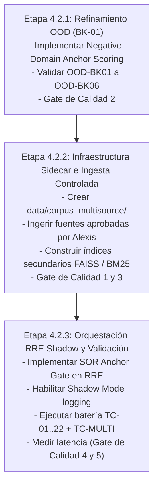

# SOR-IJF — ORDEN DE EJECUCIÓN FASE 4.2
**Secuencia Paso a Paso, Precondiciones y Protocolo Operativo**

- **Proyecto:** IJF Sport and Organisation Rules (SOR) Assistant
- **Fase:** Fase 4.2.0 — Orden de Ejecución Técnica
- **Fecha:** 2026-11-05
- **Rama Git:** `integration/ijf-sor-2026-08-merge` (Commit Base: `61afc1bc`)
- **Autor / Ejecutor Técnico:** Antigravity
- **Arquitectura y Auditoría:** ChatGPT
- **Supervisión Normativa:** Alexis

---

## 1. PRECONDICIONES OBLIGATORIAS (GATES PREVIOS)

Antes de iniciar la ejecución de cualquier tarea de implementación de Fase 4.2, deben verificarse las siguientes condiciones en el entorno de desarrollo:

1. **Gate Previo 1:** Aprobación formal por parte de Alexis y ChatGPT del documento [`docs/decisiones_arquitectonicas_fase4_2_ijf.md`](file:///C:/PROYECTOS/IJF-SOR-Assistant/docs/decisiones_arquitectonicas_fase4_2_ijf.md).
2. **Gate Previo 2:** Disponibilidad de la bitácora de curaduría firmada por Alexis (`curatorship_log_alexis.md`) autorizando la incorporación de recursos específicos (e.g. `PPT-002`, `NEW-001`, `NEW-003`).
3. **Gate Previo 3:** Estado limpio de Git en lo concerniente a archivos funcionales (los 212 tests de regresión ejecutándose y pasando en verde).
4. **Gate Previo 4:** Congelamiento verificado del corpus primario en `data/processed/rebuild_2026_08_corrected/`.

---

## 2. SECUENCIA PASO A PASO DE IMPLEMENTACIÓN

La ejecución se dividirá en tres sub-etapas estrictamente secuenciales:

---

### ETAPA 4.2.1: Refinamiento del Detector OOD (BK-01)
1. **Paso 1.1:** Extender `src/ood_detector.py` para incorporar los centroides de anclas semánticas negativas (deportes de raqueta, deportes acuáticos, deportes de pelota, striking).
2. **Paso 1.2:** Crear la suite de pruebas unitarias `tests/test_ood_negative_anchors.py`.
3. **Paso 1.3:** Ejecutar la suite OOD y certificar que `GEN-08` (tenis) y `GEN-09` (natación) arrojen unívocamente `ABSTAIN (OUT_OF_DOMAIN)`.
4. **Paso 1.4:** Re-verificar que las 22 consultas canónicas y los 212 tests existentes no sufran alteración.
5. **Gate de Validación:** Aprobación del auditor técnico antes de proceder a 4.2.2.

---

### ETAPA 4.2.2: Ingesta Controlada y Sidecar Indexes
1. **Paso 2.1:** Crear la estructura de almacenamiento aislado: `data/corpus_multisource/`.
2. **Paso 2.2:** Desarrollar el pipeline desacoplado de segmentación e indexación: `src/multisource_indexer.py`.
3. **Paso 2.3:** Procesar exclusivamente los documentos que cuenten con la firma de aprobación de Alexis en `docs/registro_documental_multifuente_ijf.csv`.
4. **Paso 2.4:** Generar el índice denso `faiss_multisource.index` y el índice léxico `bm25_multisource.pkl`.
5. **Paso 2.5:** Calcular y verificar el manifiesto criptográfico de lote (`batch_manifest_001.json`).
6. **Gate de Validación:** Inspección forense de que ningún archivo en `data/processed/rebuild_2026_08_corrected/` fue tocado.

---

### ETAPA 4.2.3: Integración RRE en Modo Sombra (Shadow Mode)
1. **Paso 3.1:** Incorporar en `src/rre_engine.py` la compuerta de anclaje normativo (`SOR_Anchor_Gate`) y el flag de lectura secundaria `enable_multisource_sidecar: bool = False`.
2. **Paso 3.2:** Conectar la generación del `EvidenceBundle` a través de `DocumentValidator.build_certified_bundle()`.
3. **Paso 3.3:** Activar el registro en segundo plano en `scratch/shadow_evaluation_log.jsonl`.
4. **Paso 3.4:** Ejecutar la batería de evaluación paralela ($N=30$ iteraciones) y registrar deltas de latencia.
5. **Paso 3.5:** Auditar la ausencia de colisiones y certificar el presupuesto de latencia ($\le +35\text{ ms}$).

---

## 3. PROTOCOLO DE AUDITORÍA Y CIERRE DE ETAPA

Al concluir las tres etapas:
1. El ejecutor técnico (**Antigravity**) producirá `docs/informe_implementacion_fase4_2_ijf.md`.
2. El auditor (**ChatGPT**) ejecutará una inspección independiente contra los Criterios de Aceptación.
3. El supervisor (**Alexis**) revisará el dictamen de auditoría y determinará si se autoriza el paso a **Fase 4.3 (Recuperación Activa y Atribución ADA)**.
4. Si se detecta cualquier anomalía no prevista, se ejecutará el protocolo de rollback desacoplando el Sidecar Index.
