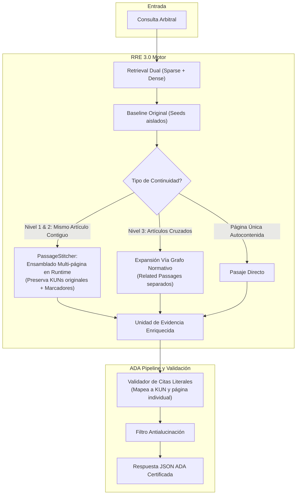

# PLAN DE IMPLEMENTACIÓN REVISADO FASE 2 — RECONSTRUCCIÓN DE PASAJES Y CHUNK STITCHING (RRE 3.0)
**Proyecto:** IJF SOR Assistant  
**Rol:** Ingeniero Responsable de Planificación Técnica  
**Fecha:** 5 de noviembre de 2026 (Versión Revisada con Observaciones)  
**Rama de Trabajo:** `integration/ijf-sor-2026-08-merge`  
**Commit Base:** `61afc1bc2c8fa273f118f4e10bc447dbafcfe650`  
**Estado:** Documento de Planificación y Diseño Arquitectónico (NO IMPLEMENTAR HASTA AUTORIZACIÓN)

---

## 1. DIAGNÓSTICO PROFUNDO DE LA ARQUITECTURA ACTUAL

### 1.1. Estado de la Fragmentación Documental
El sistema IJF SOR Assistant procesa el reglamento canónico (*IJF SOR 2026-08-14*, 298 páginas) utilizando un modelo de extracción física por página (`pypdf_page_physical`), materializado en `passages_candidate.json` (385 pasajes).

Cada pasaje tiene asignado un identificador único KUN (*Knowledge Unit Name*) con formato canónico:
$$\text{KUN} = \text{SOR-2026-08-P}\langle \text{Page} \rangle\text{-S}\langle \text{Section} \rangle$$
Ejemplo: `SOR-2026-08-P166-S187` y `SOR-2026-08-P167-S187`.

### 1.2. El Problema de las Fronteras de Página (*Page Boundary Cut*)
El análisis de cobertura estructural revela que **35 artículos normativos sustantivos abarcan dos o más páginas consecutivas**:
- Artículos de 2 páginas: 21 artículos (ej. Art. 14, Art. 18.1.4, Art. 2.7.2).
- Artículos de 3 páginas: 6 artículos (ej. Art. 13, Art. 2.7.1, Art. 3.5, Art. 4.4, Art. G1.3).
- Artículos de 4 páginas: 3 artículos (ej. Art. 15, Art. 18.2.2, Art. 6.5).
- Artículos de 7 a 14 páginas: Art. G1.1 (Glosario, 7 páginas), Art. 18.1.2 (Shido por movimientos ilegales, 10 páginas), Art. 4 (Señas arbitrales, 14 páginas).
- Apéndice H1.1 (Historial documental): 40 páginas continuas.

Debido a que el chunker actual corta rígidamente en el límite físico de la página:
1. **Pérdida de Continuidad Sintáctica y Semántica:** Las oraciones, listas de excepciones y tablas de puntuación quedan truncadas entre el pie de una página y el encabezado de la siguiente.
2. **Desconexión entre Regla y Excepción:**
   - **Caso Puente (Art. 14.2):** La definición del puente voluntario (*«All situations in which one of the athletes voluntarily makes a bridge... will be ippon»*) reside al pie de la página 166 (`P166-S187`). La justificación cervical y la excepción crítica de aterrizaje sobre el cuerpo de Tori (*«No score or penalty will be given if the landing of uke occurs on the body of tori...»*) residen en las tres primeras líneas de la página 167 (`P167-S187`).
   - **Caso Osaekomi (Art. 7 y Art. 17):** Los tiempos de inmovilización (10-19s Waza-ari, 20s Ippon) y la señal de *Toketa* se encuentran divididos entre los artículos 7 (pág. 152) y 17 (págs. 173-174).
   - **Caso Cadetes (Art. 18.1.4):** Los puntos 33 (cabeza Tori) y 34 (cabeza Uke) están al pie de la página 188 (`P188-S196`), mientras que el punto 35 (reverse seoi-nage) y la nota aclaratoria de participación en Seniors se ubican al tope de la página 189 (`P189-S196`).
3. **Impacto en el Pipeline ADA:**
   - Al validar citas literales contra un único pasaje semilla, ADA no puede contrastar simultáneamente la regla general y su excepción sin recurrir a pasajes desconectados.

---

## 2. AUDITORÍA DE CONFIABILIDAD DE METADATOS Y CRITERIOS DE CONTINUIDAD

### 2.1. Confiabilidad de `article_id` y `heading_path`
La inspección detallada del corpus revela:
1. **Zonas de Alta Confiabilidad:** En el cuerpo principal de las reglas de arbitraje (págs. 136-199), `article_id` es consistente (ej. `Article 14`, `Article 18.1.4`, `Article 18.2.2`).
2. **Zonas con Riesgo de Ambigüedad:**
   - Hay 20 páginas con `article_id: "GENERAL"` repartidas en distintos apéndices y secciones, con 16 encabezados diferentes.
   - En una misma página física pueden convivir dos artículos distintos: en la página 188 coexisten `Article 18.1.3` (`SOR-2026-08-P188-S195`) y `Article 18.1.4` (`SOR-2026-08-P188-S196`). En la página 152 conviven `Article 6` y `Article 7`.
   - Por tanto, la igualdad simple de `article_id` **no es suficiente por sí sola** para gobernar la reconstrucción.

### 2.2. Taxonomía de Tres Niveles de Relación entre Fragmentos
Para evitar uniones erróneas o indiscriminadas, la arquitectura distingue tres niveles estrictos:
1. **Nivel 1: Continuidad Textual Pura (Oración o Párrafo Partido):**
   - El texto al final de la página $N$ termina sin punto final, o con una conjunción, o con una oración incompleta (ej. lista numerada que continúa en $N+1$).
   - *Criterio de detección:* Heurística sintáctica de corte (ausencia de puntuación terminal o continuación de lista numerada/alfabética).
2. **Nivel 2: Pertenencia Estructural (Misma Sección / Artículo / Apéndice):**
   - Ambos fragmentos comparten el mismo `article_id` y `heading_path` formal, y corresponden a páginas contiguas $N$ y $N+1$ (o hasta $N+k$ si el artículo se extiende legítimamente).
   - *Criterio de detección:* Coincidencia de tupla `(article_id, heading_path)` + contigüidad de `pdf_page_index`.
3. **Nivel 3: Relación Normativa Sustantiva (Referencia Cruzada / Regla-Excepción en Distintos Artículos):**
   - Fragmentos con artículos distintos que regulan la misma situación jurídica (ej. Art. 7 Osaekomi Time pág. 152 y Art. 17 Osaekomi-waza pág. 174; o Art. 18.1.4 restricciones Cadetes y Art. 20 participación de Cadetes en Seniors).
   - *Criterio de detección:* Aristas certificadas en el Grafo Normativo (`knowledge_graph_candidate.json`) con relaciones semánticas explícitas (`references_article`, `cross_reference_penalty`, `exception_to`).

### 2.3. Matriz de Reconstrucción Automática vs. Asistida por Reglas

| Tipo de Relación | ¿Reconstrucción Automática? | Mecanismo de Ensamblado | Requisitos / Validaciones |
| :--- | :---: | :--- | :--- |
| **Continuidad Textual en Mismo Artículo** | **SÍ (Automática)** | Concatenación directa con delimitador de página | `article_id` idéntico, páginas contiguas ($N, N+1$), encabezado compatible. |
| **Continuidad Multi-Página ($\ge$ 3 páginas)** | **SÍ (Automática con Tope)** | Enlace dinámico según longitud del artículo sustantivo | Tope de expansión: máximo hasta agotar el artículo o límite de seguridad de 3 páginas contiguas para evitar incluir apéndices masivos (ej. H1.1 de 40 páginas). |
| **Múltiples Artículos en Misma Página** | **SÍ (Selectiva)** | Desambiguación por sección KUN | Si la página 188 tiene S195 y S196, se enlaza únicamente S196 con la página 189 S196. |
| **Regla-Excepción en Artículos Separados** | **NO Automática (Vía Grafo)** | Inclusión como evidencia conexa (`related_passages`) | Utilizar aristas tipadas del Grafo Normativo. No fusionar textos para evitar confundir la procedencia documental de citas. |

---

## 3. DISEÑO ARQUITECTÓNICO PROPUESTO

### 3.1. Principios de Integridad y Trazabilidad Estricta
1. **Preservación Total de Chunks Originales:** El archivo `passages_candidate.json`, sus hashes SHA256 y sus identificadores KUN originales **permanecen 100% inalterados**.
2. **No Sustitución de Referencias para ADA:** El validador de citas y el contrato JSON de ADA seguirán utilizando los KUNs originales primarios (`SOR-2026-08-P166-S187`) para que la interfaz web y los enlaces al visor PDF anclen exactamente a la página de origen. El KUN compuesto (`composite_kun`) se añade exclusivamente como metadato complementario de auditoría.
3. **Marcadores Explícitos de Transición de Página:**
   ```text
   [PAGE BREAK: P166 -> P167 | KUN_TRANSITION: SOR-2026-08-P166-S187 -> SOR-2026-08-P167-S187]
   ```
   Esto permite que el extractor de citas sepa exactamente qué líneas pertenecen a qué página y KUN individual.

### 3.2. Diagrama de Arquitectura de Tres Canales


---

## 4. FLUJO TÉCNICO Y PSEUDOCÓDIGO DETALLADO

### 4.1. Módulo `PassageStitcher` (`src/passage_stitcher.py`)
```python
class PassageStitcher:
    """
    Reconstruye la continuidad normativa de fragmentos contiguos pertenecientes
    al mismo artículo o sección reglamentaria del IJF SOR 2026.
    """
    MAX_EXPANSION_PAGES = 3  # Límite de seguridad para artículos extensos

    def __init__(self, passages_by_id: dict[str, dict]):
        self.passages_by_id = passages_by_id
        self._build_index()

    def _build_index(self):
        # Mapea (article_id, heading_path_tuple, pdf_page_index) -> list of passage_ids
        self.structural_map = {}
        for pid, p in self.passages_by_id.items():
            art = p.get("article_id")
            heading = tuple(p.get("heading_path", []))
            page = p.get("pdf_page_index")
            if art and page and art not in ["GENERAL", "H1.1"]:
                key = (art, heading, page)
                self.structural_map.setdefault(key, []).append(pid)

    def stitch_evidence(self, seed_passage: dict) -> dict:
        art = seed_passage.get("article_id")
        heading = tuple(seed_passage.get("heading_path", []))
        page = seed_passage.get("pdf_page_index")

        if not art or not page or art in ["GENERAL", "H1.1"]:
            return seed_passage  # No ensamblar secciones ambiguas o historiales masivos

        # Buscar páginas hacia adelante y hacia atrás que compartan artículo y encabezado
        forward_pids = []
        for next_page in range(page + 1, page + self.MAX_EXPANSION_PAGES + 1):
            matching = self.structural_map.get((art, heading, next_page))
            if matching:
                forward_pids.extend(matching)
            else:
                break

        backward_pids = []
        for prev_page in range(page - 1, max(1, page - self.MAX_EXPANSION_PAGES) - 1, -1):
            matching = self.structural_map.get((art, heading, prev_page))
            if matching:
                backward_pids.extend(matching)
            else:
                break
        backward_pids.reverse()

        if not forward_pids and not backward_pids:
            return seed_passage

        # Ensamblar texto continuo con trazabilidad completa
        all_pids = backward_pids + [seed_passage.get("passage_id")] + forward_pids
        stitched_text = ""
        source_spans = []

        for idx, pid in enumerate(all_pids):
            p = self.passages_by_id[pid]
            p_text = p.get("text_original", "").strip()
            p_page = p.get("pdf_page_index")
            source_spans.append({
                "kun": pid,
                "page": p_page,
                "url": f"{p.get('source_url', '')}#page={p_page}"
            })
            if idx > 0:
                prev_p = self.passages_by_id[all_pids[idx - 1]]
                stitched_text += (
                    f"\n\n--- [PAGE BREAK: P{prev_p.get('pdf_page_index')} -> P{p_page} | "
                    f"KUN: {prev_p.get('passage_id')} -> {pid}] ---\n\n"
                )
            stitched_text += p_text

        # Preservar el objeto original enriqueciéndolo con metadatos de ensamblado
        stitched_record = dict(seed_passage)
        stitched_record["text_original"] = stitched_text
        stitched_record["is_stitched"] = True
        stitched_record["primary_kun"] = seed_passage.get("passage_id")  # Para citas ADA
        stitched_record["composite_kun"] = f"SOR-2026-08-P{source_spans[0]['page']}-P{source_spans[-1]['page']}"
        stitched_record["source_spans"] = source_spans
        stitched_record["stitched_kuns"] = all_pids
        return stitched_record
```

---

## 5. CASOS NORMATIVOS PRIORITARIOS Y REEVALUACIÓN DE LOS 22 CASOS

### 5.1. Casos Prioritarios con Reconstrucción Estructural
1. **Puente e Ippon (Art. 14.1, 14.2, págs. 166-167):**  
   - Unión de `P166-S187` y `P167-S187`.  
   - *Efecto:* Resuelve directamente **TC-21** (puente como Ippon) y **TC-22** (excepción de aterrizaje sobre Tori).
2. **Restricciones de Cadetes (Art. 18.1.4, págs. 188-189):**  
   - Unión de `P188-S196` (puntos 33 y 34) y `P189-S196` (punto 35 y nota Seniors).  
   - *Efecto:* Resuelve la omisión de la consecuencia de Shido en **TC-08** y completa la visión de **TC-06** y **TC-07**.
3. **Inmovilización y Toketa (Art. 7 pág. 152 y Art. 17 págs. 173-174):**  
   - Cobertura integral de la escala de tiempos y anuncio de anulación en **TC-05**.
4. **Criterios de Puntuación Ippon vs. Waza-ari (Art. 14 y Art. 15, págs. 166-170):**  
   - Previene el desvío hacia dimensiones del tatami en caídas laterales de 90° (**TC-04**).

### 5.2. Clasificación Correcta Obligatoria de TC-08
> [!IMPORTANT]
> **Norma Canónica Oficial para TC-08 (SOR 2026 Art. 18.1.4 p.34, pág. 188):**  
> *«34. In cadet events athletes are not allowed to use the head to defend as UKE. In this situation, tori will be awarded a score, if any, and uke will be penalised with shido.»*  
> **Sanción obligatoria en la prueba:** **SHIDO para Uke** (Código PS34, pág. 255) y puntuación técnica para Tori si existió proyección. Toda afirmación que mencione Hansoku-make en este supuesto se calificará como `ERROR_CONSECUENCIA_NORMATIVA`.

---

## 6. SUITE DE PRUEBAS, PREVENCIÓN DE REGRESIÓN Y PROTECCIÓN OOD

### 6.1. Pruebas Unitarias de Chunk Stitching (`tests/test_passage_stitcher.py`)
1. **Continuidad Sintáctica y Delimitadores:** Comprobar que los marcadores de página se insertan exactamente entre páginas consecutivas.
2. **Aislamiento de Secciones Ambiguas:** Verificar que pasajes con `article_id: "GENERAL"` o apéndices extensos (`H1.1`) no sean fusionados erróneamente.
3. **Preservación de Metadatos Individuales:** Validar que `source_spans` contenga cada KUN, página y URL correspondiente.
4. **Modo Baseline / Bypass:** Validar que si `enable_chunk_stitching=False`, la salida de RRE es bit a bit idéntica a la Fase 1.

### 6.2. Protección Estricta contra Falsos Positivos Fuera de Dominio (OOD)
Para corregir fallos como **TC-16 (falta personal en básquetbol)**:
- **Guardrail de Dominio Judo:** El validador en `retrieve()` debe exigir que al menos un lema sustantivo provenga del vocabulario canónico del judo (técnicas Kodokan, términos de vestimenta, áreas oficiales o sanciones específicas) o que la consulta cite una página verificable del SOR. Consultas sobre deportes ajenos deben resultar categóricamente en `status: ABSTAIN`.

### 6.3. Suite Completa de Regresión
- Mantener las **172 pruebas existentes en estado PASS**.
- Añadir un mínimo de **10 pruebas nuevas** (5 de stitching y 5 de regresión OOD).

---

## 7. CRITERIOS OBJETIVOS DE ACEPTACIÓN SEPARADOS

En lugar de una métrica global simple de aciertos (18/22), se definen **tres dimensiones obligatorias e independientes** que deben cumplirse en su totalidad:

### Dimensión 1: Criterios de Recuperación (RRE)
- **Cobertura de Casos de Corte de Frontera:** 100% de éxito en la recuperación conjunta de TC-21 y TC-22 (Puente y excepción).
- **Reducción de Fallos de Recuperación:** Tasa de acierto de recuperación en la batería de 22 casos $\ge$ 85% (al menos 19/22 en Top-3).
- **Protección OOD:** 100% de abstención justificada en consultas ajenas (TC-16 y TC-17 en `ABSTAIN`).

### Dimensión 2: Criterios de Integridad Documental y Técnica (Pipeline)
- **Trazabilidad de Citas:** 100% de las citas emitidas por ADA deben corresponder a pasajes existentes con página exacta.
- **No Alteración del Corpus:** SHA256 de `passages_candidate.json`, `vector_index_candidate.json` y del PDF oficial deben permanecer invariantes.
- **Cero Regresiones:** 182/182 pruebas (172 base + 10 nuevas) en estado PASS.

### Dimensión 3: Criterios de Exactitud Normativa y Arbitral (SOR 2026)
- **Exactitud en Sanciones Críticas:**
  - TC-08: Sanción dictada explícitamente como **SHIDO para Uke** (no Hansoku-make).
  - TC-09: Direct Hansoku-make por Head Diving especificando que el atleta **SÍ puede continuar**.
  - TC-10 / TC-18: Direct Hansoku-make por agresión/insultos especificando que el atleta **NO puede continuar**.
  - TC-21 / TC-22: Ippon por puente voluntario reconociendo la excepción de aterrizaje sobre Tori.
- **Cero Errores de Consecuencia Normativa en Casos Aprobados.**

---

## 8. MATRIZ DE RIESGOS RESIDUALES Y MECANISMO DE ROLLBACK

### 8.1. Riesgos Residuales

| Riesgo Identificado | Severidad | Probabilidad | Estrategia de Mitigación |
| :--- | :---: | :---: | :--- |
| **Dilución de Similitud Semántica:** Un pasaje compuesto largo puede diluir el score semántico de una consulta muy corta. | Media | Baja | El cálculo de score vectorial y léxico se realiza sobre el pasaje semilla original; el stitching ocurre únicamente al construir el payload de evidencias. |
| **Confusión en Visor de Citas:** Que la interfaz web intente anclar una URL a dos páginas al mismo tiempo. | Alta | Muy Baja | ADA utiliza el `primary_kun` del pasaje semilla para generar la URL base, documentando la página secundaria en el texto de la cita. |
| **Crecimiento Excesivo en Artículos Extensos:** Fusión de apéndices de más de 10 páginas. | Crítica | Nula | Regla dura: `MAX_EXPANSION_PAGES = 3` y exclusión explícita de `H1.1`, `G1.1` y `GENERAL`. |

### 8.2. Mecanismo de Rollback
El motor RRE se parametrizará con control estricto:
```python
ReasoningRetrievalEngine(enable_chunk_stitching=True)
```
Si se detecta cualquier fallo o desacuerdo arbitral:
1. Se desactiva el flag (`enable_chunk_stitching=False`).
2. El sistema revierte inmediatamente a la lógica exacta de Fase 1 sin necesidad de reconstruir archivos, tocar Git ni reiniciar la infraestructura.

---

## 9. DECISIONES TÉCNICAS PENDIENTES DE AUTORIZACIÓN

Antes de autorizar el inicio del desarrollo, se requiere confirmación expresa de Alexis y ChatGPT sobre:

1. **Aprobación del Guardrail de Dominio OOD:** ¿Se aprueba integrar el filtro de pertenencia al dominio de judo en `retrieve()` durante la Fase 2 para subsanar casos como TC-16?
2. **Tope de Expansión Multi-página:** ¿Se aprueba el límite máximo de seguridad de hasta 3 páginas contiguas para artículos sustantivos, excluyendo apéndices masivos (`H1.1`) y secciones ambiguas (`GENERAL`)?
3. **Mantenimiento del KUN Primario para ADA:** ¿Se aprueba mantener el KUN individual de la página semilla como identificador primario de cara a ADA y la interfaz web, relegando el `composite_kun` como metadato complementario?

---
*Fin del Plan Revisado de Fase 2.*
