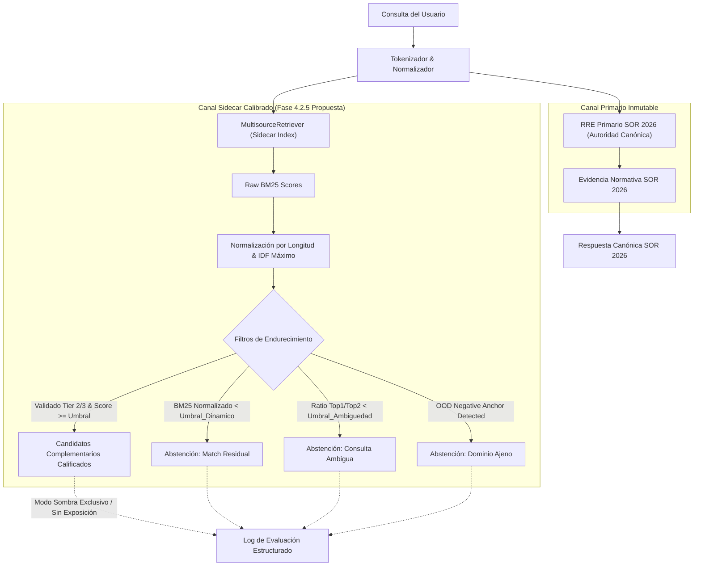

# Plan Maestro — Fase 4.2.5: Calibración y Endurecimiento del Retrieval Multifuente
**Proyecto:** IJF SOR Assistant  
**Fase:** 4.2.5 — Calibración y Endurecimiento de la Recuperación Multifuente Sidecar  
**Supervisor:** Alexis Oliveros Lozano  
**Arquitectura y Auditoría:** ChatGPT  
**Ejecutor:** Antigravity  
**Fecha:** 2026-11-05  
**Repositorio:** `C:\PROYECTOS\IJF-SOR-Assistant`  
**Branch:** `integration/ijf-sor-2026-08-merge`  
**Estado:** **DOCUMENTO DE PLANIFICACIÓN Y DISEÑO — SIN IMPLEMENTACIÓN DE CÓDIGO**

---

## 1. Contexto y Justificación

Durante la ejecución de la Fase 4.2.4 (Evaluación Multifuente Sidecar), se obtuvieron resultados favorables que confirmaron:
1. **Recall dirigido del 100% (13/13)** en consultas dirigidas sobre enmiendas oficiales (Tier 2) e interpretaciones técnicas (Tier 3).
2. **Invarianza matemática del 100% (20/20)** en el RRE normativo primario del SOR 2026.
3. **Overhead computacional imperceptible (~0.06 ms)**.
4. **261 / 261 pruebas globales aprobadas**.

Sin embargo, la auditoría independiente de ChatGPT y el propio informe técnico de la Fase 4.2.4 identificaron reservas técnicas específicas:
- **Hallazgo H-01:** El control de timeout en `MultisourceRetriever.search()` es cooperativo dentro del bucle de términos y no preemptivo.
- **Hallazgo H-02:** El log `.jsonl` persiste consultas textualmente sin sanitización de posibles datos personales (PII).
- **Hallazgo H-03:** En 4 consultas normativas puras o fuera de dominio (OOD), el algoritmo BM25 léxico no calibrado produjo coincidencias parciales espurias con scores bajos ($1.63 \le score \le 2.70$) debido a solapamiento superficial de términos genéricos como "combate", "área" o "penalización".

La **Fase 4.2.5** tiene como propósito diseñar la estrategia formal de calibración, endurecimiento y mitigación de falsos positivos en el Sidecar, previo a cualquier autorización de fusión o exposición al usuario.

---

## 2. Objetivos y Alcance

### 2.1. Objetivos Técnicos
1. Formular y documentar los modelos matemáticos de calibración y corte para el Sidecar (superando el umbral arbitrario $score \ge 3.0$).
2. Diseñar un mecanismo de **abstención activa** en el Sidecar cuando la consulta carezca de especificidad complementaria demostrable.
3. Especificar el protocolo de gobernanza criptográfica por fragmento y la verificación estricta de invariantes.
4. Definir un benchmark ampliado y representativo con 40 consultas etiquetadas (incluyendo casos adversariales y ambiguos).
5. Mantener la estricta inmutabilidad del corpus oficial SOR 2026.

### 2.2. Alcance Autorizado de esta Preparación
- Análisis estático (read-only) de componentes existentes.
- Producción de los 4 documentos normativos de la Fase 4.2.5.
- Definición de métricas operacionales formales y criterios de aceptación.

### 2.3. Exclusiones Explícitas (Restricciones Absolutas)
- **NO se implementa código funcional en `src/` ni `tests/`.**
- **NO se modifican archivos de corpus, PDF, índices vectoriales, grafos ni Sidecars.**
- **NO se activan flags en producción ni en pre-producción.**
- **NO se realizan fusiones de evidencias con la respuesta de ADA.**
- **NO se ejecutan despliegues a OCI ni comandos remotos de Git (push, merge, release).**

---

## 3. Arquitectura Experimental de la Calibración Multifuente



---

## 4. Análisis de Situación y Diseño de Calibración

### 4.1. Análisis del Comportamiento Actual de BM25
En `src/multisource_retriever.py`, el scoring BM25 se calcula como:
$$\text{Score}(D, Q) = \sum_{t \in Q} \text{IDF}(t) \cdot \frac{\text{TF}(t, D) \cdot (k_1 + 1)}{\text{TF}(t, D) + k_1 \cdot \left(1 - b + b \cdot \frac{|D|}{\text{avgdl}}\right)}$$
Con parámetros $k_1 = 1.5$, $b = 0.75$, $\text{avgdl} \approx 18.0$ tokens y $N = 8$ documentos en el Sidecar.

**Hallazgo Matemático Crítico:**
- Debido al tamaño microscópico del corpus Sidecar ($N=8$), el $\text{IDF}$ máximo de un término único es $\ln((8 - 1 + 0.5)/(1 + 0.5) + 1) \approx 1.7918$.
- Cuando una consulta contiene una sola palabra coincidente (e.g. "penalización" o "combate"), el score máximo posible para un fragmento típico es:
  $$\text{Score} \approx 1.7918 \cdot \frac{1 \cdot 2.5}{1 + 1.5 \cdot (1 - 0.75 + 0.75 \cdot 1.0)} \approx 1.7918 \cdot 1.0 = 1.79$$
- Si la consulta tiene múltiples términos que no coinciden, la normalización interna `score / max_s` fuerza artificialmente a que el único candidato residual tenga un `confidence_score = 1.0` (o relativo al máximo del batch).
- **Conclusión:** Un umbral fijo estático como $score \ge 3.0$ es una hipótesis empírica que penalizaría consultas legítimas de una sola palabra clave ("¿Qué es Yuko?") y no resolvería la ambigüedad matemática.

### 4.2. Alternativas de Calibración Evaluadas para la Fase 4.2.5

| Alternativa | Descripción | Ventajas | Desventajas | Decisión |
| :--- | :--- | :--- | :--- | :--- |
| **Alt 1: Umbral Fijo Estático (Score $\ge 3.0$)** | Cortar cualquier match con raw score $< 3.0$. | Fácil implementación. | Injusto con consultas breves; no generaliza si $N$ crece. | **Descartada como solución única.** |
| **Alt 2: Umbral por Cobertura de Términos Clave (Query Term Overlap Ratio)** | Exigir que al menos el $50\%$ de los términos sustantivos de la consulta estén en el fragmento. | Elimina matches espurios por una sola palabra aislada ("combate", "penalización"). | Sensible a consultas largas con modificadores. | **Seleccionada como Filtro Primario.** |
| **Alt 3: Ratio de Dominancia Top1 / Top2 (Margin Gap)** | Evaluar si $\text{Score}_{\text{Top1}} - \text{Score}_{\text{Top2}} \ge \delta$ para resolver ambigüedad. | Previene colisiones entre fragmentos similares. | Inaplicable si solo hay un fragmento en el topic. | **Seleccionada como Filtro de Desambiguación.** |
| **Alt 4: Calibración Híbrida: Boost Ontológico + Umbral Dinámico** | $\text{Score}_{\text{norm}} = \frac{\text{BM25}}{\sum \text{IDF}(t \in Q)}$. Si $\text{Score}_{\text{norm}} < 0.35$, abstención. | Matemáticamente comparable entre consultas de distinta longitud. | Requiere precomputar la suma de IDF de la consulta. | **PROPUESTA TÉCNICA PRINCIPAL.** |

---

## 5. Protocolo de Gobernanza e Invarianza

### 5.1. Protocolo Criptográfico por Fragmento
Cada fragmento indexado en el Sidecar debe validar la siguiente tupla estricta:
```
(chunk_id, document_id, authority, validity, eligibility, staging_sha256, passage_content_hash)
```
- **Procedimiento de Validación:**
  1. Verificar que `document_id` conste con estado `APROBADO` en `docs/registro_documental_multifuente_ijf.csv`.
  2. Verificar que `staging_sha256` coincida exactamente con el hash del archivo markdown original en `data/corpus_multisource/staging/`.
  3. Verificar que `validity == "VIGENTE"` y `eligibility == "ELIGIBLE_INTERPRETATIVA"`.
  4. Si cualquiera de estos 4 campos no se cumple, el fragmento queda vetado para indexación o consulta en memoria.

### 5.2. Protocolo de Invarianza SOR 2026 (OFF vs ON)
Para cada consulta ejecutada en benchmark o evaluación:
- **Comparación Bit a Bit Exigida:**
  - `status` (SUCCESS / ABSTAIN).
  - Número exacto de evidencias en `evidence`.
  - Orden estricto de `passage_id`.
  - Puntuaciones exactas `score` redondeadas a 4 decimales.
  - Campos `article_id`, `page`, `source_url` y `text_original`.
  - Contenido de `related_passages`.
- **Criterio de Rechazo:** Si se detecta un solo bit de divergencia en `evidence` o si se introduce cualquier campo ajeno (`authority`, `chunk_id`, etc.) en la respuesta primaria, la ejecución se declara **VIOLACIÓN DE INVARIANZA**.

---

## 6. Secuencia de Ejecución y Plan de Rollback

### 6.1. Secuencia de Ejecución Propuesta (Sujeta a Aprobación)
1. **Paso 1:** Aprobación del Plan Maestro y Criterios por Alexis y ChatGPT.
2. **Paso 2:** Implementación del normalizador de scoring y umbral dinámico en `src/multisource_retriever.py` (aislado).
3. **Paso 3:** Implementación del benchmark de 40 consultas en `scratch/run_fase4_2_5_benchmark.py`.
4. **Paso 4:** Ejecución de pruebas de regresión completa (`pytest tests/`).
5. **Paso 5:** Generación de informes técnicos y auditoría independiente.

### 6.2. Plan de Rollback Experimental
Dado que la Fase 4.2.5 operará exclusivamente bajo feature flags y en ramas locales:
- Si se detecta degradación o contaminación en el RRE primario:
  1. Forzar `enable_shadow_mode_multisource = False` en `src/rre_engine.py`.
  2. Ejecutar `git checkout src/rre_engine.py` para restaurar el estado canónico de Fase 4.2.3.
  3. El directorio primario `data/processed/rebuild_2026_08_corrected/` no es tocado jamás, asegurando restauración inmediata en 0 segundos.
