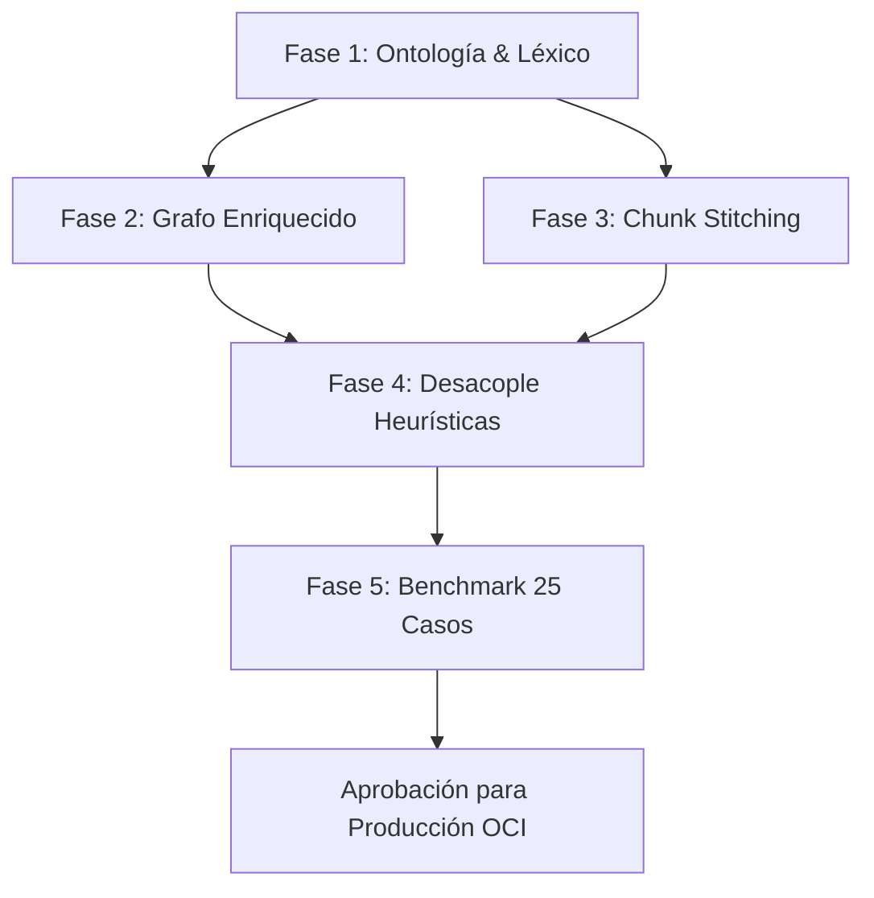

# PLAN DE IMPLEMENTACIÓN Y MIGRACIÓN RRE 3.0
## IJF SOR Assistant | Edición SOR 2026-08 (14 de agosto de 2026)

- **Documento:** Plan de Implementación por Fases y Gestión de Riesgos
- **Ruta:** `docs/plan_implementacion_rre_3_0.md`
- **Fecha:** 2026-11-04
- **Rol:** Arquitecto y Ejecutor DevOps (Antigravity)
- **Supervisión y Aprobación:** ChatGPT / Alexis
- **Documentos Asociados:** `docs/diseno_arquitectura_rre_3_0.md` y `docs/benchmark_rre_3_0.md`

---

## 1. Resumen de la Estrategia de Migración

El rediseño RRE 3.0 se ejecutará de forma **estrictamente incremental en 5 fases secuenciales**. Cada fase posee:
- Archivos afectados delimitados.
- Pruebas unitarias y de integración obligatorias.
- Procedimiento de rollback inmediato sin impacto colateral.
- Criterios objetivos de aceptación (*Quality Gate*) antes de avanzar a la siguiente fase.

---

## 2. Plan Detallado por Fases

### Fase 1: Expansor Ontológico Multilingüe y Normalización Léxica
- **Objetivo:** Resolver de forma inmediata la recuperación para consultas de conducta, agresiones, ofensas, insultos y disciplina, erradicando el desvío hacia diagramas y sorteos.
- **Archivos Nuevos:**
  - `src/normative_ontology.py`: Clase `NormativeOntology` con las 15 familias semánticas del judo y lemas bilingües oficiales.
  - `tests/test_normative_ontology.py`: Suite de pruebas unitarias para el mapeo conceptual.
- **Archivos Modificados:**
  - `src/rre_engine.py`: Integrar `NormativeOntology` en `_tokenize()` y enriquecer la generación de tokens en inglés para BM25.
- **Pruebas Obligatorias:**
  - `pytest tests/test_normative_ontology.py -v` (100% passed).
  - Verificación del Caso BM-01: La consulta *«¿Si un competidor ofende o agrede a otro que sucede?»* debe recuperar en Top 2 el Art. 18.2.2 y D1.1.
  - Suite de regresión vigente: 166/166 passed en `tests/`.
- **Riesgo:** Bajo (adición puramente aditiva en el tokenizador sin alterar índices en disco).
- **Rollback:** `git checkout src/rre_engine.py` y eliminación de `src/normative_ontology.py`.

---

### Fase 2: Reconstrucción y Enriquecimiento del Grafo de Conocimiento
- **Objetivo:** Elevar las relaciones del grafo de 68 aristas a ~450, interconectando principios éticos (P14, P134), sanciones graves (P190–P194), excepciones (P167) y códigos (P256).
- **Archivos Nuevos:**
  - `scripts/build_ontology_graph_candidate.py`: Script generador de relaciones ontológicas basado en reglas semánticas declarativas.
- **Archivos Modificados:**
  - `data/processed/rebuild_2026_08_corrected/knowledge_graph_candidate.json`: Archivo de grafo enriquecido (preservando los 385 nodos intactos).
  - `src/graph_manager.py`: Soporte para los nuevos tipos de relación (`sanctioned_with`, `governed_by_principle`, `code_specification`).
- **Pruebas Obligatorias:**
  - `pytest tests/test_graph_manager.py -v`.
  - Comprobación de que la consulta sobre agresión o insultos expande automáticamente el nodo del código oficial PX13 / DSB.
  - Suite completa: 166/166 passed.
- **Riesgo:** Medio (alteración de archivo de datos procesados).
- **Rollback:** Restauración de `knowledge_graph_candidate.json` desde copia de respaldo.

---

### Fase 3: Ensamblador Contextual (*Chunk Stitching*) en RRE
- **Objetivo:** Unir en memoria los pasajes de artículos que se encuentran divididos por saltos de página física (Art. 18.2.2 págs. 190–193, Art. 14.2 págs. 166–167), entregando a ADA el texto normativo continuo.
- **Archivos Modificados:**
  - `src/rre_engine.py`: Implementación del método `_stitch_multipage_passages(seeds)` tras el ordenamiento RRF.
- **Pruebas Obligatorias:**
  - `pytest tests/test_citation_highlighting_regression.py -v` (Verificar que los anclajes de página y citas para el visor PDF se preservan íntegros).
  - Consulta de prueba Art. 18.2.2: Confirmar que el contexto contiene simultáneamente la prohibición de continuar (Pág. 190) y la lista de actos (Pág. 193).
- **Riesgo:** Medio (gestión de identificadores múltiples en la evidencia).
- **Rollback:** `git checkout src/rre_engine.py`.

---

### Fase 4: Desacoplamiento de Heurísticas Cableadas y Reintento Adaptativo
- **Objetivo:** Eliminar bloques condicionales hardcoded (`if is_head_action`, `if is_dive_specific`, etc.) en `src/rre_engine.py` y sustituirlos por el motor general de ponderación por dominio (`DomainWeightMatrix`) y reintento adaptativo si el score inicial es inferior a `min_confidence`.
- **Archivos Modificados:**
  - `src/rre_engine.py`: Limpieza de heurísticas ad-hoc y activación del ciclo de reintento conceptual.
- **Pruebas Obligatorias:**
  - Batería completa de regresión histórica: Tatami, Judogi, Cadetes, Puente, Osaekomi y Agresiones.
  - Comprobación de que consultas fuera de dominio (OOD) siguen absteniéndose al 100%.
  - Suite de 166 pruebas automatizadas aprobadas.
- **Riesgo:** Alto (modificación nuclear del algoritmo de ranking).
- **Rollback:** Reversión atómica de `src/rre_engine.py`.

---

### Fase 5: Ejecución del Benchmark de 25 Casos y Validación Pre-despliegue
- **Objetivo:** Medir cuantitativamente la tasa de Recall, precisión sancionatoria y coherencia interpretativa en ADA 3.0 y NormativeValidator 3.0.
- **Archivos Nuevos:**
  - `tests/test_benchmark_rre_3_0.py`: Suite ejecutable de los 25 casos normativos.
- **Archivos Modificados:**
  - `src/normative_validator.py`: Inclusión de validaciones semánticas para continuación en el torneo y tipificación disciplinaria.
- **Pruebas Obligatorias:**
  - Ejecución integral del benchmark: `pytest tests/test_benchmark_rre_3_0.py -v`.
  - Criterio de pase: ≥92% de éxito (mínimo 23 de 25 casos correctos).
- **Riesgo:** Bajo (suite de validación y control de calidad).

---

## 3. Matriz de Dependencias y Trazabilidad de Componentes

---

## 4. Política de Rollback y Control de Cambios

1. **Entorno Local Primero:** Cada fase se desarrollará y validará exclusivamente en el repositorio local `C:\PROYECTOS\IJF-SOR-Assistant` en una rama de trabajo dedicada (ej. `feature/rre-3.0-architecture`).
2. **Sin Tocar Producción OCI:** La instancia en producción `sor.alxol.com` permanecerá fija en el commit `61afc1b` durante todo el proceso de desarrollo y validación.
3. **Compuerta de Aprobación Explicita:** Ninguna fase se integrará en `integration/ijf-sor-2026-08-merge` ni se transferirá a OCI sin la previa revisión del informe de fase por parte de ChatGPT y la autorización formal de Alexis.
