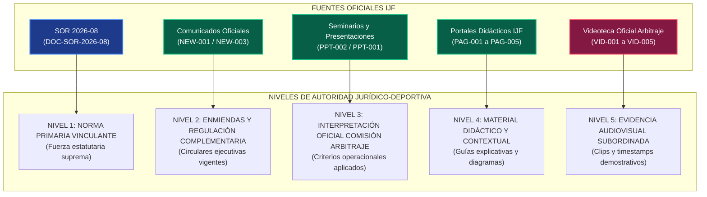
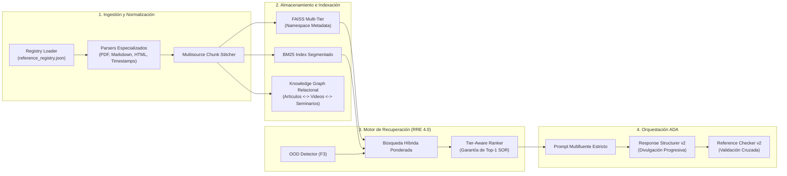
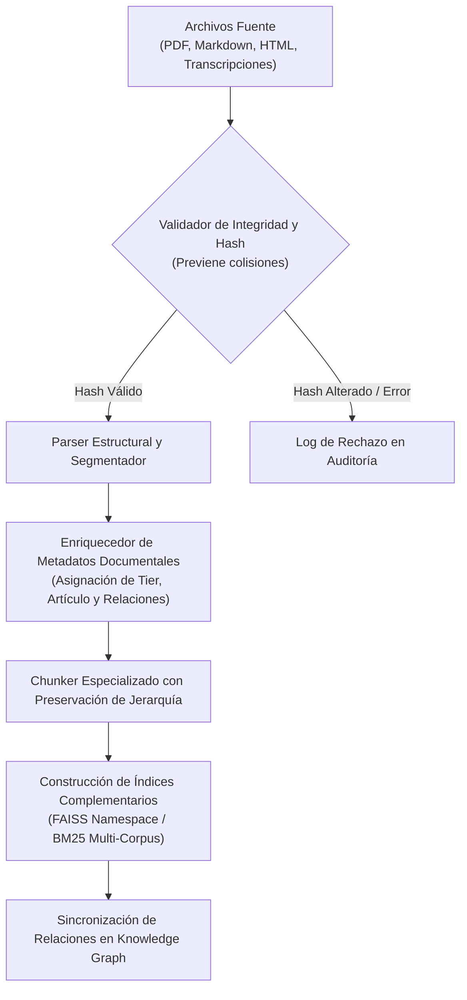
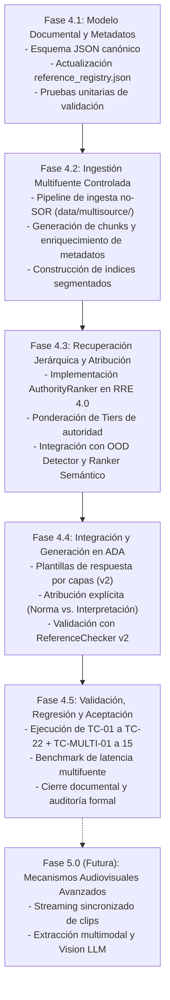

# SOR-IJF — PLAN MAESTRO DE FASE 4: ARQUITECTURA DE CONOCIMIENTO MULTIFUENTE

**Estado del Documento:** PLAN MAESTRO ARQUITECTÓNICO Y OPERATIVO (PROPUESTA CONSOLIDADA)  
**Destino:** `docs/plan_maestro_fase4_multifuente_ijf.md`  
**Fecha:** 2026-11-05  
**Entorno:** Local (`C:\PROYECTOS\IJF-SOR-Assistant`)  
**Rama Git:** `integration/ijf-sor-2026-08-merge`  
**Commit Base:** `61afc1bc2c8fa273f118f4e10bc447dbafcfe650`  
**Autor:** Antigravity (Analista Arquitectónico y Auditor Técnico)  
**Revisores:** Alexis (Supervisor) / ChatGPT (Arquitecto y Auditor Normativo)  

---

## 1. OBJETIVOS Y ALCANCE

### 1.1 Objetivo General
Diseñar, estructurar y planificar la evolución del sistema **IJF SOR Assistant** desde un motor centrado exclusivamente en el texto formal del reglamento hacia una **Arquitectura de Conocimiento Multifuente**, capaz de incorporar aclaraciones oficiales, interpretaciones arbitrales, presentaciones técnicas y evidencia audiovisual (videos con timestamps), preservando sin fisuras la **precedencia normativa suprema del SOR del 14 de agosto de 2026** (`DOC-SOR-2026-08`) y garantizando **atribución diferenciada y trazabilidad estricta** en las respuestas de ADA.

### 1.2 Objetivos Específicos
1. **Gobernanza y Autoridad Escalonada:** Formalizar una taxonomía unívoca de fuentes que distinga entre norma estatutaria vinculante, interpretación oficial de la Comisión de Arbitraje, material didáctico/procedimental y evidencia contextual.
2. **Modelo de Metadatos Canónico:** Diseñar el esquema de metadatos documental que acompañará a cada chunk o recurso en el pipeline de ingestión y recuperación.
3. **Ingestión y Normalización Desacoplada:** Definir las vías de ingesta para documentos no estructurados (PDF complementarios, notas de prensa oficiales, slides) sin contaminar los índices base ni romper los invariantes existentes.
4. **Recuperación Multifuente Jerárquica:** Integrar en el motor RRE (3.0) un mecanismo de recuperación y ranking que pondere la autoridad documental y prevenga alucinaciones normativas.
5. **Generación con Trazabilidad en ADA:** Adaptar los prompts y el estructurador de respuestas de ADA para presentar decisiones inmediatas respaldadas por citas de primer nivel (SOR) y complementadas por criterios interpretativos o enlaces a video-evidencias oficiales.
6. **Mapeo Audiovisual Subordinado:** Establecer las bases técnicas para enlazar clips de video y timestamps a los artículos y situaciones normativas sin otorgarles carácter normativo autónomo.

### 1.3 Alcance
- **Incluido en Fase 4:**
  - Definición del modelo de datos y metadatos documentales.
  - Marco de gobernanza y matriz de autoridad jurídica.
  - Especificación del pipeline de ingesta multiformato (documentos complementarios de `reference_registry.json`).
  - Extensión del recuperador híbrido RRE para filtrado y scoring por Tiers de autoridad.
  - Adaptación de la capa de estructuración de respuestas de ADA para citas en dos niveles (Fundamento Primario vs. Complemento Interpretativo).
  - Protocolo de pruebas de aceptación y batería de regresión multifuente.
- **Excluido de Fase 4 (Reservado para Fase 5):**
  - Procesamiento masivo de streaming de video, extracción automática de keyframes mediante visión por computador y modelos Speech-to-Text de alta densidad sobre videos de combates en tiempo real.

---

## 2. ARQUITECTURA CONCEPTUAL

La arquitectura multifuente descansa sobre un principio cardinal: **La letra del SOR 2026 es el estándar normativo supremo, pero las situaciones tácticas del arbitraje real requieren criterios operativos y evidencia de aplicación práctica.**



### 2.1 Principios Rectores Consolidados
1. **Principio de Primacía Normativa:** Ninguna interpretación, circular ni video puede prevalecer frente a una disposición taxativa del SOR del 14 de agosto de 2026.
2. **Principio de No Exclusión por Subsunción Parcial:** Un recurso complementario (e.g. `PPT-002` o `NEW-001`) no se descarta simplemente porque el SOR haya recogido el cambio general; si el recurso contiene explicaciones técnicas, advertencias de seguridad o casuística adicional, se mantiene como fuente interpretativa.
3. **Principio de Individualización de Fuerza Normativa:** No se presume automáticamente obligatoriedad jurídica en presentaciones o notas de prensa. La autoridad se evalúa caso por caso según el emisor y el propósito normativo.
4. **Principio de Subordinación Audiovisual:** Los videos oficiales (`VID-002` a `VID-005`) **no constituyen norma autónoma**. Su función es actuar como evidencia visual contextual de cómo se aplica la regla en el tatami.

---

## 3. ARQUITECTURA LÓGICA Y COMPONENTES

La implementación se estructura en cuatro capas funcionales estrictamente desacopladas:



### 3.1 Componentes Existentes a Reutilizar
- `src/reference_manager.py`: Módulo operativo que gestiona la resolución y disponibilidad de las referencias de `data/references/reference_registry.json`.
- `src/reference_checker.py`: Validador que garantiza que los enlaces URL y URN citados existan en el registro oficial.
- `src/rre_engine.py`: Motor híbrido de recuperación (BM25 + FAISS Dense) con soporte para feature flags.
- `src/normative_semantic_ranker.py` (Fase 3): Mecanismo de penalización y promoción contextual basado en la ontología normativa.
- `src/referee_command_disambiguator.py` (Fase 3): Desambiguación de comandos arbitrales frente a marcas/logos.
- `src/ood_detector.py` (Fase 3): Puerta de entrada para abstención limpia de consultas ajenas al judo.

### 3.2 Componentes Nuevos Necesarios
1. `src/multisource_indexer.py`: Indexador especializado que procesa fuentes no-SOR (presentaciones, notas de prensa, páginas web descargadas y metadatos de video), asignando identificadores canónicos y metadatos de autoridad.
2. `src/authority_ranker.py`: Re-clasificador que asegura que, ante cualquier consulta con relevancia normativa, los pasajes de **Tier 1 (SOR)** mantengan el primer lugar en la fundamentación, ordenando los pasajes de **Tier 2-4** como complemento interpretativo subordinado.
3. `src/video_grounding_engine.py`: Motor de resolución de evidencias audiovisuales que vincula timestamps y descripciones textuales de clips con artículos específicos del SOR.
4. `src/response_structurer_v2.py`: Generador de respuestas con divulgación en capas (Decisión Inmediata, Fundamento Normativo Primario, Criterio Operacional Complementario y Evidencia Visual).

---

## 4. MODELO DE METADATOS DOCUMENTAL

Cada unidad textual indexada (chunk o pasaje) debe incorporar obligatoriamente el siguiente esquema JSON de metadatos para permitir el filtrado semántico y la trazabilidad jurídica:

```json
{
  "chunk_id": "CHK-SOR-2026-ART15-003",
  "document_uid": "DOC-SOR-2026-08",
  "source_tier": "TIER_1_NORMATIVE_PRIMARY",
  "authority_level": 1,
  "normative_status": "VINCULANTE",
  "effective_date": "2026-08-14",
  "source_entity": "IJF Executive Committee / Refereeing Commission",
  "title": "IJF Sport and Organisation Rules - Edition August 2026",
  "section": "Article 15 - Waza-ari",
  "article_number": "15.0",
  "page_start": 168,
  "page_end": 169,
  "modality_type": "TEXT_CANONICAL",
  "content_hash": "a4f8c2e1...",
  "relations": {
    "subsumes": ["NEW-003", "VID-003"],
    "interpreted_by": ["PPT-002"],
    "demonstrated_by": [
      {
        "video_uid": "VID-003",
        "timestamp_start": "00:01:14",
        "timestamp_end": "00:01:45",
        "description": "Demostración de caída lateral a 90 grados y apoyo en glúteo"
      }
    ]
  }
}
```

---

## 5. CLASIFICACIÓN Y AUTORIDAD DE FUENTES

A partir de la auditoría de vigencia documental consolidada (`docs/auditoria_vigencia_documentos_complementarios_ijf.md` y `docs/matriz_vigencia_documentos_ijf.csv`), se formaliza la siguiente matriz de autoridad:

| Tier | Nivel de Autoridad | Descripción / Alcance Jurídico | Recursos Asignados | Función en ADA |
|---|---|---|---|---|
| **Tier 1** | **Norma Primaria Vinculante** | Estatuto supremo y taxativo. Prevalece sobre cualquier otra fuente. | `DOC-SOR-2026-08` | Fundamento normativo obligatorio e irrenunciable. |
| **Tier 2** | **Enmiendas y Circulares** | Comunicados ejecutivos oficiales con vigencia comprobada post-publicación o aclaraciones específicas. | `NEW-001` (LA28 Cycle), `NEW-003` (Temporada 2026) | Modificaciones vigentes o aclaraciones vinculantes. |
| **Tier 3** | **Interpretación Arbitral Oficial** | Directrices operativas emitidas por la Comisión de Arbitraje en seminarios internacionales. No crean normas nuevas; fijan su aplicación en tatami. | `PPT-002` (Seminario 2026), `VID-002`, `VID-003`, `VID-004`, `VID-005` (Interpretaciones Prácticas) | Criterios de aplicación, tiempos de reacción y umbrales prácticos. |
| **Tier 4** | **Material Didáctico y Guías** | Recursos web interactivos, guías de licencias y presentaciones informativas de comisiones no arbitrales. | `PAG-001` a `PAG-005` (Rules IJF), `PPT-001` (CARE IT System), `IMG-001` (Diagrama Tatami) | Contextualización pedagógica y diagramas visuales. |
| **Tier 5 / Excluidos** | **Evidencia Obsoleta o No Disponible** | Recursos dados de baja, enlaces rotos o sustituidos íntegramente por enmiendas posteriores. | `REF-VID-004-YOUTUBE` (Enlace privado / UNPLAYABLE) | Excluido del corpus activo; registrado solo en bitácora de auditoría. |

---

## 6. FLUJO DE INGESTIÓN Y NORMALIZACIÓN



### 6.1 Aislamiento de Índices
Para mantener el principio de inviolabilidad del corpus base del SOR 2026:
- El corpus primario del SOR (`data/corpus/sor_2026_corpus.json` e índices asociados) **no se modificará directamente**.
- Las fuentes complementarias se alojarán en un almacén de documentos extendido: `data/corpus_multisource/`.
- Los índices vectoriales y léxicos complementarios se cargarán como namespaces o particiones secundarias, fusionándose en tiempo de ejecución en RRE 4.0 mediante un orquestador híbrido multi-corpus.

---

## 7. ESTRATEGIA DE RECUPERACIÓN MULTIFUENTE (RRE 4.0)

El motor de recuperación combinará la búsqueda semántica y léxica con una política de ordenamiento consciente de la jerarquía documental (*Authority-Aware Ranking*):

### 7.1 Algoritmo de Ponderación Multifuente
Para cada pasaje candidato $i$ recuperado, el puntaje final $S_{\text{final}}(i)$ se calcula según:

$$S_{\text{final}}(i) = \alpha \cdot S_{\text{lexical}}(i) + \beta \cdot S_{\text{dense}}(i) + \gamma \cdot W_{\text{tier}}(i) + \delta \cdot P_{\text{normative}}(i)$$

Donde:
- $S_{\text{lexical}}(i)$ y $S_{\text{dense}}(i)$ son las similitudes normalizadas de BM25 y embeddings vectoriales.
- $W_{\text{tier}}(i)$ es el peso asociado al nivel de autoridad documental:
  - $\text{Tier 1 (SOR 2026)}: W_{\text{tier}} = 1.00$
  - $\text{Tier 2 (Enmiendas Oficiales)}: W_{\text{tier}} = 0.85$
  - $\text{Tier 3 (Interpretación Arbitral)}: W_{\text{tier}} = 0.70$
  - $\text{Tier 4 (Didáctico / Guías)}: W_{\text{tier}} = 0.50$
- $P_{\text{normative}}(i)$ es el modificador del `NormativeSemanticRanker` (Fase 3), que penaliza pasajes de infraestructura cuando la intención es una acción táctica o viceversa.
- $\alpha, \beta, \gamma, \delta$ son hiperparámetros calibrados experimentalmente con la restricción de que ningún candidato de Tier 2-4 pueda superar a un candidato de Tier 1 que contenga coincidencia normativa directa sobre la misma figura arbitral.

### 7.2 Regla de Selección Top-K en ADA
La recuperación multifuente debe devolver un conjunto estructurado:
- **Top-1 a Top-2:** Obligatoriamente pasajes de **Tier 1 (SOR 2026)** para fijar la base reglamentaria vinculante.
- **Top-3 a Top-5:** Pasajes complementarios de **Tier 2 o Tier 3** (aclaraciones, notas de seminario o clips de video asociados), siempre que su similitud semántica supere el umbral $\tau_{\text{comp}} \ge 0.60$.
- Si una consulta no posee disposiciones en el SOR pero está resuelta taxativamente en una directriz de seminario (`PPT-002`), el sistema devolverá dicha directriz advirtiendo expresamente su carácter de **Interpretación Oficial de la Comisión de Arbitraje**.

---

## 8. INTEGRACIÓN CON ADA (ARBITRATION DECISION ASSISTANT)

La presentación de respuestas en ADA adoptará el modelo de **divulgación progresiva en capas**:

```markdown
### Decisión Arbitral Inmediata
[Acción inmediata del árbitro: Gesto, Voz de mando y Sanción o Puntuación aplicable]

---

### Fundamentación y Evidencia Oficial

#### 1. Fundamento Normativo Primario (SOR 2026 — Vinculante)
- **Artículo:** [Art. XX - Título] (Págs. XX-XX)
- **Texto Normativo:** "[Cita textual o síntesis reglamentaria]"
- **Referencia Oficial:** [DOC-SOR-2026-08](urn:ijf:sor:2026-08:artXX)

#### 2. Criterio de Aplicación Arbitral (Interpretación Oficial IJF)
- **Fuente:** [Seminario Internacional de Arbitraje 2026 / Circular Oficial] (PPT-002 / NEW-001)
- **Criterio Operativo:** [Explicación práctica sobre cómo juzgar la acción en combate]

#### 3. Evidencia Audiovisual de Aplicación (Didáctico / Demostrativo)
- **Video:** [Demostración de Kumikata / Caída Yuko] (VID-002)
- **Timestamp:** [00:01:23 - 00:01:45]
- **Acción Observada:** [Descripción de la mecánica corporal observada en el clip oficial]
```

---

## 9. TRATAMIENTO DE VIDEOS Y EVIDENCIA AUDIOVISUAL

### 9.1 Principio de Subordinación Audiovisual
Los videos oficiales **no crean ni anulan reglas**. Un clip audiovisual actúa exclusivamente como:
1. **Verificación visual** del criterio expresado en el texto del reglamento.
2. **Ejemplo paradigmático** de la aplicación de la norma.
3. **Mecanismo pedagógico** para que árbitros y competidores observen la velocidad, ángulo e intención de la acción.

### 9.2 Mecanismo de Indexación y Timestamps
Cada video registrado en `reference_registry.json` se modelará mediante un archivo descriptor estructurado (`data/multisource/transcripts/VID-XXX.json`) que incluirá:
- `video_id`: Identificador canónico (e.g. `VID-002`).
- `title`: Título oficial.
- `official_url`: Enlace verificado y disponible.
- `segments`: Lista de segmentos temporales, donde cada segmento define:
  - `timestamp_start` / `timestamp_end` (formato `HH:MM:SS`).
  - `sor_article_mapping`: Artículo(s) del SOR que demuestra (e.g. `Art. 18.1.2`).
  - `tactical_action`: Descripción canónica de la acción (e.g. *"Rotura de agarre con dos manos manteniendo contacto"*).
  - `ruling`: Dictamen arbitral ilustrado (e.g. *"Legal - Continuar combate"* o *"Shido - Agarre no estándar"*).

---

## 10. CITAS, TRAZABILIDAD Y ATRIBUCIÓN

1. **Validación Previa con `ReferenceChecker`:** Antes de enviar la respuesta generada al usuario, el sistema ejecuta una validación cruzada para certificar que todos los códigos citados (`DOC-SOR-2026-08`, `PPT-002`, `VID-003`, etc.) existan en `data/references/reference_registry.json` y tengan el estado `AVAILABLE`.
2. **Trazabilidad de Versión y Fecha:** Toda cita debe incluir la fecha de referencia del documento o evento (e.g., *Seminario de Arbitraje, Enero 2026*), impidiendo la anacronía normativa.
3. **Manejo de Enlaces Rotos o Inactivos:** Si un recurso multimedia se encuentra marcado como `UNPLAYABLE` (caso `REF-VID-004-YOUTUBE`), el motor prohíbe su citación en el frontend de ADA y sugiere la búsqueda en la videoteca general activa (`VID-001`).

---

## 11. CASOS DE PRUEBA Y CRITERIOS DE ACEPTACIÓN

Para validar la Fase 4 se diseñará una batería multifuente extendida (**TC-MULTI-01 a TC-MULTI-15**):

| ID | Consulta de Prueba | Fuentes Esperadas | Criterio de Aprobación (PASS) |
|---|---|---|---|
| **TC-M01** | Transición a Ne-waza con arrastre sin técnica | Art. 16 (Tier 1) + PPT-002 (Tier 3) | Cita Art. 16 como norma y PPT-002 como criterio de continuidad obligatoria. |
| **TC-M02** | Demostración visual de caída lateral a 90° | Art. 15 (Tier 1) + VID-003 (Tier 5) | Cita Art. 15 Waza-ari y enlaza VID-003 con timestamp exacto. |
| **TC-M03** | Rotura de agarre Kumikata con dos manos | Art. 18.1.2 (Tier 1) + VID-002 (Tier 5) | Determina legalidad si mantiene contacto; cita Art. 18 y video demostrativo. |
| **TC-M04** | Regulación de reverse seoi-nage en Cadetes | Art. 18 (Tier 1) + NEW-001 (Tier 2) | Prohibido en Cadetes (Shido) pero permitido en Senior; cita comunicado oficial. |
| **TC-M05** | Tiempo de inmovilización Osaekomi para Yuko | Art. 17 (Tier 1) + NEW-003 (Tier 2) | Subsumido en SOR: cita primaria de Art. 17 (5-9 segundos). |
| **TC-M06** | Conflicto normativo hipotético (SOR vs. PPT) | Art. SOR (Tier 1) vs. Slide ficticio | El sistema debe otorgar precedencia absoluta e inquebrantable al SOR. |
| **TC-M07** | Intento de citación de video retirado | Consulta sobre Head Defence | El sistema no debe citar `REF-VID-004-YOUTUBE` (inactivo). |

### Criterios de Aceptación Cuantitativos
- **Aprobación Batería Base:** 100% PASS en TC-01 a TC-22 (0 regresiones sobre Fase 3).
- **Aprobación Batería Multifuente:** $\ge 90\%$ PASS en TC-M01 a TC-M15.
- **Precedencia Normativa:** 100% de consultas sobre reglas de combate deben contener al menos una cita válida de Tier 1 (SOR 2026).
- **Impacto en Latencia:** El incremento promedio de tiempo de respuesta en RRE + ADA no debe exceder $+60.00\text{ ms}$ respecto al baseline de Fase 3.

---

## 12. FASES INCREMENTALES DE IMPLEMENTACIÓN (HOJA DE RUTA)

Se propone un plan de trabajo estructurado en etapas lógicas y secuenciales:



### Justificación Arquitectónica de la Secuencia
1. **4.1 antes de 4.2:** No es posible ingerir fuentes heterogéneas sin antes haber congelado el contrato de metadatos y la jerarquía de Tiers que gobernará el almacenamiento.
2. **4.2 antes de 4.3:** El motor de recuperación no puede clasificar pasajes por autoridad si los índices segmentados y los chunks enriquecidos no existen físicamente en disco.
3. **4.3 antes de 4.4:** ADA no puede generar respuestas estructuradas por capas si el motor de recuperación subyacente no le entrega los candidatos ya clasificados con sus niveles de autoridad y citas verificadas.
4. **4.4 antes de 4.5:** La auditoría final de aceptación exige evaluar la experiencia de usuario y la coherencia de las respuestas de ADA completas, no solo los puntajes de recuperación crudos.
5. **Fase 5 desacoplada:** La integración audiovisual avanzada (análisis de video por visión computacional o streaming en tiempo real) involucra dependencias de infraestructura y costos que exceden la arquitectura de conocimiento textual y semántico de Fase 4.

---

## 13. RIESGOS Y MITIGACIONES

| Riesgo Técnico / Normativo | Nivel | Impacto | Estrategia de Mitigación |
|---|---|---|---|
| **R1: Dilución de la Jerarquía Normativa** | Alto | Respuestas donde una nota explicativa contradiga o suavice el texto taxativo del SOR. | Forzar en el prompt de ADA y en el `AuthorityRanker` una regla estricta: *Si existe contradicción, prevalece la letra del SOR Art. XX*. |
| **R2: Enlaces Rotos o Recursos Retirados** | Medio | ADA cita un enlace de video o comunicado que devuelve HTTP 404 o estado privado. | Integrar chequeo periódico en `ReferenceChecker` y excluir del Top-K todo recurso que no esté en estado `AVAILABLE`. |
| **R3: Degradación de Latencia en RRE** | Medio | La búsqueda en múltiples colecciones vectoriales y BM25 supera el límite de respuesta interactiva. | Indexar namespaces compactos, pre-calcular relaciones en el Knowledge Graph y aplicar filtrado léxico temprano. |
| **R4: Alucinación de Timestamps en Videos** | Alto | El LLM inventa minutos o segundos de un video donde supuestamente ocurre la acción. | Prohibir al LLM inferir timestamps: los timestamps solo pueden provenir textualmente de los metadatos inyectados en el contexto. |
| **R5: Falsos Positivos OOD por Múltiples Fuentes** | Medio | Aumentar el volumen textual con portales y noticias puede elevar la tasa de falsos positivos en el detector OOD. | Mantener las anclas semánticas del OOD Detector referenciadas exclusivamente contra el núcleo ontológico canónico de Judo. |

---

## 14. DEPENDENCIAS Y DECISIONES PENDIENTES

### 14.1 Decisiones Aprobadas
- El SOR 2026-08 es el fundamento normativo primario exclusivo.
- La separación formal entre capas funcionales y niveles de autoridad documental (Tiers).
- El uso de videos como evidencia ilustrativa subordinada mediante timestamps.
- Preservación íntegra de los invariantes del corpus base del SOR.

### 14.2 Decisiones Pendientes (Para Alexis y ChatGPT)
1. **Aprobación de la Ingesta de Portales Web (`PAG-001` a `PAG-005`):** Decidir si el portal didáctico `rules.ijf.org` se ingestará como texto completo o solo como enlace referencial externo, para evitar redundancias con el articulado del SOR.
2. **Alcance de los Comunicados Anteriores a Agosto 2026:** Validar si comunicados de tecnología (`NEW-002`) deben permanecer en el registry únicamente como metadatos informativos sin vectorizar en FAISS.
3. **Formato Visual de ADA en Frontend:** Acordar si la evidencia audiovisual se renderizará como hipervínculo estándar, tarjeta interactiva (*card*) o reproductor embebido.

---

## 15. RELACIÓN CON EL BACKLOG DE RRE 3.0

La ejecución de la Fase 4 se articulará de manera sinérgica con los elementos registrados en `docs/backlog_rre_3_0.md`:
- **BK-01 (OOD Cross-Sport Scoring):** Debe completarse antes de incorporar textos didácticos generales, a fin de evitar que términos deportivos cruzados como `puntos` o `tiempo` degraden la detección OOD.
- **BK-02 (Abstención de Cobertura Documental):** Se integra directamente en la Fase 4.4 de ADA para tipificar consultas sobre aspectos organizativos no cubiertos en el SOR ni en documentos complementarios.
- **BK-04 (Trazabilidad Multifuente en ADA):** Constituye el núcleo central de desarrollo de la Fase 4.4.
