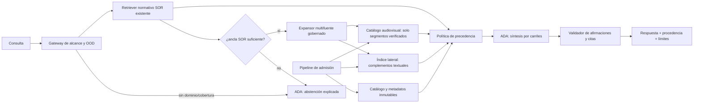
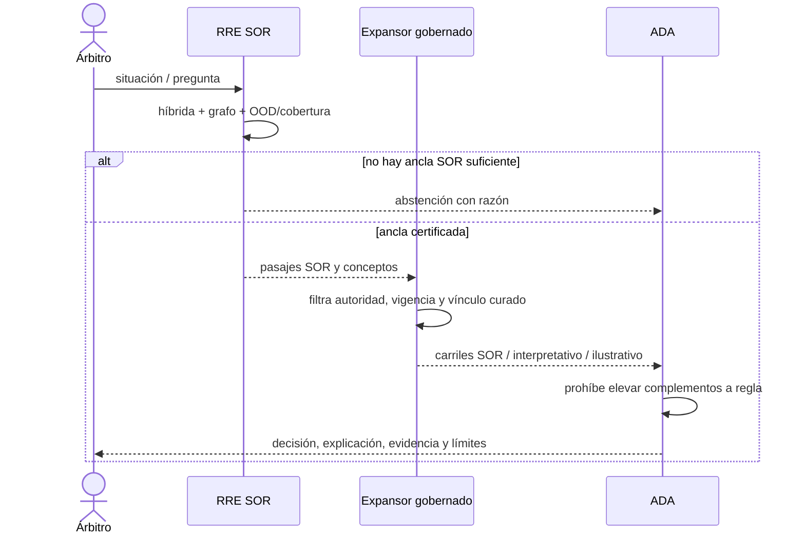

# SOR-IJF — Plan Maestro Alternativo de Fase 4: conocimiento multifuente gobernado

**Estado:** propuesta arquitectónica independiente; no autoriza implementación ni despliegue.  
**Fecha:** 2026-11-05.  
**Ámbito:** evolución controlada de RRE/ADA, preservando el corpus operativo actual.

## Convenciones de evidencia

- **[Verificado]**: observado en archivos, código o artefactos del repositorio durante esta elaboración.
- **[Propuesta]**: decisión de diseño recomendada para Fase 4; no está implementada.
- **[Supuesto]**: hipótesis operativa que debe confirmarse antes de construir.
- **[Pendiente]**: decisión, dato o validación humana necesaria.

## 1. Resumen ejecutivo

**[Propuesta]** Fase 4 debe crear una *capa de conocimiento multifuente gobernada*, no ampliar directamente el índice normativo existente. El SOR de 14 de agosto de 2026 sigue siendo la única fuente que puede fundamentar una respuesta normativa vinculante. Los demás materiales oficiales se incorporan como evidencia contextual, interpretativa, histórica o audiovisual, con autoridad explícita, vigencia verificable y trazabilidad hasta el artefacto original.

La recomendación es conservar intacto el corpus SOR, sus índices y grafo actuales; añadir un catálogo de fuentes y un *sidecar index* por fuente o lote de ingesta. La recuperación será jerárquica: primero busca y certifica el ancla SOR; solo después recupera complementos compatibles. ADA producirá una respuesta de carriles separados: **regla SOR**, **aplicación/explicación oficial**, **evidencia ilustrativa** y **limitaciones**. Ninguna alta similitud semántica elevará la autoridad de un material complementario.

El primer incremento debe ser un piloto pequeño, textual y reversible, sin mezclar los nuevos documentos con los 385 pasajes actuales. La expansión masiva y el vídeo quedan condicionados a un contrato de metadatos, curaduría de autoridad, pruebas de no regresión y aprobación humana.

## 2. Diagnóstico técnico del estado actual

### Hechos verificados

| Área | Hallazgo | Implicación para Fase 4 |
|---|---|---|
| Corpus operativo | `passages_candidate.json` contiene **385** pasajes; todos tienen `source_id = SOR-2026-08-14-ENG`. | La recuperación actual es monofuente aunque el repositorio tenga referencias adicionales. |
| Fuente activa | `src/corpus_config.py` fija como edición activa SOR **14 August 2026**, con SHA-256 y rutas a pasajes, grafo e índice corregidos. | Debe conservarse como baseline inmutable y fuente normativa primaria. |
| RRE | `src/rre_engine.py` combina recuperación léxica/densa, fusión, expansión de grafo y controles especializados. Valida correspondencia 1:1 entre corpus, metadatos e índices. | Un índice mixto rompería supuestos de integridad; es preferible un índice lateral versionado. |
| ADA | `src/ada_assistant.py` solicita evidencia a RRE, cita pasajes SOR y pasa la respuesta por `NormativeValidator`. | El contrato de evidencia/cita supone página y pasaje SOR; necesita tipos de fuente antes de admitir complementos. |
| Fases 1–2 | Ontología/recuperación RRE y stitching están implementados; stitching queda opt-in con `enable_chunk_stitching=False`. | Son capacidades experimentales que Fase 4 no debe activar ni alterar como prerrequisito. |
| Fase 3 | Hay módulos de ranking semántico, desambiguación y OOD; sus flags quedan `False` por defecto. La auditoría declara 22/22 PASS canónicos y aceptación condicionada, no despliegue. | La base no está autorizada para producción; Fase 4 debe medir sobre baseline y configuración experimental explícita. |
| Limitaciones F3 | GEN-08 (tenis), GEN-09 (natación) y GEN-14 (patrocinador específico) quedan PARTIAL en la batería de generalización. | Más fuentes pueden aumentar falsos positivos; OOD y suficiencia documental deben endurecerse antes de ampliar cobertura. |
| Referencias disponibles | Hay 18 KUN `data/markdown/kuns_*.md` y 19 entradas en `reference_registry.json`, incluidas PDF, portales, noticias, presentaciones, imágenes y vídeos. | Existencia en el registro no prueba autoridad, vigencia, granularidad ni aptitud para indexación. |
| Vídeos | El registro apunta para VID-002..005 a rutas generales SPA (`FALLBACK_GENERAL`); una entrada YouTube está `DELETED`/`MANUAL_REVIEW`. | No hay evidencia de *deep links* reproducibles ni timestamps verificables para uso decisorio. |

**[Verificado]** El árbol de trabajo contiene cambios ajenos preexistentes; esta propuesta no los interpreta como parte de Fase 4 ni los modifica.

### Lectura crítica

La arquitectura contiene mecanismos útiles de trazabilidad y verificación de citas, pero su semántica actual equivale casi siempre a «pasaje SOR certificado». Incorporar documentos heterogéneos sin introducir una semántica de autoridad produciría dos riesgos: que ADA presente una explicación como regla, o que un documento de alta similitud desplace el fundamento SOR. La ampliación debe tratar autoridad, vigencia, relevancia y recuperabilidad como atributos distintos.

## 3. Objetivos y alcance de Fase 4

### Objetivos

1. **[Propuesta]** Permitir evidencia oficial complementaria sin desautorizar ni modificar la primacía del SOR 2026.
2. **[Propuesta]** Mantener trazabilidad reproducible por documento, versión, fragmento, localizador y decisión de admisión.
3. **[Propuesta]** Mejorar las respuestas de árbitro con contexto declarado como tal, conservando la abstención cuando falte fundamento SOR o cobertura suficiente.
4. **[Propuesta]** Hacer posible la futura evidencia audiovisual mediante segmentos, transcripciones y timestamps, sin convertir vídeo en fuente normativa primaria.
5. **[Propuesta]** Proteger métricas y comportamiento del RRE existente mediante aislamiento, pruebas diferenciales y rollback por lote.

### No alcance

- **[Propuesta]** No reescribir ni reindexar los 385 pasajes del SOR ni sus artefactos actuales.
- **[Propuesta]** No inferir que toda publicación IJF sea obligatoria; tampoco resolver por diseño cuestiones jurídicas que requieran dictamen institucional.
- **[Propuesta]** No ingerir vídeos, transcribirlos ni descargar material en el piloto textual.
- **[Propuesta]** No promover Fase 3 ni Fase 4 a producción solo por cumplir pruebas locales.

## 4. Arquitectura propuesta



### Principios de diseño

- **[Propuesta] Ancla normativa obligatoria:** para una decisión, sanción, puntuación, obligación o prohibición, ADA exige por lo menos una evidencia SOR vigente admisible. Sin ella, puede describir material contextual, pero debe abstenerse de formular una conclusión normativa.
- **[Propuesta] Índices separados:** el RRE SOR no comparte vector, identificadores ni puntuación final con los complementos. La unión ocurre tras recuperar el ancla, mediante relaciones curadas `explains`, `illustrates`, `superseded_by`, `conflicts_with` o `contextualizes`.
- **[Propuesta] Política antes que ranking:** la autoridad filtra elegibilidad; la relevancia ordena únicamente elementos elegibles dentro de su carril.
- **[Propuesta] Proveniencia inmutable:** cada ingesta genera una versión de lote, huella criptográfica, extractor, fecha, decisiones de curatoría y fuente original; las correcciones producen una nueva revisión, no mutan historia.
- **[Propuesta] Degradación segura:** si un índice lateral o un enlace falla, se conserva respuesta SOR; nunca se sustituye una norma por un complemento.

## 5. Modelo de conocimiento y metadatos

**[Propuesta]** Definir entidades separadas: `Source` (documento/artefacto), `SourceRevision` (versión verificada), `EvidenceUnit` (fragmento recuperable), `AuthorityAssessment` (dictamen de autoridad/vigencia), `NormativeLink` (relación curada con SOR) e `IngestionRun` (proveniencia técnica).

| Campo mínimo | Uso |
|---|---|
| `source_id`, `revision_id`, `evidence_id` | Identidad estable sin reutilización entre SOR y complementos. |
| `publisher`, `issuer_role`, `officiality_evidence` | Distingue alojar/publicar de emitir con competencia normativa. |
| `document_type`, `media_type`, `language` | PDF, circular, presentación, web, vídeo, transcripción, imagen. |
| `authority_class`, `authority_rationale`, `approval_status` | Clase asignada por curaduría, su fundamento y quién/cuándo la aprobó. |
| `valid_from`, `valid_to`, `supersession_status`, `superseded_by` | Vigencia y relación explícita con SOR/revisiones. |
| `integrity_hash`, `acquisition_uri`, `canonical_uri` | Reproducción e integridad; no confundir URL de portal con artefacto citado. |
| `locator` | Página/diapositiva/sección/párrafo, o `start_ms`/`end_ms` para audiovisual. |
| `transcript_status`, `human_review_status` | Calidad y revisión, especialmente para ASR/traducción. |
| `linked_sor_passage_ids`, `link_type`, `link_confidence`, `link_approved_by` | Vínculo explícito con la ancla SOR; no se infiere solo por embedding. |
| `retrieval_eligibility`, `citation_policy`, `display_label` | Controla si se busca, cómo se puede citar y el rótulo visible al usuario. |

**[Propuesta]** Separar etiquetas de información y de uso: un vídeo puede ser oficial y de alta relevancia contextual, pero su `citation_policy` será «ilustrativa», no «fundamento normativo». Un comunicado puede ser oficial pero `supersession_status=SUBSUMED`, con recuperación solo cuando la consulta pida antecedentes o historia.

## 6. Clasificación de fuentes y autoridad

| Clase propuesta | Uso permitido en ADA | Ejemplos/repositorio | Regla de precedencia |
|---|---|---|---|
| A — normativa primaria vigente | Fundamento y decisión | SOR 2026-08 (`DOC-SOR-2026-08`/configuración activa) | Prevalece; única clase suficiente para mandato reglamentario. |
| B — acto oficial con alcance por validar | Complemento solo tras dictamen de vigencia/competencia | comunicados `NEW-*` | No crea obligación sin confirmación y sin contradicción A. |
| C — interpretación o explicación oficial | Explica aplicación; rótulo obligatorio | `PPT-002`, si se verifica emisor, edición y alcance | Nunca prevalece sobre A; conflicto se muestra y escala. |
| D — didáctica/contextual/audiovisual | Ilustra, orienta o enlaza evidencia | `VID-*`, `PAG-*`, `IMG-*` | No justifica una decisión normativa; exige ancla A. |
| E — histórica/sustituida | Comparación o trazabilidad histórica, con advertencia | `DOC-001` enero 2026, material subsumido | Excluida por defecto de consultas vigentes. |
| X — no admitida / incierta | No recuperable para respuestas | URL eliminada, artefacto no verificable | Bloqueada hasta curaduría. |

**[Pendiente]** La clase B/C no debe asignarse automáticamente por dominio IJF. Debe aprobarse una matriz institucional que establezca quién puede emitir interpretación operativa, cómo se prueba su vigencia y cuál es el tratamiento de contradicciones.

## 7. Estrategia de recuperación



1. **[Propuesta] Clasificación inicial:** detectar intención: normativa vigente, procedimiento arbitral, explicación, histórico, evidencia audiovisual o fuera de cobertura.
2. **[Propuesta] Recuperación SOR primero:** ejecutar el RRE actual y evaluar suficiencia combinando relevancia, cobertura ontológica, coherencia de pasajes y umbral OOD.
3. **[Propuesta] Expansión condicionada:** obtener complementos solo para conceptos/pasajes SOR anclados; filtrar por autoridad, vigencia, revisión humana, idioma y `retrieval_eligibility`.
4. **[Propuesta] Ranking en dos dimensiones:** `relevance_score` ordena dentro del carril; `authority_class` y `policy_eligibility` gobiernan qué carriles se muestran. No sumar ambos en un único score opaco.
5. **[Propuesta] Conflicto y abstención:** si un complemento contradice A, no se sintetiza como armonía; ADA prioriza SOR, marca conflicto y recomienda revisión. Si la consulta exige un hecho no cubierto (p. ej., patrocinador concreto), se devuelve abstención de cobertura, no el pasaje semánticamente más próximo.

**[Propuesta]** Para los falsos positivos OOD observados, Fase 4 debe añadir una puerta de suficiencia de cobertura previa a la expansión multifuente, pruebas multideporte y una categoría de abstención `OUT_OF_SCOPE_OR_UNSUPPORTED`, diferenciada de `OUT_OF_DOMAIN`.

## 8. Integración ADA

**[Propuesta]** ADA recibirá un `EvidenceBundle` tipado, no una lista plana. Contrato mínimo:

```text
normative_primary[]     # A, pasajes SOR certificados
official_interpretation[] # B/C admitidos, con rótulo y vínculo SOR
contextual_evidence[]   # D, nunca fundamento
historical_context[]    # E, solo bajo intención explícita
conflicts[]             # discrepancias no resueltas
coverage_assessment     # suficiente / insuficiente / OOD / fuera de alcance
```

La respuesta será obligatoriamente ordenada así: (1) decisión o abstención; (2) fundamento SOR con cita; (3) explicación oficial, cuando exista y sea elegible; (4) vídeo/material ilustrativo, cuando sea verificable; (5) condiciones, incertidumbres y conflictos. El validador debe comprobar que cada afirmación modal («debe», «prohibido», «sanción») cite A; que B/C/D lleven etiqueta visible; que los localizadores existan en su revisión; y que no se cite material no recuperado.

## 9. Estrategia de ingestión documental

**[Propuesta]** Aplicar una cadena de admisión con *gates*, sin ingesta automática a producción:

1. **Descubrimiento y expediente:** registrar candidato, emisor, URL canónica, licencia/acceso, finalidad y posible relación SOR.
2. **Verificación de artefacto:** adquirir copia autorizada, hash, fecha, idioma, versión y localizador estable; una URL de sección general no pasa este gate como evidencia granular.
3. **Curaduría jurídica/deportiva:** asignar clase, vigencia, política de citación y relaciones concretas con SOR. Requiere doble revisión para B/C.
4. **Normalización reproducible:** extraer texto/estructura preservando página, diapositiva, tabla, idioma y advertencias de OCR. No traducir para sustituir el original; las traducciones son capas derivadas.
5. **Segmentación y enlaces:** crear unidades con alcance semántico coherente y enlaces SOR curados; rechazar unidades sin localizador o sin contexto mínimo.
6. **Índice lateral de lote:** construir artefactos separados, manifiesto, hashes, métricas y rollback por `batch_id`.
7. **Evaluación de sombra:** consultar baseline y candidato en paralelo; revisar cobertura, precisión, citas, abstenciones, conflictos y latencia antes de habilitar el lote.

### Piloto recomendado

**[Propuesta]** Seleccionar un solo documento textual oficialmente emitido, de alcance limitado y con versión/localizadores verificables —preferentemente `PPT-002` **solo si** se valida el artefacto concreto y la autoridad de su emisor—. Ingerir un subconjunto curado de temas enlazados a artículos SOR, mantenerlo desactivado en respuestas de usuario y ejecutar evaluación de sombra. `NEW-001/003` deben entrar después de establecer de forma explícita si su contenido está vigente, subsumido o meramente histórico.

## 10. Tratamiento futuro de vídeos y evidencia audiovisual

**[Propuesta]** Un vídeo debe modelarse como `VideoAsset → VideoRevision → Segment → TranscriptRevision → EvidenceUnit`, con `start_ms`, `end_ms`, fotograma/descriptor opcional, idioma, método de transcripción, revisión humana, URI reproducible y estado de disponibilidad.

- El vídeo solo es recuperable cuando el segmento, la transcripción y su enlace son verificables.
- La transcripción automática es un candidato de trabajo; no se usa para conclusión hasta revisión humana de terminología y marcas temporales.
- ADA lo presenta como «demostración/evidencia contextual», con enlace al rango, y siempre después del fundamento SOR.
- Los enlaces actuales de VID-002..005 son rutas generales del portal, no prueba de un clip ni timestamp; por tanto, son **[Pendiente]** y no deben formar parte del piloto decisorio.
- Si el recurso desaparece, se preserva el registro histórico, se inhabilita su recuperación pública y no se reemplaza silenciosamente por otro vídeo.

## 11. Plan de pruebas y aceptación

| Nivel | Pruebas propuestas | Criterio de aceptación |
|---|---|---|
| Metadatos | esquema, IDs únicos, hash, localizador, vigencia, relación SOR, políticas | 100% de unidades piloto válidas; ninguna sin clase/estado/localizador. |
| Gobernanza | casos de A/B/C/D/E/X, subsunción y conflicto | Ningún material B–E genera una afirmación normativa sin A. |
| Recuperación | consultas SOR, complementarias, históricas, ambiguas y OOD | No degradación de la batería canónica; mejora demostrada y revisada en el piloto. |
| ADA/citas | atribución de cada oración, enlace y etiqueta de carril | 100% de citas resuelven a evidencia recuperada; 0 elevaciones de autoridad. |
| Abstención | deportes cruzados, patrocinadores, hecho no cubierto, complemento sin ancla | Abstención tipada y explicada; sin pasaje cercano presentado como respuesta. |
| Regresión | baseline actual versus sidecar deshabilitado/habilitado | Con sidecar deshabilitado, resultados SOR equivalentes bajo configuración fija. |
| Rendimiento | p50/p95, memoria, coste de embeddings por lote y por consulta | Presupuesto aprobado antes de activar; ningún fetch de red síncrono en respuesta. |
| Humana | muestreo por árbitros y custodios de conocimiento | Aprobación explícita de autoridad, exactitud y presentación de cada lote. |

**[Pendiente]** Definir métricas numéricas finales: tamaño de muestra, tolerancia exacta de regresión, objetivo de precisión de abstención, SLA y presupuesto. Los valores de Fase 3 no deben reciclarse automáticamente porque miden un corpus monofuente.

## 12. Fases y entregables

| Fase | Entregable verificable | Gate de salida |
|---|---|---|
| 4.0 — Gobernanza y contratos | taxonomía de autoridad, esquema de metadatos, política de conflicto/citación y matriz de responsabilidades | aprobación de arquitectura y curaduría. |
| 4.1 — Inventario y línea base | inventario trazable de candidatos, manifiesto SOR inmutable, batería ampliada OOD/cobertura | baseline reproducible y candidatos clasificados. |
| 4.2 — Piloto textual en sombra | índice lateral de un lote curado, adaptador de `EvidenceBundle`, resultados diferenciales | cero elevación de autoridad y aprobación humana. |
| 4.3 — ADA multicaril controlado | renderizado/citas diferenciadas, validador de tipos, flags de lote | prueba funcional y de regresión aprobada. |
| 4.4 — Expansión textual | incorporación secuencial por lote, auditoría de vigencia/conflictos | cada lote independiente pasa gates. |
| 4.5 — Preparación audiovisual | catálogo de segmentos, proceso de transcripción/revisión y pruebas de enlaces | no se habilita ningún vídeo sin revisión y ancla SOR. |
| 4.6 — Decisión de promoción | paquete de evidencia, operación, costes, rollback y dictamen humano | autorización explícita; fuera del alcance de este plan ejecutar despliegue. |

## 13. Riesgos y mitigaciones

| Riesgo | Impacto | Mitigación propuesta |
|---|---|---|
| Complemento presentado como norma | Crítico | carriles tipados, ancla A obligatoria y validador de modalidad/cita. |
| Documento oficial desactualizado o subsumido | Alto | vigencia/revisión obligatoria, exclusión por defecto y relación `superseded_by`. |
| Mezcla de índices altera RRE | Alto | sidecar aislado, manifiestos y pruebas diferenciales; no tocar corpus SOR. |
| Falsos positivos por más vocabulario | Alto | puerta de cobertura, OOD multideporte y abstención tipada antes de expansión. |
| Enlace de vídeo inespecífico/roto | Medio | recuperar solo segmentos verificables; monitorizar, conservar historia, deshabilitar uso. |
| OCR/ASR altera significado | Alto | conservar original, localizadores y revisión humana; no usar derivado no revisado como fundamento. |
| Latencia/coste crece | Medio | recuperación SOR primero, expansión acotada, caché local y evaluación de sombra. |
| Curaduría insuficiente | Crítico | responsable de conocimiento, doble aprobación B/C y registro auditable de decisiones. |

## 14. Decisiones pendientes

1. **[Pendiente]** ¿Qué órgano/persona aprueba clases B/C y qué evidencia prueba su competencia interpretativa?
2. **[Pendiente]** ¿Qué significa «vigente» para cada tipo de documento y cómo se resuelven contradicciones SOR–comunicado–seminario?
3. **[Pendiente]** ¿Cuál documento exacto, revisión y subconjunto temático será el piloto? Las URLs de portal no bastan.
4. **[Pendiente]** ¿Se permite una respuesta operativa cuando falta SOR pero existe explicación oficial? Recomendación: no; responder como contexto no decisorio.
5. **[Pendiente]** ¿Qué nivel de revisión humana exige una transcripción, traducción y vínculo audiovisual antes de exposición pública?
6. **[Pendiente]** ¿Cuáles son SLA, presupuesto de almacenamiento/embeddings y política de retención de copias fuente?
7. **[Pendiente]** ¿Qué criterios autorizan promover Fase 3 experimental y, posteriormente, un lote Fase 4? Son decisiones de gobernanza separadas.

## 15. Recomendación arquitectónica final

**[Propuesta]** Adoptar una arquitectura de *ancla normativa SOR + expansión multifuente gobernada por metadatos*, implementada como índices laterales por lote y no como un corpus único. Es la opción que preserva los controles de integridad existentes, hace visible la diferencia entre autoridad y relevancia, y permite obtener valor de explicaciones y material audiovisual sin convertirlos artificialmente en derecho reglamentario.

No recomendaría una ingesta masiva ni audiovisual hasta aprobar 4.0, cerrar el piloto textual en sombra y demostrar que la expansión no empeora abstención, citas ni regresión del SOR. El éxito de Fase 4 no es tener más documentos recuperables: es poder explicar con precisión **qué regla SOR decide**, **qué material oficial ayuda a aplicarla** y **qué evidencia solo ilustra**, conservando la capacidad de decir «no hay respaldo suficiente».

