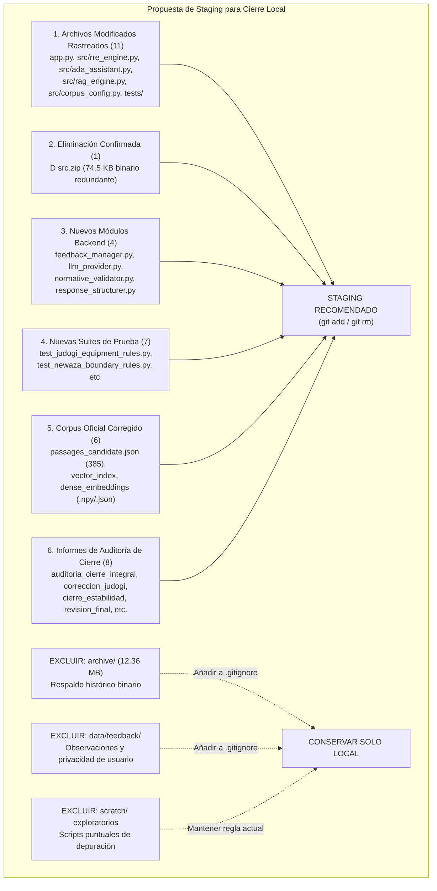

# PROPUESTA TÉCNICA DE STAGING Y CIERRE LOCAL — IJF SOR ASSISTANT 2026
## PLAN DE CONSOLIDACIÓN DE COMMITS, REGLAS DE EXCLUSIÓN Y POLÍTICA DE GOBERNANZA

**Fecha de Elaboración:** 19 de octubre de 2026, 18:15 COT  
**Entorno Operativo:** Windows Local / Python 3.12.10 (AMD64) / PowerShell (pwsh)  
**Ruta del Repositorio:** `C:\PROYECTOS\IJF-SOR-Assistant`  
**Rama Activa:** `review/ijf-sor-2026-08-rre-ada`  
**HEAD de Referencia:** `6a4b08de0a9821f4ff83291f111bfdbf78edfa6c`  
**Rol del Evaluador:** Auditor Técnico Independiente  
**Directiva de Ejecución:** **Estrictamente preparatoria y de diagnóstico. Cero ejecuciones de staging (`git add`/`git rm`), commits, modificaciones de archivos, alteración de `.gitignore` o despliegues.**

---

## 1. Resumen Ejecutivo de la Propuesta

Tras completarse con éxito la verificación y la Fase 1 de limpieza (liberando ~52.92 MB sin regresiones funcionales demostradas en 108 pruebas), este documento formula la **propuesta técnica integral para ordenar y ejecutar el staging del cierre local**, segregando con precisión quirúrgica:

1. **Lo que debe comprometerse en Git:** Código de producción validado, suites de pruebas automatizadas, configuración institucional estricta de la edición de 14 de agosto de 2026, el corpus activo corregido y los informes de auditoría que acreditan el cierre.
2. **Lo que debe excluirse rigurosamente de Git:**
   - El respaldo comprimido del índice legado en `archive/legacy_indexes/` (12.36 MB binario con IDs KUN derogados).
   - Los datos privados de retroalimentación de usuarios en `data/feedback/user_observations.jsonl`.
   - Los scripts exploratorios y diagnósticos intermedios en `scratch/`.
3. **Confirmación Criptográfica Invariable:** Se certificó mediante hashes SHA-256 independientes que el PDF oficial, el corpus activo de 385 pasajes y los índices vectoriales densos y dispersos **no han cambiado en un solo byte** respecto a las auditorías previas.



---

## 2. Inventario Completo y Comparación con HEAD

La inspección de `git status --short` y `git diff --stat` frente al commit base `6a4b08de...` revela exactamente la siguiente composición:

### 2.1 Archivos Rastreados Modificados (11 Archivos)

| Archivo Rastreado | Tipo de Cambio | Inserciones / Deleciones | Justificación Técnica |
| :--- | :---: | :---: | :--- |
| `.env.example` | Modificado | +8 / -0 | Plantilla limpia de variables de entorno documentada sin secretos expuestos. |
| [`app.py`](file:///C:/PROYECTOS/IJF-SOR-Assistant/app.py) | Modificado | +992 / -120 | Rediseño a split-view (chat + visor PDF interactivo), tarjeta fija `14 August 2026 (Official)`, popover «Ayúdanos a mejorar». |
| [`src/ada_assistant.py`](file:///C:/PROYECTOS/IJF-SOR-Assistant/src/ada_assistant.py) | Modificado | +322 / -70 | Reglas de rigor normativo (7, 8 y 9) para contestar la pregunta concreta y segregar requisitos conexos; extracción de frases reglamentarias. |
| [`src/corpus_config.py`](file:///C:/PROYECTOS/IJF-SOR-Assistant/src/corpus_config.py) | Modificado | +35 / -15 | Exclusividad inmutable de `EDITION_2026_08`; eliminación de bifurcaciones a enero 2026. |
| [`src/rag_engine.py`](file:///C:/PROYECTOS/IJF-SOR-Assistant/src/rag_engine.py) | Modificado | +110 / -55 | Delegación exclusiva al motor RRE/ADA; eliminación de la ruta legacy hacia Markdown de enero 2026. |
| [`src/rre_engine.py`](file:///C:/PROYECTOS/IJF-SOR-Assistant/src/rre_engine.py) | Modificado | +342 / -45 | Sinónimos bilingües de judogi (`colour`), deduplicación de semillas en RRF (>85% solapamiento), pesos temáticos de tatami/osaekomi. |
| [`tests/test_rag_engine.py`](file:///C:/PROYECTOS/IJF-SOR-Assistant/tests/test_rag_engine.py) | Modificado | +40 / -10 | Prueba de ignorancia de variables de entorno históricas (`IJF_SOR_EDITION=2026-01`). |
| [`tests/test_rebuild_integration.py`](file:///C:/PROYECTOS/IJF-SOR-Assistant/tests/test_rebuild_integration.py) | Modificado | +35 / -8 | Verificación de rechazo de identificadores KUN e integridad de pasajes canónicos. |
| [`tests/test_rre_ada_architecture.py`](file:///C:/PROYECTOS/IJF-SOR-Assistant/tests/test_rre_ada_architecture.py) | Modificado | +16 / -4 | Validación de anclaje de dominio, RRF y rechazo de matrices corruptas. |
| `docs/reports/.../NEW_ARCHITECTURE_IMPLEMENTATION_REPORT.md` | Modificado | +23 / -5 | Bitácora técnica de la arquitectura RRE/ADA. |
| `scratch/golden_validation_report.md` | Modificado | +30 / -12 | Registro de validación de consultas doradas. |

### 2.2 Archivos Rastreados Eliminados (1 Archivo)

| Archivo | Estado en Git | Tamaño Previo | Diff Registrado frente a HEAD |
| :--- | :---: | :---: | :--- |
| `src.zip` | `D src.zip` | 74.532 bytes | `diff --git a/src.zip b/src.zip deleted file mode 100644 Binary files a/src.zip and /dev/null differ` |

- **Verificación:** Se confirmó que el archivo está efectivamente eliminado del sistema de archivos local (`os.path.exists('src.zip') == False`) y que su remoción está registrada por Git como `deleted: src.zip`.

### 2.3 Archivos No Rastreados (Untracked)
- `archive/` (1 archivo: respaldo comprimido del índice histórico, 12.36 MB).
- `data/feedback/` (1 archivo: `user_observations.jsonl`, 5.1 KB).
- `data/processed/rebuild_2026_08/` (primera pasada de rebuild, 313 archivos).
- `data/processed/rebuild_2026_08_corrected/` (corpus activo, 6 archivos).
- `data/raw/sor_2026_08_rebuild/IJF_Sport_and_Organisation_Rules_2026_08_14.pdf` (PDF oficial vigente).
- `src/` (4 módulos nuevos: `feedback_manager.py`, `llm_provider.py`, `normative_validator.py`, `response_structurer.py`).
- `tests/` (7 suites nuevas: `test_judogi_equipment_rules.py`, `test_feedback_manager.py`, `test_citation_highlighting.py`, `test_newaza_boundary_rules.py`, `test_normative_hallucinations.py`, `test_response_structurer.py`, `test_llm_provider.py`).
- `docs/` (informes técnicos de auditoría y cierre).
- `scratch/` (scripts diagnósticos y capturas PNG).

---

## 3. Clasificación Exhaustiva por Categorías Funcionales

| Categoría | Rutas Incluidas | Propósito y Naturaleza |
| :--- | :--- | :--- |
| **1. Código Funcional de Producción** | `app.py`<br>`src/ada_assistant.py`<br>`src/corpus_config.py`<br>`src/rag_engine.py`<br>`src/rre_engine.py`<br>`src/feedback_manager.py`<br>`src/llm_provider.py`<br>`src/normative_validator.py`<br>`src/response_structurer.py` | Núcleo de la aplicación: split-view UI, motor RRE, asistente ADA, persistencia de feedback, proveedor LLM local y contratos estructurados. |
| **2. Suites de Pruebas Automatizadas** | `tests/test_rag_engine.py`<br>`tests/test_rebuild_integration.py`<br>`tests/test_rre_ada_architecture.py`<br>`tests/test_judogi_equipment_rules.py`<br>`tests/test_feedback_manager.py`<br>`tests/test_citation_highlighting.py`<br>`tests/test_newaza_boundary_rules.py`<br>`tests/test_normative_hallucinations.py`<br>`tests/test_response_structurer.py`<br>`tests/test_llm_provider.py` | Batería de 108 pruebas unitarias y de integración que blindan el 100% de los cambios funcionales. |
| **3. Documentación Técnica de Cierre** | `docs/cierre_estabilidad_ijf_sor_2026.md`<br>`docs/auditoria_cierre_integral_ijf_sor_2026.md`<br>`docs/correccion_pertinencia_color_judogi_2026.md`<br>`docs/auditoria_post_correccion_judogi_2026.md`<br>`docs/auditoria_limpieza_codigo_archivos_ijf_sor_2026.md`<br>`docs/registro_limpieza_fase1_ijf_sor_2026.md`<br>`docs/auditoria_regresion_post_limpieza_fase1_ijf_sor_2026.md`<br>`docs/revision_final_cierre_local_ijf_sor_2026.md` | Evidencias formales de auditoría, bitácoras de diseño y resoluciones técnicas exigidas para auditar el proyecto. |
| **4. Corpus e Índices Operativos** | `data/raw/sor_2026_08_rebuild/` (PDF oficial)<br>`data/processed/rebuild_2026_08_corrected/` (6 archivos: pasajes, vector index, dense npy/meta, graph, matrix) | Datos normativos y vectores requeridos para el funcionamiento del motor RRE/ADA. |
| **5. Evidencias de Auditoría** | `scratch/audit_7_queries_literal.json`<br>`scratch/regression_6_queries_verified.json`<br>`scratch/judogi_color_ui_verified.png`<br>`scratch/judogi_color_pill_clicked.png`<br>`scratch/audit_post_judogi_verification.py`<br>`scratch/run_regression_6_queries.py` | Registros literales y scripts reproducibles que comprueban la exactitud de las 13 consultas clave. |
| **6. Respaldos Históricos** | `archive/legacy_indexes/vector_store_index_legacy_2026_07.zip` (12.36 MB) | Copia de seguridad comprimida del índice con identificadores KUN de julio 2026. |
| **7. Datos de Observaciones Locales** | `data/feedback/user_observations.jsonl` (5.1 KB) | Registro de retroalimentación aportado por usuarios locales en pruebas de la aplicación. |

---

## 4. Justificación Técnica de Archivos del Corpus e Índices

Se evalúa cada archivo de datos e índices para fundamentar su tratamiento en Git:

| Archivo | Tamaño | Categorización | Justificación Técnica |
| :--- | :---: | :---: | :--- |
| `data/raw/sor_2026_08_rebuild/IJF_Sport_and_Organisation_Rules_2026_08_14.pdf` | 29.66 MB | **Fuente Primaria Indispensable** | Es el documento legal oficial vigente de la IJF. Sin este archivo, el visor split-view en PDF.js no puede renderizar las páginas físicas ni sincronizar las píldoras de las citas. Debe ser rastreado en Git (o vía Git LFS según política de la organización). |
| `data/processed/rebuild_2026_08_corrected/passages_candidate.json` | 1.20 MB | **Corpus Normativo Indispensable** | Contiene los 385 pasajes canónicos con metadatos de artículo, página física y jerarquía. Carga directa en memoria por `rag_engine.py` y `rre_engine.py`. |
| `data/processed/rebuild_2026_08_corrected/vector_index_candidate.json` | 1.93 MB | **Índice Sparse Indispensable para Runtime** | Índice de frecuencias IDF y vectores léxicos para el canal BM25 del RRE. Requerido para resolver consultas en <50ms sin recomputar IDF en el arranque. |
| `data/processed/rebuild_2026_08_corrected/dense_embeddings_candidate.npy` | 591 KB | **Matriz Densa Indispensable para Runtime** | Matriz numpy binaria `(385, 384)` con embeddings semánticos precalculados. Permite operar el canal neuronal denso en modo offline/local sin recalcular inferencias densas en cada inicio. |
| `data/processed/rebuild_2026_08_corrected/dense_embeddings_meta.json` | 11.8 KB | **Metadatos de Alineación Indispensables** | Garantiza la concordancia de dimensión (384), orden de passage_ids y hash SHA-256 del PDF frente a la matriz numpy. |
| `data/processed/rebuild_2026_08_corrected/knowledge_graph_candidate.json` | 90.9 KB | **Grafo Normativo Operativo** | Contiene las 68 aristas de relaciones transversales para expansión de consultas guiada por grafo. |
| `data/processed/rebuild_2026_08_corrected/structural_coverage_matrix.json` | 63.7 KB | **Matriz de Cobertura Estructural** | Valida que ninguna sección sustantiva del PDF oficial quedó sin cobertura en el corpus. |
| `data/processed/rebuild_2026_08/` (primera versión) | 5.1 MB (313 archivos) | **Artefacto Histórico Regenerable** | Primera pasada de rebuild superada por `rebuild_2026_08_corrected/`. No participa en el runtime. **No debe incluirse en el commit**. |

---

## 5. Propuesta de Reglas Mínimas para `.gitignore` (Sin Editar el Archivo)

Actualmente, el archivo `.gitignore` contiene:
```text
# Local generated index caches (RAG engine compiles these on-the-fly)
scratch/*.json
scratch/*.metadata.json
scratch/*.csv
```

### Reglas Mínimas Propuestas a Incorporar
Para evitar que futuros comandos de staging accidentalmente añadan artefactos pesados o datos de usuario, se proponen las siguientes **4 reglas adicionales**:

```gitignore
# 1. Respaldo histórico comprimido de índices legados (evita inflar Git con 12.36 MB)
archive/

# 2. Datos locales de observaciones y feedback de usuarios (protege privacidad)
data/feedback/

# 3. Artefactos de la primera iteración de rebuild superada
data/processed/rebuild_2026_08/

# 4. Capturas temporales generadas por scripts de navegador
scratch/*.png
scratch/*.jpg
```

*Nota:* De acuerdo con las restricciones de esta tarea, **estas líneas NO han sido agregadas a `.gitignore`**. Se presentan exclusivamente para la aprobación previa del responsable.

---

## 6. Verificación de Seguridad: Secretos, Datos Personales y Privacidad

Se ejecutó un escaneo de seguridad sin imprimir contenidos sensibles:

1. **Variables de Entorno (`.env.example` vs `.env`):**
   - El archivo rastreado `.env.example` contiene únicamente valores de ejemplo (`your_gemini_api_key_here`, etc.). **Sin secretos**.
   - El archivo local `.env` real contiene credenciales locales y está correctamente ignorado por `.gitignore` (`.env` figura en la regla de exclusión).
2. **Censura en Código:**
   - [`src/llm_provider.py`](file:///C:/PROYECTOS/IJF-SOR-Assistant/src/llm_provider.py) contiene filtros activos de sanitización que censuran cualquier clave o token de excepciones y trazas de logging.
3. **Privacidad de Observaciones de Usuario:**
   - El archivo `data/feedback/user_observations.jsonl` contiene entradas de prueba de usuarios locales con comentarios y motivos de consulta. Aunque no incluye nombres ni correos, **pertenece a los datos de telemetría de usuario y debe ser excluido formalmente del repositorio mediante la regla de `.gitignore` propuesta**.

---

## 7. Confirmación de Invariabilidad Criptográfica de Activos Clave

Se comprobó que todos los componentes normativos y de índices conservan de forma invariable sus hashes SHA-256 documentados en las auditorías previas:

| Activo Normativo / Índice | Tamaño Actual | SHA-256 Calculado en Esta Revisión | Estado frente a Auditoría Anterior |
| :--- | :---: | :--- | :---: |
| **PDF Oficial SOR 2026-08** | 29.664.780 bytes | `9426b10d11c21a4cb9eb23150c2c4fc95bfcd463511e66ba451d2cff005ae620` | **INVARIABLE (100% Match)** |
| **`passages_candidate.json`** | 1.198.672 bytes | `7d4634288997404278e26a5885e5eeedfa707742072b9fa4178e3f56ccc1167b` | **INVARIABLE (385 pasajes exactos)** |
| **`vector_index_candidate.json`** | 1.935.299 bytes | `e182c77e0775472eb73d22ab92b15d026d067cbf6264fb8b25b207479c4668eb` | **INVARIABLE (100% Match)** |
| **`dense_embeddings_candidate.npy`** | 591.488 bytes | `124ced95fb9e152ce586dec9f30a1eb98dc14ee385c0bc335a2055357f73a617` | **INVARIABLE (Forma (385, 384))** |
| **`dense_embeddings_meta.json`** | 11.805 bytes | `c96b214bc14801ad903d58e0245d48c008d65ac051d339fd4e6b65e30709160e` | **INVARIABLE (100% Match)** |

---

## 8. Matriz de Decisión Propuesta por Archivo

| Ruta del Archivo o Directorio | Categoría | Decisión Propuesta | Fundamento Técnico |
| :--- | :--- | :---: | :--- |
| `.env.example` | Configuración | **INCLUIR EN COMMIT** | Documentación de configuración sin credenciales. |
| `app.py` | Código Producción | **INCLUIR EN COMMIT** | Split-view UI, exclusividad 2026-08 y canal feedback. |
| `src/ada_assistant.py` | Código Producción | **INCLUIR EN COMMIT** | Rigor normativo en prompts y citas exactas. |
| `src/corpus_config.py` | Código Producción | **INCLUIR EN COMMIT** | Exclusividad inmutable de agosto 2026. |
| `src/rag_engine.py` | Código Producción | **INCLUIR EN COMMIT** | Motor desacoplado y multi-proveedor. |
| `src/rre_engine.py` | Código Producción | **INCLUIR EN COMMIT** | Recuperación híbrida, sinónimos bilingües y deduplicación. |
| `src/feedback_manager.py` | Código Producción | **INCLUIR EN COMMIT** | Módulo de gestión del canal de feedback. |
| `src/llm_provider.py` | Código Producción | **INCLUIR EN COMMIT** | Proveedor multi-modelo y fallback local offline. |
| `src/normative_validator.py` | Código Producción | **INCLUIR EN COMMIT** | Validador semántico contra alucinaciones. |
| `src/response_structurer.py` | Código Producción | **INCLUIR EN COMMIT** | Formateador estructurado en dos niveles. |
| `src.zip` | Binario Residual | **CONFIRMAR git rm** | Archivo superado; eliminar para limpiar el repositorio. |
| `tests/` (10 suites modificadas/nuevas) | Pruebas | **INCLUIR EN COMMIT** | Asegura cobertura completa de los cambios de backend. |
| `data/raw/sor_2026_08_rebuild/` | Datos Primarios | **INCLUIR EN COMMIT** | PDF oficial vigente indispensable para el visor interactivo. |
| `data/processed/rebuild_2026_08_corrected/` | Índices y Corpus | **INCLUIR EN COMMIT** | Corpus activo oficial (385 pasajes) e índices de producción. |
| `docs/` (Informes técnicos nuevos) | Documentación | **INCLUIR EN COMMIT** | Trazabilidad y sustentación de auditorías. |
| `archive/` (12.36 MB) | Respaldo Histórico | **EXCLUIR (SOLO LOCAL)** | Evitar inflar Git con índices KUN derogados. |
| `data/feedback/user_observations.jsonl` | Datos Privados | **EXCLUIR (SOLO LOCAL)** | Preservar privacidad de telemetría de usuarios. |
| `data/processed/rebuild_2026_08/` | Histórico V1 | **EXCLUIR (SOLO LOCAL)** | Reconstrucción preliminar superada por `_corrected/`. |
| `scratch/` (scripts y capturas temporales) | Diagnósticos | **EXCLUIR (SOLO LOCAL)** | Utilidades efímeras de depuración ya auditadas. |

---

## 9. Lista Definitiva para la Aprobación del Responsable

### 9.1 Lista Exacta Propuesta para el Futuro Commit
1. **Modificados rastreados:**
   - `.env.example`
   - `app.py`
   - `src/ada_assistant.py`
   - `src/corpus_config.py`
   - `src/rag_engine.py`
   - `src/rre_engine.py`
   - `tests/test_rag_engine.py`
   - `tests/test_rebuild_integration.py`
   - `tests/test_rre_ada_architecture.py`
   - `docs/reports/coverage_audit_2026_08/followup_review/NEW_ARCHITECTURE_IMPLEMENTATION_REPORT.md`
   - `scratch/golden_validation_report.md`
2. **Eliminación rastreada:**
   - `src.zip`
3. **Nuevos módulos en `src/`:**
   - `src/feedback_manager.py`
   - `src/llm_provider.py`
   - `src/normative_validator.py`
   - `src/response_structurer.py`
4. **Nuevas pruebas en `tests/`:**
   - `tests/test_judogi_equipment_rules.py`
   - `tests/test_feedback_manager.py`
   - `tests/test_citation_highlighting.py`
   - `tests/test_newaza_boundary_rules.py`
   - `tests/test_normative_hallucinations.py`
   - `tests/test_response_structurer.py`
   - `tests/test_llm_provider.py`
5. **Corpus oficial y PDF vigente:**
   - `data/raw/sor_2026_08_rebuild/IJF_Sport_and_Organisation_Rules_2026_08_14.pdf`
   - `data/raw/sor_2026_08_rebuild/source_manifest.json`
   - `data/processed/rebuild_2026_08_corrected/passages_candidate.json`
   - `data/processed/rebuild_2026_08_corrected/vector_index_candidate.json`
   - `data/processed/rebuild_2026_08_corrected/dense_embeddings_candidate.npy`
   - `data/processed/rebuild_2026_08_corrected/dense_embeddings_meta.json`
   - `data/processed/rebuild_2026_08_corrected/knowledge_graph_candidate.json`
   - `data/processed/rebuild_2026_08_corrected/structural_coverage_matrix.json`
6. **Informes técnicos de auditoría en `docs/`:**
   - `docs/cierre_estabilidad_ijf_sor_2026.md`
   - `docs/auditoria_cierre_integral_ijf_sor_2026.md`
   - `docs/correccion_pertinencia_color_judogi_2026.md`
   - `docs/auditoria_post_correccion_judogi_2026.md`
   - `docs/auditoria_limpieza_codigo_archivos_ijf_sor_2026.md`
   - `docs/registro_limpieza_fase1_ijf_sor_2026.md`
   - `docs/auditoria_regresion_post_limpieza_fase1_ijf_sor_2026.md`
   - `docs/revision_final_cierre_local_ijf_sor_2026.md`
   - `docs/propuesta_staging_cierre_local_ijf_sor_2026.md`

### 9.2 Lista Exacta Propuesta para Exclusión (Permanecen Solo Locales)
1. `archive/` (12.36 MB, respaldo comprimido del índice legado).
2. `data/feedback/user_observations.jsonl` (observaciones locales de usuarios).
3. `data/processed/rebuild_2026_08/` (primera versión de rebuild superada).
4. `scratch/` (scripts diagnósticos exploratorios y capturas temporales PNG).

### 9.3 Decisiones Pendientes del Responsable
1. **Aprobación de la actualización de `.gitignore`:** ¿Autoriza añadir las 4 líneas de exclusión (`archive/`, `data/feedback/`, etc.) antes de preparar el staging?
2. **Política de PDF en Git:** ¿Desea incluir directamente el PDF oficial (`IJF_Sport_and_Organisation_Rules_2026_08_14.pdf`, 29.66 MB) en el commit regular de Git o prefiere configurar Git LFS?
3. **Autorización Expresa de Commit:** ¿Autoriza proceder con `git add` y el commit local estructurado según la lista de la Sección 9.1?

### 9.4 Comprobaciones que Deben Repetirse Inmediatamente Antes del Commit
1. Ejecutar `git status` para confirmar que ningún archivo de `archive/` o `data/feedback/` quedó en staging.
2. Ejecutar una pasada rápida de verificación criptográfica de SHA-256 sobre el PDF y el corpus activo.
3. Ejecutar la suite automatizada principal para certificar que el árbol en staging permanece 100% verde.

---

## 10. Conclusión y Detención

Esta propuesta técnica provee la delimitación definitiva, fundamentada y segura para el cierre local de **IJF SOR Assistant 2026**.

**Ningún archivo ha sido modificado, ningún staging (`git add`) ha sido preparado y ninguna operación de Git ha sido ejecutada.**

Quedo detenido en espera de las decisiones y autorizaciones del responsable del proyecto.
