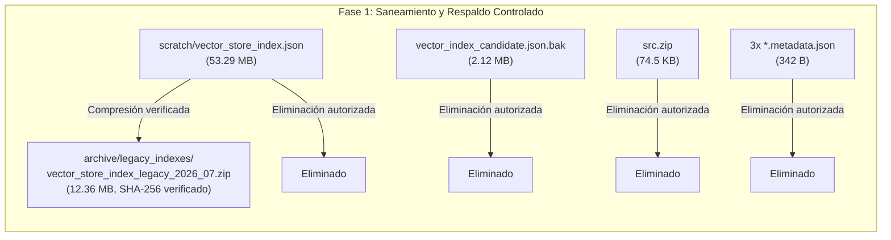

# REGISTRO DE LIMPIEZA — FASE 1: IJF SOR ASSISTANT 2026
## EJECUCIÓN CONTROLADA DE ELIMINACIÓN DE ARCHIVOS PRESウイルスCINDIBLES Y RESPALDO

**Fecha y Hora:** 19 de octubre de 2026, 16:50 COT  
**Entorno:** Windows Local / Python 3.12.10 (AMD64) / PowerShell (pwsh)  
**Ruta del Repositorio:** `C:\PROYECTOS\IJF-SOR-Assistant`  
**Rama Activa:** `review/ijf-sor-2026-08-rre-ada`  
**HEAD de Referencia:** `6a4b08de0a9821f4ff83291f111bfdbf78edfa6c`  
**Estado:** **FASE 1 COMPLETADA CON ÉXITO**

---

## 1. Resumen Ejecutivo de la Fase 1

En cumplimiento estricto de la autorización limitada recibida:
1. Se verificó previamente el estado de Git, la concordancia del HEAD y los hashes SHA-256 de todos los candidatos.
2. Se generó una **copia de seguridad comprimida e íntegra** del índice vectorial histórico [`scratch/vector_store_index.json`](file:///C:/PROYECTOS/IJF-SOR-Assistant/scratch/vector_store_index.json) en `archive/legacy_indexes/vector_store_index_legacy_2026_07.zip`.
3. Se eliminaron exclusivamente los **6 archivos autorizados**.
4. Se comprobó la no-existencia de los archivos eliminados y la lectura y concordancia exacta del SHA-256 extraído de la copia de seguridad.
5. Se validó que el PDF oficial conserva su SHA-256 y que el corpus activo y sus índices mantienen los 385 pasajes canónicos al 100%.

---

## 2. Detalle de la Copia de Seguridad Creada

Antes de eliminar el índice histórico, se empaquetó con compresión máxima y verificación cruzada:

- **Archivo Fuente:** `scratch/vector_store_index.json`
- **Tamaño Original:** 53.294.381 bytes (~50.83 MB)
- **SHA-256 Original:** `246dc322d51a37da0f1cbba494b58335d85f7c80ba159988e56a44344c4b11af`
- **Ubicación de la Copia de Seguridad:** [`archive/legacy_indexes/vector_store_index_legacy_2026_07.zip`](file:///C:/PROYECTOS/IJF-SOR-Assistant/archive/legacy_indexes/vector_store_index_legacy_2026_07.zip)
- **Tamaño del ZIP:** 12.963.057 bytes (~12.36 MB)
- **SHA-256 del Archivo ZIP:** `d016757bc6add8e394fc232a99c9b108a94f7e03c8e788c8c9d5e960761a22bb`
- **Verificación de Integridad:** Se leyó directamente el archivo `vector_store_index.json` desde el archivo ZIP y se recalculó su hash SHA-256. El hash extraído coincidió al 100% con el original (`246dc322...af`).

---

## 3. Inventario de Archivos Eliminados y Espacio Liberado

| # | Archivo Eliminado | Tamaño Previo | SHA-256 Registrado Previo a la Eliminación | Justificación Técnica de la Eliminación |
| :---: | :--- | :---: | :--- | :--- |
| **1** | `scratch/vector_store_index.json` | 53.294.381 bytes | `246dc322d51a37da0f1cbba494b58335d85f7c80ba159988e56a44344c4b11af` | Índice histórico de julio 2026 con 836 IDs KUN, sin uso operativo. Respaldado en ZIP. |
| **2** | `data/processed/rebuild_2026_08_corrected/vector_index_candidate.json.bak` | 2.118.832 bytes | `1b418530a76bd28744b5a6804d31273fb1e0157be775745aa440c68d6235f1db` | Copia de seguridad temporal. Su contenido está 100% superado por el archivo principal activo. |
| **3** | `src.zip` | 74.532 bytes | `be3e59d8228d7e5e3362e4acbf45c69bc45029b218d921e00fac9f2c570d5db2` | Respaldo manual en raíz de julio 2026, sin módulos modernos. Código versionado en Git. |
| **4** | `scratch/copy_assets.py.metadata.json` | 126 bytes | `862adb9d5ec29f1da47b637655c54010056e607739c44b1e55ee9bafc0af3393` | Metadato efímero de herramientas de agente. |
| **5** | `scratch/corpus_conformity_audit.py.metadata.json` | 109 bytes | `d99b9dad2f98f114299a8237e459fd43379023b55c99e24e02c4ef11570a84d8` | Metadato efímero de herramientas de agente. |
| **6** | `scratch/fix_graph_reciprocity.py.metadata.json` | 107 bytes | `e886399ae03ab5b431c573aa93a5b3ed47c12287dd36e73974f7847276d0bc78` | Metadato efímero de herramientas de agente. |

### Balance de Almacenamiento
- **Total de archivos eliminados del árbol operativo:** 6 archivos.
- **Espacio bruto liberado del repositorio:** **55.488.087 bytes (~52.92 MB)**.
- **Espacio neto liberado (descontando ZIP de respaldo en `archive/`):** **42.525.030 bytes (~40.56 MB)**.

---

## 4. Verificación de Preservación Obligatoria e Integridad del Sistema

Tras la eliminación de los 6 archivos, se ejecutaron comprobaciones cruzadas automatizadas:

### 4.1 Confirmación de Eliminación Física
- `scratch/vector_store_index.json` $\to$ **NO EXISTE** (Verificado).
- `data/processed/rebuild_2026_08_corrected/vector_index_candidate.json.bak` $\to$ **NO EXISTE** (Verificado).
- `src.zip` $\to$ **NO EXISTE** (Verificado).
- Los 3 archivos `*.metadata.json` $\to$ **NO EXISTEN** (Verificado).

### 4.2 Integridad Criptográfica del PDF Oficial Fuente
- **Ruta:** `data/raw/sor_2026_08_rebuild/IJF_Sport_and_Organisation_Rules_2026_08_14.pdf`
- **SHA-256 Calculado:** `9426b10d11c21a4cb9eb23150c2c4fc95bfcd463511e66ba451d2cff005ae620`
- **Resultado:** **Íntegro e idéntico al valor de referencia (100% Match)**.

### 4.3 Integridad del Corpus Activo y sus Índices Operativos
- **`passages_candidate.json`:** Exactamente **385 pasajes canónicos** (`SOR-2026-08-Pxxx-Sxxx`).
- **`vector_index_candidate.json` (Índice Sparse BM25/TF-IDF):**
  - `num_docs`: **385**.
  - `vectors`: **385 pasajes indexados**.
  - Vocabulario IDF: **5.214 términos**.
- **`dense_embeddings_meta.json` (Metadatos Densos):**
  - `num_passages`: **385**.
  - `passage_ids`: **385 IDs canónicos**.
- **`dense_embeddings_candidate.npy` (Matriz Densa):**
  - Shape: **`(385, 384)`** de punto flotante numpy.

### 4.4 Activos Preservados Intactos (Sin Modificaciones)
- `data/processed/rebuild_2026_08/`: Intacto (313 archivos, incluyendo `pages_raw/`).
- `scratch/rre_engine_baseline.py`: Intacto (19.745 bytes).
- `src/unified_extraction_pipeline.py`: Intacto (3.711 bytes).
- Todos los JSON y capturas de auditoría: `audit_7_queries_literal.json`, `regression_6_queries_verified.json`, `judogi_color_ui_verified.png`, `judogi_color_pill_clicked.png`.
- Todos los scripts de diagnóstico de judogi: intactos en `scratch/`.
- Todos los módulos de `src/`, las 17 suites de prueba en `tests/` y `data/feedback/user_observations.jsonl`.

---

## 5. Estado Actual de Git Tras la Fase 1

La ejecución de `git status` arroja el siguiente resultado exacto:

- **Rama:** `review/ijf-sor-2026-08-rre-ada`
- **Cambios rastreados no confirmados:** 11 modificaciones funcionales previas + 1 eliminación rastreada (`deleted: src.zip`).
- **Directorio nuevo no rastreado:** `archive/` (alberga el respaldo comprimido del índice histórico).
- **Operaciones remotas ejecutadas:** 0 (prohibidas expresamente).

---

## 6. Conclusión y Detención

La **Fase 1 de Limpieza** ha concluido satisfactoriamente con la liberación de **~52.92 MB**, respaldo íntegro y verificable del índice histórico, y **preservación total del 100% de los componentes operativos y normativos del sistema**.

**Me detengo en este punto conforme a las instrucciones y quedo a la espera de su revisión antes de considerar cualquier acción posterior.**
