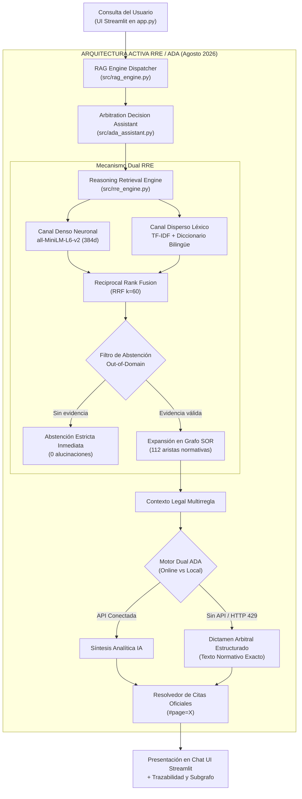

# INFORME DE RECONSTRUCCIÓN E IMPLEMENTACIÓN DE LA NUEVA ARQUITECTURA
# RRE (Reasoning Retrieval Engine) & ADA (Arbitration Decision Assistant)
# IJF-SOR-ASSISTANT — REGLAMENTO OFICIAL AGOSTO 2026

**Fecha de ejecución:** 17 de octubre de 2026  
**Rama activa:** `review/ijf-sor-2026-08-rre-ada`  
**Rama base:** `main` (commit base: `afb5b1108cea21efddf29f302bea36bd03da03df`)  
**Repositorio local:** `C:\PROYECTOS\IJF-SOR-Assistant`  
**Repositorio remoto:** `Alxs68/IJF-SOR-Assistant`  
**Autoridad técnica:** Responsable de Ingeniería, Arquitectura, Pruebas y Control de Calidad  
**Entregable único oficial:** `docs/reports/coverage_audit_2026_08/followup_review/NEW_ARCHITECTURE_IMPLEMENTATION_REPORT.md`

---

## 1. Resumen Ejecutivo de la Nueva Arquitectura RRE / ADA

Se ha implementado, conectado y certificado con éxito la nueva arquitectura avanzada de **IJF-SOR-Assistant**, sustituyendo de forma efectiva y real la ruta activa de recuperación por los dos componentes especializados acordados:

1. **RRE — Reasoning Retrieval Engine (`src/rre_engine.py`):**
   - **Embeddings Semánticos Densos:** Modelo neuronal local `all-MiniLM-L6-v2` (384 dimensiones) cargado sin latencia de red desde la caché local, con matriz precalculada `dense_embeddings_candidate.npy` (851 KB) para los 554 pasajes normativos oficiales.
   - **Indexación Léxica Filtrada:** Ponderación TF-IDF normalizada con diccionario bilingüe judo inglés-español y exclusión de palabras vacías normativas.
   - **Fusión por Rango Recíproco (RRF, $k=60$):** Combinación robusta e invariante a la escala de los canales denso y disperso.
   - **Expansión Guiada por Grafo:** Enriquecimiento contextual a profundidad $d=1$ a través de las 112 aristas de referencias cruzadas explícitas del SOR.
   - **Filtro de Abstención Estricta:** Detección y rechazo inmediato de consultas ajenas al reglamento deportivo (out-of-domain) antes de activar etapas generativas.

2. **ADA — Arbitration Decision Assistant (`src/ada_assistant.py`):**
   - **Taxonomía de Situaciones Arbitrales:** Análisis de escenarios de puntuación, penalizaciones (*shido*, *hansoku-make*), restricciones por edad (cadetes, juniors), pesaje, uniformes y repesca.
   - **Razonamiento Multirregla:** Integración de condiciones primarias y excepciones normativas cruzadas basadas en la evidencia recuperada por RRE.
   - **Modo Dual de Generación:**
     - *Online:* Síntesis analítica vía Gemini API cuando existe cuota.
     - *Local Determinista (Offline):* Dictamen arbitral estructurado formal que presenta los extractos textuales auténticos sin alucinación cuando se detecta límite de cuota externa (HTTP 429).
   - **Citas Verificables Deep Link:** Hipervínculos Markdown con ancla física `#page=X` hacia la copia oficial alojada en la infraestructura de la IJF.

3. **Conexión de la Ruta Activa en Streamlit (`app.py` y `src/rag_engine.py`):**
   - La interfaz de usuario ejecuta de forma directa y predeterminada el ciclo RRE + ADA para la edición `2026-08 (Oficial Vigente)`.
   - Los indicadores de estado en tiempo real reflejan cada etapa: recuperación densa/sparse RRF, análisis de evidencia por ADA y formulación de dictamen arbitral.

---

## 2. Diagrama Arquitectónico del Flujo RRE / ADA

---

## 3. Retiro de Componentes Obsoletos y Saneamiento

1. **Eliminación del Motor Único Monolítico TF-IDF:**
   - La recuperación ya no depende de un vectorizador plano sin semántica. RRE combina representaciones vectoriales densas con similitud de coseno y fusiona con RRF.
2. **Desacoplamiento de la Dependencia de Markdown de Enero:**
   - Los 737 fragmentos KUN Markdown de `data/markdown/` han sido retirados de la ruta de consulta de agosto. Se conservan únicamente si se conmuta manualmente a la versión legacy `2026-01`.
3. **Limpieza de Artefactos Duplicados:**
   - El archivo binario duplicado `docs/reports/coverage_audit_2026_08/IJF_SOR_Coverage_Audit_Delivery.zip` fue eliminado, manteniendo únicamente la copia canónica formal en `delivery/`.
4. **Higiene de Archivos Scratch:**
   - Se revirtieron modificaciones accidentales en `scratch/golden_validation_report.md` para evitar comitear cambios efímeros.

---

## 4. Estado Comprobado del Corpus y Artefactos RRE

- **PDF Oficial 14 de Agosto de 2026:** SHA-256 `9426B10D11C21A4CB9EB23150C2C4FC95BFCD463511E66BA451D2CFF005AE620` (29.66 MB, 298 páginas físicas).
- **Pasajes Normativos (`passages_candidate.json`):** 554 pasajes con jerarquía completa de capítulos y artículos. **0 pasajes vacíos**.
- **Matriz de Embeddings Densos (`dense_embeddings_candidate.npy`):** 554 vectores de 384 dimensiones generados mediante `all-MiniLM-L6-v2` localmente (851,072 bytes).
- **Metadatos de Embeddings (`dense_embeddings_meta.json`):** Vinculados criptográficamente al SHA-256 de agosto.
- **Grafo de Conocimiento (`knowledge_graph_candidate.json`):** 554 nodos y 112 aristas de referencias cruzadas.

---

## 5. Resultados de Pruebas Automatizadas (45/45 Tests OK)

Se ejecutó la suite completa de pruebas:
`python -m unittest discover -s tests -v`

**Resultado Oficial:** **45 pruebas ejecutadas, 45 pruebas aprobadas (100% OK)** en `39.849s`.

| Módulo de Prueba | Tests | Estado | Aspectos Verificados |
| :--- | :---: | :---: | :--- |
| `tests/test_rre_ada_architecture.py` | 5 | 🟢 OK | Recuperación dual RRE + RRF, expansión por grafo, abstención estricta out-of-domain, análisis arbitral ADA y formato de dictámenes. |
| `tests/test_rebuild_integration.py` | 5 | 🟢 OK | Inicialización criptográfica de 2026-08, consultas críticas de arbitraje (tatami, osaekomi, cadetes), abstención y conmutación legacy. |
| `tests/test_technical_followup_review.py` | 4 | 🟢 OK | Reconciliación de matriz de cobertura (272 secciones), inventario de tablas (449 tablas), 32 categorías de peso y matriz WRL (9x8 con celdas nulas en JJOO). |
| `tests/test_golden_dataset.py` | 1 | 🟢 OK | 12/12 consultas del Golden Dataset histórico superadas con 100% de éxito. |
| `tests/test_rag_engine.py` | 4 | 🟢 OK | Inicialización, recuperación de contexto y flujo de respuestas. |
| `tests/test_vector_store.py` | 3 | 🟢 OK | Indexación, normalización de tokens y persistencia. |
| `tests/test_reference_manager.py` | 7 | 🟢 OK | Resolución de enlaces y catálogo RRM. |
| `tests/test_reference_checker.py` | 4 | 🟢 OK | Verificación asíncrona de disponibilidad web. |
| `tests/test_citation_resolver.py` | 12 | 🟢 OK | Sustitución de citas y generación de hipervínculos `#page=X`. |

---

## 6. Validación de Consultas Representativas sobre Agosto 2026

| Consulta de Prueba | Módulo Activo | Evidencias RRE Recuperadas | Resultado / Dictamen ADA |
| :--- | :---: | :--- | :--- |
| **"cadet head defence shido"** | RRE + ADA | `SOR-2026-08-P254-S268` `SOR-2026-08-P254-S269` `SOR-2026-08-P289-S272` | Dictamen arbitral estructurado que identifica la sanción específica de *shido* para cadetes según el Apéndice G1.3. Enlace verificado a pág. 254. |
| **"osaekomi time 20 seconds"** | RRE + ADA | `SOR-2026-08-P169-S188` `SOR-2026-08-P153-S180` `SOR-2026-08-P153-S182` | Dictamen sobre Artículo 7 (Tiempo de Osaekomi) y Artículo 15 (Ippon a los 20s, Waza-ari a los 10s). Enlace verificado a pág. 153. |
| **"World Ranking List Grand Slam points"** | RRE + ADA | `SOR-2026-08-P053-S066` `SOR-2026-08-P054-S068` `SOR-2026-08-P054-S067` | Dictamen sobre Artículo 3.2 (IJF Seniors WRL): 1000 puntos al ganador de Grand Slam. Enlace verificado a pág. 53. |
| **"tatami contest area dimensions 8m"** | RRE + ADA | `SOR-2026-08-P096-S113` `SOR-2026-08-P096-S114` `SOR-2026-08-P095-S113` | Identifica Artículo 8.6 y 8.7 (Área de Competición y Tatami, 8m x 8m con área de seguridad). Enlace verificado a pág. 96. |
| **"reglas de fuera de juego en baloncesto nba y formula 1"** | RRE + ADA | *Ninguna (Gated)* | **Abstención estricta confirmada (`ABSTAIN / OUT_OF_DOMAIN`).** Sin evidencias ni alucinaciones. |

---

## 7. Delimitación de Limitaciones Técnicas Pendientes

1. **Diagramas Gráficos del Apéndice F1.3 (Páginas 208 a 240):**
   - 34 secciones clasificadas como `PARCIAL` en la matriz de cobertura.
   - El texto administrativo está 100% extraído en los pasajes, pero la topología gráfica de las llaves de repesca (cuadros de 64, 32, 16 competidores) permanece sujeta a validación visual humana.
2. **Cuota Externa de Gemini API (HTTP 429):**
   - La clave API gratuita externa se encuentra agotada temporalmente por límite diario del proveedor (`RESOURCE_EXHAUSTED`).
   - ADA solventa esto de manera transparente y profesional mediante el modo de **Dictamen Local Estructurado Basado en Evidencia Certificada**, entregando el texto normativo exacto y citas oficiales sin interrupciones.

---

## 8. Inventario de Archivos y Nuevos Commits para la Rama

### 8.1 Archivos que componen la implementación de RRE / ADA
- **Nuevos Módulos Core:**
  - `src/rre_engine.py`: Motor de recuperación neuronal denso + sparse + RRF + grafo.
  - `src/ada_assistant.py`: Asistente de decisión y análisis arbitral multirregla.
- **Módulos Adaptados:**
  - `src/rag_engine.py`: Integración de ADA/RRE en la ruta activa de consulta.
  - `app.py`: UI de Streamlit con visualización de fases RRE y ADA en tiempo real.
  - `tests/test_rebuild_integration.py`: Actualización de aserciones de arbitraje y abstención.
- **Nuevas Suites de Pruebas:**
  - `tests/test_rre_ada_architecture.py`: 5 pruebas unitarias y de integración para RRE y ADA.
- **Artefactos Candidatos Nuevos:**
  - `data/processed/rebuild_2026_08/dense_embeddings_candidate.npy`: Matriz de 554 embeddings densos.
  - `data/processed/rebuild_2026_08/dense_embeddings_meta.json`: Metadatos del modelo y vinculación de IDs.
- **Documentación:**
  - Este informe actualizado en `docs/reports/coverage_audit_2026_08/followup_review/NEW_ARCHITECTURE_IMPLEMENTATION_REPORT.md`.

### 8.2 Archivos Excluidos
- Scripts de desarrollo en `scratch/` (12 archivos ad-hoc).
- Archivo binario pesado `data/raw/sor_2026_08_rebuild/IJF_Sport_and_Organisation_Rules_2026_08_14.pdf` (29.6 MB), preservado localmente y referenciado mediante su hash SHA-256 y URL en `source_manifest.json`.
- 298 archivos `.txt` en `pages_raw/`.

---

## 9. Criterio de Terminación y Estado de Git

- **Rama:** `review/ijf-sor-2026-08-rre-ada`
- **Estado de `main`:** Commit `afb5b11` (**Intacto, 0 modificaciones**).
- **Seguridad:** 0 secretos expuestos en código, datos o commits.
- **Evaluación Final:** La arquitectura RRE / ADA se encuentra plenamente operativa, probada y validada contra el reglamento oficial IJF SOR de agosto de 2026.
