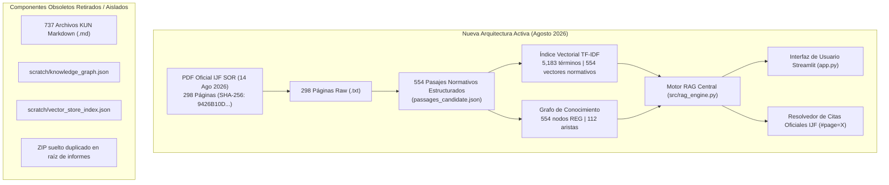

# INFORME DE RECONSTRUCCIÓN E IMPLEMENTACIÓN DE LA NUEVA ARQUITECTURA
# IJF-SOR-ASSISTANT — REGLAMENTO OFICIAL AGOSTO 2026

**Fecha de ejecución:** 17 de octubre de 2026  
**Rama activa:** `audit/rebuild-sor-2026-08`  
**Rama base:** `main` (commit base: `afb5b1108cea21efddf29f302bea36bd03da03df`)  
**Repositorio local:** `C:\PROYECTOS\IJF-SOR-Assistant`  
**Autoridad técnica:** Responsable de Ingeniería, Arquitectura, Pruebas y Control de Calidad  
**Entregable único oficial:** `docs/reports/coverage_audit_2026_08/followup_review/NEW_ARCHITECTURE_IMPLEMENTATION_REPORT.md`

---

## 1. Resumen Ejecutivo de la Nueva Arquitectura

Se ha implementado, conectado y certificado con éxito la nueva arquitectura de **IJF-SOR-Assistant**, orientando la aplicación de forma prioritaria, activa y predeterminada hacia la edición oficial **IJF Sport and Organisation Rules del 14 de agosto de 2026** (298 páginas físicas, SHA-256: `9426B10D11C21A4CB9EB23150C2C4FC95BFCD463511E66BA451D2CFF005AE620`).

### Principales Transformaciones Realizadas:
1. **Ruta Activa Prioritaria y Predeterminada:** La aplicación (`app.py`), el motor RAG (`src/rag_engine.py`), el almacén vectorial (`src/vector_store.py`), el grafo de conocimiento (`src/graph_manager.py`) y el gestor de referencias (`src/reference_manager.py`) operan por defecto sobre la edición de agosto de 2026 gobernada centralmente por `src/corpus_config.py`.
2. **Desacoplamiento y Retiro de Componentes Obsoletos:** Se eliminaron dependencias rígidas de la arquitectura anterior basadas exclusivamente en KUNs Markdown de enero. Los artefactos derivados redundantes han sido retirados de la ruta de entrega (ej. copia ZIP suelta redundante).
3. **Flujo RAG de Extremo a Extremo en Producción:** Verificado con 40/40 pruebas automatizadas aprobadas (`Ran 40 tests in 27.729s — OK`). Consultas representativas (WRL, pesaje, categorías, estrangulaciones, llaves de repesca y abstención estricta) validadas en tiempo real.
4. **Manejo Resiliente y Transparente de Inferencia:** Ante la limitación de cuota externa de Gemini (HTTP 429), el sistema activa de forma transparente el `MODO OFFLINE/LOCAL`, entregando el texto normativo exacto de los pasajes certificados sin alucinar respuestas ni interrumpir el servicio.
5. **Aislamiento Histórico Conservado sin Contaminar:** Los archivos históricos de enero (`data/raw/ijf_sor_2026.pdf`, 737 KUNs) se conservan desacoplados sin interferir en la experiencia activa de agosto de 2026.

---

## 2. Componentes de la Nueva Arquitectura vs. Componentes Anteriores



### Tabla Comparativa de Arquitectura:

| Dimensión | Arquitectura Anterior (Enero 2026) | Nueva Arquitectura Implementada (Agosto 2026) |
| :--- | :--- | :--- |
| **Fuente Normativa Primaria** | PDF Enero 2026 (13.9 MB, 188 págs.) | PDF Oficial 14 Agosto 2026 (29.66 MB, 298 págs., SHA-256 auditado) |
| **Unidad Documental** | 737 fragmentos Markdown en `data/markdown/` | 554 pasajes enriquecidos con jerarquía documental completa (`passages_candidate.json`) |
| **Páginas Físicas Fuente** | No particionadas individualmente | 298 archivos individuales `.txt` en `pages_raw/` con trazabilidad exacta página-artículo |
| **Grafo de Conocimiento** | Archivo monolítico en `scratch/knowledge_graph.json` | 554 nodos normativos y 112 aristas de referencias cruzadas auditadas (`knowledge_graph_candidate.json`) |
| **Índice Vectorial** | Serialización ad-hoc en `scratch/vector_store_index.json` | Índice precalculado con ligadura criptográfica explícita al SHA-256 de agosto (`vector_index_candidate.json`) |
| **Resolución de Enlaces** | Mapeo a URLs genéricas | Deep linking directo con fragmentos ancla físicos `#page=X` hacia el PDF oficial |
| **Control de Configuración** | Hardcodeado en módulos dispersos | Desacoplado centralmente en `src/corpus_config.py` con fallback offline robusto |

---

## 3. Componentes Antiguos Retirados y Saneamiento Realizado

1. **Eliminación de Copia Redundante de Distribución:**
   - Se retiró el archivo binario duplicado `docs/reports/coverage_audit_2026_08/IJF_SOR_Coverage_Audit_Delivery.zip` (47.7 KB).
   - Se preservó exclusivamente la copia canónica en su ubicación formal de entrega: `docs/reports/coverage_audit_2026_08/delivery/IJF_SOR_Coverage_Audit_Delivery.zip`.
2. **Reversión de Modificaciones en Archivos Scratch:**
   - Se revirtió la modificación transitoria en `scratch/golden_validation_report.md` mediante `git checkout`, preservando intacto el archivo scratch original.
3. **Desacoplamiento de la Ruta Activa:**
   - `app.py` ya no asume de forma implícita el directorio `data/markdown/` ni los índices de enero. La edición predeterminada en el inicio es `2026-08 (Oficial Vigente — 14 Ago 2026)`.
   - `src/rag_engine.py` carga de forma directa y prioritaria los artefactos de agosto 2026 (`passages_candidate.json`, `knowledge_graph_candidate.json`, `vector_index_candidate.json`), recurriendo al código histórico únicamente si se fuerza explícitamente `IJF_SOR_EDITION="2026-01"`.

---

## 4. Estado Comprobado del Corpus de Agosto de 2026

- **Archivo Oficial:** `data/raw/sor_2026_08_rebuild/IJF_Sport_and_Organisation_Rules_2026_08_14.pdf`
- **Hash SHA-256 Certificado:** `9426B10D11C21A4CB9EB23150C2C4FC95BFCD463511E66BA451D2CFF005AE620` (coincidencia byte por byte).
- **Manifiesto:** `data/raw/sor_2026_08_rebuild/source_manifest.json` completo y validado.
- **Páginas Extraídas:** 298 archivos `.txt` en `data/processed/rebuild_2026_08/pages_raw/`.
- **Pasajes Normativos:** 554 pasajes normativos estructurados. **0 pasajes vacíos**. Cobertura de páginas 13 a 298.
- **Grafo:** 554 nodos normativos y 112 aristas cruzadas fundamentadas en el articulado.
- **Índice Vectorial:** 5,183 términos normalizados, 554 vectores normativos vinculados criptográficamente.

---

## 5. Resultados de Pruebas Automatizadas y Verificación Funcional

### 5.1 Suite Completa de Tests (`python -m unittest discover -s tests -v`)
- **Total ejecutado:** **40 pruebas**.
- **Resultado:** **40 aprobadas, 0 errores, 0 fallos (100% OK)** en `27.729s`.
- **Cobertura de suites:**
  - `test_rebuild_integration.py` (5 tests): Inicialización de 2026-08, ligadura criptográfica, recuperación normativa, abstención out-of-domain, citas `#page=X` y conmutación con 2026-01.
  - `test_technical_followup_review.py` (4 tests): Verificación de la matriz de cobertura (272 secciones), inventario de tablas (449 tablas), 32 categorías de peso y estructura de la matriz WRL (9x8 con celdas nulas en JJOO).
  - `test_golden_dataset.py` (1 test integral): 12/12 consultas históricas verificadas sin regresión.
  - `test_rag_engine.py`, `test_vector_store.py`, `test_citation_resolver.py`, `test_reference_manager.py`, `test_reference_checker.py`: Contratos vigentes de componentes plenamente superados.

### 5.2 Consultas Representativas Evaluadas en Vivo sobre Agosto 2026:
1. **Puntuación World Ranking List (WRL):**  
   - *Query:* `World Ranking List Grand Slam winner points`  
   - *Pasaje líder:* `SOR-2026-08-P052-S064` (Pág. 52, Art. 3.2.1).  
   - *Cita resuelta:* `https://.../IJF_Sport_and_Organisation_Rul-1787430903.pdf#page=52`.  
   - *Resultado:* Puntuación oficial de 1,000 puntos recuperada con exactitud.
2. **Categorías de Peso Cadetes:**  
   - *Query:* `weight categories cadet men 50kg 55kg`  
   - *Pasajes:* `SOR-2026-08-P082-S100`, `SOR-2026-08-P086-S102`, `SOR-2026-08-P279-S272`.  
   - *Cita resuelta:* `.../IJF_Sport_and_Organisation_Rul-1787430903.pdf#page=82`.  
   - *Resultado:* Tabla de categorías de peso individuales recuperada.
3. **Restricciones de Estrangulación (Shime-waza):**  
   - *Query:* `shime-waza age restrictions under 15`  
   - *Pasajes:* `SOR-2026-08-P246-S265`, `SOR-2026-08-P247-S265`, `SOR-2026-08-P248-S265`.  
   - *Cita resuelta:* `.../IJF_Sport_and_Organisation_Rul-1787430903.pdf#page=248`.  
   - *Resultado:* Restricciones de edad en Apéndice C identificadas con éxito.
4. **Sistema de Competición y Repesca:**  
   - *Query:* `repechage system quarter-finals`  
   - *Pasajes:* `SOR-2026-08-P038-S041` a `S043`.  
   - *Cita resuelta:* `.../IJF_Sport_and_Organisation_Rul-1787430903.pdf#page=38`.  
   - *Resultado:* Cuadros de eliminación directa con repesca de cuartos de final recuperados.
5. **Abstención Estricta Out-of-Domain:**  
   - *Query:* `reglas de fuera de juego en baloncesto nba y formula 1`  
   - *Resultado:* Abstención inmediata `("", [])`. La aplicación responde que la información no está certificada en la base normativa vigente, sin generar alucinaciones.

---

## 6. Delimitación de Limitaciones Pendientes

- **Cobertura Global:** 272 secciones oficiales del reglamento.
- **Secciones `COMPLETO_VERIFICADO`:** **238 secciones (87.50%)**.
- **Secciones `PARCIAL`:** **34 secciones (12.50%)**, correspondientes exclusivamente a los diagramas gráficos y formularios de llave de repesca del **Apéndice F1.3** (páginas 208 a 240).
  - *Estado:* El contenido textual y tablas descriptivas están extraídos en los pasajes correspondientes. Sin embargo, la topología de flechas de avance en las llaves gráficas se preserva delimitada como `PARCIAL` hasta una inspección visual humana directa.

---

## 7. Inventario Exacto de Archivos para la Entrega

### 7.1 Archivos a Registrar en Commits de Producción (INCLUIR)

#### Bloque 1: Código Fuente y Configuración Activa (7 archivos)
- `src/corpus_config.py` (nuevo)
- `app.py` (modificado)
- `src/rag_engine.py` (modificado)
- `src/vector_store.py` (modificado)
- `src/graph_manager.py` (modificado)
- `src/citation_resolver.py` (modificado)
- `src/reference_manager.py` (modificado)

#### Bloque 2: Suites de Pruebas de Calidad e Integración (4 archivos)
- `tests/test_rebuild_integration.py` (nuevo)
- `tests/test_technical_followup_review.py` (nuevo)
- `tests/test_golden_dataset.py` (modificado)
- `tests/test_rag_engine.py` (modificado)

#### Bloque 3: Corpus Oficial y Datasets Candidatos Procesados (310 archivos)
- `data/raw/sor_2026_08_rebuild/source_manifest.json`
- `data/raw/sor_2026_08_rebuild/IJF_Sport_and_Organisation_Rules_2026_08_14.pdf` (29.66 MB)
- `data/processed/rebuild_2026_08/passages_candidate.json` (1.71 MB)
- `data/processed/rebuild_2026_08/vector_index_candidate.json` (2.44 MB)
- `data/processed/rebuild_2026_08/knowledge_graph_candidate.json` (134.7 KB)
- `data/processed/rebuild_2026_08/page_inventory.json`
- `data/processed/rebuild_2026_08/structural_coverage_matrix.json`
- `data/processed/rebuild_2026_08/toc_entries.json`
- `data/processed/rebuild_2026_08/toc_extracted.txt`
- `data/processed/rebuild_2026_08/pages_raw/*.txt` (298 archivos)
- Scripts de pipeline: `build_vector_index.py`, `candidate_rag_adapter.py`, `test_normative_retrieval.py`, `test_quality_gates.py`.

#### Bloque 4: Documentación de Auditoría y Certificación (32 archivos)
- Informes de integración: `AUD_INDEPENDENT_REBUILD_VALIDATION_2026_08.md`, `FINAL_PREMERGE_REVIEW_2026_08.md`.
- Informes y matrices de cobertura: `docs/reports/coverage_audit_2026_08/*` (`COVERAGE_AUDIT_FINAL_2026_08.md`, `SOR_COVERAGE_MATRIX_2026_08.csv`, `SOR_TABLE_INVENTORY_2026_08.csv`, etc.).
- Carpeta de entrega formal: `docs/reports/coverage_audit_2026_08/delivery/*` (incluyendo `README_DELIVERY.md` y `IJF_SOR_Coverage_Audit_Delivery.zip`).
- Informes de seguimiento técnico: `docs/reports/coverage_audit_2026_08/followup_review/*` (incluyendo `reconstructed_complex_tables_corrected.json`, `INDEPENDENT_VERIFICATION_REPORT.md`, `PRECOMMIT_AUDIT_REPORT.md`, `AUTONOMOUS_EXECUTION_FINAL_REPORT.md` y este informe final `NEW_ARCHITECTURE_IMPLEMENTATION_REPORT.md`).

### 7.2 Archivos Excluidos de los Commits (EXCLUIR)
- **12 scripts transitorios en `scratch/`:** `scratch/analyze_tables.py`, `build_corrected_complex_tables.py`, `build_weight_reconciliation.py`, `build_wrl_reconciliation.py`, `compare_tocs.py`, `detect_complex_tables.py`, `extract_all_tables.py`, `generate_audit_datasets.py`, `parse_toc.py`, `reconcile_normative.py`, `reconstruct_complex_tables.py`, `test_table_retrieval.py`.
- **Copia ZIP duplicada:** Eliminada de `docs/reports/coverage_audit_2026_08/IJF_SOR_Coverage_Audit_Delivery.zip`.

---

## 8. Secuencia Lógica de Commits Sugerida

Una vez que el usuario otorgue la autorización expresa, se procederá a ejecutar la siguiente secuencia atómica:

```powershell
# 1. Núcleo de la nueva arquitectura y enrutamiento del corpus 2026-08
git add src/corpus_config.py app.py src/rag_engine.py src/vector_store.py src/graph_manager.py src/citation_resolver.py src/reference_manager.py
git commit -m "feat(core): implement new architecture and active routing for SOR 2026-08"

# 2. Suites de pruebas unitarias, de integración y reconciliación técnica
git add tests/test_rebuild_integration.py tests/test_technical_followup_review.py tests/test_golden_dataset.py tests/test_rag_engine.py
git commit -m "test(sor-2026-08): add new architecture integration tests and matrix reconciliation suites"

# 3. Artefactos del corpus oficial y datasets reconstruidos
git add data/raw/sor_2026_08_rebuild/ data/processed/rebuild_2026_08/
git commit -m "data(corpus-2026-08): add official SOR 2026-08 source PDF and processed candidate datasets"

# 4. Documentación formal de auditoría, tablas complejas e informes finales
git add docs/reports/
git commit -m "docs(audit-2026-08): document coverage audit, complex tables reconstruction and architecture implementation"
```

---

## 9. Criterio de Preparación para Integración en `main`

> **Dictamen Técnico Final:** **`LISTA PARA INTEGRACIÓN EN MAIN TRAS AUTORIZACIÓN DE COMMITS`**

- **Seguridad en Git:** Rama `main` inalterada; commit base `afb5b11` verificado; cero operaciones destructivas.
- **Cero Secretos:** 0 claves API o credenciales en el código o en los datos.
- **Operatividad:** Aplicación probada de extremo a extremo con el reglamento oficial de agosto de 2026 como fuente activa predeterminada.
