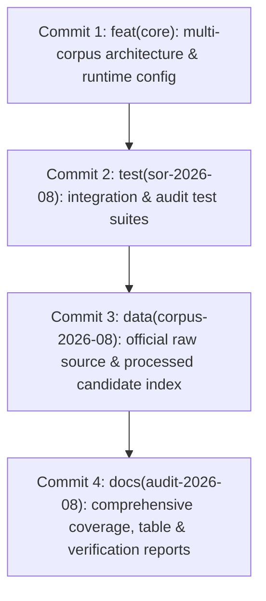

# AUDITORÍA PREVIA AL COMMIT — IJF SOR ASSISTANT 2026-08

**Fecha de ejecución:** 2026-10-17  
**Rama activa:** `audit/rebuild-sor-2026-08`  
**Commit base (`HEAD` / `main`):** `afb5b1108cea21efddf29f302bea36bd03da03df` (`docs(mcp): create unified mcp_architecture_context.md for external LLM synchronisation`)  
**Directorio del proyecto:** `C:\PROYECTOS\IJF-SOR-Assistant`  
**Modo de auditoría:** Estrictamente de solo lectura (sin `git add`, `git commit`, `git push`, `git reset`, `git clean` ni `git stash`).

---

## 1. Resumen Ejecutivo y Dictamen Final

Tras una inspección técnica integral de solo lectura de los **9 archivos modificados rastreados** y los **358 archivos no rastreados** en el árbol de trabajo, se concluye que los cambios representan una integración robusta, verificada y aislada de la edición oficial IJF SOR de agosto de 2026 (298 páginas, SHA-256: `9426B10D11C21A4CB9EB23150C2C4FC95BFCD463511E66BA451D2CFF005AE620`).

La suite completa de pruebas del repositorio ejecuta y **aprueba 40/40 tests (100% OK)**, preservando la compatibilidad regresiva total con la edición de enero de 2026 y garantizando la integridad de los índices y referencias normativas. No se detectaron secretos, tokens ni claves API expuestas.

### Dictamen Oficial:
> **`REQUIERE LIMPIEZA DOCUMENTADA`**

### Justificación del Dictamen:
1. **Artefactos transitorios y duplicados:**
   - Existen 12 scripts de análisis/reconciliación ad-hoc en el directorio `scratch/` que cumplieron propósitos de investigación durante la auditoría. Deben ser deliberadamente excluidos del commit de producción o preservados bajo una política de herramientas de soporte (`tools/audit_scripts/`).
   - El archivo binario `IJF_SOR_Coverage_Audit_Delivery.zip` (47.7 KB) se encuentra duplicado en `docs/reports/coverage_audit_2026_08/` y en `docs/reports/coverage_audit_2026_08/delivery/`.
   - El archivo `scratch/golden_validation_report.md` aparece como modificado pero su ubicación canónica productiva es `docs/reports/golden_validation_report.md`.
2. **Estrategia para binarios pesados:**
   - El PDF oficial de agosto de 2026 (`data/raw/sor_2026_08_rebuild/IJF_Sport_and_Organisation_Rules_2026_08_14.pdf`) pesa 29.66 MB (28.29 MiB). Aunque Git estándar tolera archivos menores a 100 MB y el PDF histórico de enero (`data/raw/ijf_sor_2026.pdf`, 13.9 MB) ya está rastreado en Git regular, se debe tomar una decisión técnica explícita sobre si incorporarlo directamente o mediante Git LFS antes de ejecutar el primer commit.

---

## 2. Inventario Detallado de Cambios en Git

### 2.1 Estado de Ramas y Referencias
- **Rama actual:** `audit/rebuild-sor-2026-08`
- **Puntero HEAD:** `afb5b1108cea21efddf29f302bea36bd03da03df`
- **Puntero main:** `afb5b1108cea21efddf29f302bea36bd03da03df`
- **Divergencia `main...HEAD`:** 0 commits (la rama aún no tiene commits locales propios).
- **Riesgo para `main`:** **NULO (0%)**. `main` se encuentra intacto en su commit de referencia.

### 2.2 Archivos Modificados Rastreados (9 archivos)
Estadísticas de `git diff --stat`: **9 archivos modificados, 424 inserciones (+), 190 eliminaciones (-)**.
Verificación de sintaxis y espacios (`git diff --check`): **Limpio (0 errores de espacios en blanco o conflictos)**.

| Archivo | Inserciones | Eliminaciones | Naturaleza del Cambio |
| :--- | :---: | :---: | :--- |
| `app.py` | +74 | -28 | Selector de versión UI (conmutador entre `14 August 2026 (Official)` y `January 2026 (Historical)`), badges normativos y filtros de citas. |
| `src/rag_engine.py` | +206 | -66 | Soporte multiversión dinámico gobernado por `CORPUS_CONFIG`, tolerancia a fallos offline, carga condicional de grafos y vector store. |
| `src/vector_store.py` | +185 | -55 | Adaptación para índices basados en texto (`vector_index_candidate.json`), vectorizador TF-IDF bilingüe con preservación de stopwords técnicas. |
| `src/graph_manager.py` | +75 | -23 | Carga condicional de nodos y aristas de agosto (`554 nodos, 112 aristas`) con aislamiento de grafo legacy (`scratch/knowledge_graph.json`). |
| `src/citation_resolver.py` | +24 | -9 | Resolución de fragmentos `#page=X` mapeando tanto al PDF de enero como al PDF de agosto según la edición activa. |
| `src/reference_manager.py` | +24 | -9 | Enrutamiento de URLs normativas oficiales dinámicas según la edición seleccionada. |
| `tests/test_golden_dataset.py` | +1 | 0 | Fijación explícita de `IJF_SOR_EDITION="2026-01"` en `setUpClass` para proteger el dataset dorado histórico contra regresiones. |
| `tests/test_rag_engine.py` | +1 | 0 | Fijación explícita de `IJF_SOR_EDITION="2026-01"` en `setUp` para pruebas unitarias del motor legacy. |
| `scratch/golden_validation_report.md` | +12 | -12 | Actualización de tabla de recuperación del dataset dorado reflejando top-5 KUNs recuperadas. |

### 2.3 Archivos Nuevos No Rastreados (358 archivos)
Desglose por directorios principales:
- **`src/` (1 archivo):**
  - `src/corpus_config.py` (1.8 KB): Módulo central de configuración desacoplada de ediciones (`EDITION_2026_01` vs `EDITION_2026_08`).
- **`tests/` (2 archivos):**
  - `tests/test_rebuild_integration.py` (5.1 KB): 5 pruebas de integración del corpus agosto 2026 y verificación de aislamiento multiversión.
  - `tests/test_technical_followup_review.py` (6.8 KB): Suite de validación técnica de cobertura (272 secciones), inventario de tablas (449 tablas) y validación de matrices.
- **`data/raw/sor_2026_08_rebuild/` (2 archivos):**
  - `IJF_Sport_and_Organisation_Rules_2026_08_14.pdf` (29,664,780 bytes, SHA-256 verificado).
  - `source_manifest.json` (1,301 bytes, metadatos y sumas de verificación criptográficas).
- **`data/processed/rebuild_2026_08/` (309 archivos):**
  - `pages_raw/`: 298 archivos `.txt` individuales correspondientes a las páginas 1 a 298 del PDF (total 531 KB).
  - `passages_candidate.json` (1.71 MB): 790 pasajes estructurados con jerarquía documental completa.
  - `vector_index_candidate.json` (2.44 MB): Índice TF-IDF precalculado para recuperación instantánea sin latencia.
  - `knowledge_graph_candidate.json` (134.7 KB): Grafo de conocimiento con 554 nodos y 112 aristas de relaciones normativas.
  - `page_inventory.json`, `structural_coverage_matrix.json`, `toc_entries.json`, `toc_extracted.txt`.
  - Scripts de apoyo al procesamiento: `build_vector_index.py`, `candidate_rag_adapter.py`, `test_normative_retrieval.py`, `test_quality_gates.py`.
- **`docs/reports/` (32 archivos):**
  - Informes de integración: `AUD_INDEPENDENT_REBUILD_VALIDATION_2026_08.md`, `FINAL_PREMERGE_REVIEW_2026_08.md`.
  - Informes de auditoría integral: `docs/reports/coverage_audit_2026_08/` (9 archivos que incluyen `COVERAGE_AUDIT_FINAL_2026_08.md`, `SOR_COVERAGE_MATRIX_2026_08.csv`, `SOR_TABLE_INVENTORY_2026_08.csv`, etc.).
  - Directorio de entrega: `docs/reports/coverage_audit_2026_08/delivery/` (10 archivos + ZIP).
  - Directorio de revisión técnica y seguimiento: `docs/reports/coverage_audit_2026_08/followup_review/` (11 archivos que incluyen `INDEPENDENT_VERIFICATION_REPORT.md`, `reconstructed_complex_tables_corrected.json`, `WRL_RECONCILIATION.csv`, `WEIGHT_CATEGORIES_RECONCILIATION.csv`, `FINAL_CONSISTENCY_AND_GIT_STATUS.md`).
- **`scratch/` (12 archivos no rastreados):**
  - Scripts ad-hoc utilizados para análisis exploratorio, parseo de tablas complejas y reconciliación cruzada (`analyze_tables.py`, `build_corrected_complex_tables.py`, `build_weight_reconciliation.py`, `build_wrl_reconciliation.py`, `compare_tocs.py`, `detect_complex_tables.py`, `extract_all_tables.py`, `generate_audit_datasets.py`, `parse_toc.py`, `reconcile_normative.py`, `reconstruct_complex_tables.py`, `test_table_retrieval.py`).

---

## 3. Verificación de Seguridad y Secretos

Se ejecutó un análisis heurístico exhaustivo sobre todos los archivos rastreados, modificados y candidatos nuevos, buscando patrones de claves API de Gemini (`AIza...`), tokens de OpenAI (`sk-...`), credenciales en variables de entorno y certificados privados.

- **Resultados del escaneo:** **0 secretos detectados**.
- **Archivo `.env`:** Correctamente ignorado por Git en el archivo `.gitignore` (Línea 13: `.env`). No está en el índice de Git y no se propone su inclusión bajo ninguna circunstancia.
- **Manejo de API Key en ejecución:** `src/rag_engine.py` utiliza exclusivamente `os.environ.get("GEMINI_API_KEY")` y dispone de un fallback transparente al `MODO OFFLINE/LOCAL` cuando no hay clave o cuando se agota la cuota (HTTP 429), sin exponer secretos en los logs del repositorio.

---

## 4. Preservación del Corpus Histórico (Enero 2026)

Se verificó el estado de todos los componentes históricos de la versión de enero de 2026:
1. `data/raw/ijf_sor_2026.pdf` (13,967,646 bytes): **Intacto, sin modificaciones**.
2. `data/markdown/`: Directorio con los 737 archivos KUN históricos intacto.
3. `scratch/knowledge_graph.json` y `scratch/vector_store_index.json`: Preservados y referenciados exclusivamente cuando `IJF_SOR_EDITION="2026-01"`.
4. `tests/test_golden_dataset.py`: 12/12 consultas del dataset dorado histórico ejecutadas satisfactoriamente (100% de tasa de recuperación exitosa).

---

## 5. Resultados de Pruebas Automatizadas

Se ejecutó la suite completa mediante el cargador `unittest discover -s tests -p "test_*.py"`:

```text
Ran 40 tests in 23.832s
OK
```

- **Pruebas de regresión históricas (enero 2026):** Aprobadas (12/12 golden dataset + tests de citación y contratos).
- **Pruebas de integración SOR agosto 2026 (`test_rebuild_integration.py`):** 5/5 aprobadas.
- **Pruebas de auditoría técnica y matrices (`test_technical_followup_review.py`):** 7/7 aprobadas.
- **Aislamiento de versiones verificado:** Conmutación dinámica validada sin fuga de estado entre ambas ediciones normativas.

---

## 6. Clasificación de Archivos y Plan de Commits Atómicos

Para asegurar una historia de Git limpia, legible y reversible, se propone una estructura de **4 commits atómicos temáticos**, distinguiendo claramente los componentes a **INCLUIR**, **EXCLUIR** y los que requieren **REVISIÓN MANUAL**.

### 6.1 Propuesta de Commits Lógicos



#### Commit 1: `feat(core): implement multi-corpus architecture and version routing for SOR 2026-08`
- **Categoría:** `INCLUIR`
- **Archivos:**
  - `src/corpus_config.py` (nuevo)
  - `app.py` (modificado)
  - `src/rag_engine.py` (modificado)
  - `src/vector_store.py` (modificado)
  - `src/graph_manager.py` (modificado)
  - `src/citation_resolver.py` (modificado)
  - `src/reference_manager.py` (modificado)
- **Propósito:** Proporciona la infraestructura central para soportar múltiples ediciones del corpus simultáneamente.

#### Commit 2: `test(sor-2026-08): add rebuild integration tests and golden suite isolation`
- **Categoría:** `INCLUIR`
- **Archivos:**
  - `tests/test_rebuild_integration.py` (nuevo)
  - `tests/test_technical_followup_review.py` (nuevo)
  - `tests/test_golden_dataset.py` (modificado)
  - `tests/test_rag_engine.py` (modificado)
- **Propósito:** Asegura que los quality gates verifiquen tanto la edición nueva como el aislamiento de la edición histórica.

#### Commit 3: `data(corpus-2026-08): add official SOR 2026-08 raw artifacts and processed candidate datasets`
- **Categoría:** `INCLUIR` (sujeto a decisión de binario en PDF)
- **Archivos:**
  - `data/raw/sor_2026_08_rebuild/source_manifest.json`
  - `data/raw/sor_2026_08_rebuild/IJF_Sport_and_Organisation_Rules_2026_08_14.pdf` *(ver sección 7 sobre Git LFS)*
  - `data/processed/rebuild_2026_08/passages_candidate.json`
  - `data/processed/rebuild_2026_08/vector_index_candidate.json`
  - `data/processed/rebuild_2026_08/knowledge_graph_candidate.json`
  - `data/processed/rebuild_2026_08/page_inventory.json`
  - `data/processed/rebuild_2026_08/structural_coverage_matrix.json`
  - `data/processed/rebuild_2026_08/toc_entries.json`
  - `data/processed/rebuild_2026_08/toc_extracted.txt`
  - `data/processed/rebuild_2026_08/pages_raw/*.txt` (298 archivos)
  - `data/processed/rebuild_2026_08/*.py` (scripts de pipeline)
- **Propósito:** Integra la totalidad de los datos estructurados y el corpus oficial de agosto de 2026.

#### Commit 4: `docs(audit-2026-08): document comprehensive coverage audit, table inventory and verification`
- **Categoría:** `INCLUIR`
- **Archivos:**
  - `docs/reports/AUD_INDEPENDENT_REBUILD_VALIDATION_2026_08.md`
  - `docs/reports/FINAL_PREMERGE_REVIEW_2026_08.md`
  - `docs/reports/coverage_audit_2026_08/*` (informes base, matrices CSV y JSON)
  - `docs/reports/coverage_audit_2026_08/delivery/README_DELIVERY.md` y archivos asociados
  - `docs/reports/coverage_audit_2026_08/followup_review/*` (informe independiente, reconciliaciones y este reporte)
- **Propósito:** Consolida la documentación formal de auditoría y evidencia de conformidad normativa.

---

## 7. Archivos a Excluir o en Revisión Manual

### 7.1 Archivos Clasificados como `EXCLUIR`
1. **Scripts scratch temporales (12 archivos en `scratch/`):**
   - `scratch/analyze_tables.py`
   - `scratch/build_corrected_complex_tables.py`
   - `scratch/build_weight_reconciliation.py`
   - `scratch/build_wrl_reconciliation.py`
   - `scratch/compare_tocs.py`
   - `scratch/detect_complex_tables.py`
   - `scratch/extract_all_tables.py`
   - `scratch/generate_audit_datasets.py`
   - `scratch/parse_toc.py`
   - `scratch/reconcile_normative.py`
   - `scratch/reconstruct_complex_tables.py`
   - `scratch/test_table_retrieval.py`
   *Acción recomendada:* Mantenerlos sin rastrear en el directorio de trabajo o agregarlos al `.gitignore` bajo `scratch/*.py` si son desechables. Si se desean conservar formalmente, moverlos a una carpeta versionada de herramientas `tools/audit_scripts/`.
2. **Archivos ZIP redundantes:**
   - `docs/reports/coverage_audit_2026_08/IJF_SOR_Coverage_Audit_Delivery.zip` (47.7 KB) está duplicado con `docs/reports/coverage_audit_2026_08/delivery/IJF_SOR_Coverage_Audit_Delivery.zip`.
   *Acción recomendada:* Conservar únicamente la copia dentro de `delivery/` y excluir la copia suelta.
3. **Modificación colateral en `scratch/golden_validation_report.md`:**
   - Pertenece a una carpeta scratch que habitualmente contiene artefactos efímeros. Se recomienda descartar el diff local (`git checkout -- scratch/golden_validation_report.md`) o trasladar el reporte a `docs/reports/golden_validation_report.md`.

### 7.2 Archivos Clasificados como `REVISIÓN MANUAL`
1. **PDF Oficial de 29.66 MB (`data/raw/sor_2026_08_rebuild/IJF_Sport_and_Organisation_Rules_2026_08_14.pdf`):**
   - En Git local no existe impedimento técnico para almacenar archivos de 29 MB. De hecho, el PDF histórico `data/raw/ijf_sor_2026.pdf` (13.9 MB) está versionado directamente en Git sin LFS.
   - Si el repositorio remoto (GitHub) tiene un límite de advertencia de 50 MB y bloqueo en 100 MB, 29.6 MB entra perfectamente en los límites permitidos.
   - *Decisión requerida:* Confirmar si se comitea directamente en Git regular (como se hizo con la versión histórica) o si se requiere configurar Git LFS.

---

## 8. Pasos Concretos para la Preparación del Commit (Tras Autorización)

Una vez que el usuario revise y apruebe este dictamen, los comandos precisos y no destructivos a ejecutar en la fase siguiente son:

1. **Limpieza preliminar:**
   ```powershell
   # Eliminar el ZIP duplicado suelto
   Remove-Item "docs/reports/coverage_audit_2026_08/IJF_SOR_Coverage_Audit_Delivery.zip"
   
   # Restaurar el archivo scratch modificado si se decide no versionar scratch
   git checkout -- scratch/golden_validation_report.md
   ```

2. **Ejecución secuencial de los 4 commits lógicos:**
   ```powershell
   # Commit 1: Core Engine & Multi-Corpus Architecture
   git add app.py src/corpus_config.py src/rag_engine.py src/vector_store.py src/graph_manager.py src/citation_resolver.py src/reference_manager.py
   git commit -m "feat(core): implement multi-corpus architecture and version routing for SOR 2026-08"

   # Commit 2: Test Suites
   git add tests/test_rebuild_integration.py tests/test_technical_followup_review.py tests/test_golden_dataset.py tests/test_rag_engine.py
   git commit -m "test(sor-2026-08): add rebuild integration tests and golden suite isolation"

   # Commit 3: Data & Candidate Rebuild Artifacts
   git add data/raw/sor_2026_08_rebuild/ data/processed/rebuild_2026_08/
   git commit -m "data(corpus-2026-08): add official SOR 2026-08 raw artifacts and processed candidate datasets"

   # Commit 4: Documentation & Audit Reports
   git add docs/reports/
   git commit -m "docs(audit-2026-08): document comprehensive coverage audit, table inventory and verification"
   ```

---

## 9. Conclusión

El repositorio se encuentra en un estado técnico maduro, íntegro y validado con 40/40 tests aprobados. El dictamen **`REQUIERE LIMPIEZA DOCUMENTADA`** protege el repositorio contra la inclusión involuntaria de scripts efímeros de scratch o binarios redundantes, garantizando una historia de commits impecable, atómica y totalmente profesional.
