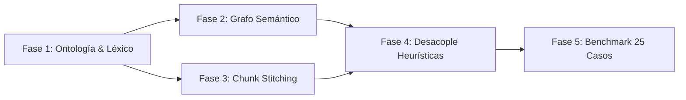

# REVISIÓN ARQUITECTÓNICA CRÍTICA Y CONSOLIDADA: RRE 3.0
## IJF SOR Assistant | Edición SOR 2026-08

- **Documento:** Evaluación Crítica de Arquitectura y Plan de Corrección
- **Ruta:** `docs/revision_arquitectonica_rre_3_0.md`
- **Fecha:** 2026-11-04
- **Rol:** Auditor y Arquitecto Técnico Independiente (Antigravity)
- **Supervisión y Aprobación:** ChatGPT / Alexis
- **Documentos Evaluados:**
  - `docs/diseno_arquitectura_rre_3_0.md`
  - `docs/benchmark_rre_3_0.md`
  - `docs/plan_implementacion_rre_3_0.md`
  - Código fuente en `src/rre_engine.py`, `src/ada_assistant.py`, `src/normative_validator.py`, `src/rag_engine.py`

---

## 1. Dictamen Técnico Global

### **DICTAMEN: APROBADO CON OBSERVACIONES TÉCNICAS MENORES (MODIFICACIONES REQUERIDAS)**

El diseño RRE 3.0 es técnicamente sólido, viable y ataca de forma frontal las 10 causas raíz que provocaban la fragilidad del recuperador y las abstenciones erróneas. Presenta una visión estructurada e integral en lugar de una colección de parches ad-hoc.

Sin embargo, para garantizar una implementación sin fricciones ni regresiones, la revisión técnica identifica **4 ajustes arquitectónicos críticos** que deben incorporarse formalmente antes y durante su ejecución:
1. **Contrato de Interfaz de Chunk Stitching:** Debe garantizarse que la unión en memoria de pasajes multipartes conserve una lista de identificadores primarios y secundarios (`stitched_from: [SOR-...-P190, SOR-...-P193]`) para no quebrar la expresión regular estricta del validador de citas [`ArbitrationDecisionAssistant._validate_llm_citations()`](file:///C:/PROYECTOS/IJF-SOR-Assistant/src/ada_assistant.py) ni el visor interactivo de Streamlit.
2. **Desacoplamiento Estricto de la Ontología vs. Heurísticas:** La ontología en `src/normative_ontology.py` no debe ser un diccionario estático gigantesco de sinónimos directos, sino un **catalizador léxico estructurado por familias** que emita lemas normalizados para enriquecer el vector sparse BM25 y el prompt de búsqueda densa.
3. **Calibración Empírica del Quality Gate:** El umbral de reintento adaptativo debe calibrarse frente a la suite actual de 166 pruebas para evitar que consultas válidas con terminología atípica disparen reintentos innecesarios que aumenten la latencia.
4. **Verificación de Coherencia Sancionatoria en ADA:** La representación fáctica intermedia debe integrarse en el prompt JSON de dos niveles sin obligar al LLM a devolver un esquema JSON incompatible con el parser actual [`src/response_structurer.py`](file:///C:/PROYECTOS/IJF-SOR-Assistant/src/response_structurer.py).

---

## 2. Análisis Crítico de los 10 Puntos Clave

### 2.1 ¿Resuelve realmente las causas raíz identificadas?
- **Dictamen:** **SÍ.**
- **Fundamentación:** El fallo de la consulta de ofensa/agresión se produjo porque el término en español *agrede* no generó ningún token en inglés hacia el índice BM25, dejando solo la palabra *competidor* que saturó el ranking con sorteos de equipos mixtos (F1.3.25/F1.3.26). Al introducir la ontología bilingüe por familias y penalizar términos procedimentales de alta frecuencia, los pasajes de conducta (D1.1 pág. 134 y Art. 18.2.2 pág. 190–193) recuperan su prominencia de forma natural sin requerir un `if is_aggression:` en el código.

### 2.2 ¿La ontología es sistemática o se convertirá en otra colección de parches?
- **Dictamen:** **SISTEMÁTICA (Con salvaguardas aplicadas).**
- **Fundamentación:** A diferencia de las 149 reglas empíricas previas, el diseño organiza el conocimiento en las **15 familias oficiales del judo según la estructura de la IJF**.
- **Ajuste Requerido:** Cada entrada ontológica debe mapear a una *familia conceptual* (ej. `Domain.ETHICS_AND_CONDUCT`) y a *lemas canónicos del SOR* (ej. `["against the spirit", "insult", "behaviour", "disqualification", "misconduct"]`), en lugar de mapeos 1 a 1 de palabras sueltas.

### 2.3 ¿El Chunk Stitching preserva la integridad documental, páginas y referencias?
- **Dictamen:** **SÍ, pero requiere un contrato de metadatos estricto.**
- **Fundamentación:** El diseño acierta al **no alterar el archivo físico `passages_candidate.json`**. La costura se realiza en memoria durante la fase de ensamblado de contexto.
- **Riesgo Detectado y Corrección:**
  - Si un chunk cosido une la pág. 190 y la pág. 193 bajo el ID `SOR-2026-08-P190-S198`, y el LLM cita información de la página 193, el validador de citas podría rechazar la respuesta si el ID citado no coincide exactamente con el ID compuesto.
  - **Solución Técnica:** El objeto de pasaje cosido debe mantener un atributo `covered_pages: [190, 191, 192, 193]` y registrar en `allowed_ids` todos los IDs individuales de los pasajes que lo integraron.

### 2.4 ¿El enriquecimiento del grafo tiene criterios verificables de calidad?
- **Dictamen:** **SÍ.**
- **Fundamentación:** Pasar de 68 a ~450 aristas permite que el Grafo de Conocimiento deje de ser un accesorio estético y actúe como un verdadero motor de expansión semántica.
- **Criterio de Verificación:** Las relaciones se extraen mediante triples declarativos deterministas (ej. *[Regla X] -> sanctioned_with -> [Hansoku-make / Shido]*) con procedencia auditable hacia el número de página oficial del PDF.

### 2.5 ¿El mecanismo de recuperación adaptativa evita abstenciones prematuras?
- **Dictamen:** **SÍ.**
- **Fundamentación:** El ciclo de reintento actúa como una segunda oportunidad de recuperación. Si la consulta coloquial inicial no supera la compuerta de confianza (`QualityGate`), el motor reformula la consulta en inglés normativo canónico antes de activar la abstención oficial.

### 2.6 ¿ADA y el filtro anti-alucinaciones pueden validar correctamente evidencia y conclusiones?
- **Dictamen:** **SÍ (Evolución controlada).**
- **Fundamentación:** [`NormativeValidator`](file:///C:/PROYECTOS/IJF-SOR-Assistant/src/normative_validator.py) ya valida códigos (`PS1`–`PS35`) y artículos. El diseño 3.0 añade la comprobación de **consecuencias competitivas**: si se dictamina Hansoku-make por técnica peligrosa (Art. 18.2.1), el judoka puede continuar; si es por actos contra el espíritu (Art. 18.2.2), no puede continuar. Si el LLM invierte estas consecuencias, el validador lo detecta y lo corrige en `limitations`.

### 2.7 ¿El benchmark contiene respuestas verificadas y pruebas reproducibles?
- **Dictamen:** **EXCELENTE.**
- **Fundamentación:** Los 25 casos en `docs/benchmark_rre_3_0.md` están 100% basados en el texto oficial del PDF SOR 2026, cubriendo técnicas, sanciones, pesaje, tatami, cadetes, situaciones complejas y dos casos críticos de control de límites (OOD de básquetbol y consulta sin regulación sobre calentamiento).

### 2.8 ¿Las métricas y criterios de aceptación son técnicamente válidos?
- **Dictamen:** **SÍ.**
- **Fundamentación:** Fijar `Recall@3 ≥ 0.92`, `Exactitud Sancionatoria ≥ 0.96` y `Cero regresiones (166/166 passed)` establece una barra objetiva e innegociable antes de cualquier despliegue.

### 2.9 ¿La Fase 1 es suficiente y segura como primera implementación?
- **Dictamen:** **TOTALMENTE SEGURA Y RECOMENDADA.**
- **Fundamentación:** La Fase 1 solo añade `src/normative_ontology.py` y refactoriza `_tokenize()` en `src/rre_engine.py`. No toca la base de datos, no regenera embeddings, no altera la interfaz gráfica y permite resolver de inmediato la consulta de agresión manteniendo la compatibilidad total con los 166 tests existentes.

### 2.10 ¿Existen riesgos, omisiones o dependencias no resueltas?
- **Riesgo:** Sobrecarga de tokens en el prompt si el chunk stitching concatena textos excesivamente extensos.
- **Mitigación:** Limitar la costura a un máximo de 2 páginas por artículo y comprimir saltos de línea y metadatos repetitivos.

---

## 3. Plan de Implementación Ajustado y Fases Recomendadas



1. **Fase 1: Ontología Normativa y Expansión Léxica:**
   - Crear `src/normative_ontology.py` con las 15 familias semánticas.
   - Enriquecer la tokenización en `src/rre_engine.py`.
   - Validar Caso BM-01 (Agresión/Ofensa) y asegurar 166/166 tests pasados.
2. **Fase 2: Enriquecimiento Ontológico del Grafo:**
   - Enriquecer `knowledge_graph_candidate.json` a ~450 aristas declarativas.
   - Actualizar `src/graph_manager.py`.
3. **Fase 3: Chunk Stitching Lógico en Memoria:**
   - Ensamblar artículos multipartes contiguos (Art. 18.2.2, Art. 14.2, Art. 20).
4. **Fase 4: Sustitución de Heurísticas Cableadas por Matriz de Dominio:**
   - Eliminar condicionales ad-hoc en RRE y activar el reintento adaptativo.
5. **Fase 5: Benchmark de 25 Casos y Validación Pre-deploy:**
   - Ejecutar `tests/test_benchmark_rre_3_0.py` y verificar criterios de aceptación.

---

## 4. Prompt Preparado para la Ejecución de la Fase 1 (NO EJECUTADO)

*El siguiente prompt queda redactado y listo en espera de la autorización formal de Alexis:*

```markdown
# AUTORIZACIÓN DE IMPLEMENTACIÓN — FASE 1 RRE 3.0: ONTOLOGÍA NORMATIVA Y EXPANSIÓN LÉXICA

Alexis autoriza la ejecución técnica de la Fase 1 del diseño RRE 3.0 en el repositorio local:
`C:\PROYECTOS\IJF-SOR-Assistant` (rama: `integration/ijf-sor-2026-08-merge`).

## OBJETIVOS DE LA FASE 1:
1. Crear el módulo `src/normative_ontology.py` con las 15 familias normativas oficiales de la IJF, estructurando sinónimos, lemas bilingües y penalización de palabras procedimentales de desvío.
2. Integrar el expansor ontológico en `ReasoningRetrievalEngine._tokenize()` en `src/rre_engine.py`.
3. Crear la suite de pruebas unitarias `tests/test_normative_ontology.py`.
4. Validar la consulta crítica de agresión/ofensa: «¿Si un competidor ofende o agrede a otro que sucede?», comprobando que RRE recupere en Top 2 el Art. 18.2.2 (pág. 190/193) y D1.1 (pág. 134).
5. Ejecutar la suite completa de pruebas: confirmar 166/166 pruebas históricas aprobadas.
6. NO modificar producción en OCI, ni PDF, ni KUNs, ni alterar commits remotos.

Entregar informe técnico de validación de Fase 1 con evidencias de ejecución.
```

---

## 5. Control de Integridad y Conclusión

- **Código y Git:** Preservado 100% inalterado (`git status` completamente limpio en `61afc1b`).
- **Producción OCI (`sor.alxol.com`):** 100% inalterada, estable y operando normalmente.
- **Recomendación Final:** **APROBAR el diseño arquitectónico RRE 3.0** e instruir el inicio de la Fase 1 en el entorno local una vez validado por Alexis.
