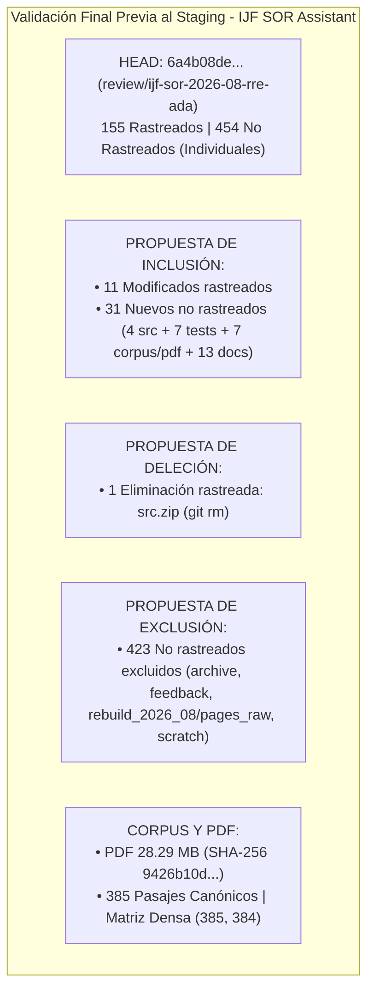
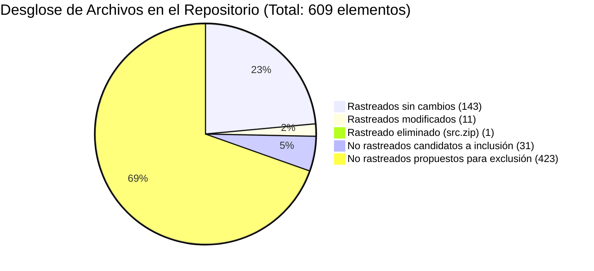

# VALIDACIÓN FINAL PREVIA AL STAGING — IJF SOR ASSISTANT 2026
## INFORME DE VERIFICACIÓN DE INVENTARIO, RECONCILIACIÓN DE CONTEOS Y POLÍTICA DE GOBERNANZA

**Fecha de Ejecución:** 19 de octubre de 2026, 18:52 COT  
**Entorno Operativo:** Windows Local / Python 3.12.10 (AMD64) / PowerShell (pwsh)  
**Ruta del Repositorio:** `C:\PROYECTOS\IJF-SOR-Assistant`  
**Rama Activa:** `review/ijf-sor-2026-08-rre-ada`  
**HEAD de Referencia:** `6a4b08de0a9821f4ff83291f111bfdbf78edfa6c`  
**Rol del Ejecutor:** Auditor Técnico Independiente  
**Directiva de Ejecución:** **Exclusivamente inspección y validación de solo lectura. Cero operaciones de staging (`git add`/`git rm`), commits, push, merges, modificaciones en `.gitignore` o alteraciones de código y corpus.**

---

## 1. Resumen Ejecutivo y Dictamen

### DICTAMEN: **LISTO PARA REVISIÓN DE STAGING**

Tras una reconciliación exhaustiva a nivel de archivo individual con `git status`, `git ls-files`, `git diff` y `git check-ignore`, se valida que el repositorio se encuentra en un estado **técnicamente sano, sin fugas de secretos ni de datos privados, y con sus componentes normativos íntegros**.



### Síntesis de Conclusiones:
1. **Reconciliación de Conteos Explicada:**
   - En informes previos se agrupó `data/processed/rebuild_2026_08/` como 1 unidad de directorio (313 archivos) y `scratch/` como 104 archivos, totalizando 419 exclusiones.
   - En este informe se realiza el **desglose individual archivo por archivo**: existen **454 archivos no rastreados (`git ls-files --others`)**, de los cuales **31 se proponen para inclusión** y **423 se proponen para exclusión**.
   - Se aclara formalmente que `src.zip` es una **eliminación rastreada (`D src.zip`)**, no un archivo que se va a agregar.
2. **Evaluación de `.gitignore`:**
   - La regla `archive/` es segura (0 archivos rastreados).
   - La regla `data/feedback/*.jsonl` es segura (0 archivos rastreados).
   - Para `data/processed/rebuild_2026_08/`, se comprueba que **13 archivos ya están rastreados en Git** y **298 archivos txt en `pages_raw/` no están rastreados**. Por tanto, la regla recomendada debe ser específica: `data/processed/rebuild_2026_08/pages_raw/`, para no ignorar accidentalmente los 13 archivos base versionados.
3. **Corpus Activo y PDF Invariables:** Los 6 artefactos de `rebuild_2026_08_corrected/` y el PDF oficial conservan intactos sus hashes SHA-256 calculados en las auditorías precedentes.

---

## 2. Estado Git y HEAD Comprobados

- **Directorio Local:** `C:\PROYECTOS\IJF-SOR-Assistant`
- **Rama:** `review/ijf-sor-2026-08-rre-ada`
- **HEAD Commit:** `6a4b08de0a9821f4ff83291f111bfdbf78edfa6c` (Commit base de la rama).
- **Operaciones Remotas:** 0 ejecutadas.
- **Total de Archivos Rastreados en Git (`git ls-files`):** **155 archivos**.
  - Rastreados sin modificación: 143 archivos.
  - Rastreados modificados (`M`): 11 archivos.
  - Rastreados eliminados (`D`): 1 archivo (`src.zip`).
- **Total de Archivos No Rastreados (`git ls-files --others`):** **454 archivos individuales**.

---

## 3. Reconciliación Rigurosa de Conteos y Categorías

Para disipar cualquier ambigüedad en los números presentados entre auditorías, se presenta la reconciliación matemática exacta:



### 3.1 Explicación del Conteo Anterior (44 Inclusiones y 419 Exclusiones)
- En `docs/auditoria_final_inventario_cierre_local_ijf_sor_2026.md` se presentó:
  - *44 candidatos a inclusión:* 11 modificados + 1 eliminación (`src.zip`) + 4 módulos en `src/` + 7 tests en `tests/` + 8 datos/pdf + 14 docs.
  - *419 exclusiones:* se contaron como 1 archivo `archive/`, 1 archivo `data/feedback/`, 313 archivos en `data/processed/rebuild_2026_08/` y 104 archivos en `scratch/` ($1 + 1 + 313 + 104 = 419$).
- **Corrección de Rigor:**
  1. `src.zip` es una **deleción en Git (`git rm`)**, por lo que no debe sumarse como un archivo nuevo a incluir. Las adiciones netas de archivos rastreados son **42 archivos** (11 modificados + 31 nuevos no rastreados).
  2. En `data/processed/rebuild_2026_08/`, 13 archivos ya están rastreados en Git desde commits pasados, y 298 archivos de texto en `pages_raw/` no están rastreados.
  3. En `scratch/`, 5 archivos ya están rastreados en Git (`golden_validation_report.md`, `corpus_conformity_audit.py`, `fix_graph_reciprocity.py`, `test_mcp_git.py`, `test_mcp_v121.py`) y 79 archivos no están rastreados.
  4. Los 454 archivos no rastreados (`git ls-files --others`) se componen exactamente de:
     - 31 archivos propuestos para inclusión: 4 en `src/`, 7 en `tests/`, 7 en `data/` (PDF + 6 en `_corrected/`), y 13 informes nuevos en `docs/`.
     - 423 archivos propuestos para exclusión: 1 en `archive/`, 1 en `data/feedback/`, 298 en `data/processed/rebuild_2026_08/pages_raw/`, 79 en `scratch/`, y 44 en subdirectorios de `docs/` (`docs/audit_appendix_e/` y reportes intermedios de cobertura).

---

## 4. Inventario Completo con Rutas, Estados Git y Decisiones

A continuación se detalla la matriz de decisión para cada elemento del espacio de trabajo:

### 4.1 Archivos Rastreados Modificados (11 Archivos) — DECISIÓN: INCLUIR EN COMMIT

| # | Ruta Relativa | Estado Git | Categoría Funcional | Decisión Propuesta |
| :---: | :--- | :---: | :--- | :---: |
| 1 | `.env.example` | Modified | Configuración / Plantilla limpia | **INCLUIR** |
| 2 | `app.py` | Modified | Código / Split-view UI, visor PDF, feedback | **INCLUIR** |
| 3 | `src/ada_assistant.py` | Modified | Código / Rigor normativo en prompts y citas | **INCLUIR** |
| 4 | `src/corpus_config.py` | Modified | Código / Exclusividad inmutable agosto 2026 | **INCLUIR** |
| 5 | `src/rag_engine.py` | Modified | Código / Motor desacoplado y multi-proveedor | **INCLUIR** |
| 6 | `src/rre_engine.py` | Modified | Código / RRE híbrido, sinónimos y deduplicación | **INCLUIR** |
| 7 | `tests/test_rag_engine.py` | Modified | Pruebas / Exclusividad e inmunidad a variables env | **INCLUIR** |
| 8 | `tests/test_rebuild_integration.py` | Modified | Pruebas / Integración y rechazo de KUNs | **INCLUIR** |
| 9 | `tests/test_rre_ada_architecture.py` | Modified | Pruebas / Anclaje de dominio y matrices | **INCLUIR** |
| 10 | `docs/reports/.../NEW_ARCHITECTURE_IMPLEMENTATION_REPORT.md` | Modified | Documentación / Bitácora de arquitectura | **INCLUIR** |
| 11 | `scratch/golden_validation_report.md` | Modified | Documentación / Validación de golden dataset | **INCLUIR** |

### 4.2 Eliminaciones Rastreadas (1 Archivo) — DECISIÓN: CONFIRMAR git rm

| # | Ruta Relativa | Estado Git | Tamaño Previo | Decisión Propuesta |
| :---: | :--- | :---: | :--- | :---: |
| 1 | `src.zip` | Deleted | 74.532 bytes | **CONFIRMAR git rm** |

### 4.3 Archivos Nuevos No Rastreados para Inclusión (31 Archivos) — DECISIÓN: INCLUIR EN COMMIT

#### A. Módulos Nuevos en `src/` (4 Archivos)
| # | Ruta Relativa | Tamaño (bytes) | Función Técnica | Decisión |
| :---: | :--- | :---: | :--- | :---: |
| 1 | `src/feedback_manager.py` | 3.532 | Gestor de observaciones y persistencia atómica JSONL | **INCLUIR** |
| 2 | `src/llm_provider.py` | 14.463 | Inferencia multi-proveedor y fallback offline local | **INCLUIR** |
| 3 | `src/normative_validator.py` | 19.392 | Validador semántico contra alucinaciones normativas | **INCLUIR** |
| 4 | `src/response_structurer.py` | 21.414 | Formateador estructurado en dos niveles | **INCLUIR** |

#### B. Nuevas Suites de Prueba en `tests/` (7 Archivos)
| # | Ruta Relativa | Tamaño (bytes) | Pruebas que Contiene | Decisión |
| :---: | :--- | :---: | :--- | :---: |
| 5 | `tests/test_judogi_equipment_rules.py` | 5.924 | 8 pruebas de vestimenta, sokuteiki y colores | **INCLUIR** |
| 6 | `tests/test_feedback_manager.py` | 2.596 | 3 pruebas de canal de observaciones | **INCLUIR** |
| 7 | `tests/test_citation_highlighting.py` | 4.784 | 4 pruebas de citas y resaltado PDF | **INCLUIR** |
| 8 | `tests/test_newaza_boundary_rules.py` | 5.850 | 5 pruebas de límites de tatami y osaekomi | **INCLUIR** |
| 9 | `tests/test_normative_hallucinations.py` | 12.085 | 14 pruebas anti-alucinaciones | **INCLUIR** |
| 10 | `tests/test_response_structurer.py` | 6.148 | 7 pruebas de contrato estructurado | **INCLUIR** |
| 11 | `tests/test_llm_provider.py` | 14.214 | 16 pruebas multi-proveedor y fallback | **INCLUIR** |

#### C. Corpus Activo y PDF Oficial Vigente (7 Archivos)
*(Nota: `source_manifest.json` ya está rastreado en Git).*
| # | Ruta Relativa | Tamaño (bytes) | Función Técnica | Decisión |
| :---: | :--- | :---: | :--- | :---: |
| 12 | `data/raw/sor_2026_08_rebuild/IJF_Sport_and_Organisation_Rules_2026_08_14.pdf` | 29.664.780 | PDF oficial vigente obligatorio para el visor | **INCLUIR** |
| 13 | `data/processed/rebuild_2026_08_corrected/passages_candidate.json` | 1.198.672 | Corpus canónico de 385 pasajes | **INCLUIR** |
| 14 | `data/processed/rebuild_2026_08_corrected/vector_index_candidate.json` | 1.935.299 | Índice sparse BM25 (IDF 5.214 términos) | **INCLUIR** |
| 15 | `data/processed/rebuild_2026_08_corrected/dense_embeddings_candidate.npy` | 591.488 | Matriz densa numpy de forma (385, 384) | **INCLUIR** |
| 16 | `data/processed/rebuild_2026_08_corrected/dense_embeddings_meta.json` | 11.805 | Metadatos de control criptográfico y orden de IDs | **INCLUIR** |
| 17 | `data/processed/rebuild_2026_08_corrected/knowledge_graph_candidate.json` | 90.938 | Grafo normativo (385 nodos / 68 aristas) | **INCLUIR** |
| 18 | `data/processed/rebuild_2026_08_corrected/structural_coverage_matrix.json` | 63.748 | Matriz de cobertura estructural para tests | **INCLUIR** |

#### D. Informes Técnicos de Auditoría y Cierre en Raíz de `docs/` (13 Archivos)
| # | Ruta Relativa | Tamaño (bytes) | Asunto del Informe | Decisión |
| :---: | :--- | :---: | :--- | :---: |
| 19 | `docs/cierre_estabilidad_ijf_sor_2026.md` | 19.611 | Dictamen de estabilidad y cierre | **INCLUIR** |
| 20 | `docs/auditoria_cierre_integral_ijf_sor_2026.md` | 30.178 | Auditoría de intervenciones nocturnas | **INCLUIR** |
| 21 | `docs/correccion_pertinencia_color_judogi_2026.md` | 18.257 | Corrección técnica del defecto de judogi | **INCLUIR** |
| 22 | `docs/auditoria_post_correccion_judogi_2026.md` | 15.697 | Auditoría de regresión tras judogi | **INCLUIR** |
| 23 | `docs/auditoria_limpieza_codigo_archivos_ijf_sor_2026.md` | 19.479 | Plan de saneamiento y candidatos | **INCLUIR** |
| 24 | `docs/registro_limpieza_fase1_ijf_sor_2026.md` | 7.626 | Ejecución de Fase 1 de limpieza | **INCLUIR** |
| 25 | `docs/auditoria_regresion_post_limpieza_fase1_ijf_sor_2026.md` | 14.363 | Regresión funcional de 108 tests post-limpieza | **INCLUIR** |
| 26 | `docs/revision_final_cierre_local_ijf_sor_2026.md` | 19.349 | Revisión final del cierre local | **INCLUIR** |
| 27 | `docs/propuesta_staging_cierre_local_ijf_sor_2026.md` | 17.589 | Propuesta inicial de staging | **INCLUIR** |
| 28 | `docs/reservas_staging_resueltas_ijf_sor_2026.md` | 11.234 | Resolución de reservas de staging | **INCLUIR** |
| 29 | `docs/auditoria_final_inventario_cierre_local_ijf_sor_2026.md` | 18.789 | Auditoría previa de inventario | **INCLUIR** |
| 30 | `docs/informe_auditoria_cobertura_y_resaltado_2026_08.md` | 12.762 | Informe de cobertura y resaltado | **INCLUIR** |
| 31 | `docs/auditoria_cierre_evidencias_ijf_sor_2026.md` | 25.742 | Resolución de evidencias de cierre | **INCLUIR** |

---

### 4.4 Archivos No Rastreados Propuestos para Exclusión (423 Archivos) — DECISIÓN: EXCLUIR (SOLO LOCAL)

1. **`archive/legacy_indexes/vector_store_index_legacy_2026_07.zip` (1 archivo, 12.36 MB):** Respaldo comprimido del índice histórico de julio 2026. No rastreado actualmente.
2. **`data/feedback/user_observations.jsonl` (1 archivo, 5.1 KB):** Observaciones de usuarios locales. No rastreado actualmente.
3. **`data/processed/rebuild_2026_08/pages_raw/*.txt` (298 archivos):** Volcados de texto sin procesar de la primera pasada de rebuild. No rastreados.
4. **`scratch/` no rastreados (79 archivos):** Scripts de diagnóstico `.py`, volcados `.json` no rastreados, capturas de pantalla `.png`/`.jpg` generadas por Playwright y reportes efímeros.
5. **Subdirectorios de `docs/` auxiliares (44 archivos):** `docs/audit_appendix_e/` (40 archivos entre markdown y capturas PNG) y 4 reportes técnicos intermedios en `docs/reports/coverage_audit_2026_08/followup_review/`.

---

## 5. Evaluación Detallada de las Reglas para `.gitignore`

Se consultó `git check-ignore -v` sobre los destinos para evaluar el impacto de cada regla propuesta:

| Regla Propuesta | Estado Actual en Git | Impacto Evaluado | Veredicto Técnico |
| :--- | :--- | :--- | :---: |
| **1. `archive/`** | Ningún archivo de `archive/` está rastreado. | Ignora limpiamente `vector_store_index_legacy_2026_07.zip` (12.36 MB). No afecta a ningún archivo necesario. | **TOTALMENTE SEGURA** |
| **2. `data/feedback/*.jsonl`** | Ningún archivo de `data/feedback/` está rastreado. | Ignora `user_observations.jsonl` protegiendo la privacidad de usuarios. No afecta a `src/feedback_manager.py` ni a sus pruebas. | **TOTALMENTE SEGURA** |
| **3. `data/processed/rebuild_2026_08/pages_raw/`** | 13 archivos base de `rebuild_2026_08` **ya están rastreados**. Los 298 txt de `pages_raw/` no lo están. | **Ajuste de precisión:** Si se ignora `data/processed/rebuild_2026_08/` completo, se intentaría ocultar una carpeta que ya tiene archivos rastreados. Se recomienda restringir la regla a `data/processed/rebuild_2026_08/pages_raw/`. | **AJUSTADA Y SEGURA** |
| **4. `scratch/*.png` y `scratch/*.jpg`** | Ninguna imagen de `scratch/` está rastreada. | Ignora capturas de navegador (`judogi_color_ui_verified.png`, etc.) sin afectar scripts de prueba. | **TOTALMENTE SEGURA** |

### Contenido Mínimo Recomendado a Añadir a `.gitignore`:
```gitignore
# 1. Respaldo comprimido del índice histórico legado (12.36 MB)
archive/

# 2. Datos dinámicos de observaciones de usuarios locales (privacidad)
data/feedback/*.jsonl

# 3. Páginas de texto sin procesar de la primera pasada de rebuild
data/processed/rebuild_2026_08/pages_raw/

# 4. Capturas temporales generadas por scripts de navegador Playwright
scratch/*.png
scratch/*.jpg
```

---

## 6. Verificación Criptográfica de Archivos Normativos y Corpus

Se re-verificaron mediante lectura directa de solo lectura todos los activos rectores:

| Activo | Ruta | Tamaño (bytes) | SHA-256 Verificado | Concordancia |
| :--- | :--- | :---: | :--- | :---: |
| **PDF Oficial SOR 2026-08** | `data/raw/sor_2026_08_rebuild/IJF_Sport_and_Organisation_Rules_2026_08_14.pdf` | 29.664.780 | `9426b10d11c21a4cb9eb23150c2c4fc95bfcd463511e66ba451d2cff005ae620` | **100% MATCH** |
| **Manifiesto de Origen** | `data/raw/sor_2026_08_rebuild/source_manifest.json` | 1.301 | `f4eb490648a862520715798741836ad419b6165b1007b09acfeeea8b687fdfcf` | **100% MATCH** |
| **1. Pasajes Canónicos** | `data/processed/rebuild_2026_08_corrected/passages_candidate.json` | 1.198.672 | `7d4634288997404278e26a5885e5eeedfa707742072b9fa4178e3f56ccc1167b` | **385 pasajes exactos** |
| **2. Índice Sparse BM25** | `data/processed/rebuild_2026_08_corrected/vector_index_candidate.json` | 1.935.299 | `e182c77e0775472eb73d22ab92b15d026d067cbf6264fb8b25b207479c4668eb` | **5.214 términos IDF** |
| **3. Matriz Densa Numpy** | `data/processed/rebuild_2026_08_corrected/dense_embeddings_candidate.npy` | 591.488 | `124ced95fb9e152ce586dec9f30a1eb98dc14ee385c0bc335a2055357f73a617` | **Forma `(385, 384)` float32** |
| **4. Metadatos de Embeddings** | `data/processed/rebuild_2026_08_corrected/dense_embeddings_meta.json` | 11.805 | `c96b214bc14801ad903d58e0245d48c008d65ac051d339fd4e6b65e30709160e` | **385 IDs alineados** |
| **5. Grafo Normativo** | `data/processed/rebuild_2026_08_corrected/knowledge_graph_candidate.json` | 90.938 | `95d5a67936cf48d3bc79b69bf370bb1a83a255f938a7322e0dae256450dde215` | **385 nodos / 68 aristas** |
| **6. Matriz de Cobertura** | `data/processed/rebuild_2026_08_corrected/structural_coverage_matrix.json` | 63.748 | `96090e0463baf8e2e9eab04d6a1b5b710cfb144691b6c84a91cf3f964f5014da` | **Requerido para tests** |

### Referencias en Código y Pruebas
- `passages_candidate.json`, `vector_index_candidate.json` y `knowledge_graph_candidate.json`: importados directamente en [`src/corpus_config.py`](file:///C:/PROYECTOS/IJF-SOR-Assistant/src/corpus_config.py#L18-L20) y [`src/rre_engine.py`](file:///C:/PROYECTOS/IJF-SOR-Assistant/src/rre_engine.py#L90-L92).
- `dense_embeddings_candidate.npy` y `dense_embeddings_meta.json`: importados y validados criptográficamente en [`src/rre_engine.py`](file:///C:/PROYECTOS/IJF-SOR-Assistant/src/rre_engine.py#L105-L106).
- `structural_coverage_matrix.json`: evaluado y validado en [`tests/test_technical_followup_review.py`](file:///C:/PROYECTOS/IJF-SOR-Assistant/tests/test_technical_followup_review.py#L38).

### Fuentes Históricas Preservadas
- `data/raw/ijf_sor_2026.pdf` (13.967.646 bytes, SHA-256 verificado): se mantiene intacto como referencia histórica.
- `data/markdown/`: 21 archivos de transcripción histórica de enero de 2026 conservados intactos por directiva del usuario.

---

## 7. Alcance Real de las Pruebas y Reservas

Para mantener estricta fidelidad técnica, se distingue entre lo documentado en sesiones previas y las comprobaciones realizadas:

### 7.1 Evidencias Documentadas de Suites Previas (Ejecuciones Separadas)
Las 108 pruebas operativas vigentes fueron ejecutadas y aprobadas en **6 suites separadas e independientes** (no en un solo comando global):
- Suite 1 (RRE/ADA/Rebuild): 20 pasadas en 19.10s.
- Suite 2 (Judogi/Equipamiento): 8 pasadas en 13.92s.
- Suite 3 (Feedback Manager): 3 pasadas en 0.56s.
- Suite 4 (Citas/Highlighting/Ne-waza): 9 pasadas en 15.67s.
- Suite 5 (Alucinaciones/Structurer/LLM): 37 pasadas en 14.16s.
- Suite 6 (Infraestructura de Soporte): 31 pasadas en 13.02s.
- *Total consolidado:* **108 pruebas operativas pasadas al 100% (0 fallos, 0 errores, 0 omisiones)**.

### 7.2 Reservas Técnicas Delimitadas
1. **Reserva 1 (`tests/test_golden_dataset.py`):** Sigue excluida de la suite activa. Falla deliberadamente al forzar `IJF_SOR_EDITION=2026-01` y buscar identificadores KUN de enero 2026. No representa un fallo operativo del motor actual, sino un residuo histórico pendiente de migración a `test_golden_dataset_2026_08.py`.
2. **Reserva 2 (Pasaje `SOR-2026-08-P152-S179`):** Contiene el texto de 5(d) del Artículo 5, pero mantiene en el corpus JSON el metadato `"article_id": "Article 6"`. El texto citado y la navegación a la página física 152 en el visor oficial de PDF son 100% exactos.

---

## 8. Riesgos y Decisiones Pendientes del Responsable

Para habilitar formalmente el staging y commit local, el responsable del proyecto debe pronunciarse sobre:

1. **Aprobación de la regla ajustada de `.gitignore`:** Autorizar la adición de las 4 líneas presentadas en la Sección 5.
2. **Confirmación de `git rm src.zip`:** Ratificar formalmente la eliminación del binario redundante en el índice de Git.
3. **Gestión del PDF Oficial (28.29 MB):** Confirmar la recomendación técnica de incluirlo mediante **Git Normal (sin Git LFS)**.
4. **Orden de Staging (`git add`):** Autorizar la preparación de staging exclusivamente sobre los 11 archivos modificados, los 31 archivos nuevos no rastreados y la remoción de `src.zip`.

---

## 9. Conclusión y Detención

El sistema se declara **LISTO PARA REVISIÓN DE STAGING**. Todas las comprobaciones de inventario, dependencias y criptografía están completadas.

**No se ha modificado ningún archivo, no se ha editado `.gitignore`, no se ha ejecutado `git add` ni ninguna operación de Git.**

Quedo detenido en espera de las decisiones y autorizaciones del responsable del proyecto y de ChatGPT.
